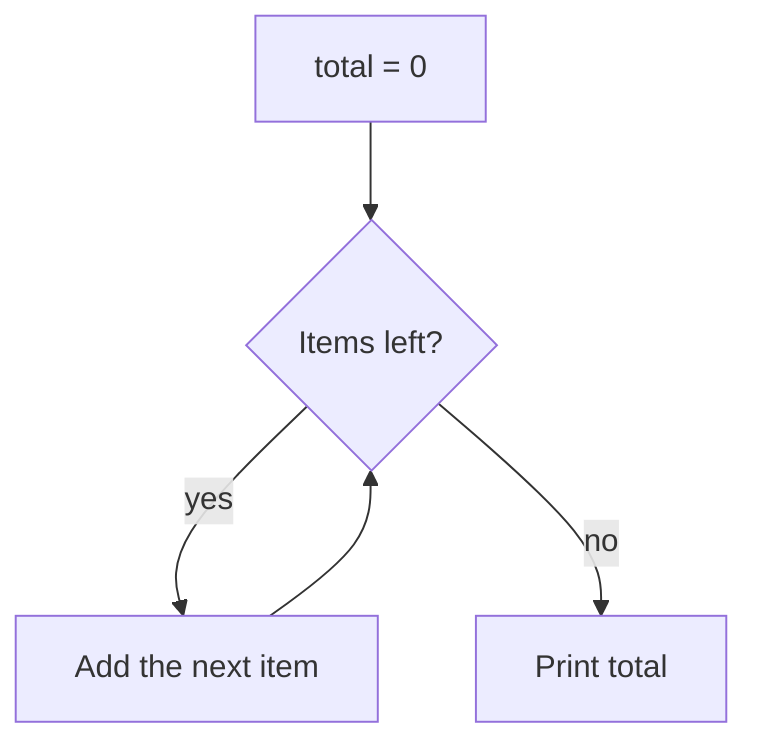

# Writing lesson content

Lessons are Markdown files in `learning/content/<course-id>/`, compiled by
`npm run content` into the lesson pages. The bar is the best free course on
the internet for this subject: the clarity of Andrew Ng's courses, the
hands-on feel of a good notebook, and real media in every lesson.

## Layout

Each course has 8 modules × 3 lessons = 24 files, named `m<module>-l<lesson>.md`.

| Module | Lesson 1                                         | Lesson 2                                                   | Lesson 3                                                       |
| ------ | ------------------------------------------------ | ---------------------------------------------------------- | -------------------------------------------------------------- |
| `m1` Get set up | What you need and installing it, step by step, per OS | Your first run and proof it works | How to work in this course: saving, organizing, getting unstuck |
| `m2`–`m7` core  | **Notes**: the concepts, taught properly | **Build-along**: make one real thing step by step | **Practice**: 5–7 exercises with hints and solutions, plus a challenge |
| `m8` Capstone   | Brief, project ideas, planning | Building it in milestones, with a starter | Testing, polishing, presenting, and the rubric |

In live classes `m2`–`m7` are Weeks 1–6; in self-paced courses they are
Modules 2–7. Don't say "week" in self-paced courses.

## File format

```
---
title: Loops that add things up
summary: One sentence for the course outline saying what the learner will do.
module: Repeat work with loops
notebook: true
---

Markdown body…
```

-   `title`, `summary`: required.
-   `module`: optional, **only in `l1` files**. Renames the module in the
    outline (keep it short and concrete: "Repeat work with loops").
-   `notebook: true`: optional. All `python run` cells in the lesson share
    variables, like a Jupyter notebook. Use it for data/ML lessons that build
    on earlier cells. Without it every `run` cell is a standalone program.

A course can also have `course.json` (see the bottom of this file).

## How to write (read this twice)

Write like a great teacher talking to one curious student, not like a
brochure. The compiler rejects common filler, but the real test is: would a
smart 15-year-old keep reading?

1.  **Start with something concrete.** A specific problem, a surprising
    result, a bug, a number. "Your quiz app says 7 + 3 is 73." Not "Variables
    are an important concept in programming."
2.  **Intuition first, then precision, then code.** Explain the idea in plain
    words with an everyday example, then state it exactly, then show it
    working. Andrew Ng's pattern: "Here's the intuition… Let's make that
    precise… Let's see it in code."
3.  **Show, then explain what happened.** After each code block, point at the
    line that matters and say why the output is what it is.
4.  **Predict before you run.** Ask the learner to guess the output before
    revealing it. Traces and quizzes are built for this.
5.  **Name the common mistakes.** Every concept has 1–2 classic bugs. Show the
    broken version, the real error message, and the fix.
6.  **Short paragraphs** (2–4 sentences), descriptive `##` headings that tell
    the story ("Why `input()` always gives you text", not "Overview").
7.  **Vary your rhythm.** Don't open every lesson the same way or end every
    section with a summary sentence. No "In this lesson…", no "Let's dive in",
    no "Great job!", no hype adjectives, no emoji, at most 4 em dashes.
8.  **Be correct.** Real APIs, real menu names, real error messages. If you're
    not sure a menu item exists, check the official docs or say it more
    generally. Never invent a function, flag, or video.

Bad: "Loops are a powerful and crucial tool that unlock a world of
possibilities." Good: "Printing 1 to 100 takes 100 lines of `print`, or two
lines with a loop."

## Lesson recipes

**Notes (`l1`)**, 900–1,500 words:
`:::objectives` → concrete hook → 3–5 `##` sections, each with a short
explanation, a runnable example (or a diagram), and what to notice → one
`:::trace` or diagram where the idea is about how things change step by step
→ a `:::video` that teaches the same idea a different way → common mistakes
(`:::warning`) → `:::quiz` (3–4 questions) → `:::takeaways` →
`## Further reading` (2–3 links).

**Build-along (`l2`)**, 900–1,600 words:
`:::objectives` → what we're building, shown first (a diagram, preview, or
the final output) → `## Step 1: …`, `## Step 2: …` (each step adds a little
code, runs it, and shows the result) → the full finished program → `:::quiz`
(2–3 questions about decisions made in the build) → `:::takeaways` → ideas to
extend it → `## Further reading`.

**Practice (`l3`)**, 700–1,400 words:
`:::objectives` → a quick warm-up → `### Exercise 1: …` through
`### Exercise 6: …`, rising in difficulty, each with a clear task, sample
output, a `:::hint`, and a `:::solution` (with runnable code where the course
has it) → `### Challenge: …` → a video or diagram that helps with the hardest
exercise.

**Setup (`m1`)**: real step-by-step install instructions with `:::tabs` for
Windows / macOS / Chromebook (or Linux) where steps differ, what success
looks like, and the exact fixes for the 3–4 problems beginners actually hit.
Include a video walkthrough of installing or touring the tool.

**Capstone (`m8`)**: 3–5 concrete project ideas at different difficulty
levels, a planning template, a starter skeleton, milestones, a test plan,
and a rubric table.

## Blocks

Blocks start with `:::name` on its own line and end with `:::`. They cannot
be nested (no `:::tip` inside a `:::solution`).

```
:::objectives
- Write a `for` loop that visits every item in a list.
- Keep a running total.
:::

:::takeaways
- A running total starts at zero before the loop.
:::

:::tip
A short, useful hint.
:::

:::warning
A classic mistake, the error it causes, and the fix.
:::

:::note
A side fact worth knowing.
:::

:::try
A 2-minute thing to try right now ("Change 3 to 30 and run it again.").
:::

:::hint
A nudge for an exercise, without giving the answer away.
:::

:::solution
The worked answer, usually with a `run` code block and a sentence on why it works.
:::
```

`:::objectives` is required in every lesson. Core Notes and Build-along
lessons also need `:::takeaways` and a quiz. Practice lessons need solutions.

### Quiz (instant feedback)

```
:::quiz
Q: What does this print if `sales = [1, 1, 1]`?
- [ ] `1`
  That's only the last item; the loop adds every item.
- [x] `3`
  Each pass adds 1, so after three passes the total is 3.
- [ ] `111`
  That would happen if the items were strings.

Q: What happens if `total = 0` moves inside the loop?
- [ ] The total doubles
  Nothing doubles: the variable is reset to zero each pass.
- [x] Only the last item is counted
  Every pass starts again from zero, so only the final item survives.
:::
```

Each question starts with `Q:`, has 2–4 options, exactly one `[x]`, and an
explanation line (indented two spaces) under **every** option saying why it
is right or wrong. Good questions test understanding: predict the output,
spot the bug, pick the right tool. Not trivia, and not "which is true about X".

### Video

```
:::video _L39rN6gz7Y start=2:15
What to watch for: how each split makes the groups purer.
:::
```

Use a real YouTube id from `node scripts/find-videos.js "search words"`
(prints id, length, channel, views). Pick from channels known for teaching
well (e.g. CS50, freeCodeCamp, Khan Academy, 3Blue1Brown, StatQuest,
Computerphile, Corey Schafer, Fireship, Programming with Mosh, The Coding
Train, Kevin Powell, Web Dev Simplified, Android Developers, Google for
Developers, Scratch Team, micro:bit Educational Foundation, Raspberry Pi,
Paul McWhorter, DroneBot Workshop, Ben Eater, Brackeys, Unity, Hugging Face,
Sentdex, Andrej Karpathy, Jeremy Howard / fast.ai, DeepLearningAI). Prefer
focused videos of 3–25 minutes. For a long course video, use `start=` to
jump to the part you mean, and say what to watch for. The compiler checks
every id with YouTube and shows the real title, channel, and length, so a
wrong id fails the build. Aim for one video in most lessons; never more than
two.

### Diagrams (Mermaid)

````

````

Use `flowchart`, `sequenceDiagram`, `stateDiagram-v2`, `classDiagram`,
`erDiagram`, `gitGraph`, `timeline`, `mindmap`, or `xychart-beta`. Keep them
small (under ~12 boxes) with short labels, and always add a caption. Put
labels with punctuation in quotes: `A["Open file (read)"]`. The compiler
parses every diagram, so syntax errors fail the build.

### Step-through animation (Python)

````
:::trace Watch `total` grow
```python
sales = [3, 5, 2]
total = 0
for count in sales:
    total = total + count
print(total)
```
:::
````

The compiler runs the program and records every step, and learners step
through it line by line, watching the variables, the call stack, and the
output change. Use it for loops, conditions, functions, recursion, and
mutation (the ideas beginners can't see). Keep it short (under 150 steps).
For `input()`, add `input="Sam|12"` after `python`.

### Code that runs for real

Tag every code block with its language. Add `run` to a complete Python,
JavaScript (Node), or Java program, and the compiler runs it and shows its
**real output** underneath; don't type the output yourself.

````
```python run title="tickets.py" input="12|yes"
age = int(input("Age: "))
...
```
````

-   `title="file.py"` labels the block with a file name (use it for files the
    learner saves).
-   `input="12|yes"` feeds those lines to `input()`/stdin, and they appear in
    the output as if typed.
-   `raises` means the program is meant to crash (to teach an error message);
    the real traceback is shown. Without `raises`, a crash fails the build.
-   Charts: a `python run` block that draws with matplotlib (or seaborn)
    shows the chart as an image. It needs `alt="what the chart shows"` and
    can have `caption="…"`. Don't call `plt.savefig`.
-   In `notebook: true` lessons, cells share state in order, so later cells
    can use earlier variables.
-   Use data that ships with the libraries or is built inline: small
    DataFrames you type out, `sklearn.datasets` (`load_iris`, `load_wine`,
    `load_breast_cancer`, `load_diabetes`, `make_classification`, …), or
    generated NumPy data. Nothing that downloads (`seaborn.load_dataset`,
    `fetch_openml`, Hugging Face models, torchvision datasets) inside `run`
    cells. Keep each lesson's code under ~30 seconds on a laptop CPU. No
    network calls and no API keys in `run` cells.

Code that can't run here (browser JavaScript, Android, Unity C#, Arduino,
MakeCode, shell commands, Docker, YAML) stays as a normal block: write it
exactly as it appears in the real tool, double-check every name against the
official docs, and show the expected result in a `text` block.

HTML/CSS (and browser JavaScript inside a page) can be shown **live**:

````
```html preview height="220"
<button onclick="this.textContent = 'Clicked!'">Click me</button>
<style> button { font: 20px sans-serif; padding: 12px 20px; } </style>
```
````

The learner sees the code and the working result in a sandboxed frame.

Other languages for highlighting: `python`, `javascript`, `typescript`,
`java`, `xml`, `html`, `css`, `json`, `yaml`, `sql`, `bash`, `powershell`,
`csharp`, `cpp`, `arduino`, `makecode`, `toml`, `dockerfile`, `diff`,
`text` (printed output), `scratch` (Scratch blocks in scratchblocks syntax,
e.g. `when green flag clicked` / `move (10) steps`; they render as real
Scratch blocks).

### Tabs (per-OS steps)

```
:::tabs
@tab Windows
Steps for Windows…
@tab macOS
Steps for macOS…
@tab Chromebook
Steps for Chromebook…
:::
```

### Images

Only from Wikimedia Commons (`https://upload.wikimedia.org/…`), with alt text
and a credit: ``.
Prefer diagrams, charts, previews, and videos.

## Further reading

End Notes and Build-along lessons with `## Further reading`: 2–3 links to
official docs or excellent articles, each with a few words on why it's worth
reading. Check each URL with
`curl -sIL -o /dev/null -w "%{http_code}" URL` and use it only if it returns
200 (some sites need `-A "Mozilla/5.0"`).

## Checking your work

```
node scripts/build-lesson-content.js --check course-03
node scripts/check-lesson-code.js course-03
```

The first validates structure, runs every `run` cell, checks videos and
diagrams, and rejects filler. The second runs plain `python`/`java` blocks
without `run`. Both must pass. `--check` writes nothing, so several authors
can run it at once.

## course.json (rewritten courses)

```json
{
  "summary": "One or two sentences for the catalog card.",
  "description": "A paragraph on what learners build and how the course works. Name the real tools.",
  "audience": "Who it's for.",
  "prerequisites": ["What to know first"],
  "outcomes": ["4–6 concrete things learners can do by the end"],
  "tags": ["python", "beginner"],
  "primaryTool": {
    "name": "Thonny (free Python editor)",
    "description": "What it is and why this course uses it.",
    "setupSteps": ["Step 1", "Step 2", "Step 3"],
    "verification": "What the learner sees when it works.",
    "url": "https://thonny.org/"
  },
  "optionalGear": [
    { "name": "BBC micro:bit V2", "description": "Optional; the in-browser simulator covers every lesson.", "url": "https://microbit.org/buy/" }
  ],
  "freeCompletionPromise": "How every lesson can be completed for $0."
}
```
