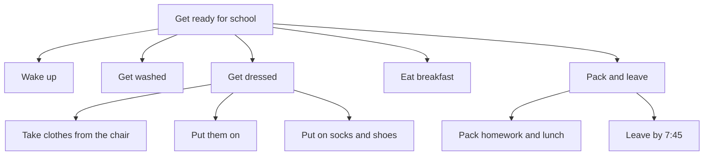

:::objectives
- Name the goal, inputs, constraints, and output of a new problem.
- Decompose a problem into pieces until every piece is obvious.
- Find the repeated piece in a task, and the blank that changes each time.
- Rewrite fuzzy instructions so they can only mean one thing.
- Add a new piece to a Scratch program and test it on its own.
:::

Work these in your notebook. Most are on paper; Exercise 6 uses Scratch. Every problem has more than one good answer, so if yours differs from the solution, check it against the problem's goal and constraints instead of the exact words.

Keep this process in view while you work. It's the whole module on one card:

```mermaid caption="Decomposing any problem: pin it down, split it, and keep splitting until each piece is obvious"
flowchart TD
    A[A messy problem] --> B[Write the goal, inputs, constraints, output]
    B --> C[Split it into a few pieces]
    C --> D{Is each piece obvious?}
    D -->|no| E[Split that piece again]
    E --> D
    D -->|yes| F[Write precise steps for each piece]
    F --> G[Check the plan against every constraint]
```

## Warm-up: the sleepover

"Plan snacks for a sleepover. Five friends are coming, you have $20 to spend, and one friend can't eat nuts."

Which part is the goal? The inputs? The constraints? The output? Decide before you open the answer.

:::solution
-   **Goal:** everyone has snacks they can eat.
-   **Inputs:** 5 friends (6 people, counting you), $20.
-   **Constraints:** spend no more than $20; nothing with nuts.
-   **Output:** a shopping list.

The headcount is the easiest thing to get wrong. "Five friends" plus you is six people.
:::

### Exercise 1: The class pizza order

A class of 26 students is having a pizza party. Each student gets 2 slices. Each pizza has 8 slices and costs $12. The class has $100.

Write the goal, inputs, constraints, and output. Then work out how many pizzas to order and whether the class can afford them.

```text
Sample answer format:
Pizzas to order: __     Total cost: $__     Within budget? yes / no
```

:::hint
Decompose it: first work out how many slices you need, then how many pizzas that takes. If the pizzas don't come out to a whole number, think about which way to round. The fair-share helper had the same decision to make.
:::

:::solution
-   **Goal:** every student gets 2 slices.
-   **Inputs:** 26 students, 2 slices each, 8 slices per pizza, $12 per pizza, $100 budget.
-   **Constraint:** total cost of $100 or less.
-   **Output:** the number of pizzas to order.

```text
Slices needed:  26 x 2  = 52
Pizzas:         52 / 8  = 6.5, rounded UP to 7
Cost:           7 x $12 = $84, which is within the $100 budget
```

Round up for the same reason as the helper: 6 pizzas is only 48 slices, so two students would get one slice. With 7 pizzas there are 4 slices left over, and you can't make a fraction of a pizza appear.
:::

### Exercise 2: Decompose your school morning

"Get ready for school" is one big task. Split it into 4 to 6 pieces. Then pick the piece that's least obvious and split it again, until every piece at the bottom is something you could do without thinking. Draw it as a tree, with the big task at the top.

:::hint
A good first split is by *time* (what happens first, next, last) or by *place* (bathroom, kitchen, bedroom, front door). "Get dressed" sounds simple, but could someone who had never seen your room do it?
:::

:::solution
One good answer:



The detail that makes this work is in the bottom row. "Get dressed" became three pieces anyone could follow, and "leave" got an exact time. Your tree will look different; check that each bottom box passes the "could I do this right now?" test.
:::

### Exercise 3: Thirty party invitations

Here's how someone wrote out making the first two invitations for a party with 30 guests:

```text
Buy a pack of cards and 30 stamps.
Write "Dear Amir" on a card. Fold it. Put it in an envelope.
  Write Amir's address on the envelope. Stick on a stamp.
Write "Dear Bea" on a card. Fold it. Put it in an envelope.
  Write Bea's address on the envelope. Stick on a stamp.
...
Take all the envelopes to the mailbox.
```

Find the piece that repeats. What's the blank that changes each time? Which steps happen only once?

:::hint
Look for the lines that look the same except for a name. Then look at the first and last lines: do they happen once per guest or once in total?
:::

:::solution
The repeated piece, written once:

```text
Make one invitation for ___:
  1. Write "Dear ___" on a card.
  2. Fold it and put it in an envelope.
  3. Write ___'s address on the envelope.
  4. Stick on a stamp.
```

The blank is the guest (their name and address). The whole plan becomes:

```text
1. Buy a pack of cards and 30 stamps.          (once)
2. Make one invitation for each of the 30 guests.
3. Take all the envelopes to the mailbox.      (once)
```

Thirty times four steps would be 120 lines written out. Now it's 3 lines plus a 4-step piece. Module 4 turns step 2 into a loop.
:::

### Exercise 4: The pet sitter's note

A family going on vacation left this note for the neighbor's kid who is looking after their dog:

```text
Feed Biscuit some food in the morning.
Give her water if she needs it.
Walk her for a while.
Don't let her out too much.
```

Rewrite it so that two different pet sitters would do exactly the same thing.

:::hint
Go word by word and ask "how much?", "when?", or "how would I know?" Words like *some*, *if she needs it*, *a while*, and *too much* are where two sitters would do different things.
:::

:::solution
```text
1. At 8:00 a.m., put 1 cup of dry food (the blue bag, in the pantry) in Biscuit's bowl.
2. At 8:00 a.m. and 5:00 p.m., empty her water bowl and fill it to the line.
3. At 5:00 p.m., walk her on the leash around the block twice (about 20 minutes).
4. She stays inside except for the walk and a 5-minute trip to the backyard at 8:00 a.m.
```

Every fuzzy word got replaced with an amount, a time, or a place. Notice that the rewrite also added information the sitter couldn't have guessed (where the food is). Precise instructions often need facts that only the writer knows.
:::

### Exercise 5: Decompose a game before you build it

Here's a game idea: *An apple falls from a random spot at the top of the screen. You move a bowl left and right with the arrow keys. Catching the apple scores a point, and a new apple falls. The game ends after 30 seconds and shows your score.*

Don't build it. Decompose it: list the pieces the game needs, and mark which pieces repeat.

:::hint
Think about each *thing* in the game (the apple, the bowl, the score, the timer) and what it has to do. Then ask what happens over and over while the game is running.
:::

:::solution
```mermaid caption="The apple game, decomposed by the thing that does each job"
flowchart TD
    A[Apple-catching game] --> B[Bowl]
    A --> C[Apple]
    A --> D[Score]
    A --> E[Timer]
    B --> B1[Move left or right when an arrow key is pressed]
    C --> C1[Start at a random spot at the top]
    C --> C2[Fall down a little, again and again]
    C --> C3[If it touches the bowl, add a point and restart]
    D --> D1[Start at 0]
    E --> E1[After 30 seconds, stop and show the score]
```

The repeated pieces are "fall down a little, again and again" and the whole apple cycle (start, fall, get caught or missed, restart). Splitting by *thing* works well for games, because in Scratch each thing usually becomes its own sprite with its own scripts.
:::

### Exercise 6: Add a piece to the fair-share helper

Open `m2-fair-share-helper.sb3`. Add a new piece that makes the cat also say how many computers sit empty in the last round.

```text
9 kids, 6 computers, 60 minutes:
Cat:  2 rounds.
Cat:  Each turn is 30 minutes.
Cat:  3 computers are free in the last round.
```

Work out the expected answer by hand for 12, 9, 7, and 18 kids (with 6 computers) before you build anything. Then test your new piece with all four.

:::hint
How many seats are there in total, across all the rounds? How many of those seats get used? Make a new variable called `empty` for the answer.
:::

:::solution
Total seats across all rounds is `computers × rounds`. Every kid uses exactly one seat, so the unused seats are `computers × rounds − kids`. Every round except the last is full, so all of the unused seats are in the last round.

```scratch
set [empty v] to (((computers) * (rounds)) - (kids))
say (join (empty) [ computers are free in the last round.]) for (3) seconds
```

Add these two blocks at the bottom of the script, after the other `say` blocks.

```text
12 kids:  6 x 2 - 12 = 0
 9 kids:  6 x 2 -  9 = 3
 7 kids:  6 x 2 -  7 = 5
18 kids:  6 x 3 - 18 = 0
```

If your answer for 7 kids is 1, you probably subtracted the wrong way around (`kids − computers`), which only happens to look right for some inputs. That's why the plan said to test four cases, not one.
:::

### Challenge: The bake sale deadline

The class needs 120 cookies for a bake sale that opens at 3:00 p.m. Here's what you know:

-   Mixing the dough takes 30 minutes, and it has to be done before any baking starts.
-   You have 2 ovens. Each holds one tray of 12 cookies at a time.
-   A tray bakes for 15 minutes. Swapping trays takes no time.
-   The last trays need 10 minutes to cool before they can be sold.

What's the latest time you can start? Decompose the problem first, and write each piece's answer before combining them.

:::hint
Three pieces: the dough, the baking, the cooling. For the baking piece, work out how many trays you need, then how many rounds of baking two ovens take.
:::

:::solution
```text
Dough:     30 minutes
Trays:     120 / 12 = 10 trays
Rounds:    10 trays / 2 ovens = 5 rounds of baking
Baking:    5 x 15 = 75 minutes
Cooling:   10 minutes after the last round
Total:     30 + 75 + 10 = 115 minutes, which is 1 hour 55 minutes
Start by:  3:00 p.m. minus 1:55 = 1:05 p.m.
```

The "rounds" piece is the fair-share helper in disguise: trays instead of kids, ovens instead of computers. Spotting that two problems share a piece is decomposition paying off twice. A careful planner would start earlier than 1:05, though. The plan has no room for a dropped tray, and real ovens need time to heat up.
:::
