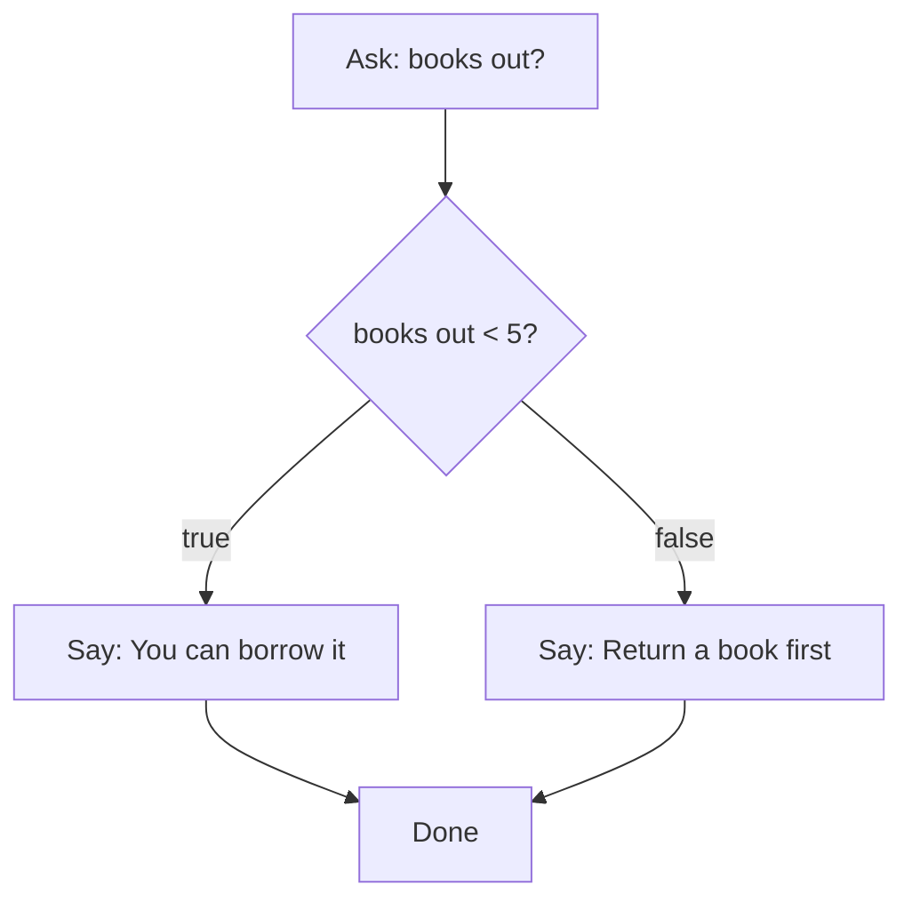

:::objectives
- Write a rule as a condition that is either true or false.
- Use if/else so a program takes exactly one of two paths.
- Combine conditions with and, or, and not, and predict the result.
- Put several decisions in a sensible order as a decision tree.
- Find edge cases by testing a boundary, one value below it, and one above it.
:::

The library on Maple Street has a self-checkout kiosk with one simple rule: nobody may have more than 5 books out at once. Jada already has 5. She scans a sixth, and the screen says **Enjoy your book!**

The kiosk did exactly what it was told. Its programmer wrote the rule as "refuse if books out is more than 5," and 5 is not more than 5. So Jada walked out with 6 books. Nothing crashed, and no error appeared. The rule was one number off, and only someone standing exactly at the limit could ever notice.

Programs make decisions like this all day, from logging you in to charging for shipping. This module is about writing them precisely and hunting down the cases, like Jada's, that slip through.

## A condition is a question with only two answers

A **condition** is a yes-or-no question a computer can check right now. "Is it raining?" works. "What's the weather like?" doesn't, because its answer isn't yes or no. Programmers say **true** and **false** instead of yes and no, and call a true-or-false value a **Boolean**, after the mathematician George Boole.

In Scratch, conditions are the pointy-ended hexagon blocks, and they only fit into pointy slots. The three comparison blocks live in the green **Operators** category:

```scratch
<(books out) < (5)>
<(fines) > (5)>
<(answer) = [yes]>
```

Here is what the first two say for a few different values:

| Condition | value is 3 | value is 5 | value is 7 |
| --- | --- | --- | --- |
| `books out < 5` | true | **false** | false |
| `fines > 5` | false | **false** | true |

Look at the middle column. When the value is exactly 5, *both* comparisons are false: 5 isn't less than 5, and it isn't more than 5 either. Remember that column. It's where most decision bugs live.

:::note
Scratch's `=` block ignores capital letters, so `YES`, `Yes`, and `yes` all count as equal to `yes`. Most text languages are stricter. In Python, `"YES" == "yes"` is false.
:::

## if/else: two roads, and exactly one gets taken

An **if/else** decision checks a condition once, then takes one of two paths. Here is the kiosk's rule as plain-English steps:

1. Ask how many books the person has out.
2. If that number is less than 5, say "You can borrow it."
3. Otherwise, say "Please return a book first."

Here is the same algorithm as a flowchart. The diamond is the decision, and every diamond has exactly two arrows leaving it: one for true, one for false.



In Scratch it becomes the `if <> then … else` block from the orange **Control** category:

```scratch
when green flag clicked
ask [How many books do you have out right now?] and wait
if <(answer) < (5)> then
  say [You can borrow it!] for (2) seconds
else
  say [Please return a book first.] for (2) seconds
end
```

Try it with 4, then 5, then 6. Whatever you type, exactly one `say` block runs: never both, never neither. That guarantee is what `else` is for. A plain `if` with no `else` is different: when its condition is false, it skips everything inside and does nothing. That's fine for optional extras ("if it's your birthday, play a song") but wrong when everyone who walks up needs an answer.

## Combining conditions with and, or, not

Real rules come in bundles. The Maple Street kiosk actually checks several things: the card is active, the person has fewer than 5 books out, and they owe less than $5 in fines. Scratch has three blocks for gluing conditions together:

```scratch
<<(books out) < (5)> and <(fines) < (5)>>
<<(age) < (5)> or <(age) > (64)>>
<not <(card) = [expired]>>
```

- **and** is true only when both sides are true. "You can borrow if you have room *and* you owe less than $5."
- **or** is true when at least one side is true. "Free entry for kids under 5 *or* people 65 and up." Ages here are whole numbers, so "over 64" means 65 and up.
- **not** flips true to false and false to true.

A **truth table** lists every combination, so nothing is left to guesswork:

| A | B | A and B | A or B |
| --- | --- | --- | --- |
| true | true | true | true |
| true | false | false | true |
| false | true | false | true |
| false | false | false | false |

`and` is the strict one: it says true in only one row out of four. `or` is the generous one: it says false in only one row.

:::warning
**Using `or` when the rule needs `and`.** Someone writes the borrowing rule as `<<(books out) < (5)> or <(fines) < (5)>>`. Now a person with 2 books out and $40 in fines can borrow, because one true side is enough for `or`. When a rule says "both of these must be true," you need `and`. Read the condition out loud with one specific person in mind ("2 books, owes $40…") and check that the answer matches the library's policy.
:::

## Decision trees: asking questions in the right order

One giant `and` can tell a person yes or no, but not *why*. A good kiosk says "your card has expired" or "you owe $7.50," so the person knows what to fix. To do that, ask the questions one at a time and give each "no" its own message. Drawn out, that's a **decision tree**:

```mermaid caption="The kiosk as a decision tree: every failed check explains itself"
flowchart TD
    A{"Card active?"} -->|no| B["See the front desk"]
    A -->|yes| C{"Reference book?"}
    C -->|yes| D["This one stays in the library"]
    C -->|no| E{"Books out < 5?"}
    E -->|no| F["Return a book first"]
    E -->|yes| G{"Fines < $5?"}
    G -->|no| H["Pay your fines first"]
    G -->|yes| I["Enjoy your book!"]
```

The order matters. The card check goes first because without a valid card, the kiosk can't look up anyone's books or fines. Ask the questions that make the others pointless first.

Here is the same tree in a text language, Python. You don't need to know Python: read `return` as "give this answer and stop," and `>=` as "is at least." Step through it and watch which lines get skipped. As soon as a check fails, the later questions are never asked.

:::trace Watch the kiosk skip questions it no longer needs
```python
def kiosk(card_ok, reference, books_out, fines):
    if not card_ok:
        return "See the front desk"
    if reference:
        return "This one stays in the library"
    if books_out >= 5:
        return "Return a book first"
    if fines >= 5:
        return "Pay your fines first"
    return "Enjoy your book!"

print(kiosk(True, False, 2, 0))
print(kiosk(True, False, 5, 0))
print(kiosk(False, False, 0, 0))
print(kiosk(True, False, 1, 7.50))
```
:::

The second call is Jada. The rule now says `books_out >= 5`, so it refuses at 5 *or more*, which is what the library meant all along.

## Edge cases: the inputs at the corners

An **edge case** is an input sitting right on the boundary of a rule, or an unusual input the programmer never pictured. Jada's 5 books were an edge case. So is a fine of exactly $5.00, a person with 0 books out, a blank answer, or someone who types "five" instead of 5.

Here's a method that finds most of them. For every number in a rule, test the number itself, one value just below it, and one just above it. Then add the strange inputs.

| Test | Books out | Fines | Expected | Why this test |
| --- | --- | --- | --- | --- |
| 1 | 4 | 0 | borrow | just under the limit |
| 2 | 5 | 0 | refuse | exactly on the limit |
| 3 | 6 | 0 | refuse | over the limit (shouldn't happen, but might) |
| 4 | 2 | 4.99 | borrow | just under the fine limit |
| 5 | 2 | 5.00 | refuse | exactly on the fine limit |
| 6 | 0 | 0 | borrow | the smallest sensible value |
| 7 | -1 | 0 | ??? | an impossible value |

Test 7 is the interesting one. The library's rules never say what to do with a negative number. Spotting gaps like that is part of a programmer's job: you take the question back to whoever wrote the rules (here, the librarian) and decide together.

:::warning
**Two separate `if` blocks that leave a gap.** This looks like it covers everyone:

```scratch
if <(answer) < (5)> then
  say [You can borrow it!]
end
if <(answer) > (5)> then
  say [Return a book first.]
end
```

Type 5 and the kiosk says nothing at all, because both conditions are false at exactly 5 (the middle column again). Use one `if <> then … else` block instead, so every input lands on exactly one path.
:::

:::video STMtgEsi2Ik
What to watch for: the difference between a project that does the same thing every time and one that reacts to what's happening. Notice which slot the hexagon condition block snaps into, and how changing the condition changes what the sprite does.
:::

:::quiz
Q: The kiosk uses `<(books out) < (5)>` to decide who can borrow. Jada has exactly 5 books out. What happens?
- [ ] She can borrow the book
  That needs the condition to be true, but 5 is not less than 5.
- [x] She's told to return a book first
  At exactly 5 the condition is false, so the else path runs. That matches the library's real rule: 5 books is the maximum.
- [ ] Nothing happens
  An if/else always runs one of its two paths, so the kiosk always says something.

Q: A water park lets you on the big slide if you are at least 120 cm tall **and** at least 10 years old. Who gets on?
- [ ] Ravi: 135 cm, 9 years old
  He passes the height check but not the age check, and `and` needs both.
- [x] Mei: 120 cm, 10 years old
  She's exactly on both limits, and "at least" includes the limit itself, so both checks are true.
- [ ] Sam: 110 cm, 12 years old
  Old enough, but not tall enough. With `and`, one false side makes the whole condition false.

Q: You're testing the rule "fines under $5 are OK." Which set of test values tells you the most?
- [ ] $0, $1, $2
  All three are far below the limit, so they'd pass even if the boundary were wrong.
- [ ] $20, $50, $100
  All far above it. A rule that's off by a little near $5 would still get these right.
- [x] $4.99, $5.00, $5.01
  These sit right on both sides of the boundary, which is exactly where a wrong `<` or `>` shows up.
:::

:::takeaways
- A condition is a true-or-false question. In Scratch it's a hexagon block.
- `if <> then … else` always runs exactly one of its two paths; a plain `if` may run nothing.
- `and` needs both sides true, `or` needs at least one, and `not` flips the answer.
- A decision tree asks one question at a time so every "no" can explain itself. Put the questions that make the rest pointless first.
- Test every boundary three ways: just below, exactly on, and just above. Then try the weird inputs.
:::

## Further reading

- [If () Then, Else (Scratch Wiki)](https://en.scratch-wiki.info/wiki/If_%28%29_Then,_Else_%28block%29): how the block runs, with example scripts you can copy.
- [Boolean Block (Scratch Wiki)](https://en.scratch-wiki.info/wiki/Boolean_Block): a list of every hexagon block in Scratch and what each one checks.
- [() = () (Scratch Wiki)](https://en.scratch-wiki.info/wiki/%28%29_%3D_%28%29_%28block%29): the surprising ways Scratch compares text and numbers, including why capitals don't matter.
