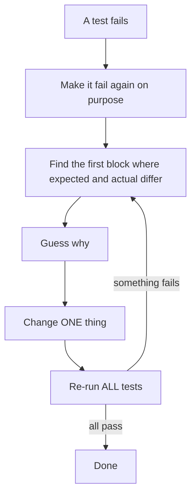

:::objectives
- Describe a bug as a gap between expected and actual results.
- Trace a script by hand with a table of variable values.
- Recognize sequence bugs, condition bugs, and loop bugs.
- Choose tests that break things on purpose, and make inputs controllable.
- Follow a debugging routine that changes one thing at a time.
:::

Sam built an alarm clock in Scratch. It worked perfectly on Monday, Tuesday, Wednesday, and Thursday: 6:30 a.m., beep beep, time for school. On Friday it stayed silent and Sam was late. On Sunday it went off at 6:30 and woke up the whole house.

Here is Sam's script:

```scratch
when green flag clicked
set [day v] to (current [day of week v])
if <<(day) = (6)> or <(day) = (7)>> then
  say [No alarm today. Sleep in!]
else
  say [ALARM! 6:30. Time for school!]
end
```

It looks fine. Monday through Friday are days 1 to 5, Saturday and Sunday are 6 and 7, so 6 or 7 means weekend. Except that Scratch doesn't count that way. The `current [day of week]` block reports **1 for Sunday** and 7 for Saturday. Sam's script treated Friday (6) as a weekend and Sunday (1) as a school day.

Nothing crashed, no error appeared, and the script was right five days out of seven. That's typical: most bugs are small, quiet mismatches between what you *think* a block does and what it *actually* does.

## A bug is a gap between expected and actual

A **bug** is any difference between what a program should do (the **expected** result) and what it really does (the **actual** result). Here's Sam's week laid out that way:

| Day | `day` | Expected | Actual | Match? |
| --- | --- | --- | --- | --- |
| Monday | 2 | alarm | alarm | yes |
| Tuesday | 3 | alarm | alarm | yes |
| Wednesday | 4 | alarm | alarm | yes |
| Thursday | 5 | alarm | alarm | yes |
| Friday | 6 | alarm | sleep in | **no** |
| Saturday | 7 | sleep in | sleep in | yes |
| Sunday | 1 | sleep in | alarm | **no** |

The table makes the bug impossible to miss, and the `day` column points straight at the cause. But it only works if the Expected column is written *before* you look at the Actual one. Run the program first, and it's easy to watch what it does and think "yep, looks right." So always predict first: before you click the green flag, write down what should happen.

## Trace it by hand: be the computer

**Tracing** means running a script in your head, one block at a time, writing down every variable as it changes. It's how you find bugs in code that runs too fast to watch.

Here's a countdown script to trace:

```scratch
when green flag clicked
set [count v] to (3)
repeat until <(count) = (0)>
  say (count) for (1) seconds
  change [count v] by (-1)
end
say [Wake up!] for (2) seconds
```

| Step | Block | `count` | Sprite says |
| --- | --- | --- | --- |
| 1 | `set count to 3` | 3 | |
| 2 | check: is count 0? no | 3 | |
| 3 | `say count` | 3 | 3 |
| 4 | `change count by -1` | 2 | |
| 5 | check: is count 0? no | 2 | |
| … | … | … | … |
| 11 | check: is count 0? **yes**, leave loop | 0 | |
| 12 | `say Wake up!` | 0 | Wake up! |

It says 3, 2, 1, Wake up! That one's correct. Now predict: what happens if you change `-1` to `-2`? Trace it before you read on.

The count goes 3, 1, -1, -3, and so on. It jumps right over 0, so `count = 0` is never true and the loop **never stops**. A trace finds that in thirty seconds.

A computer can trace for you too. Here is Sam's alarm logic in a text language, Python, running through a whole week. `for day in range(1, 8)` means "for each day number from 1 to 7," and `names` turns a number into a day's name. Keep your eye on `day` and `weekend`:

:::trace Watch Sam's alarm get Friday and Sunday wrong
```python
names = {1: "Sun", 2: "Mon", 3: "Tue", 4: "Wed", 5: "Thu", 6: "Fri", 7: "Sat"}
for day in range(1, 8):
    weekend = day == 6 or day == 7
    if weekend:
        print(names[day], "sleep in")
    else:
        print(names[day], "ALARM 6:30")
```
:::

## Three places bugs hide

Almost every logic bug lives in one of three places.

**1. Sequence: the right blocks in the wrong order.** This coin script shows the score *before* adding the points, so the player always sees the old score:

```scratch
when this sprite clicked
say (join [Score: ] (score)) for (1) seconds
change [score v] by (10)
```

Swap the two blocks and it's fixed. A classic version of this bug is a `set` block that ended up *inside* a loop, so the variable gets reset on every pass.

**2. Conditions: the wrong question.** Sam's bug lives here. So does using `>` where you needed `<`, using `or` where the rule says `and`, or a boundary that's one off (`> 5` when the rule means 5 or more). Condition bugs tend to show up only for certain inputs, which is why they survive so long.

**3. Loops: the wrong number of repeats.** A loop can run one time too many, one time too few, never stop, or never start. The countdown with `-2` never stops. A safer stopping condition is `repeat until <(count) < (1)>`, which still works if the count skips past zero. Running one time too many or too few is so common it has a name: an **off-by-one error**.

## Test like you're trying to break it

Testing isn't about proving your program works. It's about finding the input that makes it fail before someone else does. Good tests come from four places:

- **Normal cases:** a regular Wednesday.
- **Boundaries:** the first and last school days of the week (Monday, Friday), and the days just past them.
- **Weird inputs:** a holiday that falls on a weekday, a blank answer, a negative number.
- **Everything,** when there are only a few possible inputs. A week has 7 days, so test all 7. Sam tested only Monday and would never have found the bug that way.

There's one more problem. Sam can't wait until Sunday to test Sunday. The fix is to make the input **controllable**: while testing, replace `(current [day of week v])` with a value you choose, such as `set [day v] to (1)` or an `ask` block. Programmers call this a test mode. Once every test passes, you switch back to the real clock.

## A debugging routine that works

When a test fails, guessing and changing random blocks usually makes things worse. Follow the same routine every time:



Scratch gives you good tools for the "find the first block" step:

- **Click a block to run it alone.** Click a reporter like `(current [day of week v])` and a bubble shows its value right now. That alone would have caught Sam's bug.
- **Show variable monitors.** Tick the checkbox next to a variable in the **Variables** category to watch it change on the stage.
- **Add a temporary `say`.** Drop `say (day) for (1) seconds` into the middle of a script to see a value at that exact moment.
- **Slow it down.** A `wait (1) seconds` inside a fast loop lets your eyes keep up.
- **Click Debug.** The Scratch editor's top bar has a **Debug** button that opens a list of tips for getting unstuck.

When you're truly stuck, explain the script out loud, block by block, to a friend or to anything that will sit still. Programmers call this **rubber duck debugging**, because some keep a real rubber duck on the desk for it. Saying "and then this block sets day to..." is often when you hear the mistake.

:::video auv10y-dN4s
What to watch for: the four steps the speakers use to squash a bug, and their tips for debugging faster. Compare their steps with the routine in the diagram above.
:::

:::warning
**Changing several things at once.** If you change three blocks and the bug disappears, you don't know which change fixed it, or whether the other two broke something new. Change one thing, re-run the tests, then decide on the next change.
:::

:::warning
**Re-running only the test that failed.** Sam fixes Sunday by changing `6` to `1`, checks Sunday, and stops. But a fix can break a different case, or uncover a bug that the first one was hiding. Re-run the whole test table after every change.
:::

:::quiz
Q: A countdown starts at `count = 10`, runs `repeat until <(count) = (0)>`, and does `change [count v] by (-3)` each pass. What happens?
- [ ] It counts 10, 7, 4, 1, then stops
  After 1 comes -2, and the loop only stops at exactly 0.
- [x] It never stops
  10, 7, 4, 1, -2, -5… never lands exactly on 0, so the stopping condition is never true.
- [ ] It stops at 0 after four passes
  Subtracting 3 from 10 never gives exactly 0.

Q: Sam fixes his weekend check to `<<(day) = (1)> or <(day) = (7)>>`. Which tests should he run now?
- [ ] Just Sunday, because that's the day that was broken
  A fix can break other days. Friday was broken too, and he wouldn't know if it's fixed.
- [ ] Sunday and Friday, the two failing days
  Better, but the fix could have broken Saturday or a weekday. Seven tests are cheap.
- [x] All seven days
  There are only 7 possible inputs, so testing all of them proves the whole week is right.

Q: In a game, the score display always shows 10 points less than the real score. What kind of bug is most likely?
- [x] A sequence bug: the score is shown before the points are added
  The display is always exactly one coin behind, which points to the order of the blocks.
- [ ] A loop bug: the loop runs too many times
  Too many repeats would give a score that's too high, not one that lags by one coin.
- [ ] A condition bug: the wrong comparison
  There's no decision involved in showing a score, so a comparison is unlikely to be the cause.
:::

:::takeaways
- A bug is a gap between expected and actual. Write the expected result first.
- Tracing a script by hand, with a table of values, finds bugs that run too fast to see.
- Bugs hide in sequence (wrong order), conditions (wrong question), and loops (wrong number of repeats).
- Test normal cases, boundaries, weird inputs, and every input when there are only a few.
- Make inputs controllable with a test mode, change one thing at a time, and re-run every test after every fix.
:::

## Further reading

- [Debugging Scripts (Scratch Wiki)](https://en.scratch-wiki.info/wiki/Debugging_Scripts): Scratch-specific tips, including the most common causes of broken scripts.
- [Off-by-one error (Wikipedia)](https://en.wikipedia.org/wiki/Off-by-one_error): the bug that's so common it got a name, with the famous fence-post puzzle.
- [Rubber duck debugging (Wikipedia)](https://en.wikipedia.org/wiki/Rubber_duck_debugging): where the idea came from and why explaining code out loud works.
