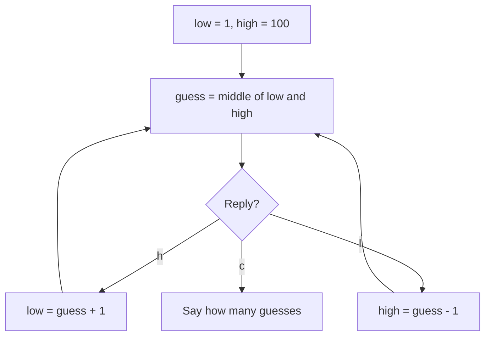

:::objectives
- Track what's still possible with two variables, `low` and `high`.
- Find the middle of a range with the `floor` block.
- Repeat until the player says "correct," counting every guess.
- Catch the edge case of a player who changes their number.
- Compare two strategies on every possible input and record the evidence.
:::

## What we're building

You think of a number. The robot finds it. Here's a full game where the secret number is 71:

```text
Robot: Think of a whole number from 1 to 100. I'll find it in 7 guesses or fewer!
Robot: Is it 50? (h = higher, l = lower, c = correct)
You:   h
Robot: Is it 75? (h = higher, l = lower, c = correct)
You:   l
Robot: Is it 62? (h = higher, l = lower, c = correct)
You:   h
Robot: Is it 68? (h = higher, l = lower, c = correct)
You:   h
Robot: Is it 71? (h = higher, l = lower, c = correct)
You:   c
Robot: Got it in 5 guesses!
```

The robot keeps two numbers in its head: `low`, the smallest number it still thinks is possible, and `high`, the largest. Every answer you give moves one of them, and the gap between them halves each time:

| After guess | Guess | You said | `low` | `high` | Numbers still possible |
| --- | --- | --- | --- | --- | --- |
| start | | | 1 | 100 | 100 |
| 1 | 50 | h | 51 | 100 | 50 |
| 2 | 75 | l | 51 | 74 | 24 |
| 3 | 62 | h | 63 | 74 | 12 |
| 4 | 68 | h | 69 | 74 | 6 |
| 5 | 71 | c | | | found |



## Step 1: Variables and the opening line

1.  At [scratch.mit.edu](https://scratch.mit.edu), click **Create**. Pick a robot-looking sprite with **Choose a Sprite** if you like.
2.  In **Variables**, make five variables: `low`, `high`, `guess`, `guesses`, and `reply`.

Start the script by setting every variable:

```scratch
when green flag clicked
set [low v] to (1)
set [high v] to (100)
set [guesses v] to (0)
set [reply v] to []
say [Think of a whole number from 1 to 100. I'll find it in 7 guesses or fewer!] for (3) seconds
```

Setting `reply` to nothing (leave the box empty) matters later. The loop will stop when `reply` is `c`, and you don't want a `c` left over from the last game to end the new game before it starts.

## Step 2: Guess the middle

The middle of `low` and `high` is their average: add them and divide by 2. At the start, that's (1 + 100) ÷ 2 = 50.5, and "Is it 50.5?" is a silly question when the numbers are whole. The `floor` option rounds *down* to a whole number.

In **Operators**, find the block that says `abs of ()`, click its dropdown, and pick **floor**. Then build:

```scratch
set [guess v] to ([floor v] of (((low) + (high)) / (2)))
change [guesses v] by (1)
ask (join [Is it ] (join (guess) [? (h = higher, l = lower, c = correct)])) and wait
set [reply v] to (answer)
```

The two `join` blocks glue three pieces of text together: `Is it `, the number, and the rest of the question. Leave a space after "it" inside the first box, or the robot asks "Is it50?".

Click the green flag. The robot should ask "Is it 50?". Type anything; nothing else happens yet.

## Step 3: Use the reply to move low or high

```scratch
if <(reply) = [h]> then
  set [low v] to ((guess) + (1))
end
if <(reply) = [l]> then
  set [high v] to ((guess) - (1))
end
```

Why `guess + 1` and not just `guess`? If the answer is "higher," the guess itself has been ruled out too. Setting `low` to the guess would leave it in play, and the robot could end up asking the same number twice. Ruling out the guess is what keeps the range shrinking every single time.

## Step 4: Repeat until correct

Wrap Step 2 and Step 3 inside `repeat until <(reply) = [c]>`, then add a final message after the loop:

```scratch
repeat until <(reply) = [c]>
  set [guess v] to ([floor v] of (((low) + (high)) / (2)))
  change [guesses v] by (1)
  ask (join [Is it ] (join (guess) [? (h = higher, l = lower, c = correct)])) and wait
  set [reply v] to (answer)
  if <(reply) = [h]> then
    set [low v] to ((guess) + (1))
  end
  if <(reply) = [l]> then
    set [high v] to ((guess) - (1))
  end
end
say (join [Got it in ] (join (guesses) [ guesses!])) for (3) seconds
```

Play a few games, and test the edges: pick 1, pick 100, pick 50. Tick the checkboxes for `low` and `high` so you can watch them squeeze together on the stage. The robot should never need more than 7 guesses.

Here is the robot's thinking in a text language, Python, playing against the secret number 71 by itself. `!=` means "is not equal to," and `//` divides and rounds down, just like `floor`. Step through it and watch `low` and `high`:

:::trace The robot closes in on 71
```python
secret = 71
low = 1
high = 100
guesses = 0
reply = ""
while reply != "correct":
    guess = (low + high) // 2
    guesses = guesses + 1
    if guess < secret:
        reply = "higher"
        low = guess + 1
    elif guess > secret:
        reply = "lower"
        high = guess - 1
    else:
        reply = "correct"
print("Found", guess, "in", guesses, "guesses")
```
:::

## Step 5: Catch a player who changes their number

What if a player cheats, or makes a mistake? Try it: answer `h` to every single guess. The robot guesses 50, 75, 88, 94, 97, 99, 100, and you say "higher" than 100. Now `low` is 101 and `high` is 100. There are **no numbers left**, but the loop keeps going and asks about 100 forever.

When `low` is bigger than `high`, the answers contradict each other. Add this check at the end of the loop body, just before `end`:

```scratch
if <(low) > (high)> then
  say [Hmm, that's impossible. Did you change your number?] for (3) seconds
  stop [this script v]
end
```

Test it two ways: answer `h` every time (the message should appear after 7 guesses, at 100), and answer `l` every time (it should appear after 6 guesses, at 1). Then play a normal game to check that honest players never see it.

## Step 6: Collect the evidence

Is the robot really better than counting up 1, 2, 3…? One game proves nothing, because counting up wins easily when the secret is 3. A fair test plays **every** possible secret number with both strategies and compares the results. That's 200 games, which would take a while by hand, so here they are in Python:

```python run title="compare.py" alt="Bar chart of how many of the 100 secret numbers the binary robot finds in each number of guesses: 1 number in 1 guess, 2 in 2, 4 in 3, 8 in 4, 16 in 5, 32 in 6, and 37 in 7." caption="The robot's guess counts for all 100 secret numbers: most take 6 or 7, none take more"
import matplotlib.pyplot as plt

def binary_robot(secret):
    low, high, guesses = 1, 100, 0
    while True:
        guess = (low + high) // 2
        guesses = guesses + 1
        if guess == secret:
            return guesses
        if guess < secret:
            low = guess + 1
        else:
            high = guess - 1

def counting_robot(secret):
    return secret  # guesses 1, 2, 3, ... so it needs `secret` guesses

binary = [binary_robot(s) for s in range(1, 101)]
counting = [counting_robot(s) for s in range(1, 101)]
print(f"{'Strategy':<14}{'Best':>6}{'Worst':>7}{'Average':>9}")
print(f"{'Binary robot':<14}{min(binary):>6}{max(binary):>7}{sum(binary) / 100:>9}")
print(f"{'Counting up':<14}{min(counting):>6}{max(counting):>7}{sum(counting) / 100:>9}")

counts = [binary.count(g) for g in range(1, 8)]
fig, ax = plt.subplots(figsize=(7, 3.6))
ax.bar(range(1, 8), counts, color="#2a78d6", width=0.6)
for g, c in zip(range(1, 8), counts):
    ax.annotate(str(c), (g, c), xytext=(0, 3), textcoords="offset points", ha="center", color="#0b0b0b")
ax.set_xlabel("Guesses the binary robot needed")
ax.set_ylabel("Secret numbers")
ax.set_title("Binary robot: guesses needed for each of the 100 numbers", loc="left")
ax.spines[["top", "right"]].set_visible(False)
```

Two things stand out. The binary robot's *worst* game (7 guesses) is better than counting up's *average* game (50.5). And look at the bars: 1 number takes 1 guess, 2 take 2, 4 take 3, 8 take 4… each extra guess covers twice as many numbers as the one before. That doubling is binary search's whole secret.

Record the result as an evidence table in your notes:

| Strategy | Inputs tested | Best | Worst | Average | Needs |
| --- | --- | --- | --- | --- | --- |
| Binary robot | all 100 numbers | 1 | 7 | 5.8 | "higher/lower" answers |
| Counting up | all 100 numbers | 1 | 100 | 50.5 | only "yes/no" answers |

The last column is a fair point in counting up's favor: it works even if the player only says "yes" or "no." Binary search needs the extra information that "higher" and "lower" give it.

## The finished robot

```scratch title="Robot sprite"
when green flag clicked
set [low v] to (1)
set [high v] to (100)
set [guesses v] to (0)
set [reply v] to []
say [Think of a whole number from 1 to 100. I'll find it in 7 guesses or fewer!] for (3) seconds
repeat until <(reply) = [c]>
  set [guess v] to ([floor v] of (((low) + (high)) / (2)))
  change [guesses v] by (1)
  ask (join [Is it ] (join (guess) [? (h = higher, l = lower, c = correct)])) and wait
  set [reply v] to (answer)
  if <(reply) = [h]> then
    set [low v] to ((guess) + (1))
  end
  if <(reply) = [l]> then
    set [high v] to ((guess) - (1))
  end
  if <(low) > (high)> then
    say [Hmm, that's impossible. Did you change your number?] for (3) seconds
    stop [this script v]
  end
end
say (join [Got it in ] (join (guesses) [ guesses!])) for (3) seconds
```

:::video DSffdCT5Cx4
What to watch for: the phone book search done three ways, from one page at a time to splitting the book in half. Your robot does the same thing to the numbers 1 to 100 that the halving method does to the pages.
:::

:::quiz
Q: The robot's first guess uses `floor` of (1 + 100) ÷ 2. What would go wrong without `floor`?
- [ ] Nothing; Scratch rounds automatically
  Scratch keeps the decimal: (1 + 100) ÷ 2 is 50.5.
- [x] The robot would ask about numbers like 50.5, which can never be the answer
  The secret is a whole number, so a half-number guess wastes a turn and can make the range math messy.
- [ ] The robot would always guess 100
  The average of 1 and 100 is 50.5, nowhere near 100.

Q: After you say "higher" to a guess of 50, why does the robot set `low` to 51 instead of 50?
- [x] Because 50 has already been ruled out
  You said the number is higher than 50, so 50 itself can't be it. Keeping it in range could make the robot guess 50 again.
- [ ] Because Scratch lists start counting at 1
  There's no list here; `low` is the smallest number still possible.
- [ ] To make the game harder
  It makes the robot smarter, not the game harder.

Q: In the middle of a game, `low` is 64 and `high` is 63. What does that tell you?
- [ ] The secret number is 63
  If that were true, the player would have said "c" when it came up. There are no numbers from 64 to 63.
- [x] The player's answers contradict each other
  No whole number is at least 64 and at most 63, so at least one answer was wrong or the player changed their number.
- [ ] The robot needs one more guess
  There's nothing left to guess. That's exactly why Step 5 stops the game.
:::

:::takeaways
- Two variables, `low` and `high`, are enough to track every number that's still possible.
- `floor` of the average gives a whole-number middle; `guess + 1` and `guess - 1` make sure each guess is ruled out.
- When `low` passes `high`, nothing is left, which means the answers contradict each other. Check for it.
- Compare strategies on every input (or many inputs), and record best, worst, and average in an evidence table.
:::

## Ideas to extend it

- **1 to 1,000:** change `high` to 1000. Predict the worst case before you test it. (The Notes have the answer.)
- **A counting-up rival:** add a second sprite that asks "Is it 1?", "Is it 2?" and so on, with its own guess counter. Play the same secret number against both.
- **Switch roles:** let the computer pick the number with `pick random (1) to (100)` while *you* guess. Does halving help you too?
- **Typo-proof:** right now, typing anything other than h, l, or c makes the robot ask the same number again and still counts a guess. Make it say "Please type h, l, or c" and not count that turn.

## Further reading

- [A guessing game (Khan Academy)](https://www.khanacademy.org/computing/computer-science/algorithms/intro-to-algorithms/a/a-guessing-game): the same game, used to introduce how computer scientists think about algorithms.
- [() of () (Scratch Wiki)](https://en.scratch-wiki.info/wiki/%28%29_of_%28%29_%28Operators_block%29): every option in the `of` block, including floor and ceiling.
- [Join () () (Scratch Wiki)](https://en.scratch-wiki.info/wiki/Join_%28%29_%28%29_%28block%29): how to build sentences from text and numbers.
