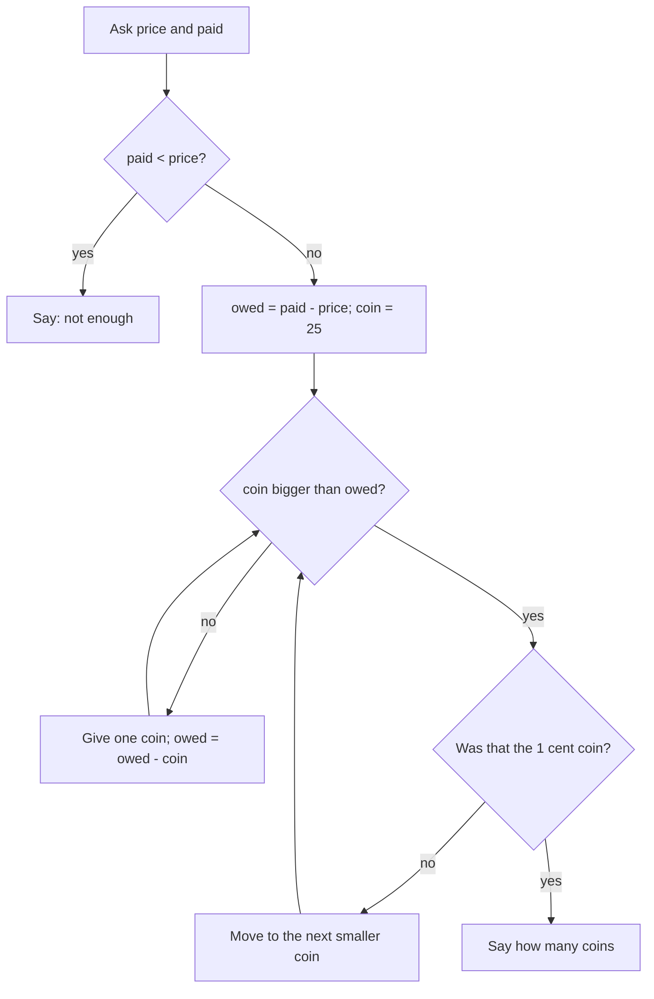

:::objectives
- Choose a capstone project that fits your time and skills.
- Fill in a planning template: inputs, outputs, steps, decisions, repetition, edge cases, and tests.
- Write steps precise enough for someone else to follow without asking questions.
- List edge cases and expected results before writing a single block.
:::

A vending machine owes you 68 cents. It drops two quarters, a dime, a nickel, and three pennies: seven coins. Could it have done it with six? Who decided which coins come out, and in what order? Somebody wrote an algorithm for that, tested it on amounts like 0, 4, and 99 cents, and thought about what happens when you pay too little.

That's your capstone. You'll design one algorithm of your own, build it in Scratch, prove it works with tests, and explain how it works to someone else. This lesson is about the part that most people skip and then regret: the plan.

## The brief

Design, build, and test an algorithm for **a maze, a puzzle, a sorting task, or a real-world process.** When you're done, you'll hand in four things:

1. **A Scratch project** that runs your algorithm.
2. **An algorithm card:** your plain-English steps and a flowchart.
3. **A test table** with at least 8 tests, including edge cases, with expected and actual results.
4. **An explanation** (a 2–3 minute talk, a short video, or one written page) covering your inputs, outputs, sequence, decisions, repetition, edge cases, and results.

The final lesson of this module has the rubric that all four are judged on. Read it now if you like knowing the target.

## Five project ideas

Each idea uses the whole course: sequence, decisions, repetition, edge cases, and testing. The stars show roughly how hard it is to get a complete, tested version working.

| Idea | Difficulty | What it does | A tricky edge case |
| --- | --- | --- | --- |
| **Animal guesser** | ★ | Asks yes/no questions and guesses which of 8 animals you're thinking of | The player types "maybe" |
| **Change maker** | ★★ | Works out the fewest coins to give as change | The customer pays less than the price |
| **Fair sign-up** | ★★ | Grows Module 2's fair-share helper into a real schedule: a list of names, assigned to computers round by round | Zero working computers, or a kid who leaves early |
| **Maze runner** | ★★ | A sprite escapes a maze drawn on the stage using the right-hand rule, counting moves | A maze where the exit isn't connected to the outer wall |
| **Sorting machine** | ★★★ | Fills a list with random numbers, sorts it with bubble sort, and counts comparisons and swaps | A list that's already sorted, or has repeated numbers |

You can also invent your own, as long as it has at least one decision, at least one loop, and inputs you can test. A few that work well: a quiz that adapts its difficulty, a tournament bracket, a recipe scaler, a bus-route planner for three stops.

:::tip
Pick a project where you could build a *tiny* working version in one session. The animal guesser with 4 animals, the change maker with only quarters and pennies, the sorting machine with 4 numbers. Once the tiny version works and passes its tests, grow it. A finished small project beats an unfinished big one every time.
:::

## The planning template

Copy this onto paper or into a document and fill in every line before you open Scratch.

```text
PROJECT:
PROBLEM (one sentence):
INPUTS (what goes in, and where it comes from):
OUTPUTS (what comes out, and how the user sees it):
STEPS (numbered, plain English, precise enough for a robot):
DECISIONS (each if/else, and its exact condition):
REPETITION (each loop, and exactly what makes it stop):
EDGE CASES (at least 4, and what should happen for each):
TESTS (input -> expected output, at least 8):
HOW I'LL MEASURE IT (what counts as one step):
```

## A worked plan: the change maker

Here is the template filled in for the change maker, so you can see the level of detail to aim for.

**Problem:** give a customer their change using the fewest US coins.

**Inputs:** the price and the amount paid, both typed in **cents**. (Why cents? Scratch, like most computers, stores decimals in a way that makes 1.10 − 0.25 come out as 0.8500000000000001. Whole cents avoid that whole problem.)

**Outputs:** the coins given, shown in a list on the stage, and a message with the number of coins.

**Steps:**

1. Ask for the price and the amount paid.
2. If the amount paid is less than the price, say "That's not enough" and stop.
3. Set `owed` to paid minus price.
4. Start with the biggest coin, 25¢.
5. While that coin is not bigger than `owed`, give one coin and subtract it from `owed`.
6. Move to the next smaller coin (10¢, then 5¢, then 1¢) and repeat step 5.
7. When `owed` is 0, say how many coins were given.

**Decisions:** "paid < price?" (step 2) and "coin bigger than owed?" (step 5).

**Repetition:** the loop over the four coins (stops after the 1¢ coin), and the loop inside it that gives coins (stops when the coin is bigger than what's owed).



Here are the same steps in a text language, Python, making change for 68 cents. Step through it and watch `owed` shrink as each coin goes into `coins`. The outer `for` loop moves through the coin sizes, and the inner `while` loop keeps giving the same coin while it still fits:

:::trace Making 68 cents of change, one coin at a time
```python
owed = 68
coins = []
for coin in [25, 10, 5, 1]:
    while coin <= owed:
        coins.append(coin)
        owed = owed - coin
print("Coins:", coins, "  count:", len(coins))
```
:::

**Edge cases:**

| Edge case | What should happen |
| --- | --- |
| Paid exactly the price | No coins; say "Exact change, thanks!" |
| Paid less than the price | Say "That's not enough" and give nothing |
| Change of 99¢ (the most coins possible) | 3 quarters, 2 dimes, 4 pennies: 9 coins |
| Change that's only pennies, like 4¢ | Four 1¢ coins, and no larger coins tried |
| A negative price, or a word instead of a number | Say the input doesn't make sense |

**Tests:** at least 8 rows, each with a price, an amount paid, and the exact coins expected. For example: price 32, paid 100 → 25, 25, 10, 5, 1, 1, 1 (7 coins).

**How I'll measure it:** one step = one coin given. I'll compare against a "pennies only" machine, which needs 68 steps for 68¢.

:::note
Giving the biggest coin that fits, again and again, is called a **greedy** algorithm. With US coins it always finds the fewest coins. But it isn't always right: with coins worth 1, 3, and 4, greedy makes 6 as 4 + 1 + 1 (three coins), when 3 + 3 (two coins) is better. Testing a coin system like that would make a great extra section for your capstone.
:::

## Check the plan before you build

Two quick tests catch most planning mistakes.

**The robot-friend test.** Hand your numbered steps to a friend or family member and an input from your test table. Ask them to follow your steps *exactly*, out loud, doing only what the words say. Every time they ask "what do you mean?" or do something you didn't intend, a step needs rewriting.

**The checklist test.** Go through your plan and check:

- Every decision has both paths covered (what happens on "no"?).
- Every loop has a clear stopping condition, and you can explain why it will be reached.
- Every edge case in your list appears in your tests.
- Every test has an exact expected result, not "it should work."

:::video ZMQbHMgK2rw
What to watch for: how the maze-solving robots' designers moved from simple wall-following to smarter strategies, and why the goal sits in the middle of the maze. It's a long watch, so treat it as inspiration, especially if you're considering the maze runner.
:::

:::quiz
Q: Which step is precise enough for a robot to follow?
- [ ] "Give the right coins."
  Which coins are right? The robot has no way to decide.
- [ ] "Give some quarters, then the rest."
  How many quarters? What is "the rest" made of?
- [x] "While 25 is not bigger than owed, give a quarter and subtract 25 from owed."
  It says exactly what to check, what to do, and when to stop.

Q: Which of these is an edge case for the change maker?
- [ ] Price 40¢, paid 50¢
  An ordinary case: 10¢ change, one dime.
- [x] Price 50¢, paid 50¢
  Exactly zero change sits right on the boundary between "owe change" and "not enough," so it needs its own test.
- [ ] Price 20¢, paid 50¢
  Also ordinary: 30¢ change.
:::

:::takeaways
- The plan comes first: inputs, outputs, steps, decisions, loops, edge cases, tests, and how you'll measure.
- Start with a tiny version you can finish, then grow it.
- Write expected results for every test before you build.
- Run the robot-friend test on your steps: if a careful reader has to guess, the step isn't finished.
:::
