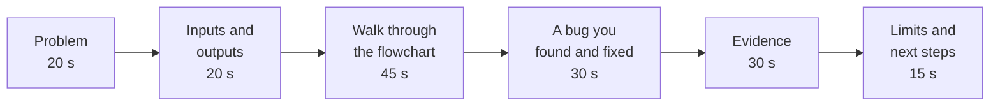

:::objectives
- Run a full test day, including a "break it" round with someone else.
- Polish a project so a stranger can use it without your help.
- Explain an algorithm's inputs, outputs, decisions, loops, edge cases, and results in about three minutes.
- Assess your own project against the rubric.
- Read a short Python program and match it to the Scratch blocks you already know.
:::

Your change maker passes every test in your table. Now hand the laptop to a friend and watch. Within a minute they type `a dollar` instead of 100, press Enter on a blank answer, and ask why the cat is talking about "coin sizes." None of that was in your tests, because you knew how the program was *supposed* to be used. Other people don't.

That's what this last stretch is for: testing it the way a stranger would use it, making it clear to a stranger, and explaining it so a stranger understands what you built and why it works.

## Test day

**1. Run the whole table, start to finish.** Even if you ran it yesterday. Start from a freshly loaded copy of your saved file, so nothing left over from earlier testing (a variable's old value, a half-filled list) can help it pass.

**2. The break-it round.** Give a friend or family member five minutes and one instruction: "Try to make this do something wrong." Sit on your hands and don't explain anything. Write down every input they try and what happened. Common discoveries: typing words where numbers belong, typing nothing, clicking the green flag twice quickly, and typing huge numbers.

**3. Fix and log.** Every surprise from the break-it round becomes a new row in your test table *and* your fix log. Fix them one at a time, re-running the full table after each fix.

**4. Decide what not to fix.** Sometimes the right answer is "out of scope." A change maker doesn't need to handle a million-dollar payment. Write that down too ("Inputs over 10,000 cents are not supported"). Knowing the limits of your algorithm, and saying them out loud, is a sign you understand it.

## Polish: make it work without you

Go through this list with your project open:

- **The first thing on screen says what to do.** The opening `say` should tell a new user what the project is and what to type.
- **Questions say what format they want.** "Price in cents?" is better than "Price?". "(yes/no)" is better than nothing.
- **Only the useful monitors show.** Untick the checkbox next to any variable the user doesn't need to see (like `i` or `temp`).
- **Debugging leftovers are gone.** Remove the temporary `say (alarm)` blocks and extra `wait` blocks you added while hunting bugs.
- **Scripts have comments.** Right-click an empty part of the code area and choose **Add Comment** to stick a note on the code. One comment per script saying what it does helps anyone reading it (including you, next month).
- **Variable names explain themselves.** `owed` beats `x`. To rename one, right-click the variable in the block palette and choose **Rename variable**.

If you have a Scratch account and decide to share, the project page has an **Instructions** box (how to use it) and a **Notes and Credits** box (what it does and who helped). Sharing is optional. Your project counts either way.

## Explain it in three minutes

A good explanation follows the same path every time. Here is the order, with rough timings:



Here's what that sounds like for the change maker, in brief:

> "My project gives change using the fewest coins. You type the price and the amount paid, in cents, and it shows the coins in a list. Here's the flowchart: first it checks you paid enough, then it starts with quarters and gives one while it still fits, then moves down to dimes, nickels, and pennies. That's two loops, one inside the other. My best bug: when someone typed `five`, it said 'Here are your 0 coins!' I fixed it by checking that every answer is a whole number. For evidence, I tested every amount from 0 to 99 cents, and the most coins it ever gives is 9. A pennies-only machine would give up to 99. It doesn't handle amounts over 10,000 cents, and next I'd like to try a coin system where this strategy fails."

Notice what's in there: inputs, outputs, sequence, a decision, repetition, an edge case, evidence with numbers, and a limit. That's the whole brief, out loud.

:::tip
Practice once to a friend or a mirror, and time it. Most first attempts run long because they describe every block. Describe the *steps* instead, and show the blocks only for the one decision or loop you're proudest of.
:::

## The rubric

Use this to check your own work before you hand it in. Each row is scored 1 to 4.

| Criterion | 1: Beginning | 2: Developing | 3: Proficient | 4: Excellent |
| --- | --- | --- | --- | --- |
| **Algorithm design** | Steps are missing or out of order | Steps work for the main case only | Clear sequence with at least one decision and one loop, all from the plan | Decisions and loops are well chosen, and you can explain why each is there |
| **Precision** | A reader would have to guess often | Some steps are vague ("give the coins") | A reader could follow every step | Every step is exact, and every loop's stopping condition is stated |
| **Edge cases** | None considered | 1–2 listed, not all handled | 4 or more listed and handled | Edge cases found by testing (not just planning) are handled and explained |
| **Testing and evidence** | Little or no testing | A few tests, no expected column | 8+ tests with expected and actual results | Tests cover boundaries and weird inputs, plus a step-count comparison or evidence table |
| **Debugging record** | No fix log | Bugs fixed but not recorded | Fix log with cause and fix for each bug | Fix log shows full re-testing after each fix |
| **Explanation** | Hard to follow | Describes the blocks, not the idea | Covers inputs, outputs, steps, decisions, loops, and results | Clear and well-timed, with a bug story, evidence, and clearly stated limits |

A project scoring 3 in every row is a strong capstone. A 4 anywhere means you went beyond the brief.

## Look back

Before you move on, answer these in your notebook. They're for you, not for a grade.

1. Which milestone took the longest, and why?
2. Which bug surprised you most? What would have caught it sooner?
3. If you started over tomorrow, what would you plan differently?
4. Where in your own life is there a process that could use an algorithm? (A chore rota, a game's rules, the way your family decides on dinner.)

## Next: the same ideas in a text language

Everything you've done in this course carries straight over to text languages like Python. The blocks just become words. Here's how some of the blocks you know look in Python:

| Scratch | Python |
| --- | --- |
| `set [score v] to (0)` | `score = 0` |
| `change [score v] by (1)` | `score = score + 1` |
| `say [Hello!]` | `print("Hello!")` |
| `ask [Your name?] and wait` | `answer = input("Your name? ")` |
| `repeat (10)` | `for i in range(10):` |
| `repeat until <(x) > (5)>` | `while not x > 5:` |
| `if <> then … else` | `if …:` and `else:` |
| `<<> and <>>` | `and` |

Python uses **indentation** (the spaces at the start of a line) where Scratch uses the C-shaped blocks: lines that are pushed in belong inside the loop or the `if` above them.

Here's a game you could build in Scratch in five minutes, written in Python. This time the computer has the secret number (34) and *you* guess, using the halving strategy from Module 7. Step through it. Each time `input` runs, one of the guesses 50, 25, 37, 31, 34 is typed in:

:::trace You guess the computer's number with binary search
```python input="50|25|37|31|34"
secret = 34
guesses = 0
guess = 0
while guess != secret:
    guess = int(input("Your guess: "))
    guesses = guesses + 1
    if guess < secret:
        print("Higher!")
    elif guess > secret:
        print("Lower!")
print("You got it in", guesses, "guesses!")
```
:::

You can read that. A variable, a loop with a stopping condition, a decision with three paths, and a counter. You knew every idea in it before you saw a single line of Python. That's what computational thinking means: the ideas come first, and the language is just how you write them down.

## Further reading

- [CS50's Introduction to Programming with Scratch](https://cs50.harvard.edu/scratch/): Harvard's free course, a great next step for building bigger Scratch projects.
- [Scratch Ideas](https://scratch.mit.edu/ideas): official tutorials and coding cards for your next project.
- [Python: Getting Started](https://www.python.org/about/gettingstarted/): the official starting page for the text language you saw above.
