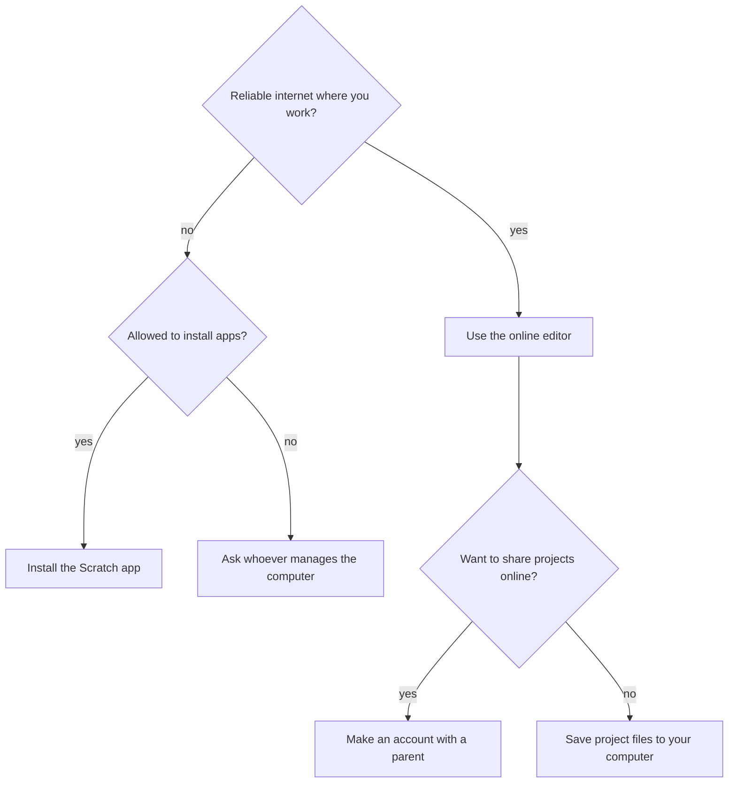

:::objectives
- Choose between the Scratch online editor and the Scratch app, and know what each one gives up.
- Open Scratch on your own device and pass a one-block test.
- Decide, together with a parent or guardian, whether to make a Scratch account.
- Fix the setup problems that stop most beginners on day one.
:::

Every game in this course gets built in one free program: Scratch 3, made by the Scratch Foundation. That includes a race with a fair start, a crab that catches falling starfish, a platformer with gravity, and a multi-level game of your own. Most people never install anything. You open a web page, and an orange cat sits on a white stage waiting for instructions.

This lesson gets you to that cat on whatever computer you have, and makes sure your setup will still work next week.

## What you need

| Thing | Details |
| --- | --- |
| A computer with a keyboard | Windows 10 or newer, a Mac with macOS 10.13 or newer, a Chromebook, or a Linux computer |
| A current web browser | Chrome, Firefox, Edge, or Safari. Scratch won't run in Internet Explorer. |
| A mouse or trackpad | A mouse makes dragging blocks easier, but a trackpad works |
| Speakers or headphones | Sound matters from Module 4 on |
| Money | None. Scratch and everything in this course is free. |

Scratch also runs on Android tablets and iPads, but the games here are steered with arrow keys and the space bar, so plan on using something with a real keyboard. The Scratch app for Android works on tablets only, not phones.

## Two ways to run Scratch

There are two versions, and they make the same projects. A file you make in one opens in the other.

| | Online editor | Scratch app |
| --- | --- | --- |
| Where it lives | A web page at scratch.mit.edu | A program installed on your computer |
| Needs internet? | Yes, while you work | No, once it's installed |
| Where projects are saved | In your Scratch account, or as a file you download | As a file on your computer (inside the app on Chromebooks) |
| Sharing with others | A Share button, if you have an account | Upload the file on the website first (the Chromebook app can share directly) |
| Best for | Almost everyone, including school computers | Spotty internet, or computers where websites are blocked |



## Option 1: The online editor, on any device

1.  Open your browser and go to **scratch.mit.edu**.
2.  Click **Create** in the blue bar at the top of the page. You can also go straight to **scratch.mit.edu/projects/editor**.
3.  The editor opens with the cat in the middle of the stage. If a tutorial window pops up, close it with the X.
4.  Bookmark the editor page so you can get back in one click.

That's the whole install. You don't need an account to build, run, or save projects this way.

## Option 2: The Scratch app

Pick your system. The download page at **scratch.mit.edu/download** usually detects it for you.

:::tabs
@tab Windows
1.  Go to **scratch.mit.edu/download**. If it shows a different system, choose **Windows**.
2.  Click the **Microsoft Store** badge, then **Get** or **Install** in the Store. Scratch has switched off its direct Windows download at times, so the Store is the dependable route.
3.  When it finishes, open the **Start** menu, type `Scratch`, and click the Scratch app.
4.  If the Microsoft Store is blocked on a school laptop, use the online editor instead. It does everything this course needs.
@tab macOS
1.  Go to **scratch.mit.edu/download** and choose **macOS** if it isn't already selected.
2.  Either click the **Mac App Store** badge and install from there, or click **Direct download** to get a `.dmg` file.
3.  If you downloaded the `.dmg`, double-click it and drag **Scratch 3** into your **Applications** folder.
4.  Open **Scratch 3** from Applications or Launchpad. The first time, macOS may warn that the app came from the internet and ask if you want to open it. Click **Open**.
@tab Chromebook
1.  Go to **scratch.mit.edu/download** on the Chromebook and click the **Google Play** badge. It opens the Scratch app's page in the Play Store.
2.  Click **Install**, then open Scratch from the launcher.
3.  The app keeps projects inside itself. To get a project out as a file, open the three-dot menu on the project, choose **Share**, then **export** and pick Google Drive, Files, or email.
4.  School Chromebooks often hide the Play Store. If yours does, use the online editor in Chrome. It runs well there.
@tab Linux
There is no official Scratch app for Linux. Use the online editor in Chrome or Firefox. Every lesson in this course works there.
:::

## Account or no account?

Talk this one over with a parent or guardian. You can finish the entire course without an account by saving project files to your computer. An account adds a few conveniences:

-   **Save now** in the File menu saves to your account, and Scratch also saves on its own every so often while you're signed in.
-   **My Stuff** lists every project you've made, on any computer you sign in from.
-   The **Backpack** lets you carry scripts and sprites from one project to another.
-   You can **share** projects, comment, and remix other people's work.

If you decide to join, click **Join Scratch** at the top of scratch.mit.edu. Scratch warns you not to use any part of your real name in your username, and it means it. If you're under the age Scratch uses for your country, it asks for a parent's email address, and a parent has to confirm the account before you can share or comment. In some countries the parent's permission comes before you can use the account at all.

## The one-block test

Whichever option you chose, prove it works:

1.  Click the blue **Motion** circle on the far left.
2.  Drag the `move (10) steps` block into the big empty area in the middle.
3.  Click the block once.

```scratch
move (10) steps
```

The cat should slide a little to the right. Below the stage you'll see boxes labeled **x** and **y**. Watch the x box as you click:

```text
New project:      x 0    y 0
After 1 click:    x 10   y 0
After 3 clicks:   x 30   y 0
```

A new project always puts the cat at x 0, y 0, the exact center of the stage. Each click adds 10 to x. If your numbers change like this, Scratch is ready.

:::tip
Dragged a block somewhere you didn't mean to? Drag it back onto the block palette on the left and it disappears.
:::

## If something goes wrong

**"Browser is not supported," or a gray, empty page.** Scratch shows that message in browsers it can't run in. Update your browser, or switch to an up-to-date Chrome, Firefox, Edge, or Safari. If the page stays blank, try a private or incognito window; a browser extension may be getting in the way.

**The editor is slow or jumpy.** Close other tabs, especially ones playing video. The stage-size buttons above the top-right corner of the stage include a small-stage mode, which shrinks the stage and gives the code area more room. On an older computer, the Scratch app often runs smoother than the website.

**No sound.** Check the computer's volume first. Then check that the browser tab isn't muted: in Chrome, right-click the tab and look for **Unmute site**. To test, click the **Sounds** tab above the blocks and press the play button on the cat's Meow sound.

**The school network blocks scratch.mit.edu.** Ask your teacher or the school's tech staff to allow it, and use the Scratch app at home in the meantime.

:::video zOa5o9Yq_ZU start=1:12
griffpatch walks through both ways of running Scratch and shows what the editor looks like on first open. Watch from 1:12 for joining Scratch versus using the offline app; you can stop at 2:32, where he starts building.
:::

## Further reading

-   [Download the Scratch app](https://scratch.mit.edu/download): the official install page, with the requirements for each system and an FAQ for the app.
-   [Scratch for parents](https://scratch.mit.edu/parents/): what Scratch is, how the online community is moderated, and answers to common parent questions.
-   [Scratch Community Guidelines](https://scratch.mit.edu/community_guidelines): the rules everyone agrees to before sharing or commenting.
