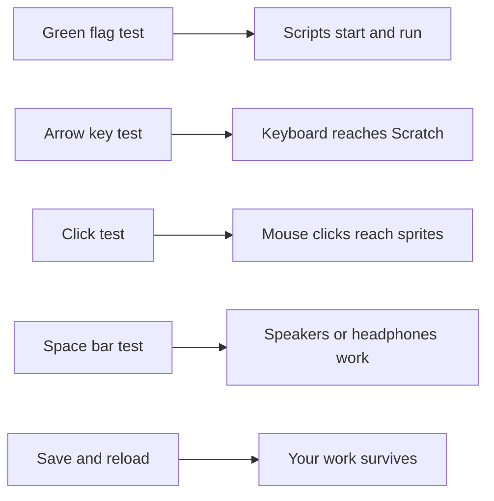

:::objectives
- Find the menu bar, block palette, code area, stage, and sprite pane in the Scratch editor.
- Build four small scripts, each testing one part of your setup.
- Save a project, start a new one, and load your file back.
- Know which test to rerun when something stops working later.
:::

Picture yourself in Module 4. Your crab won't follow the mouse, your music is silent, and you've stared at the same script for twenty minutes. Is the code wrong, or is something about the computer itself off? Ten minutes spent now on a test project answers that question for good.

So your first project is a **systems check**: four tiny scripts that each test one piece of your setup, plus one test for saving. When something breaks later, you can open this project and know in a minute whether the problem is your code or your computer.

## A map of the editor

Open the editor (from the last lesson) and find each of these. The video at the end of this lesson shows them in motion.

1.  **The menu bar**, across the top. **File** holds saving and loading. **Edit** holds Restore and Turbo Mode. **Tutorials** opens Scratch's own guides, and **Debug** opens a deck of tips for getting unstuck. The gear-shaped **Settings** menu changes the language and the color mode.
2.  **The tabs**, just below the menu bar on the left: **Code**, **Costumes**, and **Sounds**. They show the code, pictures, or sounds of whichever sprite is selected.
3.  **The block palette**, down the left side. The colored circles are categories: Motion, Looks, Sound, Events, Control, Sensing, Operators, Variables, and My Blocks. Clicking a circle scrolls to those blocks. The button at the very bottom adds extensions like Pen and Music.
4.  **The code area**, the big space in the middle. You drag blocks here and snap them into scripts. The **+**, **−**, and **=** buttons in its bottom-right corner zoom in, zoom out, and reset.
5.  **The stage**, top right, where your project runs. The **green flag** starts it and the red **stop sign** stops everything.
6.  **The sprite pane**, under the stage. It lists your sprites and shows the selected sprite's name, x, y, size, direction, and whether it's visible.
7.  **The Stage panel**, on the far right of the sprite pane, where you pick backdrops. The Stage can have scripts too.

## What each test proves



## Test 1: The green flag

Make sure the cat (Sprite1) is selected in the sprite pane. Find each block by its color: `when green flag clicked` is yellow (Events), `go to x: y:` and `point in direction` are blue (Motion), and the purple blocks are in Looks.

```scratch
when green flag clicked
go to x: (0) y: (0)
point in direction (90)
clear graphic effects
say [Flag works!] for (2) seconds
```

Drag the cat somewhere else on the stage with your mouse, then click the green flag. The cat should jump to the middle, face right, and say "Flag works!" for two seconds.

This script is also a **reset**: it puts the cat back the way it started. Almost every project in this course begins with a reset script like this one, because Scratch remembers where things were when the last run ended.

## Test 2: The keyboard

Add two more scripts beside the first. Use the dropdown on `when space key pressed` to pick the arrow keys.

```scratch
when [right arrow v] key pressed
change x by (20)

when [left arrow v] key pressed
change x by (-20)
```

**Click once on the stage**, then press the arrow keys. The cat should step 20 pixels per press, and the x box under the stage should count up and down by 20.

Clicking the stage first matters. Key presses go to whatever part of the screen you clicked last. If you last clicked the browser's address bar, your arrows move a text cursor instead of the cat.

## Test 3: The mouse

```scratch
when this sprite clicked
change [color v] effect by (25)
```

Click the cat. It changes color with each click. Click 8 times and it's orange again: the color effect wraps around every 200, and 8 × 25 = 200. Test 1 also clears the effect, so the green flag fixes the color too.

## Test 4: The speakers

```scratch
when [space v] key pressed
play sound (Meow v) until done
say [Did you hear that?] for (1) seconds
```

Press the space bar. You should hear a meow, and only *after* it finishes does the cat ask its question. That's what "until done" means: the script waits for the sound to end before moving to the next block. You'll see in Module 4 why that waiting can freeze a game.

## Test 5: Save, close, and reopen

A project you can't reopen isn't really saved. Pick the tab that matches how you use Scratch:

:::tabs
@tab No account
1.  Click **File › Save to your computer**. Your browser saves a file called `Scratch Project.sb3`, usually into Downloads (some browsers ask where to put it).
2.  Rename it `systems-check.sb3` and move it into a folder named `Scratch course`.
3.  Click **File › New**. The editor resets to a fresh cat.
4.  Click **File › Load from your computer**, pick `systems-check.sb3`, and press the green flag.
@tab With an account
1.  Click the title box in the menu bar and name the project `Systems check`.
2.  Click **File › Save now**. A short "Project saved." message appears.
3.  Click the folder icon (**My Stuff**) at the top of the Scratch website. Your project is in the list.
4.  Click its title, then **See inside**, and press the green flag.
@tab Scratch app
1.  Click **File › Save to your computer**. A normal save window opens; name the file `systems-check.sb3` and put it in a folder named `Scratch course`.
2.  Close the app completely, then open it again.
3.  Click **File › Load from your computer**, pick your file, and press the green flag.
:::

If all five tests pass, this is what you saw:

```text
Green flag       cat jumps to (0, 0), faces right, says "Flag works!"
Arrow keys       cat steps 20 pixels left or right per press
Click the cat    color shifts every click, back to orange after 8
Space bar        meow, then "Did you hear that?"
Reopen the file  all four scripts are still there and still work
```

## When a test fails

-   **Arrows do nothing, but clicking works.** Click the stage and try again. If you're using a laptop with an on-screen keyboard or a remote desktop, try a physical keyboard.
-   **Silent space bar.** Go back to the no-sound fix in the last lesson. Also check the **Sounds** tab: if the Meow sound was deleted, the block's dropdown will be empty.
-   **Can't find the saved file.** Look in Downloads, and search your computer for `.sb3`. Then change your browser's download setting so it asks where to save each file.
-   **The project opens, but scripts are missing.** You probably loaded an older copy. Check the file's date and keep just one copy in your course folder.

Keep `systems-check.sb3`. It's your known-good project: if it ever stops working, the problem is the computer, not your code.

:::quiz
Q: The arrow keys don't move the cat, but clicking the cat still changes its color. What should you try first?
- [x] Click once on the stage, then press the arrows again
  Key presses go to the last thing you clicked. Clicking the stage sends them to Scratch.
- [ ] Reinstall Scratch
  Clicks are reaching the project, so Scratch itself is working; it's a focus problem.
- [ ] Change `20` to a bigger number
  A bigger step won't help if the key presses never reach the script.

Q: You drag the cat to the top-left corner and press the green flag. Where does it end up?
- [ ] In the top-left corner, saying "Flag works!"
  The first block after the hat moves it, so it can't stay in the corner.
- [x] At the center, (0, 0), facing right
  `go to x: (0) y: (0)` and `point in direction (90)` run first, so the reset puts it back.
- [ ] Wherever it was when you last pressed the stop sign
  Stopping doesn't move sprites, but the reset script does on the next flag click.
:::

:::video 9jTPZfhuVro
A short tour from the Scratch Team. Watch where they drag blocks from and how a block snaps under another one, then compare with the map at the top of this lesson.
:::

## Further reading

-   [Project Editor on the Scratch Wiki](https://en.scratch-wiki.info/wiki/Project_Editor): every part of the editor, with screenshots, written by Scratch users.
-   [Scratch Ideas](https://scratch.mit.edu/ideas): the official tutorials and coding cards, handy when you want a second explanation.
