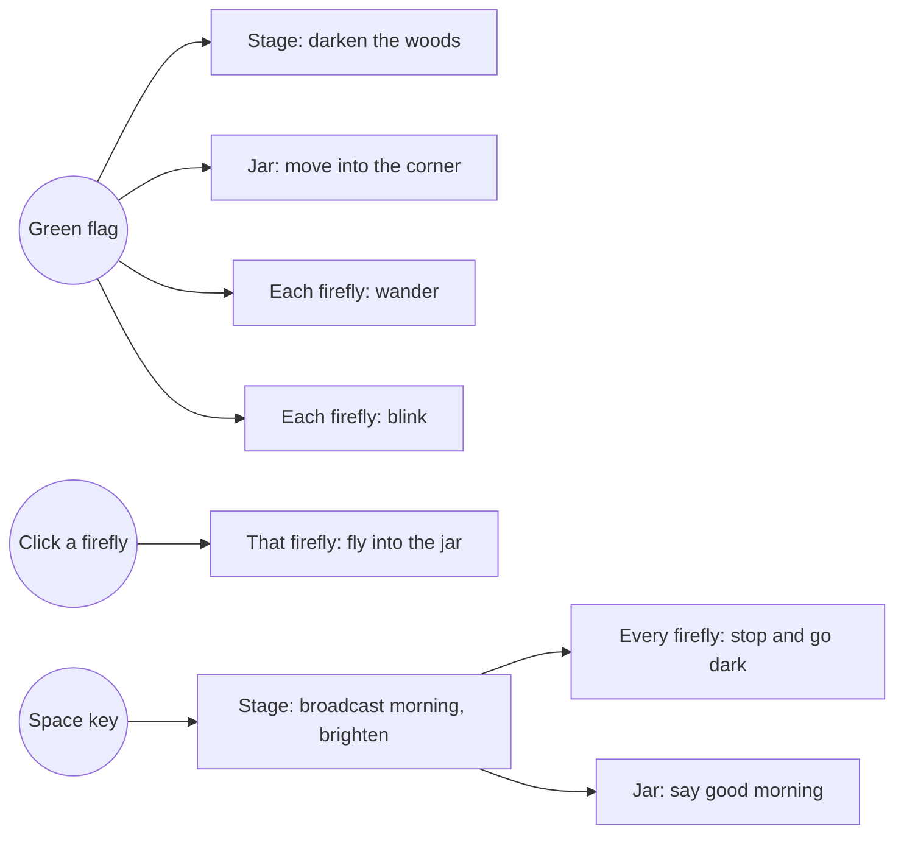

:::objectives
- Paint a sprite with two costumes and name them so scripts can use them.
- Keep moving sprites inside a region of the stage by choosing coordinate ranges.
- Run two scripts in one sprite at the same time, and stop them on purpose.
- Use four different events: green flag, sprite click, key press, and a broadcast message.
:::

It's night in the woods. Five fireflies drift between the trees, blinking on and off at their own pace. Click one and it zips into a glass jar in the corner and stays there, glowing. When you've caught enough, press the space bar: the woods brighten into morning and every firefly goes dark.

There's no score and no way to lose yet. This is a scene, not a game, but it uses every idea from the Notes: coordinates, costumes, layers, and scripts that start on events and run side by side.

## What we're building

Each sprite has a few short scripts, and each script waits for one event:



And here's where everything lives on the stage:

```text
 y = 180   +--------------------------------------------+
           |                                            |
 y = 160   |  - - - - - - - - - - - - - - - - - - - - - |
           |   fireflies wander here:                   |
           |   x from -220 to 220, y from -40 to 160    |
 y = -40   |  - - - - - - - - - - - - - - - - - - - - - |
           |                                  +------+  |
           |            ground                | jar  |  |  jar center: (180, -130)
 y = -180  +----------------------------------+------+--+
         x = -240                                    x = 240
```

## Step 1: Make the woods dark

1.  Start a new project. Right-click the cat in the sprite pane and choose **delete**.
2.  Click **Choose a Backdrop** (bottom right) and pick **Woods**.
3.  Click the **Stage** panel on the far right so the code area shows the Stage's scripts, and build:

```scratch
when green flag clicked
switch backdrop to (Woods v)
set [brightness v] effect to (-70)
```

Click the green flag and the woods go dark. The brightness effect runs from −100 (black) to 100 (white), and −70 still leaves the trees faintly visible. Effects on the Stage only change the backdrop; sprites keep their own colors, which is exactly what lets a firefly glow against the dark.

## Step 2: Paint a firefly with two costumes

1.  Hover over **Choose a Sprite** and click the paintbrush (**Paint**).
2.  In the paint editor, pick the **Circle** tool. Set **Fill** to bright yellow and **Outline** to none (the crossed-out swatch).
3.  Hold Shift and drag a small circle, about the width of your fingertip on the screen, in the middle of the canvas. The middle of the canvas is the costume center, so drawing there keeps the firefly's x and y right on its body.
4.  In the **Costume** name box above the canvas, type `glow`.
5.  Right-click the costume thumbnail on the left and choose **duplicate**. Select the new costume, click the circle with the **Select** tool (the arrow), and change its fill to a dark olive green. Name this costume `dim`.
6.  In the sprite pane, rename the sprite `Firefly`.

:::video 9C_wblf4FIE
The Scratch Team builds a sprite in the paint editor from scratch. Watch how they pick fill and outline colors and how they name the costume, then do the same for your firefly.
:::

## Step 3: Let it wander through the sky band

Select the Firefly and build its first script:

```scratch
when green flag clicked
switch costume to (glow v)
go to x: (pick random (-220) to (220)) y: (pick random (-40) to (160))
forever
glide (pick random (1) to (3)) secs to x: (pick random (-220) to (220)) y: (pick random (-40) to (160))
end
```

The `pick random` block is in Operators. Click the green flag and watch for a minute.

Every number here is a decision about the stage. x from −220 to 220 keeps the firefly a little away from the side edges. y from −40 to 160 keeps it above the ground and below the top edge. If you used `glide (1) secs to (random position v)` instead, the firefly would wander into the dirt and the jar. Picking the ranges yourself is how you keep a sprite in its part of the scene.

The glide time is random too, from 1 to 3 seconds. That small change makes the movement look alive instead of mechanical.

## Step 4: Blink with a second script

Add a second script to the same sprite:

```scratch
when green flag clicked
forever
switch costume to (glow v)
wait (pick random (0.5) to (2)) seconds
switch costume to (dim v)
wait (0.3) seconds
end
```

Now the firefly wanders and blinks at the same time, because both scripts start on the green flag and run side by side. Notice the `0.5` in `pick random`: when either number has a decimal point, Scratch picks decimals like 1.37 instead of whole numbers. That's what makes each pause slightly different.

## Step 5: Catch it with a click

Here's a tempting first try. Build it and click the firefly:

```scratch
when this sprite clicked
glide (0.6) secs to x: (180) y: (-130)
```

The firefly starts toward the corner, then gets yanked back into the sky. The wander script is still running, and its glide wins on the very next frame. This is the "two scripts fighting over one sprite" bug from the Notes, live.

The fix is to stop the other scripts first. Replace the script with this one:

```scratch
when this sprite clicked
stop [other scripts in sprite v]
switch costume to (glow v)
start sound (Fairydust v)
glide (0.6) secs to x: (pick random (165) to (195)) y: (pick random (-150) to (-115))
```

`stop [other scripts in sprite v]` (in Control; pick the option from the dropdown on `stop all`) halts the wander and blink scripts for this firefly only. Then it lights up, plays a sound, and glides into the jar. Add the **Fairydust** sound first: open the **Sounds** tab, click **Choose a Sound**, and search for it.

The landing spot is random within a small box, so caught fireflies don't all stack on the same pixel.

## Step 6: Put the jar in the corner

Click **Choose a Sprite** and add **Jar**. Give it this script:

```scratch
when green flag clicked
go to x: (180) y: (-130)
set size to (200) %
go to [back v] layer
say []
```

`go to [back v] layer` puts the jar behind every other sprite, so caught fireflies glow in front of the glass instead of disappearing behind it. `say []` with an empty box clears any speech bubble left from the last run.

## Step 7: Fill the woods with five fireflies

Right-click **Firefly** in the sprite pane and choose **duplicate**. Do it four times. Each copy, named Firefly2 to Firefly5, gets its own costumes and all three scripts. Click the green flag: five fireflies, each starting in a different random spot and blinking out of step with the others.

:::note
Duplicating is the last thing you do, on purpose. If you find a bug now, you have to fix it in five sprites. Module 6 shows a better way, where one sprite makes copies of itself and every copy shares one set of scripts.
:::

## Step 8: Bring on the morning

Click the Stage and add a script that sends a message:

```scratch
when [space v] key pressed
broadcast (morning v)
repeat (10)
change [brightness v] effect by (7)
wait (0.1) seconds
end
```

To create the `morning` message, open the dropdown on `broadcast`, choose **New message**, and type `morning`. The loop raises brightness from −70 to 0 in ten small steps, so the sunrise takes one second instead of snapping.

Now every firefly needs to hear it. Add this script to **each** of the five fireflies (drag it onto the other sprites in the sprite pane to copy it):

```scratch
when I receive [morning v]
stop [other scripts in sprite v]
switch costume to (dim v)
```

And to the Jar:

```scratch
when I receive [morning v]
say [Good morning! Click the green flag for another night.]
```

One space bar press, one message, seven sprites reacting at once. That's what broadcasting is for.

## The finished project

| Sprite | Scripts |
| --- | --- |
| Stage | Green flag: Woods backdrop, brightness −70. Space key: broadcast `morning`, brighten in 10 steps. |
| Firefly (×5) | Green flag: wander. Green flag: blink. Click: stop others, glow, sound, glide into the jar. `morning`: stop others, go dim. |
| Jar | Green flag: corner, size 200%, back layer, clear bubble. `morning`: say good morning. |

Test it like a player would:

1.  Click the green flag twice in a row. Everything resets both times: dark woods, an empty jar, no speech bubble.
2.  Catch one firefly, then click it again in the jar. It shuffles to a new spot inside the jar and stays there.
3.  Press space with two fireflies caught. All five go dark, the jar talks, and nothing keeps moving.
4.  Press space twice. The woods get brighter than normal the second time. (See the first idea below.)

:::quiz
Q: Why does the click script start with `stop [other scripts in sprite v]`?
- [ ] To stop every firefly from moving
  It only affects the sprite it's in; the other fireflies keep wandering.
- [x] So this firefly's wander script stops pulling it back into the sky
  Without it, the wander glide overrides the glide to the jar every frame.
- [ ] Because a sprite can only run one script at a time
  Sprites run many scripts at once; that's exactly why this one has to stop the others.

Q: You change the wander script's y range to `pick random (-180) to (180)`. What happens?
- [x] Fireflies sometimes drift down into the ground and the jar
  −180 is the bottom edge, so the band no longer stops above the ground.
- [ ] Nothing, because Scratch keeps sprites in the sky automatically
  Scratch only keeps sprites on the stage; where on the stage is up to your numbers.
- [ ] The project shows an error
  Any number is allowed, so it runs and the fireflies just wander lower.

Q: Why put the jar on the back layer instead of the front?
- [ ] So the jar doesn't move
  Layers change what's drawn on top, not where a sprite is.
- [x] So caught fireflies are drawn in front of it and stay visible
  Sprites on higher layers cover lower ones, so the jar has to sit underneath.
- [ ] Because the jar would hide the backdrop otherwise
  Sprites are always in front of the backdrop, whatever their layer.
:::

:::takeaways
- Choose `pick random` ranges for x and y to keep a moving sprite in its own region of the stage.
- Two scripts in one sprite run at the same time; `stop [other scripts in sprite v]` ends the ones you don't want.
- Name costumes and switch by name, so your scripts still work if you reorder the costume list.
- A broadcast lets one event, like a key press, start scripts in many sprites at once.
:::

## Ideas to extend it

-   **Morning only once.** Pressing space twice over-brightens the woods. Start the space script with `set [brightness v] effect to (-70)` so the sunrise always starts from night.
-   **Crickets.** Add the **Crickets** sound to the Stage and play it with `forever` and `play sound (Crickets v) until done` in its own green flag script.
-   **Shy fireflies.** Make a firefly glide away if the mouse gets close. You'll need `distance to (mouse-pointer v)` from Sensing and an `if` block, which Module 3 covers.
-   **Count the catch.** Module 3 adds variables, so the jar can say how many fireflies you caught.

## Further reading

-   [Paint Editor on the Scratch Wiki](https://en.scratch-wiki.info/wiki/Paint_Editor): every tool in the editor, vector and bitmap modes, and keyboard shortcuts.
-   [Stop () on the Scratch Wiki](https://en.scratch-wiki.info/wiki/Stop_()_(block)): the difference between `all`, `this script`, and `other scripts in sprite`.
-   [Glide () Secs to X: () Y: () on the Scratch Wiki](https://en.scratch-wiki.info/wiki/Glide_()_Secs_to_X:_()_Y:_()_(block)): how glide works, including why the script waits for it.
