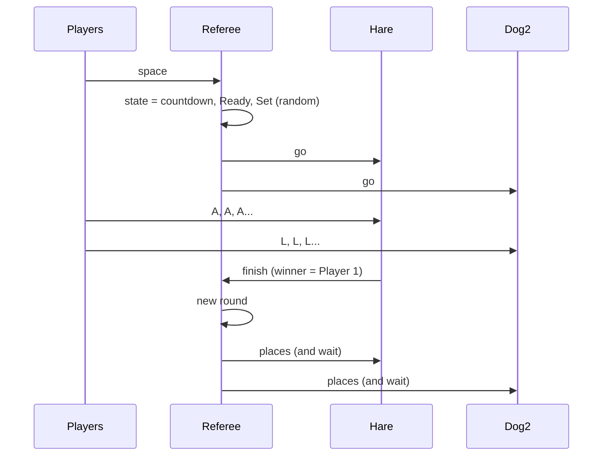

:::objectives
- Use `broadcast and wait` so a countdown can't begin until every racer is in place.
- Track the game's mode in a `state` variable and check it before every action.
- Count a key *press* rather than a key being *held*, using `wait until`.
- Guarantee exactly one winner per round, even in a photo finish.
- Keep a first-to-three score across rounds.
:::

Two players share one keyboard. Player 1 is a hare and mashes **A**; Player 2 is a dog and mashes **L**. A referee says "Ready... Set..." and blows a whistle, and both racers sprint across the field, one hop per key press. First to the finish line wins the round, and the first player to win three rounds wins the match.

Getting the *fairness* right is the real project. Nobody may move before the whistle. Holding a key down must not count as mashing it. If both racers hit the line in the same instant, only one of them can be crowned. Each of those rules is a few blocks of variables, conditions, and broadcasts.

## What we're building

The whole game moves through five states. The `state` variable always holds the current one, and broadcasts announce each change:

```mermaid caption="The race's states, and the event that moves it to the next one"
stateDiagram-v2
    [*] --> placing: green flag or new round
    placing --> waiting: both racers at the start line
    waiting --> countdown: space pressed
    countdown --> racing: whistle
    racing --> finished: a racer touches the finish
    finished --> placing: nobody has 3 wins yet
    finished --> matchOver: someone has 3 wins
    matchOver --> [*]
```

## Step 1: Set up the track

1.  Start a new project and delete the cat. Choose the **Playing Field** backdrop.
2.  Add three library sprites: **Referee**, **Hare**, and **Dog2**.
3.  Add the **Line** sprite and rename it `Finish`.
4.  In Variables, make four variables, all **For all sprites**: `state`, `winner`, `wins 1`, and `wins 2`. Untick `state` and `winner` so their monitors hide; keep `wins 1` and `wins 2` showing. Right-click each wins monitor and pick **large readout**.

The Line sprite is a long horizontal stroke. Turned to direction 0, it stands up and becomes a finish line across both lanes:

```scratch
when green flag clicked
go to x: (200) y: (0)
point in direction (0)
```

That's the Finish sprite's only script.

## Step 2: Take your places

The referee resets the match and starts the first round. Give the **Referee** these two scripts:

```scratch
when green flag clicked
set [wins 1 v] to (0)
set [wins 2 v] to (0)
set size to (70) %
go to x: (-170) y: (120)
broadcast (new round v)

when I receive [new round v]
set [state v] to [placing]
set [winner v] to []
broadcast (places v) and wait
set [state v] to [waiting]
say [Press space to start the race]
```

Each racer answers `places` by walking back to its lane. **Hare**:

```scratch
when I receive [places v]
set size to (70) %
point in direction (90)
switch costume to (hare-a v)
glide (1) secs to x: (-200) y: (40)
```

**Dog2** gets the same script with `dog2-a` and `y: (-90)`.

Click the green flag. Both racers glide to the start line, and only *then* does the referee say "Press space". That ordering is the whole point of `broadcast and wait`: the referee is held until both `places` scripts finish. With a plain `broadcast`, it would set the state to `waiting` immediately, and an eager player could start a countdown while the racers were still walking back.

## Step 3: A countdown nobody can time

Add this script to the Referee. Make the `go` message from the `broadcast` dropdown as before.

```scratch
when [space v] key pressed
if <(state) = [waiting]> then
set [state v] to [countdown]
say [Ready...] for (1) seconds
say [Set...] for (pick random (1) to (2.5)) seconds
set [state v] to [racing]
broadcast (go v)
start sound (referee whistle v)
say [GO!] for (1) seconds
end
```

Three decisions are hiding in here:

-   The `if` means space only works while the game is `waiting`. Pressing it mid-race does nothing.
-   "Set..." lasts a random time between 1 and 2.5 seconds. If it were always the same, players would learn the rhythm and press on the beat instead of reacting to the whistle.
-   `state` becomes `racing` *before* the `go` broadcast, so anything that starts on `go` can already trust the state.



## Step 4: Run, but only when the key is tapped

Here's the obvious way to make the hare run. Try it on the **Hare**:

```scratch
when [a v] key pressed
if <(state) = [racing]> then
change x by (12)
end
```

Start a race and *hold* A instead of tapping it. After a short pause the hare zooms off by itself. Your keyboard repeats a held key, the same way holding a letter in a text box types it over and over, and each repeat fires the hat block again. Holding beats mashing, so that version is a cheat.

Delete that script. This one counts a press only after the key has been let go:

```scratch
when I receive [go v]
repeat until <touching (Finish v)?>
wait until <key (a v) pressed?>
change x by (12)
next costume
wait until <not <key (a v) pressed?>>
end
```

Read the loop as a story: wait for A to go down, hop 12 steps and switch legs, wait for A to come back up, and repeat until the finish line. Holding A now gives exactly one hop. From x = −200 to the line takes about 30 taps.

Give **Dog2** the same script with the **l** key.

## Step 5: Exactly one winner

When the loop ends, the racer has touched the finish. Add these blocks to the bottom of the Hare's `go` script, after the `repeat until` loop:

```scratch
if <(state) = [racing]> then
set [state v] to [finished]
set [winner v] to [Player 1]
change [wins 1 v] by (1)
broadcast (finish v)
end
```

Why check the state? Picture a photo finish: both racers touch the line in the same frame. Scratch still runs the two scripts one after the other. The first one sees `racing`, claims the win, and changes the state to `finished`. The second sees `finished` and skips the `if`. Without that check, both players would score.

Both racers also need to react to the result. Add this to the Hare:

```scratch
when I receive [finish v]
stop [other scripts in sprite v]
if <(winner) = [Player 1]> then
say [Yes!] for (2) seconds
else
say [So close...] for (2) seconds
end
```

`stop [other scripts in sprite v]` ends the loser's running loop, which would otherwise keep waiting for key presses. Dog2's versions use `Player 2` and `wins 2`.

## Step 6: Punish false starts

Mashing during "Ready... Set..." should cost you. Add this to the Hare (and with **l** to Dog2):

```scratch
when [a v] key pressed
if <(state) = [countdown]> then
change x by (-40)
say [False start!] for (1) seconds
end
```

The same key now means three different things depending on the state: a penalty during `countdown`, nothing at all here during `racing` (the `go` script handles running), and nothing while `waiting`.

## Step 7: First to three

The referee announces each result and decides whether to start another round:

```scratch
when I receive [finish v]
say (join (winner) [ wins the round!]) for (2) seconds
if <<(wins 1) = (3)> or <(wins 2) = (3)>> then
set [state v] to [match over]
say (join (winner) [ wins the match! Click the green flag for a rematch.])
else
broadcast (new round v)
end
```

`new round` sends everyone back through `places`, so the next round always starts from a clean line.

## The finished game

| Sprite | Scripts |
| --- | --- |
| Referee | Green flag: reset wins, go to corner, broadcast `new round`. `new round`: placing, `places` and wait, waiting. Space: countdown with random "Set", racing, `go`, whistle. `finish`: announce, then match over or `new round`. |
| Hare | `places`: walk to (−200, 40). `go`: tap loop with A, then claim the win if still racing. `finish`: stop others, cheer or sulk. A key: false-start penalty during countdown. |
| Dog2 | Same as the Hare with the L key, y = −90, `Player 2`, and `wins 2`. |
| Finish | Green flag: stand up at x = 200. |

Playtest with a friend, and also try to break it:

1.  Hold A for the whole race. The hare hops once.
2.  Tap A during "Set...". The hare jumps back 40 and says "False start!".
3.  Press space during a race. Nothing happens.
4.  Win three rounds. The referee announces the match and stops starting new rounds.

:::quiz
Q: The referee uses `broadcast (places v) and wait` before setting the state to `waiting`. What goes wrong if it uses plain `broadcast (places v)`?
- [ ] The racers never move
  A plain broadcast still starts their `places` scripts.
- [x] The state becomes `waiting` immediately, so space could start a countdown while the racers are still walking back
  Without the wait, the referee doesn't hold for the glides to finish before accepting the start.
- [ ] Scratch shows an error for the missing wait
  Both blocks are valid; the bug is about timing, not an error message.

Q: Why does "Set..." last a random time?
- [ ] To make the game run faster
  It actually makes the countdown longer on average.
- [ ] Because `say for () seconds` needs a random number
  Any number works there.
- [x] So players have to react to the whistle instead of memorizing the rhythm
  A fixed countdown can be timed; a random one can't.

Q: Both racers touch the finish line in the same frame. Who scores?
- [ ] Both players
  That's what would happen without the `if <(state) = [racing]>` check.
- [x] Only the one whose script runs first in that frame
  It changes the state to `finished`, so the second script's `if` fails.
- [ ] Neither, because the scripts cancel each other out
  One script always runs first and claims the win.
:::

:::video 0ZHalwPO1og
A walkthrough of broadcasts used to time a conversation between sprites instead of `wait` blocks. Watch for the advantages the presenter gives for broadcasts over matched waits, and compare them with the fair start our referee needs.
:::

:::takeaways
- `broadcast and wait` is how you say "don't continue until everyone is ready."
- A `state` variable lets one key mean different things in different modes, and lets you ignore input when it shouldn't count.
- `wait until` key pressed, then `wait until` *not* pressed, counts taps and ignores held keys.
- Checking and changing the state in the same script prevents two winners in a tie.
- Reset match-long variables on the green flag and round-long ones at the start of each round.
:::

## Ideas to extend it

-   **Reaction time.** Add `reset timer` right after the whistle, and when a racer makes its first hop, say the `timer` value. Who reacts faster?
-   **A computer opponent.** Replace Dog2's key loop with `repeat until <touching (Finish v)?>`, `change x by (12)`, `wait (pick random (0.12) to (0.2)) seconds`. Tune the wait for easy, medium, and hard.
-   **Four players.** Add two more racers with their own keys and lanes. What has to change in the referee's scripts?
-   **A crowd.** Play **Cheer** when someone wins the match.

## Further reading

-   [Wait Until () on the Scratch Wiki](https://en.scratch-wiki.info/wiki/Wait_Until_()_(block)): how the block checks its condition, with examples like ours.
-   [Key () Pressed? on the Scratch Wiki](https://en.scratch-wiki.info/wiki/Key_()_Pressed%3F_(block)): which keys the sensing block can detect, with example scripts.
-   [Timer on the Scratch Wiki](https://en.scratch-wiki.info/wiki/Timer): what you need for the reaction-time idea.
