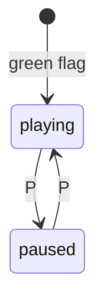
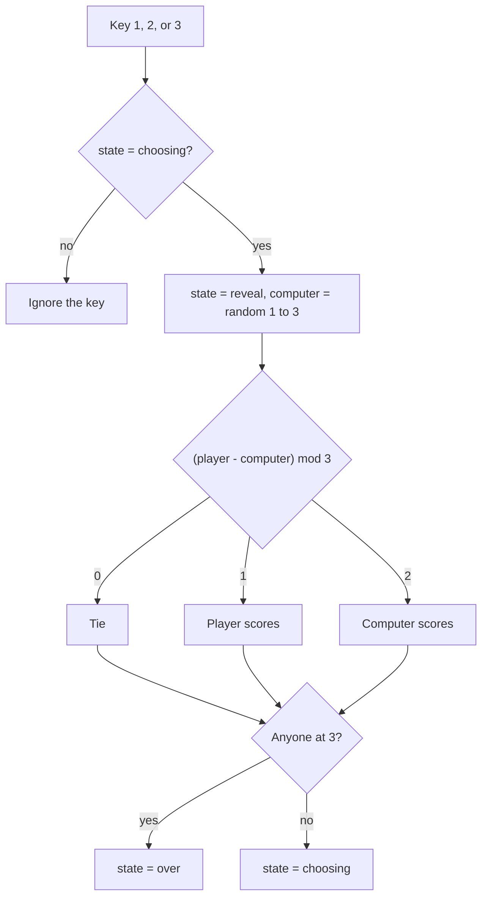

:::objectives
- Predict when scripts run after `broadcast` and `broadcast and wait`.
- Choose between variables for all sprites and for one sprite.
- Use `if`/`else`, comparisons, and `wait until` to apply scoring rules.
- Use a state variable to turn input on and off.
- Find and fix a broadcast that never returns.
:::

Start each exercise in a new project unless it says otherwise. Every variable is **For all sprites** unless the exercise says differently.

## Warm-up: when does each bubble appear?

The Stage, Sprite1, and Sprite2 have these scripts. Press the green flag. At what time, in seconds, does each word appear?

```scratch
when green flag clicked
broadcast (a v) and wait
broadcast (b v)

when I receive [a v]
say [one] for (1) seconds

when I receive [a v]
wait (2) seconds
say [two] for (1) seconds

when I receive [b v]
say [three]
```

The first script is on the Stage. The `a` receivers belong to Sprite1 and Sprite2, and the `b` receiver to Sprite1.

:::solution
"one" appears at **0 seconds**, "two" at **2 seconds**, and "three" at **3 seconds**.

Both `a` receivers start together. `broadcast and wait` holds the Stage until the *slowest* receiver is done, and Sprite2's takes 2 + 1 = 3 seconds. Only then is `b` sent.
:::

### Exercise 1: Start the show when the curtain is gone

A painted red Curtain sprite covers the stage and fades away; then a Singer sings. Right now the timing is a guess:

```scratch
when green flag clicked
show
set [ghost v] effect to (0)
wait (1) seconds
repeat (20)
change [ghost v] effect by (5)
end
hide

when green flag clicked
wait (3) seconds
say [La la la!] for (2) seconds
```

The first script is the Curtain's, the second the Singer's. Rewrite them so the Stage runs the show, and the Singer starts the instant the Curtain hides, even if you later make the fade twice as slow.

:::hint
The Stage needs two messages, one for each part of the show. Which broadcast block makes the Stage wait for the curtain before sending the second message?
:::

:::solution
Stage:

```scratch
when green flag clicked
broadcast (open curtain v) and wait
broadcast (sing v)
```

Curtain:

```scratch
when I receive [open curtain v]
show
set [ghost v] effect to (0)
wait (1) seconds
repeat (20)
change [ghost v] effect by (5)
wait (0.05) seconds
end
hide
```

Singer:

```scratch
when I receive [sing v]
say [La la la!] for (2) seconds
```

The Singer has no timer at all now. Change the curtain's loop to `repeat (40)` with `change [ghost v] effect by (2.5)` and the song still starts exactly when the curtain disappears.
:::

### Exercise 2: Gifts worth different amounts

Add the **Gift** sprite, which has two costumes, `gift-a` and `gift-b`. Make a `score` variable. Clicking the gift adds 1 point for `gift-a` and 5 points for `gift-b`. After each click the gift jumps to a random spot and picks a new costume, with `gift-b` showing up about one time in four.

```text
click gift-a  ->  score 1
click gift-a  ->  score 2
click gift-b  ->  score 7
```

:::hint
`(costume [name v])` in Looks reports the current costume's name, which you can compare in an `if`/`else`. For "one in four," pick a random number from 1 to 4 and check whether it equals 4.
:::

:::solution
```scratch
when green flag clicked
set [score v] to (0)
switch costume to (gift-a v)
go to (random position v)

when this sprite clicked
if <(costume [name v]) = [gift-b]> then
change [score v] by (5)
else
change [score v] by (1)
end
go to (random position v)
if <(pick random (1) to (4)) = (4)> then
switch costume to (gift-b v)
else
switch costume to (gift-a v)
end
```

The score rule reads the costume, so the rare costume is the valuable one. Notice the order: score first, *then* move and change costume. Swap them and you'd score the new costume instead of the one you clicked.
:::

### Exercise 3: Three ghosts, three health bars

Add a **Ghost** sprite. Clicking it takes away 1 health and makes it say what's left. At 0 it disappears. Make three ghosts, each with its own health of 3, and when all three are gone the Stage says... well, the Stage can't talk, so switch to a second backdrop you've painted with the words "You win!".

```text
click Ghost:   says 2
click Ghost:   says 1
click Ghost:   vanishes          ghosts left 2
...
last ghost vanishes              backdrop: You win!
```

:::hint
Make `health` **For this sprite only** before you duplicate the ghost; each copy then gets its own. Make `ghosts left` for all sprites, so every ghost can lower it and the Stage can watch it with `wait until`.
:::

:::solution
Ghost (then duplicate it twice; drag the copies apart):

```scratch
when green flag clicked
set [health v] to (3)
show

when this sprite clicked
change [health v] by (-1)
if <(health) > (0)> then
say (health) for (0.5) seconds
else
hide
change [ghosts left v] by (-1)
end
```

Stage:

```scratch
when green flag clicked
set [ghosts left v] to (3)
switch backdrop to (backdrop1 v)
wait until <(ghosts left) = (0)>
switch backdrop to (You win v)
```

Each ghost's `change [health v]` only touches its own copy, which is exactly what "for this sprite only" means. The shared `ghosts left` is what ties the three together. (Name your painted backdrop `You win` so the last block can find it.)
:::

### Exercise 4: A pause key

A Ball sprite bounces around the stage. Make a `state` variable. Pressing **P** pauses the ball, and pressing P again resumes it. While paused, the ball says "Paused".



:::hint
The movement loop should only move the ball when `state` is `playing`. The P key script needs `if`/`else`: if the state is `playing`, set it to `paused`, otherwise set it to `playing`.
:::

:::solution
```scratch
when green flag clicked
set [state v] to [playing]
point in direction (45)
forever
if <(state) = [playing]> then
move (6) steps
if on edge, bounce
end
end

when [p v] key pressed
if <(state) = [playing]> then
set [state v] to [paused]
say [Paused]
else
set [state v] to [playing]
say []
end
```

The loop never stops; it just skips the movement while paused. That's easier than stopping and restarting scripts, and it means *every* sprite in a bigger game can check the same `state` and freeze together.
:::

### Exercise 5: Bug hunt, the title screen that never ends

This game should show a flashing title until the player presses space, then start. Instead, pressing space hides the title and nothing else ever happens.

```scratch
when green flag clicked
broadcast (title v) and wait
broadcast (play v)

when I receive [title v]
show
forever
change [color v] effect by (5)
end

when [space v] key pressed
hide
```

The first script is the Stage's; the other two belong to the Title sprite. Find the bug and fix it without adding any new messages.

:::hint
When does a `broadcast and wait` let the Stage continue? Does the `title` script ever reach its end?
:::

:::solution
The `title` receiver has a `forever` loop, so it never finishes, and the Stage waits for it forever. Hiding the sprite doesn't end the loop. Replace the loop with one that ends when space is pressed, and delete the separate space script:

```scratch
when I receive [title v]
show
repeat until <key (space v) pressed?>
change [color v] effect by (5)
end
hide
```

Now the receiver finishes the moment space is pressed, `broadcast and wait` returns, and the Stage sends `play`.
:::

### Exercise 6: A combo meter

Add a Button2 sprite as a target. Each click scores `combo` points, and `combo` grows by 1 if this click came less than 1 second after the last one. A slower click resets `combo` to 1. The target jumps somewhere new after each click.

```text
quick, quick, quick clicks:   +1, +2, +3   (score 6)
then a slow click:            +1           (score 7)
```

:::hint
The `timer` in Sensing counts seconds. If you `reset timer` on every click, then at the *next* click, `timer` is the time since the previous one.
:::

:::solution
```scratch
when green flag clicked
set [score v] to (0)
set [combo v] to (0)

when this sprite clicked
if <(timer) < (1)> then
change [combo v] by (1)
else
set [combo v] to (1)
end
reset timer
change [score v] by (combo)
go to x: (pick random (-200) to (200)) y: (pick random (-140) to (140))
```

The order matters again: check the timer *before* resetting it. Reset first and `timer` is always about 0, so every click looks quick.
:::

### Challenge: Rock, paper, scissors, first to three

Play against the computer. Press **1** for rock, **2** for paper, **3** for scissors. The computer picks at random, both choices are revealed, the round's winner gets a point, and the first to 3 points wins the match. Keys must do nothing while a round is being revealed or after the match ends.

Number the moves 1 = rock, 2 = paper, 3 = scissors, and there's a neat shortcut for deciding who won: work out `((player) - (computer)) mod (3)`. A 0 is a tie, a 1 means the player won, and a 2 means the computer won. Try paper against rock: 2 − 1 = 1, so paper wins.



:::hint
Put all three keys through one broadcast: each key script sets `player` to 1, 2, or 3 and broadcasts `chosen`, but only if `state` is `choosing`. Then one `when I receive [chosen v]` script does the rest. `mod` is in Operators.
:::

:::solution
Stage (variables: `state`, `player`, `computer`, `result`, `you`, `cpu`):

```scratch
when green flag clicked
set [you v] to (0)
set [cpu v] to (0)
set [state v] to [choosing]

when [1 v] key pressed
if <(state) = [choosing]> then
set [player v] to (1)
broadcast (chosen v)
end

when I receive [chosen v]
set [state v] to [reveal]
set [computer v] to (pick random (1) to (3))
set [result v] to (((player) - (computer)) mod (3))
if <(result) = (1)> then
change [you v] by (1)
end
if <(result) = (2)> then
change [cpu v] by (1)
end
wait (1.5) seconds
if <<(you) = (3)> or <(cpu) = (3)>> then
set [state v] to [over]
else
set [state v] to [choosing]
end
```

Copy the key script for **2** and **3**. When the subtraction is negative, like rock against scissors (1 − 3 = −2), Scratch's `mod` still gives a number from 0 to 2: −2 mod 3 is 1, so rock wins, as it should. A Hand sprite can show the choices by switching to costumes named rock, paper, and scissors when it receives `chosen`, and the 1.5-second wait gives players time to see them before the next round.
:::
