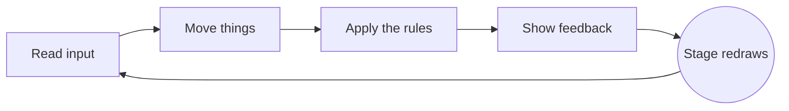

:::objectives
- Convert between steps per frame and steps per second, and explain what happens on each pass of a game loop.
- Make a sprite ease toward a target, and tune how snappy or floaty it feels.
- Animate a sprite at a sensible speed, only while it's moving.
- Use `start sound` and `play sound until done` in the right places.
- Use graphic effects and size changes as feedback, and reset them properly.
- Write scoring and edge rules that are fair and that players can see.
:::

Picture two catch games with exactly the same rules. In the first, the catcher snaps to the mouse, the falling object just vanishes when caught, and the score ticks up in silence. In the second, the catcher swings smoothly after the mouse, its claws snap as it moves, a catch makes it bounce with a rising chime and a sparkle, and getting stung flashes it white. Players will tell you the second one is *more fun*, but it doesn't have a single extra rule. It has maybe fifteen extra blocks of feedback.

Game designers call that feedback **juice**. This lesson covers the pieces: frames, easing, animation, sound, and effects. Then it covers the part juice can't fix, which is rules that feel unfair.

## Scratch thinks in frames

Scratch redraws the stage about **30 times a second**. Each redraw is a **frame**. When a loop moves or changes a sprite, Scratch runs one pass of that loop, redraws, and then runs the next pass. So the numbers in a game loop are *per frame*:

```scratch
when green flag clicked
go to x: (-200) y: (0)
forever
change x by (4)
end
```

4 steps per frame × 30 frames per second = 120 steps per second. Crossing the 480-step-wide stage takes about 4 seconds. When a speed feels wrong, do this arithmetic first.

Almost every game repeats the same four jobs on every pass of its main loop:



For time that has to be measured in real seconds, like a countdown, use `wait` blocks or the `timer` in Sensing, not a count of frames. A slow computer can drop frames, but the timer keeps counting real seconds.

## Easing: move part of the way, every frame

There are three ways to make a sprite follow the mouse, and they feel completely different.

-   `go to (mouse-pointer v)` in a forever loop jumps there instantly. It feels stiff, like a cursor, not a character.
-   `glide (0.5) secs to (mouse-pointer v)` heads for where the mouse *was*, and its script can't do anything else until the glide ends. It feels laggy.
-   **Easing** moves a fraction of the remaining distance every frame:

```scratch
when green flag clicked
forever
change x by (((mouse x) - (x position)) / (5))
end
```

`(mouse x) - (x position)` is the gap between where the sprite is and where it wants to be. Dividing by 5 moves it one fifth of that gap each frame. When the gap is 200, it moves 40. Next frame the gap is 160, so it moves 32. As it gets close, the steps shrink, so the sprite glides fast and then settles gently.

```mermaid caption="Moving from x = 0 to x = 200. Curved line: easing with the gap divided by 5. Straight line: a steady 10 steps per frame."
xychart-beta
    title "x position, frame by frame"
    x-axis "Frame" [0, 1, 2, 3, 4, 5, 6, 7, 8, 9, 10, 11, 12, 13, 14, 15, 16, 17, 18, 19, 20]
    y-axis "x position" 0 --> 200
    line [0, 40, 72, 98, 118, 134, 148, 158, 166, 173, 179, 183, 186, 189, 191, 193, 194, 195, 196, 197, 198]
    line [0, 10, 20, 30, 40, 50, 60, 70, 80, 90, 100, 110, 120, 130, 140, 150, 160, 170, 180, 190, 200]
```

The divisor is a feel knob. Divide by 2 and the sprite is snappy, covering half the gap each frame. Divide by 15 and it floats, like something underwater. Easing works on anything with a target: a camera, a health bar sliding to its new value, a menu sliding in.

## Animation at the right speed

Switching costumes is animation, and speed is everything. Flip a costume every frame (30 times a second) and legs blur; flip once a second and it looks like a slideshow. About 6 to 12 changes a second looks like walking or flapping.

Put the animation in its own script, with its own `wait`, so it never slows down the movement loop. And animate only when there's something to animate:

```scratch
when green flag clicked
forever
if <([abs v] of (speed)) > (1)> then
next costume
end
wait (0.12) seconds
end
```

Here `speed` is a variable the movement script sets each frame, and `abs` (in the `of` block in Operators) drops the minus sign, so moving left counts too. Standing still, the costume holds. Moving, it changes about 8 times a second.

## Sound: start it, don't wait for it

Two Sound blocks look almost the same and behave very differently:

-   `start sound (pop v)` starts the sound and moves on immediately.
-   `play sound (pop v) until done` starts the sound and **waits** for it to finish.

Inside a game loop, waiting is a disaster. A 0.6-second sound with `until done` freezes that loop for 0.6 seconds, about 18 frames with no movement and no collision checks. Use `start sound` for effects.

`play sound until done` is right for music, in a script of its own:

```scratch
when green flag clicked
forever
play sound (Chill v) until done
end
```

Here waiting is the point: the loop starts the music again only when it ends. Sound effects can also carry information. `change [pitch v] effect by (20)` raises every later sound from that sprite, so a chime that climbs with each catch tells the player their streak is growing without a single word. `clear sound effects` puts the pitch back.

:::video 7f9_vjl9yC8
The Scratch Team on sounds: adding them from the library, recording your own, and text to speech. Watch how a sound is added to a sprite before any block can play it, since that's the step people skip.
:::

## Graphic effects are feedback

Looks blocks can change how a sprite is drawn without changing its costume:

| Effect | Range | Good for |
| --- | --- | --- |
| `ghost` | 0 (solid) to 100 (invisible) | fading in and out |
| `brightness` | −100 (black) to 100 (white) | a hit flash, a night scene |
| `color` | wraps around every 200 | power-ups, rainbow cycles |
| `fisheye`, `whirl`, `pixelate`, `mosaic` | 0 and up | dizziness, teleports, glitches |
| size (`set size to () %`) | any percent | a squash or pop when something happens |

Three patterns cover most needs:

```scratch
set [brightness v] effect to (60)
wait (0.1) seconds
set [brightness v] effect to (0)

set size to (120) %
wait (0.1) seconds
set size to (100) %

repeat (10)
change [ghost v] effect by (10)
end
hide
```

The first is a flash, the second a pop, and the third a fade-out. Effects stay until something resets them, so start every sprite's game with `clear graphic effects`. Otherwise a sprite that faded out at the end of the last game starts the next one invisible.

:::warning
**A ghosted sprite still collides.** A sprite with the ghost effect at 100 is invisible, but `touching` still sees it. If an enemy fades out and keeps hurting the player, that's why. Use `hide` to take a sprite out of play; hidden sprites never count as touching.
:::

## Fair rules: scores, misses, and edges

Juice can't save a game whose rules feel like cheating. A few rules of thumb:

1.  **Only spawn what can be caught or dodged.** If the catcher can reach x from −200 to 200, drop things in that range, not at x = 235.
2.  **Count once.** When something is caught, change the score and move or hide the object in the same pass of the loop, so it can't be counted again on the next frame.
3.  **Decide what each edge means.** For a falling object, the bottom edge is a miss. For something drifting sideways, the side edges might wrap it around to the other side. For a ball, they bounce it. Pick the rule on purpose for each sprite.
4.  **Show every rule.** If missing costs a life, play a sound and flash something. Players accept a hard rule they can see; they hate one they can't.

For a wrap, check a little *inside* the edge:

```scratch
forever
change x by (3)
if <(x position) > (230)> then
set x to (-230)
end
end
```

Scratch won't let a sprite go fully off the stage, and for a small sprite it stops it with its center very close to 240. A check of `> (240)` might never be true. Using 230 means the wrap always fires.

:::quiz
Q: A loop runs `change x by (6)` and redraws every pass. About how far does the sprite move in 2 seconds?
- [ ] 12 steps
  That's 6 × 2, as if the loop ran once a second.
- [x] 360 steps
  6 steps per frame × 30 frames a second × 2 seconds = 360.
- [ ] 60 steps
  That's 6 × 10; Scratch runs about 30 frames a second, not 10.

Q: A sprite at x = 0 eases toward x = 100 with `change x by (((100) - (x position)) / (4))`. Where is it after one frame?
- [ ] 100
  Easing moves only part of the way each frame.
- [x] 25
  The gap is 100, and 100 ÷ 4 = 25.
- [ ] 4
  The 4 divides the gap; it isn't a step size.

Q: Every time the player grabs a coin, the whole game stutters for half a second. Which block is the likely cause?
- [x] `play sound (coin v) until done` inside the main loop
  The loop waits for the sound to finish, so nothing moves until it does.
- [ ] `start sound (coin v)` inside the main loop
  That one doesn't wait, so the loop keeps going.
- [ ] `change [score v] by (1)`
  Changing a variable takes no noticeable time.

Q: An enemy fades out with the ghost effect at 100, but the player still loses lives when walking through the empty spot. What's the fix?
- [ ] Set the ghost effect to 200
  The ghost effect tops out at 100, and it never affects collisions anyway.
- [x] `hide` the enemy after the fade
  Hidden sprites never count as touching, but ghosted ones do.
- [ ] Use `clear graphic effects`
  That would make the enemy visible again without fixing the collision.
:::

:::takeaways
- Game loop numbers are per frame, and Scratch runs about 30 frames a second.
- Easing (`change x by ((target − x) / n)`) moves part of the remaining gap each frame; a bigger `n` feels floatier.
- Run animations in their own script with a `wait`, and only animate while the sprite is moving.
- Use `start sound` for effects and `play sound until done` only for music in its own loop.
- Effects last until reset, so use `clear graphic effects` at the start, and `hide` (not ghost) to take a sprite out of play.
- Fair rules: spawn within reach, count once, choose each edge's meaning, and make every rule visible.
:::

## Further reading

-   [Game Loop on the Scratch Wiki](https://en.scratch-wiki.info/wiki/Game_Loop): how Scratch games organize their main loop.
-   [Graphic Effects on the Scratch Wiki](https://en.scratch-wiki.info/wiki/Graphic_Effects): every effect with pictures and its exact range.
-   [Sound Blocks on the Scratch Wiki](https://en.scratch-wiki.info/wiki/Sound_Blocks): each sound block, including pitch and pan effects.
