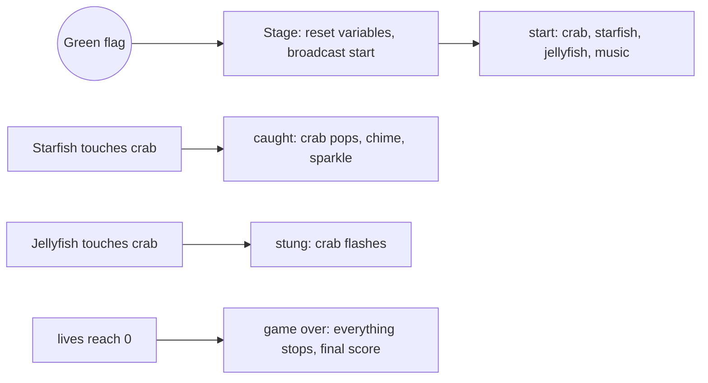

:::objectives
- Move a player with easing toward the mouse, and tune the feel with one number.
- Animate the player only while it's moving, in a separate script.
- Write catch, miss, and sting rules that are fair and that the player can see.
- Add feedback: a squash, a pitch that climbs with a streak, a sparkle, and a hit flash.
- Raise the difficulty a little with every catch, and end the game cleanly.
:::

A crab scuttles along the sea floor, following your mouse. Starfish sink from the surface, slowly spinning; catch one and the crab bounces, a chime plays, and a sparkle bursts above it. Catch several in a row and each chime is higher than the last. Every so often a jellyfish drifts down, aimed at wherever the crab is right now. Three stings and the game is over.

You'll build the rules first, then layer feedback on top. Play it after each step and notice how much the feel changes even when the rules don't.



## Step 1: Set up the reef

1.  Start a new project and delete the cat. Choose the **Underwater 1** backdrop.
2.  Add four library sprites: **Crab**, **Starfish**, **Jellyfish**, and **Star**.
3.  Make four variables **For all sprites**: `score`, `lives`, `streak`, and `sink speed`. Then select the Crab and make one variable **For this sprite only**: `speed`.
4.  Keep the `score`, `lives`, and `streak` monitors on the stage, and untick the other two.

The Stage runs the game. It resets every variable, tells the sprites to start, and watches for the end:

```scratch
when green flag clicked
switch backdrop to (Underwater 1 v)
set [score v] to (0)
set [lives v] to (3)
set [streak v] to (0)
set [sink speed v] to (2)
broadcast (start v)
wait until <(lives) < (1)>
broadcast (game over v)
```

Why do the sprites wait for `start` instead of using their own green flag scripts? Because then they're guaranteed to start *after* the reset. If the starfish and the Stage both began on the green flag, the starfish might read `sink speed` before the Stage had set it.

## Step 2: A crab that eases after the mouse

Select the Crab:

```scratch
when I receive [start v]
go to x: (0) y: (-125)
set size to (60) %
clear graphic effects
say []
forever
set [speed v] to (((mouse x) - (x position)) / (6))
change x by (speed)
end
```

Each frame, the crab covers one sixth of the gap between itself and the mouse. Move the mouse quickly and the crab hurries; as it gets close, it slows and settles. Storing the step in `speed` before using it means another script can read how fast the crab is going, which you'll need in a moment.

:::try
Change the `6` to `2`, then to `15`, and play for ten seconds each. At 2 the crab is twitchy and easy to steer; at 15 it's graceful but late. Pick the number that feels best to you. There's no right answer, only a feel you choose.
:::

## Step 3: Claws that snap only while moving

The Crab has two costumes, `crab-a` and `crab-b`. Add a second script to the Crab:

```scratch
when I receive [start v]
forever
if <([abs v] of (speed)) > (1)> then
next costume
end
wait (0.12) seconds
end
```

When the crab is nearly still, `speed` is close to 0 and the claws hold. When it moves, they snap about eight times a second. Because this script has its own `wait`, it can't slow the movement loop down.

## Step 4: Starfish that sink, spin, and score

Select the Starfish:

```scratch
when I receive [start v]
set size to (40) %
go to x: (pick random (-210) to (210)) y: (170)
show
forever
change y by ((0) - (sink speed))
turn right (3) degrees
if <touching (Crab v)?> then
change [score v] by (1)
change [streak v] by (1)
change [sink speed v] by (0.1)
broadcast (caught v)
go to x: (pick random (-210) to (210)) y: (170)
end
if <(y position) < (-170)> then
set [streak v] to (0)
go to x: (pick random (-210) to (210)) y: (170)
end
end
```

Here are the game's rules, all in one loop:

-   **Catch:** +1 score, +1 streak, the next starfish sinks a little faster, and a `caught` message goes out. The starfish jumps back to the surface *in the same pass*, so it can't be counted twice.
-   **Miss:** reaching y = −170 costs nothing but your streak. That's a gentle rule on purpose: missing should sting a bit, not end the game.
-   **Fair spawns:** x from −210 to 210 means every starfish starts fully on screen, somewhere the crab can reach.

The `turn right (3) degrees` is pure decoration. A slowly spinning starfish looks like it's drifting through water instead of falling down a chute.

The two respawn lines are identical. Module 6 shows how to turn repeated blocks like these into one block of your own.

## Step 5: Make catching feel good

The rules work. Now three pieces of feedback, each reacting to `caught`.

**A squash and a climbing chime.** On the Crab, open the **Sounds** tab and add **Collect** from the library. Then:

```scratch
when I receive [caught v]
set [pitch v] effect to ((streak) * (15))
start sound (Collect v)
set size to (70) %
wait (0.1) seconds
set size to (60) %
```

The first catch in a streak plays a little above normal; each one after that plays higher. Players notice the climbing pitch long before they notice the streak counter.

**A sparkle.** The Star sprite bursts above the crab and fades:

```scratch
when green flag clicked
hide

when I receive [caught v]
go to (Crab v)
change y by (40)
set size to (40) %
set [ghost v] effect to (0)
show
repeat (10)
change size by (8)
change [ghost v] effect by (10)
change y by (2)
end
hide
```

Why not fade the starfish itself? Because a fading starfish is still in play, still touching the crab, and still scoring. A separate sprite that only *looks* like part of the catch can take as long as it likes.

## Step 6: Jellyfish that aim at you

Select the Jellyfish. It has four costumes that make it pulse:

```scratch
when I receive [start v]
set size to (35) %
hide
forever
wait (pick random (1) to (3)) seconds
go to x: ([x position v] of (Crab v)) y: (170)
show
repeat until <<touching (Crab v)?> or <(y position) < (-170)>>
change y by ((-1.5) * (sink speed))
end
if <touching (Crab v)?> then
change [lives v] by (-1)
set [streak v] to (0)
broadcast (stung v)
end
hide
end

when I receive [start v]
forever
next costume
wait (0.15) seconds
end
```

Each jellyfish appears directly above where the crab is *at that moment*, then sinks one and a half times as fast as the starfish. Standing still gets you stung; moving makes it miss. It starts at the very top, so you always get a couple of seconds to react, and that's what keeps it fair.

Make the hit obvious. Add the **Bonk** sound to the Crab, then:

```scratch
when I receive [stung v]
start sound (Bonk v)
repeat (3)
set [brightness v] effect to (70)
wait (0.08) seconds
set [brightness v] effect to (0)
wait (0.08) seconds
end
```

## Step 7: Music and the ending

Add **Chill** (or any loop you like) to the Stage's sounds, plus **Lose**:

```scratch
when I receive [start v]
repeat until <(lives) < (1)>
play sound (Chill v) until done
end

when I receive [game over v]
stop all sounds
start sound (Lose v)
```

The music loop uses `play sound until done` correctly: it's alone in its own script, so waiting hurts nothing. At game over, `stop all sounds` cuts the music, and the loop sees `lives` is 0 and ends.

Every sprite needs to stop at game over. Starfish, Jellyfish, and Star each get:

```scratch
when I receive [game over v]
hide
stop [other scripts in sprite v]
```

And the Crab stays on screen to announce the score:

```scratch
when I receive [game over v]
stop [other scripts in sprite v]
say (join [Game over! Score: ] (score))
```

## Step 8: Tune it

Play five games. If it's too easy or too hard, change one number at a time:

| Knob | Where | Try |
| --- | --- | --- |
| Crab responsiveness | divisor in the crab's loop | 4 to 10 |
| Starting sink speed | `set [sink speed v] to (2)` on the Stage | 1.5 to 3 |
| Difficulty ramp | `change [sink speed v] by (0.1)` on the Starfish | 0.05 to 0.2 |
| Jellyfish frequency | `wait (pick random (1) to (3))` | (2) to (5) for easier |
| Jellyfish speed | `(-1.5) * (sink speed)` | −1.2 to −2 |

## The finished game

| Sprite | Scripts |
| --- | --- |
| Stage | Green flag: reset, `start`, wait for 0 lives, `game over`. `start`: music loop. `game over`: stop sounds, Lose. |
| Crab | `start`: easing loop. `start`: claw animation. `caught`: pitch, chime, squash. `stung`: bonk, flash. `game over`: stop, show score. |
| Starfish | `start`: sink, spin, catch and miss rules. `game over`: hide, stop. |
| Jellyfish | `start`: aim, sink, sting rule. `start`: pulse. `game over`: hide, stop. |
| Star | Green flag: hide. `caught`: sparkle. `game over`: hide, stop. |

:::video 7NN5v2wSL4U
The Scratch Team builds a simpler catch game. Watch how they send the falling object back to the top, and compare their catcher's movement with the easing crab you built.
:::

:::quiz
Q: Why is the sparkle a separate Star sprite instead of the starfish fading out?
- [ ] Starfish can't use the ghost effect
  Any sprite can use any graphic effect.
- [x] A fading starfish would still be touching the crab and could score again
  Ghosted sprites still collide, so the catch has to move the starfish away at once.
- [ ] The Star sprite has a better sound
  The sound comes from the Crab, not the Star.

Q: The jellyfish goes to `([x position v] of (Crab v))` before it sinks. What does that do to the game?
- [x] Standing still is punished, so the player has to keep moving
  It drops right where the crab is, so a crab that doesn't move gets stung.
- [ ] It makes every jellyfish impossible to dodge
  It starts at the top, so there's time to move out of the way.
- [ ] It makes the jellyfish follow the crab as it sinks
  The x is set once, before the fall; the jellyfish doesn't steer.

Q: Why do the crab, starfish, and jellyfish start on the `start` message instead of the green flag?
- [ ] Messages run faster than the green flag
  Both start scripts in the same frame.
- [x] So they're sure to start after the Stage has reset every variable
  The Stage broadcasts `start` only after its `set` blocks, so no sprite can read an old value.
- [ ] Because only the Stage can use the green flag
  Every sprite can have green flag scripts.
:::

:::takeaways
- Easing toward the mouse feels alive, and its divisor is the one knob that sets the feel.
- Animate in a separate script that reads the movement speed, so animation never slows the game.
- Keep all the scoring rules in one loop, and move a caught object away in the same pass.
- Feedback (squash, pitch, sparkle, flash) makes the same rules feel much better; give it its own sprites and scripts.
- A Stage script that resets, broadcasts `start`, and waits for the end makes the start and finish of a game reliable.
:::

## Ideas to extend it

-   **A golden starfish.** Give the Starfish a rare costume worth 5 points, using `pick random` and `costume [name v]` as in Module 3's practice.
-   **Streak bonus.** Every 5th catch in a streak, add 5 bonus points and make the sparkle bigger.
-   **Hearts for lives.** Replace the lives monitor with a Heart sprite that switches costumes for 3, 2, and 1 lives.
-   **More starfish at once.** Duplicating the Starfish sprite works, but Module 6 shows how clones make a whole shower of them from one sprite.

## Further reading

-   [Graphic Effects on the Scratch Wiki](https://en.scratch-wiki.info/wiki/Graphic_Effects): the exact ranges of brightness, ghost, and the other effects used here.
-   [Stop () on the Scratch Wiki](https://en.scratch-wiki.info/wiki/Stop_()_(block)): what `stop [other scripts in sprite v]` does and doesn't end.
-   [Timer on the Scratch Wiki](https://en.scratch-wiki.info/wiki/Timer): useful if you add a time limit or a survival clock to Reef Catch.
