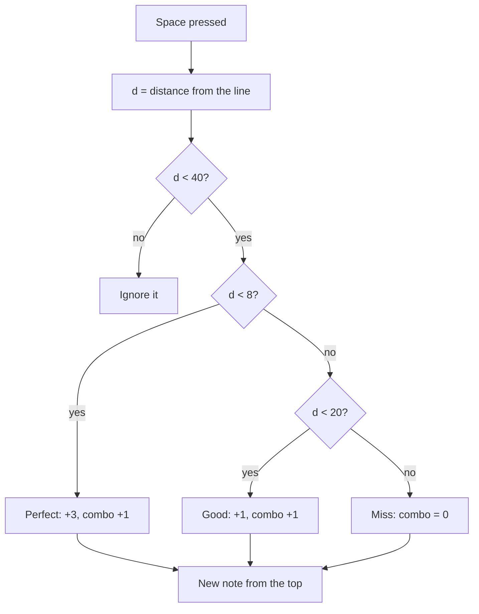

:::objectives
- Convert speeds between steps per frame and seconds.
- Wrap a sprite around the stage edges reliably.
- Time an animation with a frame counter and `mod`.
- Chain easing so sprites follow each other.
- Use the timer to make a short safe period after a hit.
- Keep feedback (sounds, squashes, blinks) from blocking the game loop.
:::

These exercises all use ideas from this module's Notes and from Reef Catch, but none of them repeats the build. Start each one in a new project.

## Warm-up: how long to cross?

A sprite starts at x = −200 and a forever loop runs `change x by (5)`. About how many seconds until it reaches x = 200?

:::solution
**About 2.7 seconds.** The distance is 200 − (−200) = 400 steps. At 5 steps per frame that's 400 ÷ 5 = 80 frames, and at 30 frames per second, 80 ÷ 30 ≈ 2.7 seconds.
:::

### Exercise 1: Fish that wrap around

Add two **Fish** sprites. The first swims right at 3 steps per frame; the second swims left at 2, facing left and right side up. When either reaches its edge, it reappears on the opposite side at the same height and keeps going.

```text
Fish:   ... x 226, 229, 232 -> jumps to -230, -227 ...
Fish2:  ... x -226, -228, -230, -232 -> jumps to 230, 228 ...
```

:::hint
Check against 230 and −230, not 240 and −240. Scratch's edge fence can stop a sprite before its center ever passes 240. The left-swimming fish needs the left-right rotation style before you point it at −90.
:::

:::solution
Fish:

```scratch
when green flag clicked
go to x: (0) y: (60)
point in direction (90)
forever
change x by (3)
if <(x position) > (230)> then
set x to (-230)
end
end
```

Fish2:

```scratch
when green flag clicked
go to x: (0) y: (-60)
set rotation style [left-right v]
point in direction (-90)
forever
change x by (-2)
if <(x position) < (-230)> then
set x to (230)
end
end
```

Only `x` changes on a wrap, so each fish keeps its height. Pac-Man's side tunnel and the asteroids in Asteroids work the same way.
:::

### Exercise 2: A walk cycle at the right speed

Add **Pico Walking** (costumes `Pico walk1` to `Pico walk4`). In one forever loop, the arrow keys walk Pico left or right 4 steps per frame, facing the way it walks. While walking, the costume changes every 4th frame. While standing still, Pico shows `Pico walk1`. Use a `frame` variable, not a `wait`, for the timing.

:::hint
Add 1 to `frame` at the top of every pass. `((frame) mod (4)) = (0)` is true on frames 4, 8, 12, and so on: once every 4 frames, or 7.5 times a second.
:::

:::solution
```scratch
when green flag clicked
set rotation style [left-right v]
set [frame v] to (0)
forever
change [frame v] by (1)
if <key (right arrow v) pressed?> then
point in direction (90)
change x by (4)
if <((frame) mod (4)) = (0)> then
next costume
end
else
if <key (left arrow v) pressed?> then
point in direction (-90)
change x by (-4)
if <((frame) mod (4)) = (0)> then
next costume
end
else
switch costume to (Pico walk1 v)
end
end
end
```

A frame counter keeps the animation locked to the movement: if the computer slows down, the legs and the feet slow down together. Try `mod (2)` and `mod (8)` to see why 4 looks right at this walking speed.
:::

### Exercise 3: A line of chicks

Add the **Chick** sprite and duplicate it twice. Chick follows the mouse with easing (gap ÷ 5, in both x and y). Chick2 eases toward Chick the same way, and Chick3 eases toward Chick2. Move the mouse in circles: the chicks should trail behind in a wobbly line.

:::hint
Chick2 doesn't need the mouse at all. Its target is `([x position v] of (Chick v))` and `([y position v] of (Chick v))`.
:::

:::solution
Chick:

```scratch
when green flag clicked
forever
change x by (((mouse x) - (x position)) / (5))
change y by (((mouse y) - (y position)) / (5))
end
```

Chick2 (Chick3 is the same with `Chick2` in both `of` blocks):

```scratch
when green flag clicked
forever
change x by ((([x position v] of (Chick v)) - (x position)) / (5))
change y by ((([y position v] of (Chick v)) - (y position)) / (5))
end
```

Each chick lags behind the one ahead of it, so the lag adds up down the line, which is what makes the trail. When the mouse stops, they all settle into one spot. Push them apart with a bigger divisor for each chick, like 5, 7, and 9.
:::

### Exercise 4: Two seconds of safety

Make a player sprite that eases after the mouse and a **Shark 2** that glides back and forth across the middle of the stage. Touching the shark costs 1 of 3 lives. After a hit, the player blinks and can't be hurt again for 2 seconds. Without this, one pass through the shark costs every life at once.

:::hint
Keep a variable `safe until`. After a hit, set it to `(timer) + (2)`. A touch only counts if `timer` is past `safe until`. Run the blink in a separate script triggered by a broadcast, so it never pauses the main loop.
:::

:::solution
Player:

```scratch
when green flag clicked
set [lives v] to (3)
set [safe until v] to (0)
reset timer
clear graphic effects
forever
change x by (((mouse x) - (x position)) / (5))
change y by (((mouse y) - (y position)) / (5))
if <<touching (Shark 2 v)?> and <(timer) > (safe until)>> then
change [lives v] by (-1)
set [safe until v] to ((timer) + (2))
broadcast (hurt v)
end
end

when I receive [hurt v]
repeat (10)
set [ghost v] effect to (60)
wait (0.1) seconds
set [ghost v] effect to (0)
wait (0.1) seconds
end
```

Shark 2:

```scratch
when green flag clicked
forever
glide (2) secs to x: (-180) y: (0)
glide (2) secs to x: (180) y: (0)
end
```

The blink loop takes 10 × 0.2 = 2 seconds, so it ends right as the safe time does. The blink isn't decoration: it's how the player *sees* the rule that they're safe for now.
:::

### Exercise 5: Bug hunt, the bell that hangs around

A player collects a **Bell** sprite. The bell should vanish to a new place the instant it's touched, with a ring. Instead, after a touch the bell sits there for about four seconds, ringing, before it moves:

```scratch
when green flag clicked
set [score v] to (0)
forever
if <touching (Sprite1 v)?> then
change [score v] by (1)
play sound (bell toll v) until done
go to x: (pick random (-200) to (200)) y: (pick random (-140) to (140))
end
end
```

Fix it so the bell moves immediately and the ring still plays in full.

:::hint
Two things are wrong, and both are about order and waiting. Which block makes the loop stand still, and does the bell have to finish ringing before it moves?
:::

:::solution
```scratch
when green flag clicked
set [score v] to (0)
forever
if <touching (Sprite1 v)?> then
change [score v] by (1)
go to x: (pick random (-200) to (200)) y: (pick random (-140) to (140))
start sound (bell toll v)
end
end
```

`play sound until done` froze the loop for the whole 4-second sound, and the move came after it. Moving first takes the bell out of reach in the same pass, and `start sound` lets the ring play while the loop carries on.
:::

### Exercise 6: A ball that bounces with velocity

Without using `if on edge, bounce`, make the **Ball** sprite fly around the stage using two variables, `vx` and `vy` (for this sprite only), starting at 5 and 3.5. When it reaches a side, flip `vx`; when it reaches the top or bottom, flip `vy`. Every bounce plays **Boing** and squashes the ball briefly, and the movement must never pause.

:::hint
The ball is about 44 steps wide at 100% size, so its edge meets a wall when its center is 22 steps from it: at x = ±218 and y = ±158. Flip a speed with `set [vx v] to ((0) - (vx))`. Put the squash in a separate script, triggered by a message, so its `wait` doesn't touch the loop.
:::

:::solution
```scratch
when green flag clicked
go to x: (0) y: (0)
set [vx v] to (5)
set [vy v] to (3.5)
forever
change x by (vx)
change y by (vy)
if <<(x position) > (218)> or <(x position) < (-218)>> then
set [vx v] to ((0) - (vx))
broadcast (boing v)
end
if <<(y position) > (158)> or <(y position) < (-158)>> then
set [vy v] to ((0) - (vy))
broadcast (boing v)
end
end

when I receive [boing v]
start sound (Boing v)
set size to (80) %
wait (0.08) seconds
set size to (100) %
```

Because x and y have their own speeds, the ball can travel at any angle, and a bounce off a wall only flips the speed that points into it. That's the same idea as Pong.
:::

### Challenge: A one-button rhythm game

Paint a round **Note** sprite and add the **Line** sprite as a hit line at y = −120. The note drops from the top at 4 steps per frame. Press space as it crosses the line:

| How far the note is from the line | Result |
| --- | --- |
| under 8 steps | **Perfect**: +3, combo +1 |
| 8 to 19 steps | **Good**: +1, combo +1 |
| 20 to 39 steps | **Miss**: combo back to 0 |
| 40 or more | press ignored |
| note falls past y = −160 unpressed | **Miss** |

After each result the note says it, and a new note starts from the top after a short random pause. Perfect hits play a higher-pitched sound than Good ones.



:::hint
The distance is `([abs v] of ((y position) - (-120)))`. Let the falling loop and the space bar script both send the note back to the top with the same message, say `next note`, so there's only one place that handles respawning. Why is a press at 30 steps a Miss instead of being ignored? Try spamming space without that rule.
:::

:::solution
Note (variables `score` and `combo` for all sprites):

```scratch
when green flag clicked
set [score v] to (0)
set [combo v] to (0)
broadcast (next note v)

when I receive [next note v]
go to x: (0) y: (180)
wait (pick random (0.3) to (1.2)) seconds
say []
repeat until <(y position) < (-160)>
change y by (-4)
end
set [combo v] to (0)
say [Miss]
broadcast (next note v)

when [space v] key pressed
if <([abs v] of ((y position) - (-120))) < (40)> then
if <([abs v] of ((y position) - (-120))) < (8)> then
change [score v] by (3)
change [combo v] by (1)
set [pitch v] effect to (60)
start sound (pop v)
say [Perfect!]
else
if <([abs v] of ((y position) - (-120))) < (20)> then
change [score v] by (1)
change [combo v] by (1)
set [pitch v] effect to (0)
start sound (pop v)
say [Good]
else
set [combo v] to (0)
say [Miss]
end
end
broadcast (next note v)
end
```

The space script broadcasts `next note`, which restarts the falling script from the top, so a judged note can't keep falling and be judged twice. That restart rule from Module 3 is doing useful work here. The `say` blocks have no time on purpose: the result stays on the note while it waits at the top, and `say []` clears it just before the next drop. A `say for 0.5 seconds` would hold up the broadcast while the judged note kept falling. The Miss band between 20 and 39 steps is what makes button-mashing a bad strategy: spam the space bar and you'll usually press too early and lose your combo.
:::
