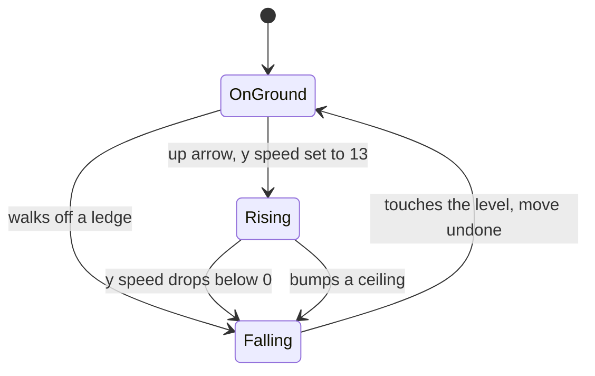

:::objectives
- Choose between `touching`, `touching color`, `color is touching`, and `distance to` for a collision.
- Stop a player at walls with the move, check, undo pattern.
- Make a sprite fall and jump with a `y speed` variable.
- Keep a player on the stage and bring it back when it falls off.
:::

Press the right arrow and your hero strolls straight through a brick wall. Scratch noticed. The moment the hero's pixels overlapped the wall, `touching (Wall v)?` turned `true`. But no script asked the question, so nothing happened.

That's how collisions work in Scratch. Sensing blocks only *report* that two things overlap. Your scripts decide what the overlap means: a wall pushes you back, a coin disappears, lava sends you to the start.

## Four ways a sprite can feel a touch

Scratch checks real pixels, not boxes. If the cat's tail overlaps a wall, the cat is touching the wall, even if its body is nowhere near.

| Block | It's true when… | Use it for |
| --- | --- | --- |
| `touching (Wall v)?` | any visible pixel of this sprite overlaps the Wall sprite or one of its clones | walls, enemies, pickups |
| `touching color [ ]?` | this sprite overlaps that exact color, on the backdrop or on any other sprite | lava or water painted into a backdrop |
| `color [ ] is touching [ ]?` | one color *inside this sprite* overlaps another color | checking only the feet or only a sword tip |
| `distance to (Guard v)` | it reports a number: how many steps apart the two sprites' centers are | "close enough" checks: sight range, magnets |

Here are all four in one script for a player sprite:

```scratch
when green flag clicked
forever
  if <touching (Coin v)?> then
    change [score v] by (1)
  end
  if <touching color [#e03c31]?> then
    say [Ouch, lava!] for (1) seconds
  end
  if <color [#3cb44b] is touching [#7a4a1e]?> then
    say [My green boots are on the dirt.]
  end
  if <(distance to (Guard v)) < (100)> then
    say [Uh oh, the guard can see me.]
  end
end
```

Notice that `distance to` doesn't care about shapes at all. Two sprites 99 steps apart are "close" even if there's a wall between them. That makes it the right tool for "the guard notices you" and the wrong one for "you hit the guard."

:::warning
**The score jumps by 20 for one coin.** `touching (Coin v)?` stays true for every frame the two sprites overlap, and the loop runs 30 times a second. Hide the coin (or move it away) in the same frame you count it. Hidden sprites never count as touching, so the next pass of the loop sees nothing.
:::

## Smooth controls come from a loop, not a hat block

There are two ways to react to a key, and they feel very different to play.

```scratch
when [right arrow v] key pressed
change x by (10)
```

Hold the right arrow with this script and the sprite moves once, pauses, then stutters along. That pause is your keyboard's repeat delay, the same one you see when you hold a letter key in a text box. And since a keyboard only repeats the last key you pressed, holding up and right together moves you in just one direction.

```scratch
when green flag clicked
forever
  if <key (right arrow v) pressed?> then
    change x by (5)
  end
  if <key (left arrow v) pressed?> then
    change x by (-5)
  end
end
```

This version asks "is the key down *right now*?" 30 times a second, so movement is smooth from the first frame and every key is checked on every pass. Use the loop for anything held down (walking, steering). Keep the hat block for single taps, like pausing or switching weapons.

## Move, check, undo: walls that push back

Here's the pattern almost every Scratch game uses for solid walls:

1. Move the player a little.
2. Check if it's now touching a wall.
3. If it is, move it back by the same amount.

```scratch
when green flag clicked
forever
  if <key (right arrow v) pressed?> then
    change x by (5)
    if <touching (Wall v)?> then
      change x by (-5)
    end
  end
  if <key (up arrow v) pressed?> then
    change y by (5)
    if <touching (Wall v)?> then
      change y by (-5)
    end
  end
end
```

Why doesn't the player flicker into the wall and out again? Scratch only redraws the stage at the end of each pass through the loop. By then the step back has already happened, so the overlap is never shown. The player just looks blocked.

Each direction gets its own check on purpose. If you moved right *and* up, then checked once and undid both, a player pressing into a wall diagonally would freeze. Checking each axis separately lets the player slide along the wall, which feels much better.

```mermaid caption="Move, check, undo, done once per direction on every frame"
flowchart TD
    A[Key held down] --> B[Move 5 steps]
    B --> C{Touching Wall?}
    C -->|yes| D[Move back 5 steps]
    C -->|no| E[Keep the new spot]
    D --> F[Screen redraws]
    E --> F
```

## Gravity is a speed that keeps changing

Real things don't fall at a steady speed. They speed up. To copy that, a game keeps the sprite's vertical speed in a variable and changes the *speed* every frame, not just the position.

```scratch
when green flag clicked
set [y speed v] to (0)
forever
  change [y speed v] by (-1)
  change y by (y speed)
end
```

Trace the first few frames in your head. `y speed` goes 0, −1, −2, −3, so the sprite drops 1 step, then 2, then 3. After four frames it has fallen 1 + 2 + 3 + 4 = 10 steps, and each frame it falls faster. That curve is what makes falling look natural.

A jump is the same loop with one change: when the player presses up, set `y speed` to a positive number like 13. Gravity eats one point of speed per frame, so the sprite rises fast, slows to a stop at the top, and falls back down. Two numbers control the whole feel: the jump speed and the gravity. This short Python program does the exact same arithmetic as the Scratch loop, so we can plot two jumps side by side:

```python run alt="Line chart of height against frame for two jumps. Jump 13 with gravity 1 rises to 78 and lands after about 26 frames. Jump 18 with gravity 2 rises to 72 and lands after about 18 frames." caption="Almost the same height, but the second jump spends about a third less time in the air."
import matplotlib.pyplot as plt

def jump(start_speed, gravity):
    # Same steps as Scratch: change y speed, then change y by y speed
    y, speed, heights = 0, start_speed, [0]
    while True:
        speed = speed - gravity
        y = y + speed
        if y < 0:
            break
        heights.append(y)
    return heights

floaty = jump(13, 1)
snappy = jump(18, 2)
print("Floaty jump:", max(floaty), "steps high,", len(floaty), "frames")
print("Snappy jump:", max(snappy), "steps high,", len(snappy), "frames")

plt.plot(floaty, marker="o", label="jump speed 13, gravity 1")
plt.plot(snappy, marker="o", label="jump speed 18, gravity 2")
plt.xlabel("Frame (Scratch runs about 30 per second)")
plt.ylabel("Height above the ground (steps)")
plt.legend()
```

Higher gravity with a stronger jump feels snappy; low gravity feels floaty, like the moon. Neither is wrong, but pick on purpose.

Landing uses move, check, undo again. After `change y by (y speed)`, if the player is touching the level, undo that move and set `y speed` to 0. You'll build the full version, with a rule that you can only jump from the ground, in the next lesson.



:::warning
**Falling straight through a thin platform.** If `y speed` reaches −20 and a platform is 10 steps thick, the player can jump from above it to below it in one frame and never touch it. This is called tunneling. Cap the falling speed (`if y speed < -12, set y speed to -12`) and draw platforms at least 15 steps thick.
:::

## Keeping the player on the stage

Scratch won't let a sprite leave the stage entirely. It stops the sprite with about 15 pixels still showing, which is how a player ends up stuck half-hidden at the edge, or jammed against the bottom forever.

Decide the limits yourself. The stage runs from x = −240 to 240 and y = −180 to 180, so:

```scratch
if <(x position) > (225)> then
  set x to (225)
end
if <(x position) < (-225)> then
  set x to (-225)
end
if <(y position) < (-160)> then
  go to x: (-200) y: (0)
  set [y speed v] to (0)
end
```

The first two `if` blocks clamp the player: if it goes past a line, put it back on the line. The third treats falling off the bottom as a fall into a pit and sends the player back to the start. Resetting `y speed` matters there. Without it, the player keeps the falling speed it had and reappears already plummeting.

:::video 9zn9t48cCug
A second walkthrough of gravity and jumping in Scratch 3. Watch how the jump is built from a speed that rises and then gets pulled back down, and compare it with the `y speed` loop above.
:::

:::quiz
Q: A player's loop does `change x by (5)`, then `if <touching (Wall v)?> then change x by (-5)`. Does the player ever appear inside the wall?
- [ ] Yes, for one frame each time
  The redraw happens at the end of the loop pass, and by then the move has already been undone.
- [x] No, the undo happens before the stage is redrawn
  Scratch draws the stage after the whole pass, so the overlap is never shown.
- [ ] Only if the wall is a different color
  Color doesn't matter for `touching (Wall v)?`; it checks the Wall sprite's pixels.

Q: `y speed` starts at 0. Each frame runs `change [y speed v] by (-1)` then `change y by (y speed)`. How far has the sprite fallen after 4 frames?
- [ ] 4 steps
  That would be a steady speed of 1. Here the speed grows every frame.
- [x] 10 steps
  It falls 1, then 2, then 3, then 4 steps: 1 + 2 + 3 + 4 = 10.
- [ ] 16 steps
  That's 4 × 4, as if it fell 4 steps every frame from the start.

Q: The score goes up by about 15 every time the player grabs one coin. What's the best fix?
- [ ] Use `when [space v] key pressed` instead of a forever loop
  The loop isn't the problem; the overlap lasts several frames.
- [x] Hide the coin in the same frame the score changes
  A hidden sprite never counts as touching, so the next frames don't add more.
- [ ] Check `distance to (Coin v)` instead
  Distance also stays small for several frames, so the score would still jump.

Q: A guard should shout when the player comes within 120 steps, even around corners. Which block fits?
- [ ] `touching (Player v)?`
  That only fires when pixels actually overlap.
- [ ] `touching color [ ]?`
  The player isn't one fixed color, and this is about range, not overlap.
- [x] `distance to (Player v)`
  It reports how far apart the centers are, so `< (120)` is a sight range.
:::

:::takeaways
- Sensing blocks report overlaps; your script decides what they mean.
- Use `key pressed?` inside a forever loop for smooth, held-down movement.
- Move, check, undo, once per direction, makes walls solid and lets players slide along them.
- Gravity changes the speed every frame, and the speed changes the position.
- Clamp the player's x position and treat falling below the stage as a reset, with `y speed` set back to 0.
:::

## Further reading

- [Touching ()? on the Scratch Wiki](https://en.scratch-wiki.info/wiki/Touching_()%3F_(block)): how pixel collisions work, including the rule about hidden sprites.
- [Simulating Gravity on the Scratch Wiki](https://en.scratch-wiki.info/wiki/Simulating_Gravity): more ways to model falling, with example scripts.
- [How to Go Off the Screen Edge](https://en.scratch-wiki.info/wiki/How_to_Go_Off_the_Screen_Edge): what sprite fencing is and why the 15-pixel margin exists.
