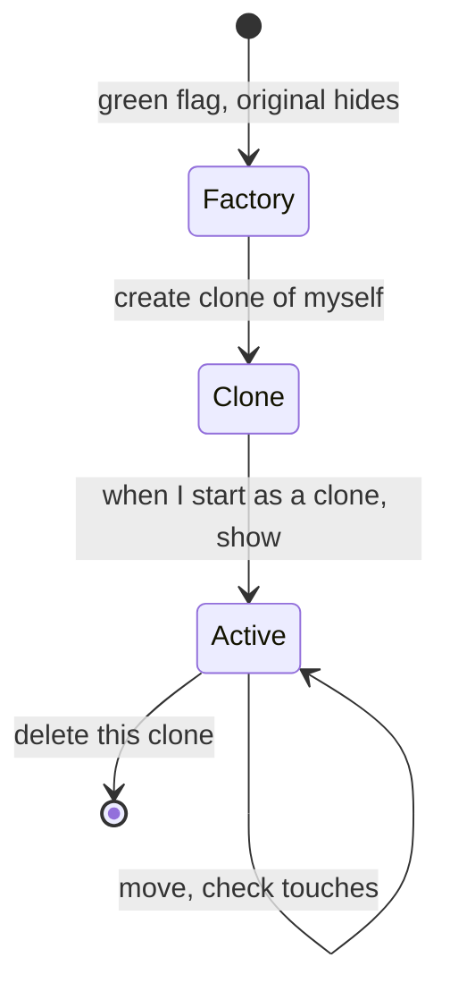

:::objectives
- Create, control, and delete clones, and explain what a clone copies from its parent.
- Give each clone its own values with **For this sprite only** variables.
- Find and fix the clone explosion bug.
- Build a custom block with inputs, and know when to tick **Run without screen refresh**.
- Store and read many values with a list.
:::

A student's ghost game had one rule: press space, get a ghost. The first press made 1 ghost. The second made the count 3. Then 7, then 15. By the sixth press there were 63 ghosts and the game had slowed to a crawl. Nothing in the script said "double". By the end of this page you'll know exactly why it happened, and the one-line fix.

## Clones: one sprite, many copies

A clone is a copy of a sprite that exists only while the project runs. You write the scripts once, and every copy runs them on its own. Three blocks from **Control** do the work:

```scratch
create clone of (myself v)
when I start as a clone
delete this clone
```

At the moment it's made, a clone copies everything about its parent: position, direction, costume, size, effects, whether it's showing, and the values of its variables. After that it's independent. Clones don't appear in the sprite list, and they all disappear when you click the stop sign or the green flag.

Here's a common setup: the original sprite hides and acts as a factory, and the clones do the work.

```scratch
when green flag clicked
hide
repeat (6)
  go to x: (-230) y: (pick random (-150) to (150))
  create clone of (myself v)
  wait (1) seconds
end

when I start as a clone
show
repeat until <(x position) > (230)>
  change x by (3)
  next costume
end
delete this clone
```

The factory moves to a random height *before* each `create clone`, so every clone starts at a different spot. Each clone shows itself (it was born hidden, like its parent), flies across, and deletes itself at the far edge. That last step matters: Scratch allows at most 300 clones at once, and clones you forget to delete keep counting toward the limit until the game stops making new ones.



## Giving each clone its own memory

Make a variable with **For this sprite only** selected and every clone gets its *own* copy. Change it in one clone and the others don't notice. A variable made **For all sprites** is a single shared box: if each clone sets `speed`, they all end up using whichever value was set last.

```scratch
when I start as a clone
set [speed v] to (pick random (1) to (5))
show
repeat until <(x position) > (230)>
  change x by (speed)
end
delete this clone
```

With a **For this sprite only** `speed`, six clones fly at six different speeds. Switch it to **For all sprites** and they all fly at the same speed.

## Why 1 ghost became 63

Clones run every script in their sprite that starts with a hat block, except green flag scripts (those already ran before the clone existed). That includes key presses and broadcasts. So this script runs in the original *and in every clone*:

```scratch
when [space v] key pressed
create clone of (myself v)
```

Press 1: the original makes 1 clone. Press 2: the original and that clone each make one, so now there are 3. Press 3: four sprites each make one, giving 7. After *n* presses there are 2ⁿ − 1 clones, which is 63 after six presses.

The fix is to make sure only one sprite does the spawning. Either move the key script to a sprite that's never cloned, using `create clone of (Ghost v)` from there, or put the spawning in a green flag loop, which clones never run:

```scratch
when green flag clicked
hide
forever
  wait until <key (space v) pressed?>
  create clone of (myself v)
  wait until <not <key (space v) pressed?>>
end
```

## My Blocks: give a chunk of code a name

Open the pink **My Blocks** category and click **Make a Block**. Type a name, and use **Add an input number or text** (or **Add an input boolean**) for anything that changes from one use to the next. Click **OK** and a `define` hat appears in the code area. Whatever you snap under it runs every time the block is used.

```scratch
define spawn bat at height (height) speed (bat speed)
go to x: (-230) y: (height)
set [speed v] to (bat speed)
create clone of (myself v)

when green flag clicked
hide
spawn bat at height (120) speed (2)
spawn bat at height (40) speed (5)
spawn bat at height (-40) speed (3)
```

The inputs `height` and `bat speed` are like variables that only exist inside the definition. Notice the trick in the middle: the original sets its own `speed`, then creates a clone, and the clone keeps a copy of that value. Three calls, three bats, three different speeds.

A custom block belongs to the sprite it was made in. Other sprites can't see it. To reuse one elsewhere, drag the `define` script onto another sprite in the sprite list to copy it there.

## Run without screen refresh: finish a loop in one frame

Remember the small gap when Pip landed in Module 5? The precise fix is to push Pip up one step at a time until it's just out of the floor:

```scratch
define push out of level
repeat until <not <touching (Level v)?>>
  change y by (1)
end
```

Normally, each pass of a loop that moves a sprite waits for the screen to redraw. If Pip lands 10 steps deep, this loop takes 10 frames: you see Pip sink into the floor and climb back out while the rest of its script waits. Tick **Run without screen refresh** in the Make a Block window and the whole loop finishes before the next redraw. Pip lands exactly on the surface, every time. (To change the setting later, right-click the `define` block and choose **Edit**.)

Use it for blocks that *calculate or position* things, like collision fixes or drawing a grid. Never use it for anything the player should watch happen.

:::warning
**A `wait` or `forever` inside a no-refresh block freezes the project.** Scratch tries to finish the whole block before drawing, so a `glide`, a `wait (1) seconds`, or an endless loop inside it makes the stage lock up instead of animating. If your game suddenly freezes after you tick the box, look for a wait or a loop that never ends.
:::

## Lists: one name, many values

A variable holds one value. A list holds as many as you like, numbered from 1. Make one with **Make a List** in the **Variables** category.

```scratch
when green flag clicked
delete all of [heights v]
add (120) to [heights v]
add (40) to [heights v]
add (-40) to [heights v]
go to x: (-230) y: (item (pick random (1) to (length of [heights v])) of [heights v])
```

`item (2) of [heights v]` reports 40. `length of [heights v]` reports 3, so `pick random (1) to (length of [heights v])` chooses a valid item number even if you add a fourth height later. Lists are perfect for lanes, level settings, quiz questions, and high-score tables.

:::warning
**The list gets longer every time you click the green flag.** Lists keep their contents when the project stops, and they're saved with it. Without `delete all of [heights v]` at the start, the second run adds three more items, and the third adds three more. Clear a list before you fill it.
:::

:::video 8G-QDBi7AOo
The Scratch Team's own clone tutorial. Watch the three clone blocks in action and match each one to the scripts above.
:::

:::quiz
Q: The original sprite is hidden and has `when [space v] key pressed` → `create clone of (myself v)`. How many clones exist after 3 presses?
- [ ] 3
  That would be true if only the original made clones. The clones run the key script too.
- [x] 7
  1 after the first press, 3 after the second, 7 after the third: every existing sprite copies itself each time.
- [ ] 8
  8 counts the original as well. There are 7 clones plus 1 original.

Q: The original sets its **For this sprite only** variable `speed` to 5, creates a clone, then sets `speed` to 2. What is the clone's `speed`?
- [x] 5
  A clone copies its parent's variables at the moment it's made. Later changes to the parent don't reach it.
- [ ] 2
  That's the parent's new value, but the clone has its own separate copy.
- [ ] 0
  The clone doesn't start from scratch; it copies the parent's value.

Q: Your `push out of level` block works, but you can see Pip sink into the floor and rise back out. What's the fix?
- [ ] Add `wait (0) seconds` inside the loop
  That adds more pauses, not fewer.
- [x] Tick **Run without screen refresh** for the custom block
  The loop then finishes before the stage redraws, so the player never sees the in-between steps.
- [ ] Change the loop to `forever`
  A forever loop never ends, so Pip would get stuck.

Q: A script adds three items to `lanes` when the green flag is clicked, with no `delete all`. You click the green flag twice. How long is the list?
- [ ] 3
  Lists don't reset when the project stops.
- [x] 6
  The second run adds three more items to the three that were already there.
- [ ] 0
  The list only empties if a script deletes its items.
:::

:::takeaways
- A clone copies its parent at the moment it's made, then lives on its own until `delete this clone`.
- **For this sprite only** variables give each clone a private copy; **For all sprites** variables are shared.
- Clones run key and broadcast scripts too. Spawn from one place only.
- Custom blocks name a piece of code and take inputs; **Run without screen refresh** makes their loops finish in a single frame.
- Lists hold many numbered values. Clear them before filling them.
:::

## Further reading

- [Cloning on the Scratch Wiki](https://en.scratch-wiki.info/wiki/Cloning): the full rules, including the 300-clone limit and local variables.
- [Separating Clone and Sprite Triggers](https://en.scratch-wiki.info/wiki/Separating_Clone_and_Sprite_Triggers): more ways to stop clones running scripts meant for the original.
- [My Blocks on the Scratch Wiki](https://en.scratch-wiki.info/wiki/My_Blocks#Run_Without_Screen_Refresh): every option in the Make a Block window, with the screen-refresh setting explained.
