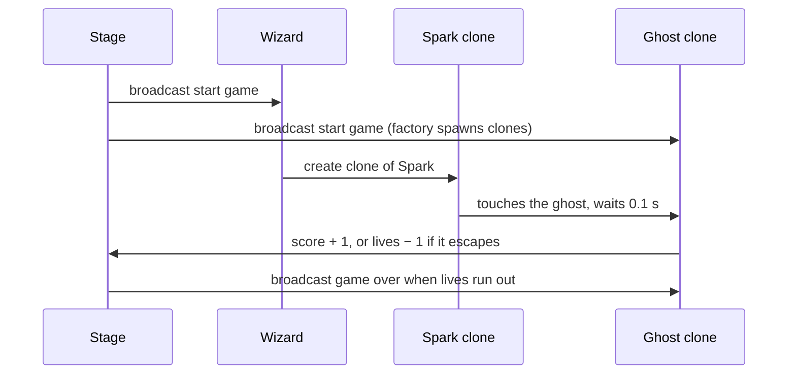

:::objectives
- Store game positions in a list and move a player by item number.
- Spawn enemies from one factory with a custom block that sets each clone's own speed.
- Clone a *different* sprite and send the clone where it belongs.
- Handle a hit between two kinds of clones without missing it.
:::

Ghosts drift in from the right side of the stage along four lanes. Your wizard stands on the left and hops up and down between those lanes, casting sparks with the space bar. A spark that hits a ghost makes it fade away and scores a point. A ghost that slips past costs a life, and losing three ends the game.

Underneath, there are only three sprites with real scripts: one Wizard, one Spark, and one Ghost. Every spark and every ghost you see is a clone. Here's who talks to whom during a game:



## Step 1: Set the scene

Start a new project and delete the cat.

1. Choose a dark backdrop from the library, such as **Night City**, so the white ghosts stand out.
2. Add the library sprites **Wizard**, **Ghost**, and **Star**. Rename Star to `Spark`.
3. Set the sizes in the sprite info panel: Wizard 40, Ghost 45, Spark 30.
4. Make the variables `score` and `lives` (**For all sprites**) and a list called `lanes` (also **For all sprites**). Select the Wizard and make `lane` (**For this sprite only**). Select the Ghost and make `speed` (**For this sprite only**).

Untick the checkboxes beside `lane` and `speed` in the palette so their monitors don't clutter the stage. Leave `score` and `lives` showing.

## Step 2: Store the lanes in a list

The four lanes are just four y positions. Keeping them in a list means every sprite can ask for "lane 3" instead of remembering the number 40. Select the **Stage** and add:

```scratch
when green flag clicked
set [score v] to (0)
set [lives v] to (3)
delete all of [lanes v]
add (-120) to [lanes v]
add (-40) to [lanes v]
add (40) to [lanes v]
add (120) to [lanes v]
broadcast (start game v)
```

Click the green flag and look at the `lanes` monitor on the stage. It should show four items, numbered 1 to 4. Click the flag again: still four, thanks to `delete all`. Now untick `lanes` in the palette to hide the monitor.

The broadcast at the end is the starting pistol. The other sprites wait for `start game` instead of their own green flag, so the list is always full before anyone reads from it.

## Step 3: Hop between lanes

Select the Wizard:

```scratch
when I receive [start game v]
set [lane v] to (2)
go to x: (-190) y: (item (lane) of [lanes v])

when [up arrow v] key pressed
if <(lane) < (length of [lanes v])> then
  change [lane v] by (1)
  set y to (item (lane) of [lanes v])
end

when [down arrow v] key pressed
if <(lane) > (1)> then
  change [lane v] by (-1)
  set y to (item (lane) of [lanes v])
end
```

Run it and tap up and down. The wizard snaps from lane to lane and stops at the top and bottom ones.

In Module 5, Pip used `key pressed?` in a loop for smooth walking. Here the `when key pressed` hat is the better choice, because a lane change is a single step. A loop checking 30 times a second would hop three lanes if you held the key for a tenth of a second.

## Step 4: A ghost factory

Select the Ghost. The original hides and only makes clones. Click **Make a Block**, name it `spawn ghost in lane`, add a number input called `lane number`, and leave **Run without screen refresh** unticked. Then build:

```scratch
when green flag clicked
hide

when I receive [start game v]
forever
  wait (pick random (1) to (2.5)) seconds
  spawn ghost in lane (pick random (1) to (length of [lanes v]))
end

define spawn ghost in lane (lane number)
go to x: (220) y: (item (lane number) of [lanes v])
set [speed v] to (pick random (1) to (3))
create clone of (myself v)

when I start as a clone
show
repeat until <(x position) < (-200)>
  change x by ((0) - (speed))
end
change [lives v] by (-1)
delete this clone
```

Run it. Ghosts appear at random intervals, each in a random lane, and each drifts at its own speed. That works because `speed` is **For this sprite only**: the factory sets its own copy, then the clone is born with that value and keeps it. Let a few ghosts through and watch `lives` drop.

`pick random (1) to (2.5)` gives decimals like 1.73 because one of the inputs has a decimal point, which makes the timing feel less mechanical.

## Step 5: Cast sparks

The Spark sprite's original also hides. The Wizard creates the clones, but there's a catch: a clone of the Spark is a copy of the *Spark*, not of the Wizard, so it appears wherever the original Spark is hiding. Its first job is to jump to the wizard.

Add this to the Wizard's `start game` script, after the `go to`:

```scratch
forever
  wait until <key (space v) pressed?>
  create clone of (Spark v)
  wait (0.3) seconds
end
```

Then select Spark:

```scratch
when green flag clicked
hide

when I start as a clone
go to (Wizard v)
show
repeat until <(x position) > (230)>
  change x by (10)
end
delete this clone
```

Hold space. A spark flies every 0.3 seconds, which keeps the player from filling the stage with hundreds of clones. Sparks pass straight through ghosts for now.

## Step 6: Hits that never get missed

Both sprites need to react to a hit: the ghost vanishes and scores, and the spark disappears. The obvious plan is for each to check `touching` and delete itself at once. That plan has a bug.

In each frame, Scratch runs scripts one after another, not all at the same moment. If the spark's script happens to run first, it sees the ghost and deletes itself. Then the ghost's script checks `touching (Spark v)?` and finds nothing, because the spark is already gone. The ghost survives a direct hit.

The fix is to make the spark linger for a moment so the ghost always gets its turn to see it. Replace the Spark clone's loop with:

```scratch
repeat until <(x position) > (230)>
  change x by (10)
  if <touching (Ghost v)?> then
    wait (0.1) seconds
    delete this clone
  end
end
```

Now give the Ghost a second custom block, `vanish`, with no inputs and **Run without screen refresh** left unticked. It's an animation, and the player is supposed to see every frame of it.

```scratch
define vanish
repeat (5)
  change [ghost v] effect by (20)
  change size by (10)
end
delete this clone
```

And add the hit check inside the ghost clone's loop:

```scratch
if <touching (Spark v)?> then
  change [score v] by (1)
  vanish :: custom
end
```

Play a round. Ghosts swell and fade when hit (yes, it's the ghost effect on a ghost), and the score goes up by exactly one each time. `delete this clone` inside `vanish` ends the clone's script, so it never reaches the `change [lives v] by (-1)` at the bottom.

## Step 7: Game over

Add to the end of the Stage's green flag script:

```scratch
wait until <(lives) < (1)>
broadcast (game over v) and wait
stop [all v]
```

In the Ghost, freeze everything when the game ends. Every clone hears the broadcast too, so they all stop where they are:

```scratch
when I receive [game over v]
stop [other scripts in sprite v]
```

And in the Wizard:

```scratch
when I receive [game over v]
say (join [The ghosts got through! Score: ] (score)) for (2) seconds
```

`broadcast and wait` holds the Stage's script until the Wizard has finished talking, and only then does `stop [all v]` end the game.

## The finished scripts

**Stage**

```scratch
when green flag clicked
set [score v] to (0)
set [lives v] to (3)
delete all of [lanes v]
add (-120) to [lanes v]
add (-40) to [lanes v]
add (40) to [lanes v]
add (120) to [lanes v]
broadcast (start game v)
wait until <(lives) < (1)>
broadcast (game over v) and wait
stop [all v]
```

**Wizard**

```scratch
when I receive [start game v]
set [lane v] to (2)
go to x: (-190) y: (item (lane) of [lanes v])
forever
  wait until <key (space v) pressed?>
  create clone of (Spark v)
  wait (0.3) seconds
end

when [up arrow v] key pressed
if <(lane) < (length of [lanes v])> then
  change [lane v] by (1)
  set y to (item (lane) of [lanes v])
end

when [down arrow v] key pressed
if <(lane) > (1)> then
  change [lane v] by (-1)
  set y to (item (lane) of [lanes v])
end

when I receive [game over v]
say (join [The ghosts got through! Score: ] (score)) for (2) seconds
```

**Spark**

```scratch
when green flag clicked
hide

when I start as a clone
go to (Wizard v)
show
repeat until <(x position) > (230)>
  change x by (10)
  if <touching (Ghost v)?> then
    wait (0.1) seconds
    delete this clone
  end
end
delete this clone
```

**Ghost**

```scratch
when green flag clicked
hide

when I receive [start game v]
forever
  wait (pick random (1) to (2.5)) seconds
  spawn ghost in lane (pick random (1) to (length of [lanes v]))
end

define spawn ghost in lane (lane number)
go to x: (220) y: (item (lane number) of [lanes v])
set [speed v] to (pick random (1) to (3))
create clone of (myself v)

when I start as a clone
show
repeat until <(x position) < (-200)>
  change x by ((0) - (speed))
  if <touching (Spark v)?> then
    change [score v] by (1)
    vanish
  end
end
change [lives v] by (-1)
delete this clone

define vanish
repeat (5)
  change [ghost v] effect by (20)
  change size by (10)
end
delete this clone

when I receive [game over v]
stop [other scripts in sprite v]
```

Keep this project. Module 7 turns it into a game with waves, a story, and difficulty that reacts to how well you're playing.

:::video kRJ37shzFp0
The Scratch Team explains variables and lists side by side. Watch how a list monitor numbers its items; it's the same view you used to check `lanes` in Step 2.
:::

:::quiz
Q: Why does the Spark clone start with `go to (Wizard v)`?
- [ ] Clones always start at the center of the stage
  Clones start wherever their parent is, not at the center.
- [x] A clone of Spark copies the original Spark's position, not the Wizard's
  The Wizard ran `create clone of (Spark v)`, but the clone is still a copy of the Spark sprite.
- [ ] So the spark faces the right way
  `go to` changes position only, not direction.

Q: What could happen if the spark ran `delete this clone` the instant it touched a ghost?
- [ ] Nothing, both sprites see the touch in the same frame
  Scripts run one after another in each frame, so the order matters.
- [x] Sometimes the ghost would survive a direct hit
  If the spark's script runs first, it's gone before the ghost checks `touching (Spark v)?`.
- [ ] The score would go up twice
  The score only changes in the ghost's script, once per hit.

Q: Why does the wizard use `when [up arrow v] key pressed` instead of `key (up arrow v) pressed?` in a forever loop?
- [x] Each press should move exactly one lane
  The hat block fires once per press. A loop would see the key held for several frames and hop several lanes.
- [ ] Hat blocks are faster than loops
  Speed isn't the point here; the hat block simply fires once per press.
- [ ] `key pressed?` doesn't work with arrow keys
  It works with every key; it's just the wrong fit for single steps.
:::

:::takeaways
- A list turns game positions into numbered slots, so code can say "lane 3" and stay correct if the lanes change.
- A factory sprite plus a custom block gives you one clean place where every enemy is born.
- Set a **For this sprite only** variable in the parent just before `create clone` and the clone keeps that value.
- A clone of another sprite starts where *that* sprite is, so move it first.
- When two clones must both react to a hit, make one wait a moment so the other can't miss it.
:::

## Ideas to extend it

- **Tough ghosts.** Give one ghost in four 2 hit points and tint it with the color effect. (The Practice lesson walks through the catch.)
- **A burst on every hit.** Make a small particle sprite and spray clones outward where a ghost vanishes.
- **Different ghosts per lane.** Store a speed for each lane in a second list and read `item (lane number)` of it in the spawner.
- **A sound for every hit**, started with `start sound` so it doesn't pause the ghost's script.

## Further reading

- [Create Clone of () on the Scratch Wiki](https://en.scratch-wiki.info/wiki/Create_Clone_of_()_(block)): what a clone copies, and how cloning another sprite works.
- [List on the Scratch Wiki](https://en.scratch-wiki.info/wiki/List): every list block, with examples.
