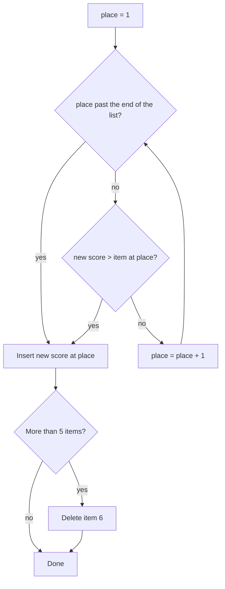

:::objectives
- Predict how many clones a script makes, and stop runaway cloning.
- Use **For this sprite only** variables so every clone behaves differently.
- Write custom blocks with inputs, and decide when to run them without screen refresh.
- Search and insert into a list to keep it in order.
:::

Exercises 1 to 4 each start from a new project. Exercise 5 uses Crystal Climb from Module 5, and Exercise 6 and the challenge use Ghost Patrol.

## Warm-up: whose variable is it?

Decide whether each one should be **For this sprite only** or **For all sprites**, then check.

1. How many hit points one ghost clone has left.
2. The player's score.
3. Which lane the wizard is standing in.
4. The number of lives, which the Stage checks for game over.

:::solution
1. **For this sprite only.** Every clone needs its own hit points, or hitting one ghost would damage them all.
2. **For all sprites.** Ghosts change it and the Stage displays it.
3. **For this sprite only** works, since only the Wizard uses it. **For all sprites** would also work, but keeping it private stops other sprites from changing it by accident.
4. **For all sprites.** The ghosts change it and the Stage reads it. A private copy in each ghost would never reach the Stage.
:::

### Exercise 1: Stop the clone explosion

Paint a small circle sprite called `Bubble` and give it these scripts. **Before you run it**, predict how many clones exist after you press space 4 times.

```scratch
when green flag clicked
hide

when [space v] key pressed
create clone of (myself v)

when I start as a clone
go to x: (pick random (-200) to (200)) y: (pick random (-150) to (150))
show
```

Then change the scripts so each press makes exactly one bubble.

:::hint
Every clone runs `when [space v] key pressed` too. Count how many sprites exist before each press: each of them makes one copy.
:::

:::solution
The counts go 1, 3, 7, 15, so after 4 presses there are **15 clones**. Each press doubles the total number of sprites, original included: 2, 4, 8, 16. Take away the hidden original and 15 are clones.

One fix is to replace both the green flag script and the key script with a single green flag loop. Clones never run green flag scripts, so only the original spawns:

```scratch
when green flag clicked
hide
forever
  wait until <key (space v) pressed?>
  create clone of (myself v)
  wait until <not <key (space v) pressed?>>
end
```

The second `wait until` makes you let go of space before the next bubble, so one press is one bubble.
:::

### Exercise 2: A ghost with something to say

Make a list called `taunts` with at least four lines, such as "Boo!", "Too slow!", "You missed!", and "I'm made of mist!". When the green flag is clicked, a Ghost sprite should say one random line from the list every 2 seconds, forever.

```text
Ghost: Too slow!
(2 seconds later)
Ghost: Boo!
```

:::hint
`pick random (1) to (length of [taunts v])` always gives a valid item number, however many lines you add. Remember to clear the list before filling it.
:::

:::solution
```scratch
when green flag clicked
delete all of [taunts v]
add [Boo!] to [taunts v]
add [Too slow!] to [taunts v]
add [You missed!] to [taunts v]
add [I'm made of mist!] to [taunts v]
forever
  say (item (pick random (1) to (length of [taunts v])) of [taunts v]) for (2) seconds
end
```

Using `length of` instead of the number 4 means you can add a fifth taunt without touching the `pick random` block.
:::

### Exercise 3: A school of fish

Add the library sprite **Fish** at size 40 on an underwater backdrop. When the green flag is clicked, make 10 fish clones at random spots. Each fish swims left or right (chosen at random) at its own speed between 1 and 4, and when it swims off one side it comes back on the other.

:::hint
You need a **For this sprite only** variable called `speed`, set inside `when I start as a clone`. Use `set rotation style [left-right v]` so fish pointing left don't swim upside down.
:::

:::solution
```scratch
when green flag clicked
hide
repeat (10)
  go to x: (pick random (-200) to (200)) y: (pick random (-150) to (150))
  create clone of (myself v)
end

when I start as a clone
set [speed v] to (pick random (1) to (4))
set rotation style [left-right v]
if <(pick random (1) to (2)) = (1)> then
  point in direction (90)
else
  point in direction (-90)
end
show
forever
  move (speed) steps
  if <(x position) > (230)> then
    set x to (-230)
  end
  if <(x position) < (-230)> then
    set x to (230)
  end
end
```

Each clone picks its own speed and direction the moment it starts, so no two fish need to match. If you made `speed` **For all sprites**, every fish would swim at whatever speed the last clone picked.
:::

### Exercise 4: A particle burst block

Paint a tiny yellow dot called `Particle`. Make a custom block `burst at x () y () count ()`. When you click anywhere on the stage, it should spray `count` particles outward in an even ring from that point, and each particle should fade out as it flies.

```text
Click the stage  ->  12 dots fly outward in a ring and fade away
Change count to 30  ->  a denser ring
```

:::hint
Before each `create clone`, turn the original by `360 / count` degrees. Clones copy their parent's direction, so each one flies a different way with `move`. Use **Add a label** in the Make a Block window to put the words "y" and "count" between the inputs.
:::

:::solution
```scratch
when green flag clicked
hide
forever
  wait until <mouse down?>
  burst at x (mouse x) y (mouse y) count (12)
  wait until <not <mouse down?>>
end

define burst at x (x) y (y) count (count)
go to x: (x) y: (y)
repeat (count)
  turn cw ((360) / (count)) degrees
  create clone of (myself v)
end

when I start as a clone
show
repeat (10)
  move (6) steps
  change [ghost v] effect by (10)
end
delete this clone
```

The block hides all the ring-making math behind one readable line. To use it in Ghost Patrol, the Particle sprite needs to hear about each hit, for example from a broadcast plus two variables holding the ghost's x and y.
:::

### Exercise 5: Pixel-perfect landing for Pip

Open Crystal Climb. Make a custom block in Pip called `fix vertical` that moves Pip one step at a time until it's no longer touching the level: up if Pip was falling, down if it hit a ceiling. Use it in place of `change y by ((0) - (y speed))`. Try it first with **Run without screen refresh** unticked, then ticked.

```text
Unticked:  Pip sinks into the floor and climbs out over several frames
Ticked:    Pip lands exactly on the surface, with no gap and no settling
```

:::hint
The loop is `repeat until <not <touching (Level v)?>>`. Inside it, check the sign of `y speed` to decide which way to step. Leave the `on ground` and `set [y speed v] to (0)` blocks after the call, exactly as they were.
:::

:::solution
```scratch
define fix vertical
repeat until <not <touching (Level v)?>>
  if <(y speed) > (0)> then
    change y by (-1)
  else
    change y by (1)
  end
end
```

The landing part of Pip's loop becomes:

```scratch
change y by (y speed)
set [on ground v] to (0)
if <touching (Level v)?> then
  fix vertical :: custom
  if <(y speed) < (0)> then
    set [on ground v] to (1)
  end
  set [y speed v] to (0)
end
```

Unticked, every pass of the `repeat until` waits for a redraw, so a 10-step-deep landing takes 10 frames to fix, and you watch it happen. Ticked, all the steps happen before the stage is drawn. The undo version from Module 5 put Pip back where it *was*; this version moves it to where it *should be*, touching the floor.
:::

### Exercise 6: A top-5 high-score table

In Ghost Patrol, make a list `high scores` and a custom block `record score (new score)` in the Wizard. It should insert the new score in the right place so the list stays sorted from highest to lowest, and drop anything past 5th place. Call it from the Wizard's `game over` script.

Test it with a temporary script, `when [t v] key pressed` → `record score (pick random (1) to (100))`, and watch the list monitor:

```text
record 40  ->  40
record 75  ->  75, 40
record 10  ->  75, 40, 10
record 50  ->  75, 50, 40, 10
record 90  ->  90, 75, 50, 40, 10
record 20  ->  90, 75, 50, 40, 20     (10 dropped off)
```

:::hint
Walk down the list with a `place` variable starting at 1. Stop when you've gone past the end, or when the new score beats the item at `place`. Then `insert (new score) at (place) of [high scores v]`. The flowchart below shows the walk.
:::

:::solution
```scratch
define record score (new score)
set [place v] to (1)
repeat until <<(place) > (length of [high scores v])> or <(new score) > (item (place) of [high scores v])>>
  change [place v] by (1)
end
insert (new score) at (place) of [high scores v]
if <(length of [high scores v]) > (5)> then
  delete (6) of [high scores v]
end

when I receive [game over v]
record score (score)
say (join [The ghosts got through! Score: ] (score)) for (2) seconds
```

Don't add `delete all` for this list: keeping old scores between games is the whole point. A score lower than all five ends up at place 6 and is deleted straight away. This block only calculates, so ticking **Run without screen refresh** is safe, though it's fast either way.
:::



:::video 596LEqy6p7M
The Scratch Team on custom blocks with inputs. Watch how the input names appear inside the `define` block and get dragged into the code, the same way `count` and `new score` work above.
:::

### Challenge: tough ghosts

In Ghost Patrol, make one ghost in four a tough ghost: tinted with the color effect, with 2 hit points instead of 1. It takes two sparks to vanish. Watch out: the spark waits 0.1 seconds before deleting itself, which means a ghost touching it sees the *same* spark for several frames in a row.

:::hint
Each clone needs its own `hp` and its own `cooldown` (both **For this sprite only**). After a hit, set `cooldown` to 5 and count it down each frame; only take damage when it's back to 0. That way one spark can only hurt a ghost once.
:::

:::solution
Replace the ghost clone script:

```scratch
when I start as a clone
set [cooldown v] to (0)
if <(pick random (1) to (4)) = (1)> then
  set [hp v] to (2)
  set [color v] effect to (100)
else
  set [hp v] to (1)
end
show
repeat until <(x position) < (-200)>
  change x by ((0) - (speed))
  if <(cooldown) > (0)> then
    change [cooldown v] by (-1)
  else
    if <touching (Spark v)?> then
      change [hp v] by (-1)
      set [cooldown v] to (5)
      if <(hp) < (1)> then
        change [score v] by (1)
        vanish :: custom
      end
    end
  end
end
change [lives v] by (-1)
delete this clone
```

Without the cooldown, a tough ghost would lose both hit points to one spark, because the spark stays visible for about 3 frames. Five frames of cooldown outlasts one lingering spark, but ends before the next spark (cast at least 0.3 seconds later) can arrive and leave again.
:::
