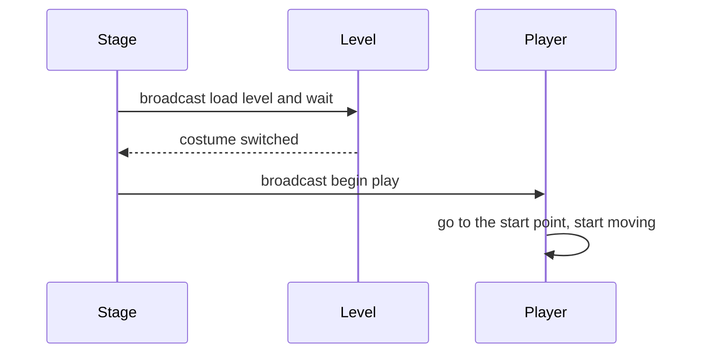

:::objectives
- Map a whole game as states and arrows before writing its broadcasts.
- Use `broadcast and wait` so a new level is fully set up before play begins.
- Store each level's settings in lists, one item per level.
- Compare difficulty curves and design one with rests.
- Adjust difficulty between rounds based on how the player did, within safe limits.
:::

Hand Ghost Patrol to a friend and watch. For the first minute they lean in. By minute three they're dodging on autopilot, because minute three is exactly as hard as minute one. The score climbs, but nothing else about the game changes.

Good games have a shape. There's a beginning that tells you what's going on, a middle that pushes harder and then lets you breathe, and an ending you can win or lose. None of that needs new blocks. It needs a plan for *when* things happen, and that's what this lesson is about.

## Map every state before you code

In Module 3 you kept a game's mode in a `state` variable and checked it before reacting to keys. A multi-level game has more states than a single round, and the arrows between them multiply fast. So draw the whole map first: every box is a state, and every arrow is a broadcast you'll have to write.

```mermaid caption="The states of a wave-based game. Each arrow is one broadcast."
stateDiagram-v2
    [*] --> Title
    Title --> Story: space pressed
    Story --> Playing: story finished
    Playing --> WaveCleared: all ghosts handled
    WaveCleared --> Playing: next wave starts
    WaveCleared --> Won: last wave cleared
    Playing --> GameOver: lives run out
    Won --> [*]
    GameOver --> [*]
```

Notice the loop between Playing and WaveCleared. The same two states repeat once per wave, which means the code for them should be written once and *fed* different numbers each time. That's the idea behind the next two sections.

Stories fit the same picture. Each scene is a state and each choice is an arrow. "The left door leads to the crypt, the right door to the tower" is one box with two arrows leaving it, and a player's typed `answer` decides which arrow to follow.

## Set up the level, *then* start playing

Starting a new level means several sprites must change at once: the level costume switches, the player moves to the new start point, the old enemies disappear. If the player starts moving before the new costume appears, it can begin the level *inside* a wall.

Module 3's `broadcast and wait` is the tool for this. Split every level change into two messages: one that gets everything ready, sent with **and wait**, and one that starts the action.



```scratch
when I receive [next level v]
change [level v] by (1)
broadcast (load level v) and wait
broadcast (begin play v)
```

Everything that must be ready goes in `load level` scripts. Everything that moves goes in `begin play` scripts. Plain `broadcast` doesn't wait, so the scripts that come next run alongside the ones it started, in an order you don't control.

## Levels are rows of settings

You could write a separate script for every level, but then five levels means five copies of the same code. Instead, write the code once and keep what *changes* between levels in lists, one item per level:

| Wave | `wave size` | `spawn gap` (seconds) |
| --- | --- | --- |
| 1 | 5 | 1.8 |
| 2 | 7 | 1.5 |
| 3 | 9 | 1.2 |
| 4 | 7 | 1.4 |
| 5 | 12 | 0.9 |

Each list is one column of this table, and the wave number picks the row:

```scratch
repeat (item (wave) of [wave size v])
  wait (item (wave) of [spawn gap v]) seconds
  create clone of (myself v)
end
```

Adding wave 6 is now two `add` blocks, not a new script. For a platformer, the level number can also pick the costume: `switch costume to (level)` with a number selects the costume in that position, so costume 3 is level 3.

## Shape the difficulty curve

How hard each level is, plotted in order, is the game's **difficulty curve**. Three common shapes:

```python run alt="Line chart of ghosts per minute over 8 waves for three designs. Flat stays at 30. Steady ramp rises evenly from 30 to 58. Ramp with rests climbs, dips at waves 4 and 7, and ends highest at wave 8." caption="Three difficulty curves for the same 8-wave game"
import matplotlib.pyplot as plt

waves = [1, 2, 3, 4, 5, 6, 7, 8]
flat = [30, 30, 30, 30, 30, 30, 30, 30]
steady = [30, 34, 38, 42, 46, 50, 54, 58]
rests = [30, 36, 42, 34, 44, 52, 42, 62]

plt.plot(waves, flat, marker="o", label="flat")
plt.plot(waves, steady, marker="o", label="steady ramp")
plt.plot(waves, rests, marker="o", label="ramp with rests")
plt.xlabel("Wave")
plt.ylabel("Ghosts per minute")
plt.legend()
```

The flat curve is what Ghost Patrol has now: easy to learn, boring by wave 3. The steady ramp never lets up, so players get tired and start losing on wave 6 without knowing why. The ramp with rests climbs, then drops for one easier wave (4 and 7) before climbing higher. That dip gives players a moment to feel how much better they've become, and it makes the next jump feel fair. Music and movies use the same tension-then-release shape.

Look at the table above again: wave 4 is a rest.

## Let the game adapt to the player

A fixed curve is a guess about a typical player. Your best friend and your little cousin aren't typical. **Adaptive difficulty** measures how the player is doing and nudges the challenge to match.

The recipe has three parts: measure something, adjust a difficulty number by a small step, and clamp it so it can't run away.

```scratch
define adapt difficulty
if <(lives lost) = (0)> then
  change [bonus v] by (0.5)
end
if <(lives lost) > (1)> then
  change [bonus v] by (-0.5)
end
if <(bonus) > (1.5)> then
  set [bonus v] to (1.5)
end
if <(bonus) < (-1)> then
  set [bonus v] to (-1)
end
```

A perfect wave makes the next one a little faster, a rough wave makes it a little slower, and one lost life changes nothing. The ghost factory adds `bonus` to each ghost's speed.

Two rules keep it from feeling unfair. Adjust **between** rounds, never in the middle, so the player can't see the game moving the goalposts. And keep the steps small: half a step of speed is something players feel without noticing why.

:::warning
**A difficulty number that goes too far breaks the game.** If `bonus` can reach −3 and a ghost's base speed is 1, its speed becomes −2 and it drifts *backward*, off the right edge, and the wave never ends. Clamp the difficulty number, and clamp anything you calculate from it (like a minimum ghost speed of 0.5).
:::

:::warning
**Last level's enemies are still flying.** Clones don't disappear when the level changes, and they hear `load level` too, so a factory that spawns on `load level` gets help from every old clone. Make `delete this clone` the first block of the factory's `load level` script. Each old clone runs it and vanishes; in the original sprite the block does nothing, so the original carries on and spawns the new level's enemies.
:::

:::video bxp4G-oJATM
Brackeys on difficulty in video games. Listen for how difficulty should change as a player gets better, and compare it with the three curves above.
:::

:::quiz
Q: The Stage runs `broadcast (load level v)` (without "and wait") and then `broadcast (begin play v)`. What can go wrong?
- [ ] Nothing, the messages always arrive in order
  They arrive in order, but plain `broadcast` doesn't wait for the first message's scripts to finish.
- [x] The player can start moving before the new level is ready
  `begin play` is sent while the `load level` scripts are still running, so the player might start inside a wall.
- [ ] The second message cancels the first
  A different message doesn't stop the first message's scripts.

Q: Using the table above, what does `item (wave) of [spawn gap v]` report during wave 3?
- [ ] 9
  That's `item (3) of [wave size v]`, the other list.
- [x] 1.2
  Wave 3 is row 3, and the third item of `spawn gap` is 1.2.
- [ ] 3
  The wave number picks the item; it isn't the item itself.

Q: A playtester loses 3 lives in wave 2. Using `adapt difficulty` above, starting from `bonus` = 0, what happens to the next wave?
- [x] Ghosts get 0.5 slower
  More than one life lost subtracts 0.5 from `bonus`.
- [ ] Ghosts get 1.5 slower
  The change is one step of 0.5, however badly the wave went.
- [ ] Nothing changes until the player loses
  The block runs after every wave, not just at game over.

Q: Why does the ramp with rests drop at waves 4 and 7?
- [ ] To make the game shorter
  The number of waves is the same in every curve.
- [x] To let the player recover and notice their own progress before it gets harder
  An easier wave after a hard one feels like relief, and it makes the next climb feel fair.
- [ ] Because the list was typed wrong
  The dips are on purpose; they're the whole point of the design.
:::

:::takeaways
- Draw your game's states first; every arrow becomes one broadcast.
- Clear old clones at the start of every level load.
- `broadcast and wait` makes a level fully ready before anything starts moving.
- Store what changes between levels in lists, one item per level, and write the level code once.
- Climb, rest, climb higher. Adapt between rounds in small, clamped steps.
:::

## Further reading

- [Broadcast on the Scratch Wiki](https://en.scratch-wiki.info/wiki/Broadcast): how messages work, including `broadcast and wait`.
- [Dynamic game difficulty balancing](https://en.wikipedia.org/wiki/Dynamic_game_difficulty_balancing): how commercial games adjust difficulty, with real examples.
- [Flow (psychology)](https://en.wikipedia.org/wiki/Flow_(psychology)): the idea that people enjoy tasks most when the challenge matches their skill.
