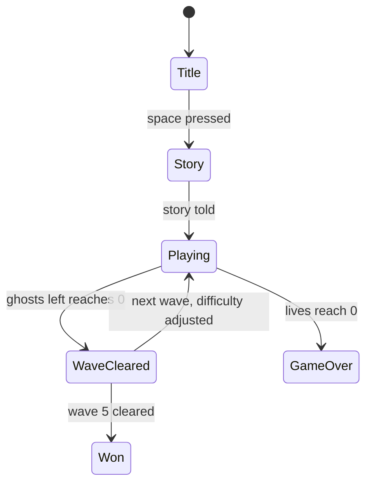

:::objectives
- Run a whole game from one Stage script that moves through title, story, waves, and endings.
- Read each wave's settings from two lists kept in step by a custom block.
- Count what's left in a wave so the game knows when it's over.
- Adapt ghost speed between waves, with clamps that keep the game winnable.
:::

Open your Ghost Patrol project from Module 6 (the full scripts are at the end of that lesson if you need them). Right now it starts instantly, never changes, and ends only when you lose. By the end of this build it will follow this plan:



The five waves follow the "ramp with rests" shape from the Notes. Wave 4 is the breather:

| Wave | Ghosts | Seconds between ghosts |
| --- | --- | --- |
| 1 | 5 | 1.8 |
| 2 | 7 | 1.5 |
| 3 | 9 | 1.2 |
| 4 | 7 | 1.4 |
| 5 | 12 | 0.9 |

## Step 1: New variables, lists, and a title screen

Make these, all **For all sprites**:

- Variables: `state`, `wave`, `ghosts left`, `lives lost`, `bonus`.
- Lists: `wave size` and `spawn gap`.

Leave the monitors for `score`, `lives`, and `wave` showing, and untick the rest. Keep `bonus` ticked for now; you'll want to watch it in Step 6.

Then make the title screen. Select the Stage, open the **Backdrops** tab, right-click Night City and choose **duplicate**. Rename the copy `Title`, and use the **Text** tool to write GHOST PATROL and "Press space to start" on it.

## Step 2: One custom block to set up the game

The Stage's green flag script is about to get long, so move all the setup into a custom block. Select the Stage, click **Make a Block**, and name it `set up game`. Make a second block called `add wave` with a number input `size`, a label "ghosts every", a number input `gap`, and a label "seconds".

```scratch
define set up game
set [score v] to (0)
set [lives v] to (3)
set [wave v] to (1)
set [bonus v] to (0)
delete all of [lanes v]
add (-120) to [lanes v]
add (-40) to [lanes v]
add (40) to [lanes v]
add (120) to [lanes v]
delete all of [wave size v]
delete all of [spawn gap v]
add wave (5) ghosts every (1.8) seconds
add wave (7) ghosts every (1.5) seconds
add wave (9) ghosts every (1.2) seconds
add wave (7) ghosts every (1.4) seconds
add wave (12) ghosts every (0.9) seconds

define add wave (size) ghosts every (gap) seconds
add (size) to [wave size v]
add (gap) to [spawn gap v]
```

`add wave` is there to keep the two lists in step. Every call adds one item to each, so item 4 of `wave size` and item 4 of `spawn gap` always describe the same wave. Each `add wave` line reads like a row of the table above, which makes the difficulty easy to tune later.

## Step 3: Title and story states

Replace the Stage's old green flag script with the start of the new one:

```scratch
when green flag clicked
set up game :: custom
switch backdrop to (Title v)
set [state v] to [title]
wait until <key (space v) pressed?>
set [state v] to [story]
switch backdrop to (Night City v)
broadcast (story v) and wait
set [state v] to [playing]
```

In the Wizard, delete the old `when I receive [start game v]` script and add these. The story is three speech bubbles, and `broadcast and wait` in the Stage holds everything until the last one finishes.

```scratch
when green flag clicked
set [lane v] to (2)
go to x: (-190) y: (-40)
say [Press space to start]

when I receive [story v]
say [Every midnight, the ghosts of Night City rise.] for (2.5) seconds
say [Hold them back for five waves and the sunrise will do the rest.] for (2.5) seconds
say [Up and down arrows to move. Space to cast.] for (2.5) seconds

when green flag clicked
forever
  wait until <<key (space v) pressed?> and <(state) = [playing]>>
  create clone of (Spark v)
  wait (0.3) seconds
end
```

Now guard the lane hops the same way, so the wizard can't wander during the title or story. Change the condition in both arrow-key scripts:

```scratch
when [up arrow v] key pressed
if <<(state) = [playing]> and <(lane) < (length of [lanes v])>> then
  change [lane v] by (1)
  set y to (item (lane) of [lanes v])
end
```

(The down arrow gets the same `(state) = [playing]` check, alongside `(lane) > (1)`.)

Click the green flag. The title shows and nothing moves. Press space and the wizard tells the story. The game doesn't start yet, because nothing broadcasts a wave. That's next.

## Step 4: Waves from lists

In the Ghost, replace the old forever spawner. The factory now makes exactly one wave's worth of ghosts and stops:

```scratch
when I receive [start wave v]
repeat (item (wave) of [wave size v])
  wait (item (wave) of [spawn gap v]) seconds
  spawn ghost in lane (pick random (1) to (length of [lanes v])) :: custom
end
```

The Stage needs to know when a wave is over: every ghost has either been hit or escaped. That's what `ghosts left` counts. Each ghost clone subtracts 1 when it's hit and when it escapes, and an escape also adds to `lives lost`:

```scratch
when I start as a clone
show
repeat until <(x position) < (-200)>
  change x by ((0) - (speed))
  if <touching (Spark v)?> then
    change [score v] by (1)
    change [ghosts left v] by (-1)
    vanish :: custom
  end
end
change [lives v] by (-1)
change [lives lost v] by (1)
change [ghosts left v] by (-1)
delete this clone
```

Back in the Stage, add the wave loop to the end of the green flag script:

```scratch
repeat until <<(lives) < (1)> or <(wave) > (length of [wave size v])>>
  set [ghosts left v] to (item (wave) of [wave size v])
  set [lives lost v] to (0)
  broadcast (start wave v)
  wait until <<(ghosts left) < (1)> or <(lives) < (1)>>
  if <(lives) > (0)> then
    change [wave v] by (1)
  end
end
```

Finally, announce each wave from the Wizard:

```scratch
when I receive [start wave v]
say (join [Wave ] (wave)) for (1) seconds
```

Play it. Wave 1 sends 5 slow ghosts. When the last one is gone, wave 2 begins at once with 7. The game now has a shape, but no pause between waves and no ending.

:::note
Ghost clones hear `start wave` too, so a clone still alive when the next wave starts would run its own spawner. That can't happen here: `ghosts left` only reaches 0 once every clone has been hit or has escaped, and each one deletes itself within a few frames of that.
:::

## Step 5: Rest stops and endings

Between waves, give the player a moment. Change the `if` inside the Stage's loop and add the endings after the loop:

```scratch
if <(lives) > (0)> then
  change [wave v] by (1)
  if <not <(wave) > (length of [wave size v])>> then
    broadcast (wave cleared v) and wait
  end
end
```

```scratch
set [state v] to [over]
if <(lives) > (0)> then
  broadcast (you win v) and wait
else
  broadcast (game over v) and wait
end
stop [all v]
```

The loop now handles losing as well as winning, so nothing else needs to watch `lives`. In the Wizard, add the matching speech:

```scratch
when I receive [wave cleared v]
say [Wave cleared! Catch your breath.] for (2) seconds

when I receive [you win v]
say (join [The sun is up. You saved the city! Score: ] (score)) for (3) seconds
```

Keep the Wizard's existing `game over` script. Setting `state` to `over` before the endings stops the space bar from casting sparks over the final message.

## Step 6: Adapt to the player

Add the `adapt difficulty` block from the Notes to the Stage, and call it just before `change [wave v] by (1)`:

```scratch
define adapt difficulty
if <(lives lost) = (0)> then
  change [bonus v] by (0.5)
end
if <(lives lost) > (1)> then
  change [bonus v] by (-0.5)
end
if <(bonus) > (1.5)> then
  set [bonus v] to (1.5)
end
if <(bonus) < (-1)> then
  set [bonus v] to (-1)
end
```

Then use `bonus` in the Ghost's spawn block, with a floor so no ghost ever stands still:

```scratch
define spawn ghost in lane (lane number)
go to x: (220) y: (item (lane number) of [lanes v])
set [speed v] to ((pick random (1) to (3)) + (bonus))
if <(speed) < (0.5)> then
  set [speed v] to (0.5)
end
create clone of (myself v)
```

Without that floor, `bonus` at −1 plus a base speed of 1 gives a speed of 0. That ghost would sit at the right edge forever, `ghosts left` would never reach 0, and the wave would never end.

## Step 7: Playtest with the dials showing

Play twice with the `bonus` monitor visible. First, play your best: after each perfect wave, `bonus` should rise by 0.5 and stop at 1.5. Then let ghosts through on purpose: after any wave where you lose 2 or more lives, it should drop. A one-life wave leaves it alone.

If wave 5 feels impossible even with `bonus` at −1, change its `add wave` line. Raising the gap from 0.9 to 1.0 seconds is a big change at that speed. When you're happy, untick `bonus` so players don't see the dial.

## The finished Stage script

The Stage also holds the three custom blocks from Steps 2 and 6. The Wizard, Ghost, and Spark scripts are the ones shown in the steps above, plus the Module 6 scripts you kept (`vanish`, the Spark clone, and both `game over` scripts).

```scratch
when green flag clicked
set up game :: custom
switch backdrop to (Title v)
set [state v] to [title]
wait until <key (space v) pressed?>
set [state v] to [story]
switch backdrop to (Night City v)
broadcast (story v) and wait
set [state v] to [playing]
repeat until <<(lives) < (1)> or <(wave) > (length of [wave size v])>>
  set [ghosts left v] to (item (wave) of [wave size v])
  set [lives lost v] to (0)
  broadcast (start wave v)
  wait until <<(ghosts left) < (1)> or <(lives) < (1)>>
  if <(lives) > (0)> then
    adapt difficulty :: custom
    change [wave v] by (1)
    if <not <(wave) > (length of [wave size v])>> then
      broadcast (wave cleared v) and wait
    end
  end
end
set [state v] to [over]
if <(lives) > (0)> then
  broadcast (you win v) and wait
else
  broadcast (game over v) and wait
end
stop [all v]
```

:::video b0MhF8pkSLw
A start-screen tutorial for Scratch games. Watch how the start screen is kept apart from the game itself, then compare it with the `state` variable you used here.
:::

:::quiz
Q: Why use an `add wave` custom block instead of separate `add` blocks for each list?
- [ ] Custom blocks make lists load faster
  Speed isn't the reason; both versions finish instantly.
- [x] Each call adds to both lists together, so their items always line up
  If one list got an extra item, every later wave would read the wrong gap. One block per row makes that mistake impossible.
- [ ] Lists can only be filled from custom blocks
  Any script can add to a list.

Q: Why does the spawn block set any speed below 0.5 back up to 0.5?
- [ ] To make the game harder
  It only affects the slowest ghosts, when `bonus` is low.
- [x] A ghost with speed 0 would never escape, so the wave would never end
  `ghosts left` only reaches 0 when every ghost is hit or escapes; a frozen ghost does neither.
- [ ] Scratch can't move a sprite by less than 1 step
  `change x by (0.3)` works fine; the floor is about keeping the game finishable.

Q: Why does `adapt difficulty` run between waves instead of every second during play?
- [x] Players notice and resent a game that changes the rules mid-wave
  Between waves the change feels like the next level, not like the game reacting to every mistake.
- [ ] Custom blocks can only run between broadcasts
  Custom blocks can run anywhere; this is a design choice.
- [ ] `lives lost` can only be read after a wave
  It's readable any time; it's reset at the start of each wave so it measures one wave.
:::

:::takeaways
- One Stage script that walks through the states is easier to follow than many scripts guessing what's happening.
- A custom block per row keeps parallel lists in step.
- Count what's left (`ghosts left`) so the game knows exactly when a wave is done.
- Every number that adapts needs a clamp, and so does anything calculated from it.
- Playtest with the hidden variables showing, then hide them.
:::

## Ideas to extend it

- **A boss wave.** Add a sixth wave with one huge, slow ghost that takes 10 hits (combine with the tough ghost challenge from Module 6).
- **Play again.** Instead of `stop [all v]`, wait for space and loop back to the title. Remember that `set up game` has to run again.
- **Story between waves.** Use the `wave cleared` message to tell one more line of the story each time.
- **Show the adaptation.** When `bonus` goes up, flash the backdrop with the brightness effect so skilled players know the game noticed.

## Further reading

- [Broadcast () and Wait on the Scratch Wiki](https://en.scratch-wiki.info/wiki/Broadcast_()_and_Wait): how the block holds its script until every receiving script has finished.
- [Game Projects on the Scratch Wiki](https://en.scratch-wiki.info/wiki/Game_Projects): a tour of game types with tips for each, useful for planning your capstone.
