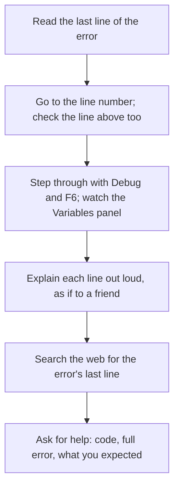

:::objectives
- Use each kind of lesson in this course (Notes, Build-along, Practice) the way it was designed.
- Organize your programs in module folders with names Python can handle.
- Read a Python error message in four steps, starting from the last line.
- Follow a routine for getting unstuck, and stop a program that won't stop.
:::

Here's a bug that catches someone in every beginner class. You write a dice game, save it as `random.py` because it uses random numbers, and run it:

```python
import random

roll = random.randint(1, 6)
print("You rolled", roll)
```

```text
Traceback (most recent call last):
  File "/Users/sam/Documents/beginner-python/random.py", line 1, in <module>
    import random
  File "/Users/sam/Documents/beginner-python/random.py", line 3, in <module>
    roll = random.randint(1, 6)
           ^^^^^^^^^^^^^^
AttributeError: module 'random' has no attribute 'randint' (consider renaming '/Users/sam/Documents/beginner-python/random.py' since it has the same name as the standard library module named 'random' and the import system gives it precedence)
```

The code is fine. The **file name** is the bug. `import random` is supposed to load Python's built-in random-number tools, but Python looks in your folder first, finds your own `random.py`, and loads that instead. Your file has no `randint` in it, so the program crashes. Rename the file `dice_game.py` and it works. (Python versions older than 3.13, like the one some Chromebooks install, give a vaguer message about a "partially initialized module" for the same mistake.)

This page is about habits like that: small things that save hours.

## How the lessons in this course fit together

Modules 2 to 7 each teach one big idea in three lessons:

| Lesson | What it is | How to use it |
| --- | --- | --- |
| 1: Notes | The ideas, with small examples you can run | Read with Thonny open. Retype the examples and change them. |
| 2: Build-along | One complete program, built a step at a time | Build it yourself in your own file, running it after every step. |
| 3: Practice | Six exercises that get harder, plus a challenge | Try each one before you open the hint, and the hint before the solution. |

Module 8 is a capstone: you plan and build a program of your own choosing.

Three habits make the biggest difference. **Type the code rather than pasting it**; that's how you learn where the colons and brackets go. **Predict before you run**: say out loud what you think a program will print, then check. Being wrong and finding out why is where most of the learning happens. And when a lesson offers a step-through animation, actually step through it, because it shows the thing beginners can't see: values changing.

## One folder, one subfolder per module

You made `beginner-python` in the last lesson. Inside it, make one folder per module, and save each program in the folder for the module it belongs to:

```text
beginner-python/
├── m1/
│   └── first_run.py
├── m2/
│   ├── kiosk_greeting.py
│   └── adventure_stats.py
├── m3/
│   └── signup_slip.py
└── m4/
    └── bike_fare.py
```

Move `first_run.py` into `m1` now. When you're looking for "that program with the bike prices" a month from now, you'll know where it is.

## Name files so Python can use them

Python file names follow the same rules as names inside Python, and breaking them causes problems later, when you try to `import` one file from another.

-   Use only lowercase letters, digits, and underscores, and end with `.py`: `bike_fare.py`, `exercise_3.py`.
-   No spaces. `my program.py` runs today but can't be imported tomorrow.
-   Don't start with a digit. `3_exercise.py` has the same import problem.
-   Never name a file after something Python already has: `random.py`, `math.py`, `time.py`, `string.py`, `turtle.py`. Thonny pops up a **Potential problem** warning if you try some of these. Take the hint.

:::tip
Before you make a big change to a program that works, keep a copy. **File › Save as…** with a new name like `bike_fare_v2.py` means you can always go back to the version that worked.
:::

## Save often, and know where your files really are

Thonny saves your file every time you click Run, but only after it has a name. An `<untitled>` tab is lost if Thonny crashes, so give every program a name before you write more than a couple of lines.

On a **Chromebook**, the **Linux files** area lives only on that Chromebook. It isn't copied to Google Drive, and removing Linux deletes it. After each module, copy your `beginner-python` folder into Google Drive in the Files app. On Windows and Mac, if your Documents folder syncs to OneDrive or iCloud, you're already covered.

## Read an error message from the bottom up

An error message is called a **traceback**. It looks scary because it's long, but it's always built the same way. Here's a program with a typo on its last line:

```python run raises title="win_rate.py"
team = "Hawks"
wins = 7
games_played = 10
print(team, "have", wins, "wins.")
print("Win rate:", wins / games_payed)
```

Read it in this order:

1.  **The last line first.** It gives the error's type (`NameError`) and a message in plain-ish English: there's no variable called `games_payed`. Python even guesses what you meant.
2.  **The line number.** `File "main.py", line 5` tells you which line crashed. (In Thonny you'll see your own file name; click it to jump to that line.)
3.  **The carets.** The `^^^^` marks under the code point at the exact part that failed.
4.  **The line itself, and the one above it.** Here the fix is on line 5: `payed` should be `played`. For syntax errors, the real mistake is often at the end of the line *above* the one Python reports.

Notice that line 4 ran and printed before the crash. Python runs lines in order, and it stops at the first line it can't run. Everything above that line already happened.

:::video 3p3p6kp39to
A walk through the parts of a Python traceback. Watch for why you read it from the bottom, and how the lines above the error show the route Python took to get there.
:::

## A routine for when you're stuck

Being stuck is a normal part of programming, not a sign you're bad at it. What matters is having a next step. Work through this list in order:



Two of these need explaining. **Explaining out loud** works surprisingly often: when you say "this line adds the tax… wait, no it doesn't", you find the bug yourself. Programmers call this rubber-duck debugging, after the idea of explaining your code to a rubber duck on your desk.

**Asking well** gets you help faster. Include the code, the *whole* error message, what you expected to happen, and what you've already tried. "It doesn't work" can't be answered; "line 5 gives NameError and I expected it to print 0.7" can.

If you use an AI chatbot, ask it to explain the error message rather than to rewrite your program. You'll learn to fix it, and next time you won't need to ask.

## When a program won't stop

Sometimes a program seems frozen. Usually it's one of two things:

-   **It's waiting for you to type something.** A program that uses `input()` pauses until you type an answer in the Shell and press Enter. Click in the Shell and look for a prompt.
-   **It's stuck repeating forever.** You'll meet loops in Module 5, and one that never ends will keep printing or keep the Shell busy.

Either way, the red **Stop** button (or **Run › Stop/Restart backend**, Ctrl+F2) ends the program and gives you a fresh `>>>` prompt. Nothing is lost: your file is still in the editor.

:::takeaways
- Never name a program after a Python module like `random` or `math`; Python will load your file instead.
- Keep one folder per module, and use lowercase names with underscores.
- Read errors from the bottom: the type and message, then the line number, then the carets.
- When stuck: read, step through, explain out loud, search, and then ask with code, error, and expectation.
- The red Stop button rescues a program that's waiting or looping forever.
:::

## Further reading

-   [Errors and Exceptions in the Python tutorial](https://docs.python.org/3/tutorial/errors.html): the difference between syntax errors and the errors that happen while a program runs.
-   [Built-in Exceptions](https://docs.python.org/3/library/exceptions.html): look up any error type you meet, like `NameError` or `TypeError`, and see exactly what it means.
