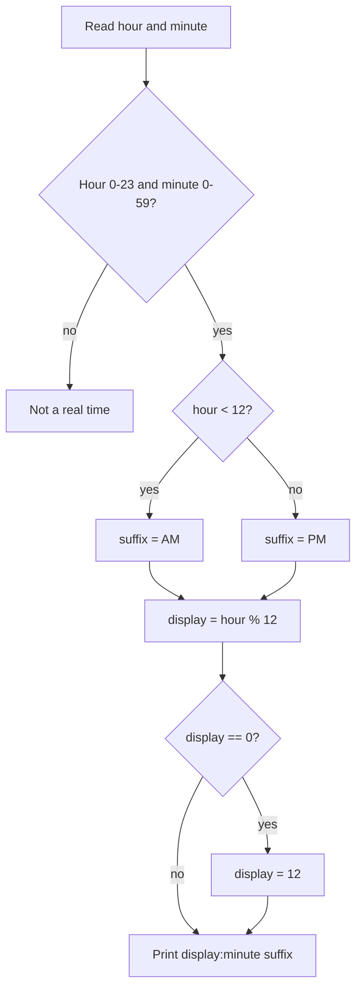

:::objectives
- Use `//` and `%` to split a number into whole groups and leftovers.
- Order an `if`/`elif` chain so the right branch wins.
- Combine conditions with `and` and `or`, using brackets to make the meaning clear.
- Compare negative numbers correctly.
- Find decision bugs by testing just below, on, and just above every cutoff.
:::

Save each exercise as its own file in your `m4` folder. For every exercise that makes a decision, write down two or three boundary tests and their expected results **before** you run anything. The solutions list the tests worth trying.

**Warm-up.** In the Shell, predict and then check `17 // 5`, `17 % 5`, `2 ** 5`, and `10 / 4`. Which one gives a float, and why?

### Exercise 1: Egg cartons

A farm packs eggs into cartons of 12. Ask how many eggs there are, then print how many cartons are full, how many eggs are left over, and how many cartons are needed in total (a part-full carton still counts).

```text
How many eggs? 30
2 full cartons with 6 eggs left over.
Cartons needed: 3
```

:::hint
`//` gives the full cartons and `%` gives the leftover. You need one extra carton only when the leftover is more than 0. Test with 24 (no leftover) and 5 (no full cartons).
:::

:::solution
```python run title="eggs.py" input="30"
eggs = int(input("How many eggs? "))
full = eggs // 12
left = eggs % 12
cartons = full
if left > 0:
    cartons += 1
print(f"{full} full cartons with {left} eggs left over.")
print(f"Cartons needed: {cartons}")
```

With 24 eggs, `left` is 0, so no extra carton is added and the answer is 2. With 5 eggs, `full` is 0 and the `if` adds 1. This "round up when there's a remainder" pattern comes up all the time: buses for a trip, pages for a list, boxes for a delivery.
:::

### Exercise 2: FizzBuzz for one number

FizzBuzz is a classic programming puzzle. Ask for a whole number. Print `Fizz` if it divides exactly by 3, `Buzz` if it divides exactly by 5, `FizzBuzz` if it divides by both, and otherwise the number itself.

```text
Number: 30
FizzBuzz
```

:::hint
`n % 3 == 0` means "divides exactly by 3". Test with 30. If your program prints `Fizz`, think about which check has to come first.
:::

:::solution
```python run title="fizzbuzz_one.py" input="30"
n = int(input("Number: "))
if n % 15 == 0:
    print("FizzBuzz")
elif n % 3 == 0:
    print("Fizz")
elif n % 5 == 0:
    print("Buzz")
else:
    print(n)
```

Numbers that divide by both 3 and 5 divide by 15, and they also pass the `% 3` test, so the both-at-once check must come first or it would never be reached. Good tests: 9 (Fizz), 10 (Buzz), 30 (FizzBuzz), and 7 (just the number).
:::

### Exercise 3: Can they swim alone?

A public pool's rule: swimmers aged **12 or over** can swim on their own. Swimmers aged **8 to 11** can swim on their own if they've **passed the swim test**. Everyone else needs an adult in the water. Ask for the age and whether they passed the test.

```text
Swimmer's age: 9
Passed the swim test? (yes/no) yes
You can swim on your own.
```

:::hint
There are two ways to be allowed: "12 or over", **or** "8 or over **and** passed". Turn the yes/no answer into a `bool` with `.strip().lower().startswith("y")`, as in Module 3.
:::

:::solution
```python run title="pool.py" input="9|yes"
age = int(input("Swimmer's age: "))
passed = input("Passed the swim test? (yes/no) ").strip().lower().startswith("y")
if age >= 12 or (age >= 8 and passed):
    print("You can swim on your own.")
else:
    print("You need an adult with you in the water.")
```

Python works out `and` before `or`, so the brackets aren't strictly needed, but they make the two routes obvious to anyone reading. The boundaries are ages 7, 8, 11 and 12, each with and without the test: 7 with a pass still needs an adult, 8 with a pass doesn't, 11 without a pass does, and 12 never does.
:::

### Exercise 4: Wi-Fi bars

Wi-Fi strength is measured in dBm, and the numbers are negative: -40 is a strong signal and -85 is a weak one. As a rough guide, -50 or higher is 4 bars, -60 or higher is 3, -70 or higher is 2, -80 or higher is 1, and anything lower has no usable signal. A positive number is impossible. Ask for the reading and print the bars.

```text
Signal strength (dBm): -67
2 bars: fair
```

:::hint
-67 is *greater* than -70, because it's closer to zero. So the comparisons work exactly like the UV index: start with the highest cutoff (-50) and go down. Check for impossible values first.
:::

:::solution
```python run title="wifi_bars.py" input="-67"
signal = int(input("Signal strength (dBm): "))
if signal > 0:
    print("That can't be right: Wi-Fi signal is always 0 dBm or below.")
elif signal >= -50:
    print("4 bars: excellent")
elif signal >= -60:
    print("3 bars: good")
elif signal >= -70:
    print("2 bars: fair")
elif signal >= -80:
    print("1 bar: weak")
else:
    print("No usable signal")
```

Test each cutoff and the number just past it: -50 and -51, -60 and -61, -70 and -71, -80 and -81. If -51 gives 4 bars, you've used `>` where you meant `>=`, or put the checks in the wrong order. Negative numbers feel backwards at first, so it helps to picture a number line: further right means bigger.
:::

### Exercise 5: Shipping costs

An online shop charges $4.99 for standard shipping, but standard shipping is free on orders of **$35.00 or more**. Express shipping always costs $12.99, whatever the order. Ask for the subtotal and whether the customer wants express, then print the shipping cost and the total.

```text
Subtotal: $34.99
Express shipping? (yes/no) no
Shipping: $4.99
Total: $39.98
```

:::hint
Which question decides things first: the order size or express? If someone picks express, the free-shipping rule doesn't matter. Put the prices in constants and test 34.99 and 35.00.
:::

:::solution
```python run title="shipping.py" input="34.99|no"
FREE_SHIPPING_AT = 35.00
STANDARD = 4.99
EXPRESS = 12.99

subtotal = float(input("Subtotal: $"))
express = input("Express shipping? (yes/no) ").strip().lower().startswith("y")

if express:
    shipping = EXPRESS
elif subtotal >= FREE_SHIPPING_AT:
    shipping = 0
else:
    shipping = STANDARD

print(f"Shipping: ${shipping:.2f}")
print(f"Total: ${subtotal + shipping:.2f}")
```

Express is checked first because it overrides everything else. Then "$35.00 or more" becomes `>=`, so an order of exactly $35.00 ships free. Test 34.99 (pays $4.99), 35.00 (free), and an express order of any size (always $12.99).
:::

### Exercise 6: The discount that never gets bigger

A shop gives **10% off orders of $50 or more** and **20% off orders of $100 or more**. This program has two bugs. Before changing anything, fill in a test table for 49.99, 50, 99.99, 100 and 120, writing what *should* happen. Then run each one and mark the rows that are wrong.

```python run title="discount_bug.py" input="120"
total = float(input("Order total: $"))
if total > 50:
    discount = 0.10
elif total > 100:
    discount = 0.20
else:
    discount = 0
print(f"Discount: {discount:.0%}")
print(f"You pay: ${total * (1 - discount):.2f}")
```

(`:.0%` shows a number as a percentage with no decimal places, so `0.1` prints as `10%`.)

:::hint
Three of your five tests should fail, for two different reasons. An order of $120 should get 20%: why can the `elif` never run? An order of exactly $50 should get 10%: which word in the rule ("or more") isn't in the code?
:::

:::solution
| Order | Should get | Buggy program gave |
| --- | --- | --- |
| 49.99 | 0% | 0% |
| 50 | 10% | 0% (wrong) |
| 99.99 | 10% | 10% |
| 100 | 20% | 10% (wrong) |
| 120 | 20% | 10% (wrong) |

```python run title="discount.py" input="100"
total = float(input("Order total: $"))
if total >= 100:
    discount = 0.20
elif total >= 50:
    discount = 0.10
else:
    discount = 0
print(f"Discount: {discount:.0%}")
print(f"You pay: ${total * (1 - discount):.2f}")
```

Bug one is the order: any total over 100 is also over 50, so the 10% branch won every time and 20% was unreachable. Bug two is `>` instead of `>=`: "or more" includes the cutoff itself. The 120 test catches the first bug; only the exact-cutoff tests, 50 and 100, catch the second. That's why boundary tests use the cutoff itself, not just numbers near it.
:::

### Challenge: 24-hour to 12-hour clock

Ask for an hour (0 to 23) and a minute (0 to 59) in 24-hour time and print it in 12-hour time with AM or PM. Minutes always have two digits. Reject times that don't exist.

```text
Hour (0-23): 0
Minute (0-59): 5
12:05 AM
```

Your program must get these right: `0:05` → `12:05 AM`, `9:30` → `9:30 AM`, `12:00` → `12:00 PM`, `13:45` → `1:45 PM`, `23:59` → `11:59 PM`, and `24:00` → not a real time.



:::hint
`hour % 12` turns 13 into 1 and 23 into 11, but it turns both 0 and 12 into 0, and the clock shows 12 for both. The format spec `:02d` pads a number to two digits with a leading zero, so `5` prints as `05`.
:::

:::solution
```python run title="clock.py" input="0|5"
hour = int(input("Hour (0-23): "))
minute = int(input("Minute (0-59): "))

if hour < 0 or hour > 23 or minute < 0 or minute > 59:
    print("That isn't a real time.")
else:
    if hour < 12:
        suffix = "AM"
    else:
        suffix = "PM"
    display_hour = hour % 12
    if display_hour == 0:
        display_hour = 12
    print(f"{display_hour}:{minute:02d} {suffix}")
```

The validity check uses `or` because *any one* bad part makes the time impossible. AM or PM depends only on whether the hour is before noon. `% 12` handles every hour except the two that land on 0, midnight and noon, which the final `if` fixes. The trickiest boundaries are 0, 11, 12 and 13; test all four.
:::
