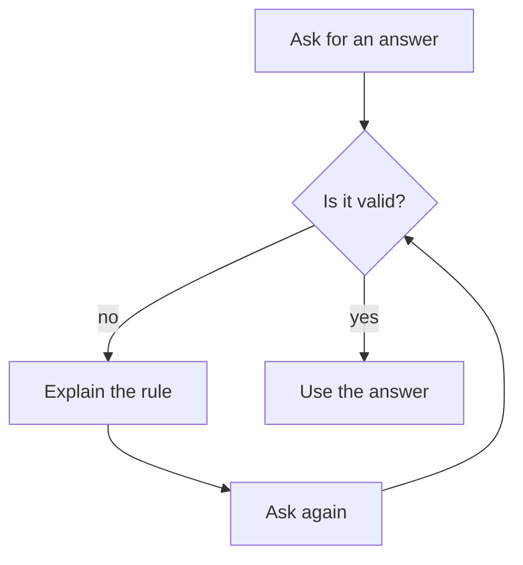

:::objectives
- Write a `while` loop that keeps asking until the user types a valid answer.
- Use `for` with `range()` and with a list to repeat work a known number of times.
- Keep a running total, a count, and a best-so-far value inside a loop.
- Leave a loop early with `break`, skip a pass with `continue`, and watch a loop run in Thonny's debugger.
:::

Here is one quiz question, and it has a flaw you won't see until a real person uses it.

```python run title="one_question.py" input="7"
choice = input("Largest ocean? (1) Atlantic (2) Pacific (3) Indian: ")
if choice == "2":
    print("Correct!")
else:
    print("Not quite. It's the Pacific.")
```

The player typed `7`, which isn't one of the choices, and the program graded it as a wrong answer anyway. A better program would say "please pick 1, 2, or 3" and ask again. But how many times? Once? Five times? You can't know in advance, so copying and pasting the `input()` line can never be enough. You need a way to say "repeat this until the answer makes sense." That is what a loop does.

## `while`: repeat as long as something is true

Think of brushing your teeth: you keep going while they still feel fuzzy. You don't decide on a number of strokes ahead of time; you check, brush, and check again.

Python's `while` loop works the same way. It checks a condition. If the condition is `True`, it runs the indented lines underneath (the **body**), then jumps back up and checks again. The moment the condition is `False`, Python skips the body and carries on with the rest of the program. Each trip through the body is one **iteration**.

Before you run this, guess how many "still gaming" lines it prints.

```python run title="battery.py"
battery = 100
while battery > 20:
    print(f"Battery at {battery}%, still gaming")
    battery = battery - 30
print(f"Battery at {battery}%. Time to charge.")
```

Three lines, not four. After the third pass `battery` is 10, so `battery > 20` is `False` and the loop ends. The line `battery = battery - 30` is what makes the loop finish: every pass moves the battery closer to the stopping point. Python also lets you write that line as `battery -= 30`, which means exactly the same thing.

## Keep asking until the answer is valid

Now back to the quiz. The fix uses a pattern you'll write over and over in this course, called a **validation loop**:

1.  Ask once, before the loop.
2.  Loop **while** the answer is bad: explain the rule, then ask again.
3.  After the loop, you know the answer is good.

```python run title="valid_choice.py" input="7|two|2"
choice = input("Largest ocean? (1) Atlantic (2) Pacific (3) Indian: ")
while choice not in ["1", "2", "3"]:
    print("Please type 1, 2, or 3.")
    choice = input("Largest ocean? (1) Atlantic (2) Pacific (3) Indian: ")

if choice == "2":
    print("Correct! The Pacific covers about a third of Earth's surface.")
else:
    print("Not quite. It's the Pacific.")
```

`choice not in ["1", "2", "3"]` is `True` when the answer matches none of the three allowed strings. The player typed `7`, then `two`, and the loop caught both. Only `2` got through to the `if`.

Step through it and keep your eye on `choice`. Notice that the `while` line is checked three times, but the last line runs only once.

:::trace Watch the validation loop catch two bad answers
```python input="7|two|2"
choice = input("Pick 1, 2, or 3: ")
while choice not in ["1", "2", "3"]:
    print("Please type 1, 2, or 3.")
    choice = input("Pick 1, 2, or 3: ")
print("You picked", choice)
```
:::

The same shape works for numbers. A string's `.isdigit()` method gives `True` only if the string is non-empty and every character is a digit like 0 to 9, which makes it a handy check before you call `int()`:

```python run title="ask_age.py" input="fourteen|-3|14"
text = input("How old are you? ")
while not text.isdigit():
    print("Use digits only, like 14.")
    text = input("How old are you? ")
age = int(text)
print(f"In five years you'll be {age + 5}.")
```

`-3` was turned away because `-` is not a digit. For an age, that's what you want. (In Module 7 you'll meet `try` and `except`, which can also handle negative numbers and decimals.)



## `for`: repeat once for each item

A `while` loop runs until something changes. A `for` loop runs once for **each item** in a collection, so you know up front how many passes it will make.

The simplest collection is a `range` of numbers. `range(5)` gives 0, 1, 2, 3, 4. Give it two numbers and it starts at the first and stops **before** the second. A third number sets the step size.

```python run title="stretch_breaks.py"
for minute in range(0, 60, 15):
    print(f"Minute {minute}: stand up and stretch")
print("Study hour finished")
```

The loop variable `minute` takes each value in turn: 0, 15, 30, 45. It never reaches 60, because `range` stops before the stop value. Only the indented line repeats; the last line runs once, after the loop.

A `for` loop can also walk through a **list**, a sequence of values written inside square brackets and separated by commas. You'll do much more with lists in Module 7. For now, here is the most useful thing a list can do:

```python run title="playlist.py"
songs = ["Intro", "Skyline", "Night Drive", "Outro"]
for song in songs:
    print("Now playing:", song)
print(len(songs), "songs played")
```

Each pass, `song` holds the next item. `len(songs)` counts the items. Notice that you never wrote "4" anywhere in the loop; add a fifth song to the list and the loop plays it too.

:::tip
Choose loop variable names that describe one item: `for song in songs`, `for minute in range(...)`. Code like `for x in y` works, but you'll have to work out what `x` means every time you read it.
:::

## Running totals, counts, and best-so-far

Loops get useful when each pass adds to something. This is the **accumulator pattern**: create a variable *before* the loop, update it *inside* the loop, and use it *after* the loop.

```python run title="basketball.py"
points = [12, 18, 7, 22, 15]
total = 0
big_games = 0
best = 0

for game in points:
    total = total + game
    if game >= 15:
        big_games = big_games + 1
    if game > best:
        best = game

print("Total points:", total)
print("Games with 15 or more:", big_games)
print("Best game:", best)
print("Average:", total / len(points))
```

Three accumulators share one loop. `total` adds every game. `big_games` adds 1 only when a condition is true, so it counts. `best` changes only when a game beats the record so far. Step through a shorter version and watch both variables change:

:::trace Watch `total` and `best` update on each pass
```python
points = [12, 18, 7]
total = 0
best = 0
for game in points:
    total = total + game
    if game > best:
        best = game
print(total, best)
```
:::

On the third pass, `game` is 7. It gets added to `total`, but `7 > 18` is `False`, so `best` stays at 18.

## `break` and `continue`: leave early or skip ahead

Sometimes you don't know how many items are coming, like a coach typing in scores until they're finished. Two keywords help:

-   `break` ends the loop immediately. Python jumps to the first line after the loop.
-   `continue` skips the rest of *this* pass and goes straight back to the top for the next one.

```python run title="scores.py" input="8||10|7|done"
total = 0
count = 0
while True:
    entry = input("Score (or 'done'): ")
    if entry == "done":
        break
    if entry == "":
        continue
    total = total + int(entry)
    count = count + 1
print(f"{count} scores, average {total / count:.1f}")
```

`while True` would run forever on its own, so the `break` is the only way out. When the coach pressed Enter on an empty line, `continue` jumped back to `input()` without adding anything, which is why the count is 3 and not 4. The `:.1f` inside the f-string rounds the average to one decimal place.

## Watch a loop run in Thonny

Reading a loop is one thing; seeing it is another. Thonny's debugger lets you run a program one step at a time:

1.  Open **View › Variables** so the Variables panel is showing.
2.  Start the debugger with **Run › Debug current script (nicer)**, the **Debug** button on the toolbar, or **Ctrl+F5**. (On a Mac you may need to hold **fn** for the F keys.)
3.  Press **F6** (Step over) to run one statement at a time. Watch the highlighted line jump back to the `while` or `for` after each pass, and watch the values change in the Variables panel.
4.  Press **F8** (Resume) to run the rest normally, or the red **Stop** button to quit.

Try it with `basketball.py`. Seeing `best` sit still while `total` keeps climbing makes the accumulator pattern click.

:::video 6iF8Xb7Z3wQ
Corey Schafer covers `for` and `while` loops and the `break` and `continue` keywords. Watch for the `while True` loop near the end and how `break` gets out of it, the same trick `scores.py` uses.
:::

## Mistakes that trip up everyone

:::warning
**Forgetting to ask again inside a validation loop.** If the `input()` line only appears before the loop, a bad answer never changes, and the program prints "Please type 1, 2, or 3." forever. Any loop whose condition never becomes `False` is an **infinite loop**. In Thonny, click the red **Stop** button (or press **Ctrl+F2**) to end it, then make sure the body changes something the condition checks.
:::

:::warning
**Off by one with `range`.** `range(1, 10)` gives 1 to 9, not 1 to 10. If you want the last number included, make the stop value one bigger: `range(1, 11)`.
:::

A loop that sometimes runs zero times can also crash code that comes after it. Here the coach types `done` straight away:

```python run raises input="done"
total = 0
count = 0
while True:
    entry = input("Score (or 'done'): ")
    if entry == "done":
        break
    total = total + int(entry)
    count = count + 1
print(f"Average: {total / count:.1f}")
```

`count` is still 0, and dividing by zero is not allowed. The fix is a check after the loop: `if count > 0:` print the average, `else:` print "No scores entered."

:::quiz
Q: What does this print? `n = 1`, then `while n < 20:` with the body `n = n * 3`, then `print(n)` after the loop.
- [ ] `9`
  9 is still less than 20, so the loop runs one more time.
- [x] `27`
  `n` goes 1, 3, 9, 27. When `n` is 27, `n < 20` is `False`, and the loop stops with 27.
- [ ] `20`
  The condition uses 20 as a limit, but `n` only ever holds powers of 3.
- [ ] Nothing, it loops forever
  `n` grows every pass, so the condition eventually becomes `False`.

Q: Which numbers does `for i in range(2, 10, 3): print(i)` print?
- [ ] 2, 5, 8, 11
  `range` stops before 10, so 11 is never produced.
- [x] 2, 5, 8
  Start at 2 and add 3 each time: 2, 5, 8. The next value, 11, is past the stop.
- [ ] 3, 6, 9
  The first number is where it starts, so 2 comes first.

Q: A validation loop prints "Please type yes or no." over and over without waiting for the user. What is the most likely bug?
- [x] The body never calls `input()` again
  The answer never changes, so the condition stays `True` forever.
- [ ] The condition uses `not in`
  `not in` is fine; it's the standard way to check for an answer outside the allowed list.
- [ ] The loop needs a `for` instead
  You don't know how many tries a person will need, so `while` is the right loop.

Q: In `scores.py`, what happens if the `continue` on the blank-line check is changed to `break`?
- [ ] Blank lines are still skipped
  `break` doesn't skip; it ends the whole loop.
- [ ] The program crashes on a blank line
  `break` happens before `int(entry)`, so nothing crashes there.
- [x] The loop ends at the first blank line, as if the coach typed `done`
  `break` leaves the loop entirely, so any scores after the blank are never asked for.
:::

:::takeaways
- A `while` loop repeats as long as its condition is `True`; something in the body must eventually make it `False`.
- A validation loop asks once before the loop, then asks again inside the loop until the answer passes.
- A `for` loop runs once per item in a `range` or a list; `range(start, stop, step)` stops *before* `stop`.
- Accumulators start before the loop, change inside it, and are used after it.
- `break` leaves a loop now; `continue` skips to the next pass.
:::

## Further reading

- [Python tutorial: More Control Flow Tools](https://docs.python.org/3/tutorial/controlflow.html): the official explanation of `while`, `for`, `range()`, `break`, and `continue`, with short examples.
- [Python docs: str.isdigit()](https://docs.python.org/3/library/stdtypes.html#str.isdigit): exactly which characters count as digits.
- [Thonny's home page](https://thonny.org/): short animations of stepping through code and watching variables.
