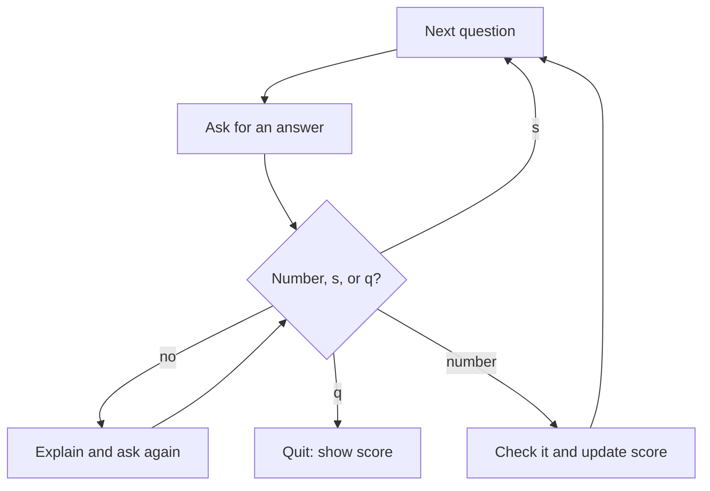

:::objectives
- Combine a `for` loop (one pass per question) with a `while` loop (one pass per bad answer).
- Use `random.randint()` to make new questions, and `random.seed()` to make them repeatable while you test.
- Keep score with accumulators and turn the score into a percentage.
- Use `break` to quit early and `continue` to skip a question.
:::

You're going to build a quick-fire multiplication quiz. It asks five questions, refuses answers like `seventy`, lets the player skip or quit, and grades them at the end. Here's a session with the finished program, where the player gets one right, skips one, mistypes one, gets one wrong, and then quits:

```text
Mental math sprint: 5 questions.
Type s to skip a question or q to quit.

Q1: 5 x 11 = 55
  Correct!
Q2: 10 x 4 = s
  Skipped. It was 40.
Q3: 7 x 11 = seventy
  Type a whole number, s to skip, or q to quit.
Q3: 7 x 11 = 77
  Correct!
Q4: 9 x 12 = 100
  Not quite: 9 x 12 = 108
Q5: 11 x 3 = q

Score: 2 out of 4 (50%)
Solid. A few more rounds and you'll be quicker.
```

The program has two loops, one inside the other. The outer `for` loop runs once per question. The inner `while` loop runs once per bad answer, which is usually zero times.



Open Thonny, make a new file, and save it as `sprint.py` in your `m5` folder. Type each step in yourself rather than pasting; you'll catch more of your own typos that way.

## Step 1: Ask one question

Start with a single question and fixed numbers, so there's nothing random to confuse you yet.

```python run title="sprint.py" input="56"
a = 7
b = 8
answer = input(f"{a} x {b} = ")
if int(answer) == a * b:
    print("Correct!")
else:
    print(f"Not quite: {a} x {b} = {a * b}")
```

`input()` always gives back a string, so `int(answer)` converts it before comparing. That works for `56`. Now try what a real player might type:

```python run raises input="fifty-six"
a = 7
b = 8
answer = input(f"{a} x {b} = ")
if int(answer) == a * b:
    print("Correct!")
```

`int()` can't turn the word `fifty-six` into a number, so the program crashes. The last line of the error names the problem: a `ValueError`, with the exact text that caused it. A quiz that crashes on a typo isn't fun, so that's the next thing to fix.

## Step 2: Refuse answers that aren't numbers

Add a validation loop between the `input()` and the `if`. It keeps asking while the answer isn't made of digits:

```python run title="sprint.py" input="fifty-six|56"
a = 7
b = 8
answer = input(f"{a} x {b} = ")
while not answer.isdigit():
    print("  Type a whole number, like 42.")
    answer = input(f"{a} x {b} = ")

if int(answer) == a * b:
    print("Correct!")
else:
    print(f"Not quite: {a} x {b} = {a * b}")
```

By the time Python reaches the `if`, `answer` is guaranteed to be all digits, so `int(answer)` can't crash. The two spaces at the start of the hint message are only there to indent it, so it stands out from the questions.

## Step 3: Five random questions

Now wrap the question in a `for` loop and let Python pick the numbers. `random.randint(2, 12)` returns a random whole number from 2 to 12, and unlike `range`, it **includes** both ends.

```python run title="sprint.py" input="55|40|76|108|33"
import random

random.seed(3)  # same questions every run while testing

for number in range(1, 6):
    a = random.randint(2, 12)
    b = random.randint(2, 12)
    answer = input(f"Q{number}: {a} x {b} = ")
    while not answer.isdigit():
        print("  Type a whole number, like 42.")
        answer = input(f"Q{number}: {a} x {b} = ")

    if int(answer) == a * b:
        print("  Correct!")
    else:
        print(f"  Not quite: {a} x {b} = {a * b}")
```

Three things changed:

-   `import random` at the top loads Python's `random` module so you can use its functions.
-   Everything about one question moved inside the `for` loop and got indented one level. The `while` loop is now indented twice, because it lives inside the `for`.
-   `range(1, 6)` gives 1 to 5, so the questions are numbered the way people count.

`random.seed(3)` deserves a word. Random numbers make testing hard: you can't check an answer if the question changes every run. Seeding the generator with a fixed number makes it produce the same "random" sequence each time, so you'll see `5 x 11` first every run. When the quiz works, delete that line and every game will be different.

:::try
Change `randint(2, 12)` to `randint(2, 20)` and run it again. Then change `range(1, 6)` to `range(1, 11)`. You just made a harder, longer quiz by editing two numbers.
:::

## Step 4: Keep score

A quiz needs a score. That's an accumulator: create it before the loop, add to it inside the loop, and report it after the loop. While you're at it, replace the magic number 5 with a named constant, `ROUNDS`, so the question count lives in one place.

```python run title="sprint.py" input="55|40|eighty|77|100|33"
import random

random.seed(3)

ROUNDS = 5
score = 0

for number in range(1, ROUNDS + 1):
    a = random.randint(2, 12)
    b = random.randint(2, 12)
    answer = input(f"Q{number}: {a} x {b} = ")
    while not answer.isdigit():
        print("  Type a whole number, like 42.")
        answer = input(f"Q{number}: {a} x {b} = ")

    if int(answer) == a * b:
        score = score + 1
        print("  Correct!")
    else:
        print(f"  Not quite: {a} x {b} = {a * b}")

print(f"You got {score} out of {ROUNDS}.")
```

`score` starts at 0 and only grows inside the `if` branch for correct answers. Names in capital letters, like `ROUNDS`, are a Python habit meaning "this value is set once and never changed."

Step through a two-question version below. Watch `score` go up only on the correct answer, and see how the `while` loop runs once for the typo and zero times otherwise.

:::trace Watch the inner loop catch a typo and `score` update
```python input="55|forty|41"
import random
random.seed(3)
score = 0
for number in range(1, 3):
    a = random.randint(2, 12)
    b = random.randint(2, 12)
    answer = input(f"{a} x {b} = ")
    while not answer.isdigit():
        answer = input(f"{a} x {b} = ")
    if int(answer) == a * b:
        score = score + 1
print("Score:", score)
```
:::

## Step 5: Let the player skip or quit

Real players want an exit. The quiz will accept two letters as well as numbers: `s` skips the current question and `q` ends the quiz. This is exactly what `continue` and `break` are for.

The validation loop needs a new condition: keep asking while the answer is **neither** a number **nor** one of the two letters.

```python
    answer = input(f"Q{number}: {a} x {b} = ").strip().lower()
    while not answer.isdigit() and answer not in ["s", "q"]:
        print("  Type a whole number, s to skip, or q to quit.")
        answer = input(f"Q{number}: {a} x {b} = ").strip().lower()

    if answer == "q":
        break
    asked = asked + 1
    if answer == "s":
        print(f"  Skipped. It was {a * b}.")
        continue
```

`.strip()` removes stray spaces, and `.lower()` turns `Q` into `q`, so the player doesn't get scolded for pressing Shift. Then:

-   `break` jumps out of the `for` loop completely, straight to the score report.
-   `continue` jumps back to the top of the `for` loop, so the next question is asked and the grading code below is skipped.
-   A new accumulator, `asked`, counts questions the player actually tried (answered or skipped). If someone quits after two questions, grading them out of 5 wouldn't be fair.

The order matters here. `asked = asked + 1` sits *after* the quit check (quitting doesn't count as a try) but *before* the skip check (skipping does).

:::video Xnzjr0Pcx-A
A short Khan Academy explanation of `break` and `continue`. Watch for the moment the loop jumps: `break` goes below the loop, `continue` goes back to its top.
:::

## Step 6: The finished program

Here's everything together, with a percentage and a message at the end. Run it with the same inputs as the session at the top of this page.

```python run title="sprint.py" input="55|s|seventy|77|100|q"
import random

random.seed(3)  # same questions every run while testing; delete to shuffle

ROUNDS = 5
score = 0
asked = 0

print(f"Mental math sprint: {ROUNDS} questions.")
print("Type s to skip a question or q to quit.\n")

for number in range(1, ROUNDS + 1):
    a = random.randint(2, 12)
    b = random.randint(2, 12)
    answer = input(f"Q{number}: {a} x {b} = ").strip().lower()
    while not answer.isdigit() and answer not in ["s", "q"]:
        print("  Type a whole number, s to skip, or q to quit.")
        answer = input(f"Q{number}: {a} x {b} = ").strip().lower()

    if answer == "q":
        break
    asked = asked + 1
    if answer == "s":
        print(f"  Skipped. It was {a * b}.")
        continue

    if int(answer) == a * b:
        score = score + 1
        print("  Correct!")
    else:
        print(f"  Not quite: {a} x {b} = {a * b}")

print()
if asked == 0:
    print("No questions tried. Come back any time.")
else:
    percent = score / asked * 100
    print(f"Score: {score} out of {asked} ({percent:.0f}%)")
    if percent >= 80:
        print("Lightning fast. Try a harder range next time.")
    elif percent >= 50:
        print("Solid. A few more rounds and you'll be quicker.")
    else:
        print("Keep practicing. Speed comes from repetition.")
```

The `\n` at the end of the second `print` adds a blank line, and `print()` with nothing inside prints one too. The `if asked == 0` check guards against dividing by zero when someone types `q` on the very first question:

```python run title="sprint.py (quitting at once)" input="q"
import random

random.seed(3)
score = 0
asked = 0

for number in range(1, 6):
    a = random.randint(2, 12)
    b = random.randint(2, 12)
    answer = input(f"Q{number}: {a} x {b} = ").strip().lower()
    if answer == "q":
        break
    asked = asked + 1

if asked == 0:
    print("No questions tried. Come back any time.")
else:
    print(f"Score: {score} out of {asked} ({score / asked * 100:.0f}%)")
```

Test your own copy the way a mischievous friend would: type nothing and press Enter, type `-5`, type ` Q ` with spaces, type `3.5`. Every one of those should get a polite hint instead of a crash.

:::quiz
Q: What would happen if `score = 0` were moved to the first line *inside* the `for` loop?
- [ ] The score would double
  Nothing adds twice; the line only sets `score` back to 0.
- [x] The final score could only ever be 0 or 1
  Each new question resets `score` to 0, so only the last question can count.
- [ ] Python would raise an error
  Setting a variable inside a loop is allowed. The bug is in the logic, not the syntax.

Q: Why does `q` use `break` while `s` uses `continue`?
- [x] Quitting should end all remaining questions; skipping should move on to the next one
  `break` leaves the `for` loop entirely, while `continue` goes back to its top for the next question.
- [ ] `continue` only works inside `while` loops
  Both keywords work in `for` and `while` loops.
- [ ] `break` is faster than `continue`
  Speed isn't the difference; where the program goes next is.

Q: A player answers 2 questions and then types `q`. Why is the score shown "out of 2" rather than "out of 5"?
- [ ] Because `ROUNDS` changes to 2
  `ROUNDS` is never changed; it stays 5.
- [x] Because the report divides by `asked`, which only counts questions the player tried
  `asked` goes up once per answered or skipped question, and quitting happens before that line.
- [ ] Because `break` resets the loop counter
  `break` doesn't reset anything; it just stops the loop.
:::

:::takeaways
- A `for` loop handles "once per question"; a `while` loop inside it handles "until the answer is valid."
- `random.randint(a, b)` includes both `a` and `b`; `random.seed()` makes the sequence repeatable for testing.
- Constants like `ROUNDS` keep a number in one place, so changing the quiz length is a one-line edit.
- `break` ends the whole loop and `continue` ends one pass; place your accumulator updates with that in mind.
- Guard any division that comes after a loop, in case the loop ran zero times.
:::

## Make it yours

- **Mix the operations.** Pick an operator with `op = random.choice(["+", "-", "x"])` and compute the right answer with `if`/`elif`. (Watch out: subtraction can give negative answers, which `.isdigit()` rejects. Keep `a` bigger than `b`.)
- **Three lives.** Replace the fixed number of rounds with a `while lives > 0:` loop that ends after three wrong answers.
- **Speed bonus.** `import time`, record `time.time()` before and after each answer, and award a bonus point for answers under 3 seconds.
- **Difficulty levels.** Ask for easy, medium, or hard at the start (with a validation loop, of course) and set the `randint` range from the answer.

## Further reading

- [Python docs: the random module](https://docs.python.org/3/library/random.html): `randint`, `choice`, `seed`, and the rest, with examples near the bottom of the page.
- [Python tutorial: break and continue](https://docs.python.org/3/tutorial/controlflow.html#break-and-continue-statements): the official short explanation, including the `else` clause that loops can have.
- [Python docs: string methods](https://docs.python.org/3/library/stdtypes.html#string-methods): look up `strip`, `lower`, and `isdigit`, three methods you'll use in almost every input loop.
