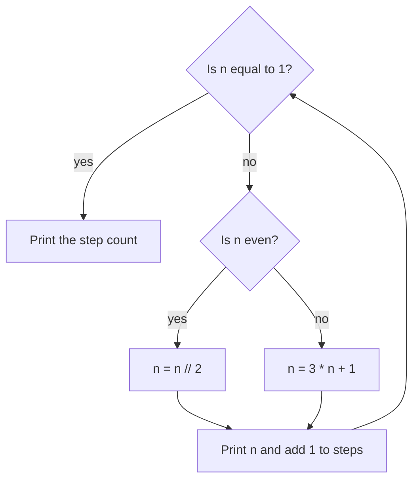

:::objectives
- Pick the right loop for a job: `for` when you know how many passes, `while` when you don't.
- Validate input with a `while` loop that checks both the type and the range of an answer.
- Use counters, totals, best-so-far values, and flags inside loops.
- Use `break` and `continue` to control a loop that reads until the user is finished.
:::

Each exercise has a sample of what your program should print. Write your own version in Thonny first, run it, and compare. Open a hint only if you're stuck for more than a few minutes, and the solution only after you've tried. If your output doesn't match, step through with **Ctrl+F5** and **F6** and watch the Variables panel.

## Warm-up: predict three ranges

Before you run anything, write down what each loop prints. `print(i, end=" ")` puts a space after each number instead of starting a new line.

```python
for i in range(4):
    print(i, end=" ")
print()
for i in range(3, 8):
    print(i, end=" ")
print()
for i in range(20, 0, -5):
    print(i, end=" ")
print()
```

:::solution
```python run title="warmup.py"
for i in range(4):
    print(i, end=" ")
print()
for i in range(3, 8):
    print(i, end=" ")
print()
for i in range(20, 0, -5):
    print(i, end=" ")
print()
```

Every range stops *before* its stop value: 4 is missing from the first line, 8 from the second, and 0 from the third. The empty `print()` calls end each line.
:::

### Exercise 1: Count down by twos

Print the even numbers from 10 down to 0, then `Lift-off!`. Use one `for` loop and no `if`.

```text
10
8
6
4
2
0
Lift-off!
```

:::hint
`range` takes a third number, the step, and a negative step counts down. The stop value is never included, so to reach 0 you need to stop one past it.
:::

:::solution
```python run title="countdown.py"
for n in range(10, -1, -2):
    print(n)
print("Lift-off!")
```

The stop is `-1`, so 0 is the last number produced. With a stop of `0` the loop would end at 2.
:::

### Exercise 2: A star rating from 1 to 5

Ask the user to rate a movie from 1 to 5. Keep asking until they type a whole number in that range, then print that many stars.

```text
Rate it from 1 to 5: 0
Please type a whole number from 1 to 5.
Rate it from 1 to 5: six
Please type a whole number from 1 to 5.
Rate it from 1 to 5: 4
Your rating: ****
```

:::hint
The loop should keep going if the text is *not* all digits, **or** if the number is below 1, **or** above 5. Put the `.isdigit()` check first: Python stops reading an `or` as soon as one part is `True`, so `int()` never sees `six`. And `"*" * 4` gives `"****"`.
:::

:::solution
```python run title="rating.py" input="0|six|4"
text = input("Rate it from 1 to 5: ")
while not text.isdigit() or int(text) < 1 or int(text) > 5:
    print("Please type a whole number from 1 to 5.")
    text = input("Rate it from 1 to 5: ")
rating = int(text)
print("Your rating:", "*" * rating)
```

Swap the order to `int(text) < 1 or not text.isdigit()` and type `six`: the program crashes with a `ValueError`, because `int()` runs before the digit check gets a chance.
:::

### Exercise 3: How long is the playlist?

Song lengths are stored in seconds. Print the total length in minutes and seconds, plus the length of the longest track.

```python
lengths = [185, 242, 201, 318, 176]
```

```text
Total: 18 min 42 s
Longest track: 318 seconds
```

:::hint
Use two accumulators in one loop: a running total that starts at 0, and a longest-so-far that changes only when a song beats it. After the loop, `//` gives whole minutes and `%` gives the seconds left over.
:::

:::solution
```python run title="playlist_length.py"
lengths = [185, 242, 201, 318, 176]
total = 0
longest = 0
for seconds in lengths:
    total = total + seconds
    if seconds > longest:
        longest = seconds

print(f"Total: {total // 60} min {total % 60} s")
print(f"Longest track: {longest} seconds")
```

1122 seconds is 18 full minutes (1080 seconds) with 42 left over. Python also has built-in `sum()` and `max()` functions that would do this in one line each, but writing the loop yourself shows you what they do inside.
:::

### Exercise 4: The first heat warning

A greenhouse sensor logs one temperature per hour. Find the **first** hour when it goes above 35°C, print a warning, and stop checking. If it never goes above 35, print `No heat warnings today.` Hours are numbered from 1.

```python
temps = [24, 27, 31, 36, 38, 33]
```

```text
Heat warning at hour 4: 36°C
```

:::hint
Keep an `hour` counter that goes up by 1 every pass. You also need a **flag**: a variable like `found = False` before the loop that you set to `True` when you find a hot reading. After the loop, the flag tells you whether to print the "no warnings" message.
:::

:::solution
```python run title="greenhouse.py"
temps = [24, 27, 31, 36, 38, 33]
hour = 0
found = False
for temp in temps:
    hour = hour + 1
    if temp > 35:
        print(f"Heat warning at hour {hour}: {temp}°C")
        found = True
        break

if not found:
    print("No heat warnings today.")
```

`break` stops the loop at hour 4, so 38 is never checked and you get exactly one warning. Change the list to `[24, 27, 31]` and the flag stays `False`, so the second message appears instead.
:::

### Exercise 5: A word collector

You're collecting words for a word game. Keep asking for words until the user presses Enter on an empty line. Reject words shorter than 3 letters with a message. At the end, print how many words were kept and the longest one.

```text
Word (Enter to finish): ox
  Too short, use 3 or more letters.
Word (Enter to finish): planet
Word (Enter to finish): sky
Word (Enter to finish): be
  Too short, use 3 or more letters.
Word (Enter to finish): lantern
Word (Enter to finish): 
Kept 3 words. Longest: lantern
```

:::hint
Use `while True:`. An empty answer means `break`. A short word means print the message and `continue`, so the counting code below doesn't run. `len(word)` gives the number of letters. What should the program print if no words were kept at all?
:::

:::solution
```python run title="word_collector.py" input="ox|planet|sky|be|lantern|"
count = 0
longest = ""
while True:
    word = input("Word (Enter to finish): ").strip()
    if word == "":
        break
    if len(word) < 3:
        print("  Too short, use 3 or more letters.")
        continue
    count = count + 1
    if len(word) > len(longest):
        longest = word

if count == 0:
    print("No words kept.")
else:
    print(f"Kept {count} words. Longest: {longest}")
```

`longest` starts as the empty string, which has length 0, so the first kept word always replaces it.
:::

### Exercise 6: The doubling penny

Someone offers you a deal: 1 cent today, 2 cents tomorrow, 4 the day after, doubling every day. On which day does that day's payment first go over $1,000,000? How much have you collected in total by then?

```text
Day 28: $1,342,177.28 that day
Total collected: $2,684,354.55
```

:::hint
You don't know how many days it takes, so use `while`. Work in cents to avoid decimal surprises: keep `day`, `today` (cents paid that day), and `total`. Loop while `today` is at most 100,000,000 cents. To print dollars with commas, divide by 100 and use `:,.2f` in the f-string.
:::

:::solution
```python run title="penny.py"
day = 1
today = 1      # cents paid on this day
total = 1      # cents collected so far

while today <= 100_000_000:
    day = day + 1
    today = today * 2
    total = total + today

print(f"Day {day}: ${today / 100:,.2f} that day")
print(f"Total collected: ${total / 100:,.2f}")
```

Python lets you write `100_000_000` with underscores so big numbers are easier to read. Notice the total is always one cent less than twice the day's payment; doubling grows that fast.
:::

### Challenge: Hailstone numbers

Pick any positive whole number and follow two rules: if it's even, halve it; if it's odd, multiply by 3 and add 1. Repeat until you reach 1. The numbers bounce up and down like hailstones in a storm cloud. Mathematicians believe every starting number eventually reaches 1, but nobody has managed to prove it (it's called the **Collatz conjecture**).

Write a program that asks for a starting number (validated: whole and greater than 0), prints the path on one line, and reports how many steps it took.

```text
Starting number: 6
6 3 10 5 16 8 4 2 1
Reached 1 in 8 steps.
```

Here's the loop's shape. The validation loop comes first, before any of this.



Step through the path from 6 and watch `n` climb to 16 before it falls:

:::trace Follow the hailstone path from 6
```python
n = 6
steps = 0
while n != 1:
    if n % 2 == 0:
        n = n // 2
    else:
        n = 3 * n + 1
    steps = steps + 1
print("Steps:", steps)
```
:::

:::hint
`n % 2 == 0` is `True` for even numbers. Use `//` (not `/`) to halve, so `n` stays a whole number instead of turning into `3.0`. Print the starting number with `end=" "` before the loop, then print each new `n` the same way inside it.
:::

:::solution
```python run title="hailstone.py" input="zero|0|27"
text = input("Starting number: ")
while not text.isdigit() or int(text) < 1:
    print("Please type a whole number bigger than 0.")
    text = input("Starting number: ")
n = int(text)

steps = 0
highest = n
print(n, end=" ")
while n != 1:
    if n % 2 == 0:
        n = n // 2
    else:
        n = 3 * n + 1
    steps = steps + 1
    if n > highest:
        highest = n
    print(n, end=" ")

print()
print(f"Reached 1 in {steps} steps. Highest point: {highest}.")
```

Starting from 27, the path takes 111 steps and climbs as high as 9232 before falling back to 1. Try 97 and 871 next. The `highest` accumulator is an extra; it uses the same best-so-far pattern as Exercise 3.
:::

:::video FadvtbvAoWk
Khan Academy traces a `while` loop step by step, following the loop variable's start value, stop condition, and update to count how many times the loop runs. Watch for how they predict the repetition count before running it; try the same thing with the hailstone loop for a start of 6.
:::
