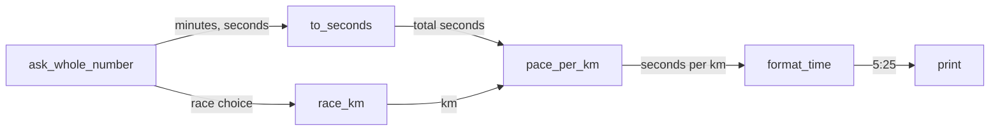

:::objectives
- Split a program into small functions that each do one job and return one result.
- Test each function on its own before connecting them.
- Write one validation function and reuse it with different limits.
- Read a short traceback that passes through a function, and fix the bug it points to.
:::

Runners talk about **pace**: how long each kilometre takes. Finish a 5K in 27 minutes and 5 seconds and your pace is 5:25 per km. Today you'll build a calculator that works that out and then predicts your time for other races at the same pace. Here's the finished program in action, including two typos it catches:

```text
Race pace calculator
1) 5K   2) 10K   3) Half marathon
Which race did you run? 4
  Please type a whole number from 1 to 3.
Which race did you run? 1
Finish time, minutes: 27
Finish time, seconds: 75
  Please type a whole number from 0 to 59.
Finish time, seconds: 5

5K pace: 5:25 per km
At that pace you would finish:
  5K: 27:05
  10K: 54:10
  Half marathon: 1:54:17
```

The program is six small functions plus a short main section that calls them. Each arrow below is a value being passed in or returned.



| Function | Takes | Gives back |
| --- | --- | --- |
| `ask_whole_number(prompt, low, high)` | a question and the allowed range | a valid `int` |
| `race_name(choice)` | 1, 2, or 3 | `"5K"`, `"10K"`, or `"Half marathon"` |
| `race_km(choice)` | 1, 2, or 3 | 5, 10, or 21.0975 |
| `to_seconds(minutes, seconds)` | two whole numbers | total seconds |
| `pace_per_km(total_seconds, km)` | a time and a distance | seconds per km |
| `format_time(total_seconds)` | a number of seconds | text like `"5:25"` |

Planning the functions like this before writing code is worth the two minutes it takes. Each row is a promise: give it this, and it gives back that.

## Step 1: Time conversion, tested first

Start a new Thonny file, `pace.py`, in your `m6` folder, with the two functions that deal with time. Test them immediately with calls whose answers you already know.

```python run title="pace.py"
def to_seconds(minutes, seconds):
    """Combine minutes and seconds into a total number of seconds."""
    return minutes * 60 + seconds


def format_time(total_seconds):
    """Turn seconds into m:ss, like 325 -> '5:25'."""
    minutes = total_seconds // 60
    seconds = total_seconds % 60
    return f"{minutes}:{seconds:02d}"


print(to_seconds(27, 5), "should be 1625")
print(format_time(325), "should be 5:25")
print(format_time(65), "should be 1:05")
```

Printing the expected answer next to the real one is a quick, honest test. If a line doesn't match, you know exactly which function to look at, before it's buried inside a bigger program.

## Step 2: Pace, and a bug

Pace is total time divided by distance. Add the function and test it with the 5K example:

```python run raises title="pace.py"
def format_time(total_seconds):
    """Turn seconds into m:ss, like 325 -> '5:25'."""
    minutes = total_seconds // 60
    seconds = total_seconds % 60
    return f"{minutes}:{seconds:02d}"


def pace_per_km(total_seconds, km):
    """Return how many seconds each kilometre took."""
    return total_seconds / km


pace = pace_per_km(1625, 5)
print("pace is", pace)
print(format_time(pace))
```

Read the error from the bottom up. The last line says a `ValueError` happened because the format code `d` doesn't work for a `float`. The line above it points inside `format_time`, at the f-string. And the line above *that* shows where `format_time` was called from.

Now look at the first line of output: `pace is 325.0`. Dividing with `/` always gives a float, even when the answer is a whole number. `format_time` was tested with whole numbers only, and `:02d` means "a whole number, padded to 2 digits," so a float breaks it.

The fix belongs inside `format_time`, so every caller benefits: round the input to the nearest whole second first. While you're there, add hours, because a half marathon takes well over 60 minutes.

```python run title="pace.py"
def format_time(total_seconds):
    """Turn seconds into m:ss or h:mm:ss, like 325 -> '5:25'."""
    total_seconds = round(total_seconds)
    hours = total_seconds // 3600
    minutes = total_seconds % 3600 // 60
    seconds = total_seconds % 60
    if hours > 0:
        return f"{hours}:{minutes:02d}:{seconds:02d}"
    return f"{minutes}:{seconds:02d}"


def pace_per_km(total_seconds, km):
    """Return how many seconds each kilometre took."""
    return total_seconds / km


print(format_time(pace_per_km(1625, 5)), "should be 5:25")
print(format_time(325.4), "should be 5:25")
print(format_time(6857), "should be 1:54:17")
```

`round()` with one argument gives back an `int`, so the rest of the function is back to whole-number math. `total_seconds % 3600 // 60` takes the seconds left after removing whole hours, then counts the whole minutes in them.

## Step 3: One validation function for every question

The program asks three questions with different limits: race 1 to 3, minutes 0 to 300, seconds 0 to 59. Instead of writing three validation loops, write one function and pass the limits in as parameters.

```python run title="pace.py" input="27|seventy|75|5"
def ask_whole_number(prompt, low, high):
    """Ask until the user types a whole number from low to high; return it as an int."""
    text = input(prompt).strip()
    while not text.isdigit() or int(text) < low or int(text) > high:
        print(f"  Please type a whole number from {low} to {high}.")
        text = input(prompt).strip()
    return int(text)


minutes = ask_whole_number("Minutes: ", 0, 300)
seconds = ask_whole_number("Seconds: ", 0, 59)
print("You typed", minutes, "and", seconds)
```

This is the validation loop from Module 5, wrapped in a function. The `return int(text)` at the end matters: the function's job is to hand back a clean number, not just to display one.

Step through it and watch the `ask_whole_number()` frame. Its `low` and `high` change between the two calls, and `text` disappears each time a call returns.

:::trace Watch one function handle two different questions
```python input="27|75|5"
def ask_whole_number(prompt, low, high):
    text = input(prompt)
    while not text.isdigit() or int(text) < low or int(text) > high:
        text = input(prompt)
    return int(text)

minutes = ask_whole_number("Minutes: ", 0, 300)
seconds = ask_whole_number("Seconds: ", 0, 59)
print(minutes, seconds)
```
:::

:::video UmNKiV7Lekk
Khan Academy shows how to package a block of code into a function and then use parameters to make it work for more than one case. Watch for the point where a parameter replaces a fixed value; that's the move that turned three validation loops into `ask_whole_number`.
:::

## Step 4: The race menu and the predictions

Two tiny functions turn a menu number into a name and a distance. Each uses early `return`s, so there's no need for `elif`.

```python run title="pace.py"
def race_name(choice):
    """Return the name of race 1, 2, or 3."""
    if choice == 1:
        return "5K"
    if choice == 2:
        return "10K"
    return "Half marathon"


def race_km(choice):
    """Return the distance in kilometres of race 1, 2, or 3."""
    if choice == 1:
        return 5
    if choice == 2:
        return 10
    return 21.0975


pace = 325  # a test pace: 5:25 per km
for option in range(1, 4):
    finish = pace * race_km(option)
    print(f"  {race_name(option)}: {finish} seconds")
```

A half marathon is 21.0975 km, half of the 42.195 km marathon. Because `ask_whole_number` guarantees the choice is 1, 2, or 3, these functions don't need to check for anything else.

The test loop at the bottom is the prediction feature in rough form: one pass per race, calling the same two functions each time. The half marathon comes out as 6856.6875 seconds, which is exactly why `format_time` rounds before it does anything else. In the finished program, `format_time(finish)` replaces the raw number.

## Step 5: The finished calculator

Put the functions at the top and the main program at the bottom. The main section reads almost like a description of what the program does, because each function's name says what it does.

```python run title="pace.py" input="4|1|27|75|5"
def ask_whole_number(prompt, low, high):
    """Ask until the user types a whole number from low to high; return it as an int."""
    text = input(prompt).strip()
    while not text.isdigit() or int(text) < low or int(text) > high:
        print(f"  Please type a whole number from {low} to {high}.")
        text = input(prompt).strip()
    return int(text)


def race_name(choice):
    """Return the name of race 1, 2, or 3."""
    if choice == 1:
        return "5K"
    if choice == 2:
        return "10K"
    return "Half marathon"


def race_km(choice):
    """Return the distance in kilometres of race 1, 2, or 3."""
    if choice == 1:
        return 5
    if choice == 2:
        return 10
    return 21.0975


def to_seconds(minutes, seconds):
    """Combine minutes and seconds into a total number of seconds."""
    return minutes * 60 + seconds


def format_time(total_seconds):
    """Turn seconds into m:ss or h:mm:ss, like 325 -> '5:25'."""
    total_seconds = round(total_seconds)
    hours = total_seconds // 3600
    minutes = total_seconds % 3600 // 60
    seconds = total_seconds % 60
    if hours > 0:
        return f"{hours}:{minutes:02d}:{seconds:02d}"
    return f"{minutes}:{seconds:02d}"


def pace_per_km(total_seconds, km):
    """Return how many seconds each kilometre took."""
    return total_seconds / km


# ---- main program ----
print("Race pace calculator")
print("1) 5K   2) 10K   3) Half marathon")
choice = ask_whole_number("Which race did you run? ", 1, 3)
minutes = ask_whole_number("Finish time, minutes: ", 0, 300)
seconds = ask_whole_number("Finish time, seconds: ", 0, 59)

total = to_seconds(minutes, seconds)
if total == 0:
    print("A race can't take zero seconds!")
else:
    pace = pace_per_km(total, race_km(choice))
    print(f"\n{race_name(choice)} pace: {format_time(pace)} per km")
    print("At that pace you would finish:")
    for option in range(1, 4):
        finish = pace * race_km(option)
        print(f"  {race_name(option)}: {format_time(finish)}")
```

Try a half marathon too. Run it in Thonny and type `3`, `115`, and `30`; you should see a pace of 5:28 per km. The `if total == 0` check exists because `0` minutes and `0` seconds are both valid answers on their own, but together they'd make a meaningless race.

:::quiz
Q: Why does `ask_whole_number` take `low` and `high` as parameters instead of always checking 0 to 59?
- [x] So the same function can check the menu (1 to 3), minutes (0 to 300), and seconds (0 to 59)
  Parameters turn fixed values into choices the caller makes, so one function covers all three questions.
- [ ] Because functions must have at least three parameters
  A function can have any number of parameters, including none.
- [ ] To make the program run faster
  Speed isn't the point; avoiding three copies of the same loop is.

Q: The float bug was fixed by adding `round()` inside `format_time`. Why there, and not before each call?
- [ ] Python only allows `round()` inside functions
  `round()` works anywhere.
- [x] One fix in one place protects every caller, including ones you haven't written yet
  If each caller had to remember to round first, the next one you write could forget and bring the bug back.
- [ ] Because `pace_per_km` can't return a float
  It can, and does; that's what exposed the bug.

Q: Suppose `ask_whole_number` ended with `print(int(text))` instead of `return int(text)`. What happens to `minutes = ask_whole_number("Finish time, minutes: ", 0, 300)`?
- [ ] `minutes` holds the number, and it also gets printed
  `print` only shows the value; it doesn't send it back.
- [x] `minutes` becomes `None`, and `to_seconds` crashes when it tries `None * 60`
  Without `return`, the function gives back `None`, and the math fails a few lines later.
- [ ] Python refuses to run the function
  The function runs fine; the problem only appears when its result is used.
:::

:::takeaways
- Plan the functions first: for each one, decide what it takes and what it gives back.
- Test each function with inputs whose answers you already know, before you connect them.
- `/` always produces a float. Code that expects whole numbers should round or convert first.
- One validation function with parameters for the limits replaces a pile of nearly identical loops.
- A traceback through a function shows the call on one line and the failing line inside the function below it.
:::

## Make it yours

- **Miles too.** Add a function `km_to_miles(km)` (1 mile is 1.609344 km) and print the pace per mile as well.
- **Goal mode.** Ask for a goal time instead, and print the pace needed to hit it.
- **Split table.** For a 5K, print the expected time at each kilometre: 1 km, 2 km, up to 5 km.
- **Add the marathon.** Make it option 4 at 42.195 km. Which functions need to change? (That's the point of small functions: only two of them do.)

## Further reading

- [Python docs: round()](https://docs.python.org/3/library/functions.html#round): note that `round(2.5)` gives 2, because Python rounds halves to the nearest even number.
- [Python docs: Format Specification Mini-Language](https://docs.python.org/3/library/string.html#format-specification-mini-language): what `:02d`, `:.1f`, and `:,` mean inside an f-string, and why `d` refuses floats.
- [Think Python, chapter 3: Functions](https://allendowney.github.io/ThinkPython/chap03.html): Allen Downey's free textbook explains functions, parameters, and stack diagrams, with exercises at the end.
