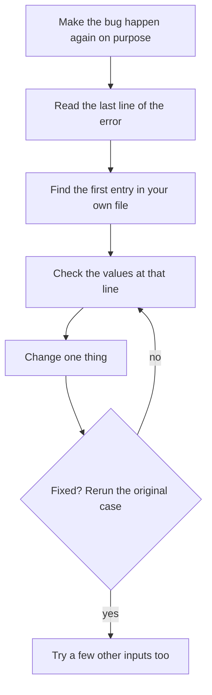

:::objectives
- Read a traceback from the bottom up to find what went wrong and where.
- Recognize the most common error types and what usually causes each one.
- Catch an error you expect with `try` and `except`, so bad input can't crash your program.
- Follow a step-by-step debugging routine, and use lists and dictionaries to hold an app's data.
:::

A friend is testing your treasure-hunt game. They type their name, and then, instead of a number, they type `ten`. The game dies with this wall of red text:

```python run raises title="treasure.py" input="Ada|ten"
def ask_steps():
    text = input("How many steps north? ")
    return int(text)

def walk(name):
    steps = ask_steps()
    print(f"{name} walks {steps} steps and finds a chest.")

name = input("Your name: ")
walk(name)
```

You read short error messages from the bottom up back in Module 1. This one is longer and mentions three different lines, but it's not a jumble; it's a precise report, called a **traceback**, and once you know the order to read it in, it usually tells you the fix in under a minute.

## Read a traceback from the bottom up

Start at the **last line**. It always has two parts: the error's type, then a message.

> `ValueError: invalid literal for int() with base 10: 'ten'`

In plain words: `int()` was given the text `'ten'`, which isn't a number it can convert. Already you know *what* happened.

Now move **up one entry** to find *where*. Each `File ... line ...` entry is one function call that was still running when the crash happened:

1.  `line 3, in ask_steps`: the crash itself, at `return int(text)`.
2.  `line 6, in walk`: the line that called `ask_steps()`.
3.  `line 10, in <module>`: the top level of the file (Python calls it `<module>`), which called `walk(name)`.

"Most recent call last" means the entries are in the order the calls were made, so the newest one, where the crash happened, sits at the bottom. In a big program, some entries may point into code you didn't write, such as a library. Scan upward for the first entry in **your** file; that's usually where the fix belongs. In Thonny you'll see your real file path instead of `main.py`, and your Python version may format the `^^^` markers a little differently.

Step through the same program and watch the stack grow one frame at a time, then stop at the crash:

:::trace Watch three frames pile up before the crash
```python input="Ada|ten" raises
def ask_steps():
    text = input("How many steps north? ")
    return int(text)

def walk(name):
    steps = ask_steps()
    print(f"{name} walks {steps} steps")

name = input("Your name: ")
walk(name)
```
:::

The bug isn't really in `int()`, which did its job by refusing nonsense. The bug is that `ask_steps` trusted the user. You'll fix that in a moment with `try`.

## The errors you'll meet most

Almost every error a beginner hits is one of these eight. Learn to recognize them and you're halfway to the fix.

| Error | What it means | Usual cause |
| --- | --- | --- |
| `SyntaxError` | Python can't read the code at all | missing `:`, unclosed quote or bracket |
| `IndentationError` | the indentation doesn't match the structure | body of an `if`, `for`, or `def` not indented |
| `NameError` | that name doesn't exist (yet) | typo, or using a variable before setting it |
| `TypeError` | the operation doesn't work on that type | `"Gold: " + 12`, a missing argument, `None + 1` |
| `ValueError` | right type, but an unusable value | `int("ten")` |
| `IndexError` | that list position doesn't exist | `items[3]` in a three-item list |
| `KeyError` | that dictionary key doesn't exist | `player["Gold"]` when the key is `"gold"` |
| `ZeroDivisionError` | dividing by zero | averaging an empty list |

Two of them deserve a closer look because Python helps you more than you'd expect. A `SyntaxError` is caught before your program runs a single line, so it points at a spot in the code rather than a chain of calls:

```python run raises
gold = 12
if gold > 10
    print("You can buy the sword.")
```

And recent versions of Python (3.10 and newer) often guess what you meant when you mistype a name:

```python run raises
score = 40
bonus = 10
print("Final:", scroe + bonus)
```

`Did you mean: 'score'?` is about as direct as an error message gets.

## Catch the errors you expect with `try` and `except`

Some errors aren't bugs in your logic; they're things users will do. You can't stop someone typing `ten`, but you can plan for it. Put the risky line inside `try:`, and put what to do instead inside `except` with the specific error type:

```python run title="ask_int.py" input="ten|3.5|-2"
def ask_int(prompt):
    """Ask until the user types a whole number (negatives allowed); return it."""
    while True:
        text = input(prompt)
        try:
            return int(text)
        except ValueError:
            print(f"  '{text}' isn't a whole number. Try again.")

floor = ask_int("Which floor? ")
print("Going to floor", floor)
```

If `int(text)` succeeds, `return` hands the number back and the loop ends. If it raises a `ValueError`, Python skips to the `except` block, prints the hint, and the `while True` loop asks again. Unlike `.isdigit()`, this accepts negative numbers like `-2` (a basement floor) because `int()` itself decides what counts.

:::warning
**Name the error you expect.** A bare `except:` with no error type catches *everything*, including typos in your own code like a `NameError`. Your program stops crashing, but it also stops telling you about real bugs. Write `except ValueError:` (or whichever error you actually expect) so anything else still shows a traceback.
:::

## Lists and dictionaries hold your app's data

Real apps keep track of many things: a backpack full of items, a player's stats, a list of high scores. Two of Python's built-in types handle almost all of it.

A **list** keeps items in order, and each item has a position number called an **index**, starting at 0:

```python run title="backpack.py"
backpack = ["rope", "lantern"]
backpack.append("map")          # add to the end
print(backpack)
print("First item:", backpack[0])
print("Last item:", backpack[-1])
print("Items carried:", len(backpack))
if "map" in backpack:
    print("You can find the exit.")
```

Negative indexes count from the end, so `backpack[-1]` is always the last item, however long the list grows.

A **dictionary** (or **dict**) stores values under names called **keys**, written as `key: value` pairs inside curly brackets. You look values up by key instead of by position:

```python run title="player.py"
player = {"name": "Ada", "health": 10, "gold": 3}
player["gold"] = player["gold"] + 5   # change a value
player["level"] = 2                    # add a new key
print(player["name"], "has", player["gold"], "gold")

for key, value in player.items():
    print(f"  {key}: {value}")

print("Armor:", player.get("armor", 0))
```

`.items()` gives you each key and value together, perfect for a `for` loop. `.get("armor", 0)` returns the value if the key exists, or the default `0` if it doesn't, without crashing.

Each type has its own signature error. Ask a three-item list for index 3 (there are only 0, 1, and 2):

```python run raises
backpack = ["rope", "lantern", "map"]
print(backpack[3])
```

Ask a dictionary for a key that isn't there, even one that differs only in capital letters:

```python run raises
player = {"name": "Ada", "health": 10, "gold": 3}
print(player["Gold"])
```

A `KeyError` message is just the missing key. When you see one, compare it letter by letter with the keys you actually created.

## A debugging routine that works

When something breaks, don't start changing lines at random. Work through the same steps every time:



-   **Reproduce it.** Write down the exact input that caused the crash, so you can test your fix with it.
-   **Check the values.** Errors are almost always about a value that isn't what you assumed. Add a temporary `print(f"{text=}")` just before the failing line (the `=` prints the name and the value, like `text='ten'`), or run the debugger with **Ctrl+F5**, step to the line, and read the Variables panel.
-   **Change one thing at a time.** If you change three lines and it works, you won't know which change mattered, or whether the other two broke something else.

Not every bug crashes. A **logic error** runs fine and gives the wrong answer, like a score that never goes up. There's no traceback to read, so the "check the values" step does all the work: step through the code and watch for the moment a variable stops matching what you expected.

:::video WUoCSkSW4cs
A software engineer from Khan Academy debugs a real program out loud, using error messages and stack traces to fix syntax errors, runtime errors, and finally a logic error. Watch for how each message gets read in full before any code changes.
:::

:::quiz
Q: A traceback ends with `IndexError: list index out of range`. Where do you look first?
- [ ] The first `File` line at the top
  That's the outermost call, usually far from the problem.
- [x] The last `File` entry that's in your own code, and the index used on that line
  The bottom entries show where the crash happened; check which index was used and how long the list really is.
- [ ] Any line that uses `input()`
  An `IndexError` is about list positions, not input.

Q: Which error does `int("3.5")` raise?
- [x] `ValueError`
  It's a string (the right type for `int()`), but its value can't be read as a whole number.
- [ ] `TypeError`
  `int()` accepts strings, so the type is fine; the problem is the value.
- [ ] `SyntaxError`
  The code is valid Python; the problem only appears when it runs.

Q: `stats = {"hp": 7}`. What does `stats.get("mp", 0)` give?
- [ ] A `KeyError`
  That's what `stats["mp"]` would do. `.get()` exists to avoid it.
- [x] `0`
  The key `"mp"` doesn't exist, so `.get()` returns the default you gave it.
- [ ] `7`
  7 belongs to the key `"hp"`, not `"mp"`.

Q: Why is `except ValueError:` better than a bare `except:` around `int(text)`?
- [ ] It runs faster
  Speed isn't the reason.
- [ ] A bare `except:` is a `SyntaxError`
  It's valid Python, just risky.
- [x] It only catches the problem you planned for, so real bugs still show a traceback
  A bare `except:` would also hide a typo like `NameError`, leaving you with a program that fails silently.
:::

:::takeaways
- Read a traceback bottom-up: the last line says what happened, the `File` entries above it say where, newest call last.
- `SyntaxError` and `IndentationError` stop the program before it starts; the others happen while it runs.
- Wrap risky lines in `try` and catch the specific error you expect, like `except ValueError:`.
- Lists hold items in order by index (starting at 0); dictionaries hold values by key. `IndexError` and `KeyError` mean the position or key doesn't exist.
- Debug by reproducing, reading, checking values, and changing one thing at a time.
:::

## Further reading

- [Python tutorial: Errors and Exceptions](https://docs.python.org/3/tutorial/errors.html): the official guide to tracebacks, `try`, and `except`, with short examples.
- [Python docs: Built-in Exceptions](https://docs.python.org/3/library/exceptions.html): a description of every error type, for when you meet one that isn't in the table above.
- [Python tutorial: Dictionaries](https://docs.python.org/3/tutorial/datastructures.html#dictionaries): creating, updating, and looping over dictionaries, plus list methods higher up the same page.
