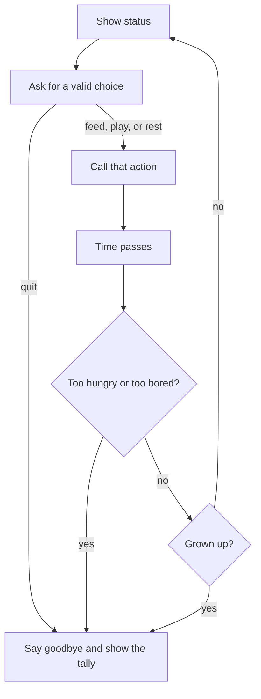

:::objectives
- Store an app's state in a dictionary and pass it to functions that update it.
- Explain why a function can change a dictionary it's given, but not a number.
- Build a validated menu loop that calls a different function for each choice.
- Read a `KeyError` traceback and fix the typo behind it.
:::

Time to put loops, functions, validation, and dictionaries together into one complete program: a virtual pet. Each turn you choose to feed, play, or rest. Every turn the pet gets hungrier and a little more bored. Keep it fed and happy for eight turns and it grows up; let hunger hit 10 or fun hit 0 and the game ends. Here's a short game that goes badly:

```text
Name your pet: Pixel

Pixel: hunger 4/10, energy 6/10, fun 5/10
feed, play, rest, or quit? rest
Pixel curls up for a nap.

Pixel: hunger 6/10, energy 10/10, fun 4/10
feed, play, rest, or quit? sing
  Pick one of: feed, play, rest, quit.
feed, play, rest, or quit? play
Pixel chases a ball around the room.

Pixel: hunger 8/10, energy 7/10, fun 7/10
feed, play, rest, or quit? rest
Pixel curls up for a nap.
Oh no! Pixel is too hungry. Game over after 3 turns.

Fed 0, played 1, rested 2.
```

Here's the plan. The main loop is the boss: it shows the stats, gets a valid choice, hands the pet to the right function, then lets time pass and checks the rules.



Save a new Thonny file as `pet.py` in your `m7` folder and build it in six steps.

## Step 1: The pet is a dictionary

The pet has a name and four numbers that change. You could use five separate variables, but then every function would need five parameters. A dictionary keeps them together under one name, so you can pass the whole pet around as a single value.

```python run title="pet.py"
def show_status(pet):
    """Print the pet's name and stats on one line."""
    print(f"\n{pet['name']}: hunger {pet['hunger']}/10, energy {pet['energy']}/10, fun {pet['fun']}/10")


pet = {"name": "Pixel", "hunger": 4, "energy": 6, "fun": 5, "age": 0}
show_status(pet)
```

Inside the f-string, the keys use single quotes (`pet['name']`) because the f-string itself uses double quotes. Mixing them up ends the string early and gives a `SyntaxError`. (Python 3.12 and newer allow matching quotes there, but older versions, which you may have in Thonny, don't, so single quotes are the safe habit.)

## Step 2: Actions that change the pet

Each action is a function that takes the pet and updates some of its values. A `clamp` helper keeps every stat between 0 and 10, the same idea as Exercise 3 in the last practice lesson.

```python run title="pet.py"
def clamp(value):
    """Keep a stat between 0 and 10."""
    if value < 0:
        return 0
    if value > 10:
        return 10
    return value


def show_status(pet):
    """Print the pet's name and stats on one line."""
    print(f"\n{pet['name']}: hunger {pet['hunger']}/10, energy {pet['energy']}/10, fun {pet['fun']}/10")


def feed(pet):
    """Make the pet less hungry."""
    pet["hunger"] = clamp(pet["hunger"] - 4)
    print(f"{pet['name']} munches a snack.")


def play(pet):
    """Make the pet happier, if it has the energy."""
    if pet["energy"] < 3:
        print(f"{pet['name']} is too tired to play.")
        return
    pet["fun"] = clamp(pet["fun"] + 4)
    pet["energy"] = clamp(pet["energy"] - 3)
    print(f"{pet['name']} chases a ball around the room.")


def rest(pet):
    """Give the pet back some energy."""
    pet["energy"] = clamp(pet["energy"] + 5)
    print(f"{pet['name']} curls up for a nap.")


pet = {"name": "Pixel", "hunger": 4, "energy": 6, "fun": 5, "age": 0}
feed(pet)
play(pet)
play(pet)
play(pet)
rest(pet)
show_status(pet)
```

The third `play` is refused: after two games energy is 0, and the bare `return` leaves the function early, before any stats change. That's an early return with no value, used purely to stop.

Now, something should be bothering you. In Module 6, `collect(coins)` changed its own copy of `coins` and the outside value stayed at 10. Yet here `feed(pet)` really does change the pet. Step through and compare:

:::trace The function and the main program share one dictionary
```python
def feed(pet):
    pet["hunger"] = pet["hunger"] - 4

pet = {"name": "Pixel", "hunger": 6}
feed(pet)
print(pet["hunger"])
```
:::

The difference is *what* the line inside the function does. `coins = coins + 5` makes the local name point to a brand-new number; the global name is untouched. `pet["hunger"] = ...` doesn't make a new dictionary. It reaches *into* the one dictionary that both names refer to and changes a value inside it. So the change is visible everywhere. Lists behave the same way: `backpack.append("map")` inside a function changes the caller's list.

:::video nf26Yv5JTOc
Khan Academy introduces dictionaries: creating one with curly brackets, reading a value by its key, and updating or adding key-value pairs. Watch for the assignment statements; they're exactly the lines inside `feed`, `play`, and `rest`.
:::

## Step 3: A KeyError to read

While typing `feed`, it's easy to write `hungry` instead of `hunger`. Here's what that looks like:

```python run raises title="pet.py"
def feed(pet):
    """Make the pet less hungry."""
    pet["hunger"] = pet["hungry"] - 4
    print(f"{pet['name']} munches a snack.")


pet = {"name": "Pixel", "hunger": 4, "energy": 6, "fun": 5, "age": 0}
feed(pet)
```

Bottom up, as always. `KeyError: 'hungry'`: some dictionary was asked for the key `'hungry'` and doesn't have it. One entry up: line 3, inside `feed`. Compare that line with the dictionary on line 7 and the typo jumps out. Change `pet["hungry"]` to `pet["hunger"]` and run again.

:::tip
Dictionary keys are just strings, so Python can't warn you about a misspelled key until that line runs. Copy and paste key names from the line that creates the dictionary, or keep the full list of keys in a comment above it.
:::

## Step 4: The menu loop

The player chooses by typing a word. `ask_choice` keeps asking until the word is on the menu, then returns it. The main loop uses `if`/`elif` to call the matching function, and `break` ends the game on `quit`.

```python run title="pet.py" input="play|dance|feed|quit"
def ask_choice():
    """Ask until the player types a menu word; return it."""
    while True:
        choice = input("feed, play, rest, or quit? ").strip().lower()
        if choice in ["feed", "play", "rest", "quit"]:
            return choice
        print("  Pick one of: feed, play, rest, quit.")


while True:
    choice = ask_choice()
    if choice == "quit":
        print("Bye!")
        break
    print("You chose", choice)
```

The `return` inside `while True` does double duty: it hands back the choice *and* ends the loop, because a function stops the moment it returns. That's why `ask_choice` doesn't need a `break`.

## Step 5: Time passes, and the game can end

After each action, a turn goes by. `pass_time` makes the pet hungrier, a little more bored, and one turn older. `trouble` checks the losing rules and returns a reason as a string, or an empty string if all is well. Keeping the rules in their own function means the main loop doesn't need to know the details.

```python run title="pet.py"
def clamp(value):
    """Keep a stat between 0 and 10."""
    if value < 0:
        return 0
    if value > 10:
        return 10
    return value


def pass_time(pet):
    """One turn goes by: the pet gets hungrier, a bit bored, and older."""
    pet["hunger"] = clamp(pet["hunger"] + 2)
    pet["fun"] = clamp(pet["fun"] - 1)
    pet["age"] = pet["age"] + 1


def trouble(pet):
    """Return why the game is over, or "" if the pet is fine."""
    if pet["hunger"] >= 10:
        return "too hungry"
    if pet["fun"] <= 0:
        return "too bored"
    return ""


pet = {"name": "Pixel", "hunger": 4, "energy": 6, "fun": 5, "age": 0}
while trouble(pet) == "":
    pass_time(pet)
    print(f"Turn {pet['age']}: hunger {pet['hunger']}, fun {pet['fun']}")
print("Ignored pet is", trouble(pet), "after", pet["age"], "turns")
```

This test lets time pass with no care at all, to see how long a neglected pet lasts. Three turns. That's a useful number when you balance the game: if neglect ended things after 20 turns, the game would be too easy.

## Step 6: Count the actions and assemble everything

One more dictionary keeps a tally of how often the player chose each action. `counts[choice] = counts[choice] + 1` works because the menu words are exactly the dictionary's keys. Here's the whole game, played to a win:

```python run title="pet.py" input="Pixel|play|feed|dance|play|rest|feed|play|feed|rest"
GROWN_UP_AGE = 8


def clamp(value):
    """Keep a stat between 0 and 10."""
    if value < 0:
        return 0
    if value > 10:
        return 10
    return value


def show_status(pet):
    """Print the pet's name and stats on one line."""
    print(f"\n{pet['name']}: hunger {pet['hunger']}/10, energy {pet['energy']}/10, fun {pet['fun']}/10")


def feed(pet):
    """Make the pet less hungry."""
    pet["hunger"] = clamp(pet["hunger"] - 4)
    print(f"{pet['name']} munches a snack.")


def play(pet):
    """Make the pet happier, if it has the energy."""
    if pet["energy"] < 3:
        print(f"{pet['name']} is too tired to play.")
        return
    pet["fun"] = clamp(pet["fun"] + 4)
    pet["energy"] = clamp(pet["energy"] - 3)
    print(f"{pet['name']} chases a ball around the room.")


def rest(pet):
    """Give the pet back some energy."""
    pet["energy"] = clamp(pet["energy"] + 5)
    print(f"{pet['name']} curls up for a nap.")


def pass_time(pet):
    """One turn goes by: the pet gets hungrier, a bit bored, and older."""
    pet["hunger"] = clamp(pet["hunger"] + 2)
    pet["fun"] = clamp(pet["fun"] - 1)
    pet["age"] = pet["age"] + 1


def trouble(pet):
    """Return why the game is over, or "" if the pet is fine."""
    if pet["hunger"] >= 10:
        return "too hungry"
    if pet["fun"] <= 0:
        return "too bored"
    return ""


def ask_choice():
    """Ask until the player types a menu word; return it."""
    while True:
        choice = input("feed, play, rest, or quit? ").strip().lower()
        if choice in ["feed", "play", "rest", "quit"]:
            return choice
        print("  Pick one of: feed, play, rest, quit.")


# ---- main program ----
name = input("Name your pet: ").strip()
if name == "":
    name = "Blob"
pet = {"name": name, "hunger": 4, "energy": 6, "fun": 5, "age": 0}
counts = {"feed": 0, "play": 0, "rest": 0}

while True:
    show_status(pet)
    choice = ask_choice()
    if choice == "quit":
        print(f"You wave goodbye to {pet['name']}.")
        break

    if choice == "feed":
        feed(pet)
    elif choice == "play":
        play(pet)
    else:
        rest(pet)
    counts[choice] = counts[choice] + 1

    pass_time(pet)
    problem = trouble(pet)
    if problem != "":
        print(f"Oh no! {pet['name']} is {problem}. Game over after {pet['age']} turns.")
        break
    if pet["age"] >= GROWN_UP_AGE:
        print(f"{pet['name']} is all grown up after {pet['age']} turns. You win!")
        break

print(f"\nFed {counts['feed']}, played {counts['play']}, rested {counts['rest']}.")
```

Look at how short the main loop is. Each line names a job, and the details live in functions you've already tested. If the pet gets hungry too fast, you change one number in `pass_time`; if you want a new action, you write one function and add one `elif`. That's what "assembling an application" means: small, tested parts, connected by a simple loop.

Before calling it finished, play it like someone trying to break it: press Enter at the name prompt, type `FEED` in capitals, type ` rest ` with spaces, and spam `play` until the pet is too tired. Each case should be handled without a traceback.

:::quiz
Q: Why does `feed(pet)` change the pet in the main program, when `collect(coins)` in Module 6 didn't change `coins`?
- [ ] Dictionaries are global and numbers are local
  Both are ordinary values; neither is automatically global.
- [x] `feed` changes a value *inside* the one shared dictionary, while `collect` pointed its local name at a new number
  Both names refer to the same dictionary, so a change inside it shows up everywhere. Reassigning a name never affects the caller.
- [ ] Because `feed` has a docstring
  Docstrings are documentation; they don't change how the code runs.

Q: Why does `trouble(pet)` return a string like `"too hungry"` instead of printing the message itself?
- [x] So the main loop can decide what to do with it: end the game, and build its own message
  Returning a value keeps the rules separate from the screen output, and makes `trouble` easy to test.
- [ ] Because functions aren't allowed to print
  Functions can print; `feed` does. It's a design choice.
- [ ] Because `print` would end the loop
  `print` never ends a loop.

Q: A player types `Rest` with a capital R. What happens?
- [ ] They see "Pick one of: feed, play, rest, quit."
  That would happen without `.lower()`.
- [x] The pet rests, because `.strip().lower()` turns it into `rest` before the check
  Cleaning up input before validating it lets small differences through without bothering the player.
- [ ] A `KeyError`
  The choice is cleaned up and validated before it's ever used as a key in `counts`.
:::

:::takeaways
- A dictionary keeps an app's related values together, so one parameter can carry the whole state.
- Changing a value inside a dictionary or list is visible to every name that refers to it; reassigning a name is not.
- A menu function that validates and returns the choice keeps the main loop short.
- Put game rules in functions that return answers, and keep the main loop in charge of what happens next.
- A `KeyError` names the missing key; compare it with the keys you created.
:::

## Make it yours

- **Random events.** `import random`, and in `pass_time` give a 1-in-5 chance (`random.randint(1, 5) == 1`) that the pet finds a toy and gains 2 fun.
- **A new action.** Add `bathe`, with a `clean` stat that drops each turn. You'll need one new function, one new key, one `elif`, and one menu word.
- **Two pets.** Keep a list of two pet dictionaries and ask which one to care for each turn.
- **Moods.** Write `mood(pet)` that returns `"happy"`, `"grumpy"`, or `"sleepy"` from the stats, and show it in `show_status`.

## Further reading

- [Python tutorial: Data Structures](https://docs.python.org/3/tutorial/datastructures.html): lists, dictionaries, and how to loop over them, from the people who make Python.
- [Python docs: Mapping types (dict)](https://docs.python.org/3/library/stdtypes.html#mapping-types-dict): every dictionary method, including `get`, `items`, and `keys`.
