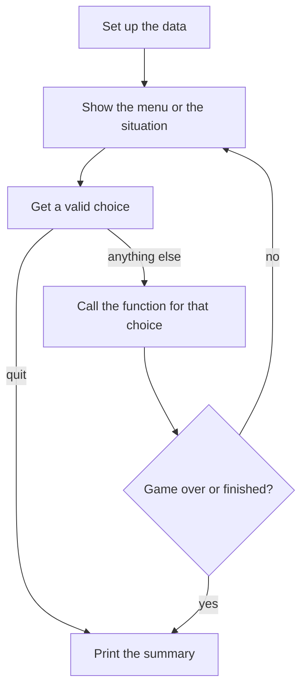

:::objectives
- List the eight things your capstone app must do, and which module taught each one.
- Choose a project that's big enough to show your skills and small enough to finish.
- Write a sample session that shows, line by line, what the user will see.
- Plan your app's data and name its functions, with what each takes and gives back.
:::

The virtual pet from Module 7 is under 100 lines. It asks questions, validates every answer, keeps its state in a dictionary, runs a main loop, splits its work into small functions, and ends cleanly. That one program checks every box on the capstone list below, which means you already know enough to build an app of your own. The difference this time is that nobody hands you the design. You decide what to build and how to break it up, and that's the skill this module is about.

## The brief

Build a complete text-based Python application that someone else could sit down and use without your help. It must have all eight of these:

| # | Requirement | What it looks like in your app | Learned in |
| --- | --- | --- | --- |
| 1 | Input and output | asks the user questions and prints clear, readable results | Module 3 |
| 2 | Variables and data | keeps track of its state, using at least one list or dictionary | Modules 2 and 7 |
| 3 | Decisions | `if`/`elif`/`else` changes what happens based on the user or the data | Module 4 |
| 4 | Loops | a main loop that keeps the app running, plus at least one other loop | Module 5 |
| 5 | Functions | at least four of your own, each with a docstring, most of them returning a value | Module 6 |
| 6 | Validation | every question re-asks politely when the answer doesn't make sense | Modules 5 and 6 |
| 7 | Error handling | no input can crash it; `try`/`except` wherever text becomes a number | Module 7 |
| 8 | A clean exit | the user can quit at any point, and the app ends with a summary | Module 5 |

You'll hand in four things: your `.py` file, a test table showing what you tried (built in the last lesson), a short README explaining how to use the app, and a two-minute demo.

## Pick a project

Choose something you'd actually want to use or play; you'll spend hours with it. Here are six ideas, from most approachable to most ambitious. Each one can meet all eight requirements.

| Project | Level | What it stores | The tricky part |
| --- | --- | --- | --- |
| **Unit converter toolkit**: a menu of at least three conversions (cooking cups to millilitres, km to miles, and so on) | Starter | a list of every conversion done, shown at the end | validating decimal input with `try`/`except` |
| **Flashcard trainer**: quiz yourself on vocabulary, then re-ask the ones you missed | Starter | a dictionary of term to answer, a list of misses | comparing answers fairly (spaces, capitals) |
| **Word guessing game**: guess a secret word one letter at a time with limited lives | Medium | the secret word, a list of guessed letters, lives left | showing `_ a _ _ e` with a loop, and rejecting repeat guesses |
| **Budget tracker**: log spending by category and see where the money went | Medium | a dictionary of category to total | the report: biggest category and percentages |
| **Text adventure**: explore rooms, collect items, solve one puzzle to escape | Stretch | a dictionary of rooms, a list for the inventory | rooms that link to each other with exits |
| **Turn-based battle**: fight a series of monsters, choosing attack, defend, or heal each turn | Stretch | dictionaries for the player and each monster | balancing the numbers so it's winnable but not easy |

The next lesson builds a small text adventure as a worked example. If you choose that idea, make your map, items, and puzzle your own rather than extending the example.

:::tip
Your own idea is welcome, as long as it ticks all eight boxes. A quick test: can you describe the smallest working version in three sentences? If not, shrink it until you can. You can always add features after it works.
:::

## Write the sample session first

Before any code, write out what the screen will show from start to finish, including your user making mistakes. This forces you to decide how the app actually behaves, and it doubles as your first test later. Here's one for the budget tracker:

```text
Budget tracker. Categories: food, transport, fun, other

Command (add, report, quit): add
Category: snacks
  Pick one of: food, transport, fun, other
Category: food
Amount: $12
  Type a number like 4.50, without the $ sign.
Amount: 12.50
  Added 12.50 to food.

Command (add, report, quit): add
Category: fun
Amount: 20
  Added 20.00 to fun.

Command (add, report, quit): report
  food: 12.50 (38%)
  fun: 20.00 (62%)
  Biggest category: fun

Command (add, report, quit): quit
You logged 2 expenses totaling 32.50. Bye!
```

Notice how much design is hiding in there. Categories are a fixed list. Amounts reject the `$` sign. The report shows percentages. Quitting prints a summary. Every one of those is a decision you'd otherwise make halfway through coding, usually badly.

## Plan the data and the functions

Next, decide what your app has to remember and which functions will do the work. Most text apps share the same overall shape:



For the budget tracker, the data is a dictionary like `{"food": 12.5, "fun": 20.0}` plus a count of expenses. The functions might be:

| Function | Takes | Gives back |
| --- | --- | --- |
| `ask_choice(prompt, options)` | a question and a list of allowed answers | one of the allowed answers |
| `ask_amount(prompt)` | a question | a float of 0 or more |
| `add_expense(totals, category, amount)` | the dictionary, a category, an amount | nothing; it updates the dictionary |
| `biggest_category(totals)` | the dictionary | the name of the biggest category |
| `show_report(totals)` | the dictionary | nothing; it prints the report |

Naming the functions now pays off twice. You can write and test each one alone, as you did with the pace calculator. And when you get stuck, you'll know exactly which small piece isn't working.

## Your planning template

Copy this into a file called `plan.txt` next to your project (or into a comment at the top of your `.py` file) and fill in every line before you start coding.

```text
PROJECT NAME:
ONE-SENTENCE PITCH: (what it does, for whom)

SAMPLE SESSION: (what the screen shows, start to finish, including
mistakes the user makes and what the app says back)

DATA: (each variable, list, or dictionary, and what goes in it)

FUNCTIONS: (name, what it takes, what it gives back)
-
-
-
-

INPUTS THAT COULD GO WRONG, AND WHAT MY APP DOES ABOUT EACH:
-
-

HOW THE USER QUITS:
SMALLEST VERSION THAT COUNTS AS DONE:
STRETCH GOALS: (only after the smallest version works)
```

## Planning mistakes that cost the most time

:::warning
**Starting with the hardest feature.** If the exciting part is a boss battle, it's tempting to code that first. But without a working menu loop around it, you can't test it. Build the boring skeleton first; the next lesson shows you how.
:::

:::warning
**A plan with no "how do I quit?"** Apps built without an exit in mind end up with `while True` loops that can only be stopped with Thonny's Stop button. Decide now: a `quit` command, a menu number, or a game-over condition, and write it into your sample session.
:::

:::warning
**Ten separate variables for one thing.** If you catch yourself planning `player_name`, `player_hp`, `player_gold`, and `player_level`, that's a dictionary: `player = {"name": ..., "hp": ..., ...}`. One name to pass around, and one place to add new fields.
:::

:::quiz
Q: Which is the best first goal for a flashcard trainer?
- [ ] Re-asking missed cards in random order, with a streak counter
  Those are good stretch goals, but nothing can be tested until the basic loop works.
- [x] Ask one hard-coded card, check the answer, and quit cleanly
  This is small enough to finish today, and every later feature builds on it.
- [ ] Design 200 vocabulary cards
  Content can be added any time; start with three cards and working code.

Q: Your plan has `ask_amount(prompt)` returning a float. Why plan the return type now?
- [x] Every function that calls it can rely on getting a number, never text or `None`
  A clear promise about what comes back is what lets you build the rest of the app on top of it.
- [ ] Python needs to know the type before the program runs
  Python decides types while the program runs; the plan is for you.
- [ ] Floats are required for the capstone
  Nothing requires floats; what matters is knowing what each function gives back.

Q: Why write a sample session that includes the user making mistakes?
- [ ] To make the plan longer
  Length isn't the goal.
- [x] It decides in advance what the app says for bad input, and it becomes your first test
  If the sample shows `Amount: $12` getting a polite hint, you know to write that validation and you know how to test it.
- [ ] So you can skip validation later
  It does the opposite: it lists exactly which validation you need.
:::

:::takeaways
- The capstone needs input, data, decisions, loops, functions, validation, error handling, and a clean exit.
- Pick a project you care about, then shrink it to a smallest version you can describe in three sentences.
- A sample session, mistakes included, is both your design and your first test.
- Plan your data and your function names (with what each takes and gives back) before writing code.
:::

## Further reading

- [Invent Your Own Computer Games with Python](https://inventwithpython.com/invent4thed/): a free online book by Al Sweigart full of complete text games. Chapter 7, "Designing Hangman with Flowcharts", plans a whole game before writing code, the same way this lesson does.
- [Python docs: the random module](https://docs.python.org/3/library/random.html): `random.choice()` and `random.randint()` are all most games need.
