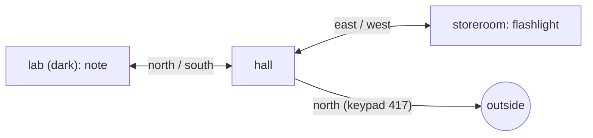

:::objectives
- Start your capstone from a skeleton that already runs, validates input, and quits cleanly.
- Build in milestones, each one small enough to finish and test in a single session.
- Follow a complete worked example, an escape-room text adventure, from skeleton to finished game.
- Diagnose the problems that most often stall a capstone.
:::

The biggest risk in a capstone isn't a hard bug. It's spending three sessions writing 200 lines without running them, then facing 15 errors at once. The fix is to build in **milestones**: small steps that each end with a program that runs. If a milestone breaks something, you only have a few new lines to suspect.

## The starter skeleton

Copy this into Thonny and save it in your `m8` folder under your project's name. It runs right now: it has a menu loop, a choice validator, a number validator with `try`/`except`, one placeholder feature, and a summary at the end. Your job is to replace the placeholders, one milestone at a time.

```python run title="capstone.py" input="hello|a|eleven|30|3|q"
"""My capstone app. Replace this line with your one-sentence pitch."""


def ask_choice(prompt, options):
    """Ask until the answer is one of options (ignoring case and spaces); return it."""
    while True:
        answer = input(prompt).strip().lower()
        if answer in options:
            return answer
        print("  Please choose one of:", ", ".join(options))


def ask_number(prompt, low, high):
    """Ask until the user types a number from low to high; return it as a float."""
    while True:
        text = input(prompt).strip()
        try:
            number = float(text)
        except ValueError:
            print("  Please type a number.")
            continue
        if low <= number <= high:
            return number
        print(f"  Please pick a number from {low} to {high}.")


def first_feature(data):
    """Placeholder: replace with your app's first real feature."""
    amount = ask_number("How many? ", 1, 10)
    data["uses"] = data["uses"] + 1
    print(f"  (Your first feature goes here. You typed {amount}.)")


def show_summary(data):
    """Print what happened during this session."""
    print(f"\nFeatures used this session: {data['uses']}. Bye!")


def main():
    """Set up the data, run the main loop, and finish with a summary."""
    data = {"uses": 0}
    print("MY APP")
    while True:
        choice = ask_choice("\n(a) first feature, (q) quit: ", ["a", "q"])
        if choice == "q":
            break
        if choice == "a":
            first_feature(data)
    show_summary(data)


main()
```

Two new things are worth a sentence each:

-   `", ".join(options)` glues the items of a list into one string, with `", "` between them, so the hint reads `a, q`.
-   The whole main program lives inside a function called `main()`, and the very last line calls it. That keeps the app's variables local (so every other function has to receive them as parameters, the habit from Module 6), and it means `return` inside `main()` ends the program cleanly from anywhere.

:::warning
If your program runs and nothing at all happens, check the last line. Without the call `main()`, Python reads every `def` and then stops, because nothing ever calls them.
:::

## The five milestones

Work through these in order. Don't start a milestone until the previous one runs and you've tested it.

| Milestone | Goal | Done when |
| --- | --- | --- |
| **M1: Skeleton** | Rename the skeleton's menu and placeholders for your app. | It starts, shows your menu, rejects nonsense, and quits with a summary. |
| **M2: Core, once** | Make your single most important feature work one time. | You can do the main thing (one quiz question, one conversion, one move) correctly. |
| **M3: Data and repetition** | Store results in your list or dictionary and let the loop repeat the feature. | Several rounds work in a row, and the data remembers them. |
| **M4: Bulletproof input** | Validate every input and add `try`/`except` wherever text becomes a number. | Nothing you type can produce a traceback. |
| **M5: Finish and polish** | Add the win, lose, or end conditions, the final summary, and tidy messages. | A friend can use it without asking you anything. |

After each milestone, save a copy (`capstone_m2.py`, `capstone_m3.py`, ...) so you can always get back to the last version that worked.

## Worked example: Escape the Lab

Here's a small text adventure built through the same five milestones. You wake up in a dark lab. To escape you need to find a flashlight, use it to read a note with the door code, and type the code into a keypad. Back in Module 2, The Lantern Cave tracked a hero's stats but couldn't respond to the player; this adventure listens to every command. It's about 140 lines when finished.



### M1: Skeleton

Commands are typed as words, like `go north`, so the first job is splitting the player's text into a verb and a noun. `split_command` always returns exactly two words (using `""` when one is missing), which means the main loop never has to worry about an `IndexError`.

```python run title="lab.py" input="hello|help|  QUIT  "
def split_command(text):
    """Turn 'Go  North' into ['go', 'north']; always return exactly two words."""
    words = text.strip().lower().split()
    if len(words) == 0:
        return ["", ""]
    if len(words) == 1:
        return [words[0], ""]
    return [words[0], words[1]]


def show_help():
    """Print the commands the game understands."""
    print("Commands: look, go DIRECTION, take, inventory, help, quit")


def main():
    """Run the game loop."""
    print("ESCAPE THE LAB")
    show_help()
    while True:
        command = split_command(input("\n> "))
        verb = command[0]
        if verb == "quit":
            print("Game over.")
            return
        elif verb == "help":
            show_help()
        else:
            print("I don't understand that. Type help for commands.")


main()
```

Notice that `  QUIT  ` with spaces and capitals still quits. Every later command gets that for free, because the cleanup happens in one place.

### M2: Core, once

The core of an adventure is moving between rooms. Each room is a dictionary with a description and its exits, and all the rooms live in one big dictionary keyed by name. `move` looks up the exits for the current room and returns where the player ends up, which is the same room if the direction isn't allowed.

Step through a two-room version. Watch `here` stay the same after the bad direction, then change after the good one:

:::trace Look up an exit, or stay put
```python
rooms = {
    "lab": {"exits": {"north": "hall"}},
    "hall": {"exits": {"south": "lab"}},
}

def move(rooms, here, direction):
    exits = rooms[here]["exits"]
    if direction not in exits:
        print("You can't go that way.")
        return here
    return exits[direction]

here = "lab"
here = move(rooms, here, "west")
here = move(rooms, here, "north")
print("Now in", here)
```
:::

`rooms[here]["exits"]` reads in two steps: `rooms[here]` gets the current room's dictionary, and `["exits"]` gets the exits inside it. A dictionary inside a dictionary sounds complicated, but each step is a lookup you already know.

### M3: Data and repetition

Now the player can pick things up. The inventory is a list; each room's `"item"` is a string, set to `""` once it's taken so it can't be taken twice. A tiny helper, `can_see`, holds the darkness rule so that both `describe` and `take` can use it:

```python
def can_see(here, inventory):
    """Return False only in the dark lab without a flashlight."""
    return here != "lab" or "flashlight" in inventory


def take(rooms, here, inventory):
    """Move the room's item into the inventory, if there is one you can see."""
    room = rooms[here]
    if not can_see(here, inventory):
        print("You fumble around in the dark but can't find anything.")
    elif room["item"] == "":
        print("There's nothing here to take.")
    else:
        item = room["item"]
        inventory.append(item)
        room["item"] = ""
        print(f"You take the {item}.")
```

`take` changes both the inventory list and the room's dictionary, and both changes stick because it's changing values *inside* them, just like `feed(pet)` in Module 7.

### M4: Bulletproof input

The keypad is the one place where text becomes a number, so that's where `try`/`except` goes. `ask_code` loops until it gets a whole number, and `move` compares it with the code:

```python
DOOR_CODE = 417


def ask_code():
    """Ask for the keypad code until the player types a whole number; return it."""
    while True:
        text = input("Keypad code: ").strip()
        try:
            return int(text)
        except ValueError:
            print("  The keypad only has the digits 0 to 9.")
```

Then the test list for this milestone: `go` with no direction, `go up`, `GO   NORTH`, an empty line, `four` at the keypad, and a wrong code. In the finished game, each of those gets a message instead of a traceback. (`go` alone hits the `direction == ""` check in `move`; an empty line falls through to "I don't understand that.")

### M5: Finish and polish

The last milestone adds the ending: the loop runs `while here != "outside"`, a `moves` counter goes up on every successful move, and a final message reports the count. It also adds the `look` and `inventory` commands, a description when you enter each room, and a docstring on every function. Here's the finished game, played from start to escape, including a few mistakes:

```python run title="lab.py" input="take|go north|go east|take|go west|go south|take|inv|dance|Go  North|go north|four|471|go north|417"
DOOR_CODE = 417


def make_rooms():
    """Return a fresh dictionary describing every room in the lab."""
    return {
        "lab": {
            "text": "A cluttered lab, lit by your flashlight. A door leads north.",
            "exits": {"north": "hall"},
            "item": "note",
        },
        "hall": {
            "text": "A long hallway. The lab is south, a storeroom is east, and a steel door with a keypad is north.",
            "exits": {"south": "lab", "east": "storeroom", "north": "outside"},
            "item": "",
        },
        "storeroom": {
            "text": "Dusty shelves of old equipment. The hall is west.",
            "exits": {"west": "hall"},
            "item": "flashlight",
        },
    }


def split_command(text):
    """Turn 'Go  North' into ['go', 'north']; always return exactly two words."""
    words = text.strip().lower().split()
    if len(words) == 0:
        return ["", ""]
    if len(words) == 1:
        return [words[0], ""]
    return [words[0], words[1]]


def can_see(here, inventory):
    """Return False only in the dark lab without a flashlight."""
    return here != "lab" or "flashlight" in inventory


def describe(rooms, here, inventory):
    """Print what the player sees in the current room."""
    if not can_see(here, inventory):
        print("It's pitch black. You can just make out a door to the north.")
        return
    room = rooms[here]
    print(room["text"])
    if room["item"] != "":
        print(f"You see a {room['item']} here.")


def ask_code():
    """Ask for the keypad code until the player types a whole number; return it."""
    while True:
        text = input("Keypad code: ").strip()
        try:
            return int(text)
        except ValueError:
            print("  The keypad only has the digits 0 to 9.")


def move(rooms, here, direction):
    """Return the room the player ends up in after trying to go in direction."""
    exits = rooms[here]["exits"]
    if direction == "":
        print("Go where? Try: go north")
        return here
    if direction not in exits:
        print("You can't go that way.")
        return here
    destination = exits[direction]
    if destination == "outside":
        if ask_code() != DOOR_CODE:
            print("The keypad buzzes. Wrong code.")
            return here
        print("The keypad beeps and the door slides open.")
    return destination


def take(rooms, here, inventory):
    """Move the room's item into the inventory, if there is one you can see."""
    room = rooms[here]
    if not can_see(here, inventory):
        print("You fumble around in the dark but can't find anything.")
    elif room["item"] == "":
        print("There's nothing here to take.")
    else:
        item = room["item"]
        inventory.append(item)
        room["item"] = ""
        print(f"You take the {item}.")
        if item == "note":
            print(f'The note says: "Door code {DOOR_CODE}".')


def show_help():
    """Print the commands the game understands."""
    print("Commands: look, go DIRECTION, take, inventory, help, quit")


def main():
    """Run one game until the player escapes or quits."""
    rooms = make_rooms()
    here = "lab"
    inventory = []
    moves = 0
    print("ESCAPE THE LAB")
    show_help()
    describe(rooms, here, inventory)

    while here != "outside":
        command = split_command(input("\n> "))
        verb = command[0]
        noun = command[1]
        if verb == "quit":
            print("You sit down to wait for rescue. Game over.")
            return
        elif verb == "look":
            describe(rooms, here, inventory)
        elif verb == "go":
            new_room = move(rooms, here, noun)
            if new_room != here:
                moves = moves + 1
                here = new_room
                if here != "outside":
                    describe(rooms, here, inventory)
        elif verb == "take":
            take(rooms, here, inventory)
        elif verb in ["inventory", "inv"]:
            if len(inventory) == 0:
                print("You're carrying nothing.")
            else:
                print("You're carrying:", ", ".join(inventory))
        elif verb == "help":
            show_help()
        else:
            print("I don't understand that. Type help for commands.")

    print(f"\nYou step out into the daylight. Escaped in {moves} moves!")


main()
```

Check it against the brief: input and output everywhere; a dictionary of rooms and an inventory list; decisions in every function; a main loop plus the keypad loop; nine functions with docstrings; validated commands; `try`/`except` at the keypad; and `quit` or escape both end the game with a message. `make_rooms()` builds a fresh map each time it's called, so adding a "play again?" question at the end would be a short change.

## When you get stuck

| What you see | Likely cause | What to try |
| --- | --- | --- |
| The program runs and does nothing | No `main()` call on the last line | Add it, unindented |
| The same message prints forever without waiting | `input()` isn't inside the loop | Move the `input()` line into the loop body |
| The loop never ends | Nothing in the loop makes the condition `False` | Check that `break`, `return`, or a changing variable is actually reached |
| A function's result is `None` | One path through the function has no `return` | Step into it with **F7** and see which path it took |
| A change to your data doesn't stick | You reassigned a name inside a function instead of changing a key | Return the new value, or change `data["key"]` directly |
| It works for you but crashes for a friend | They typed something you didn't test | Read the traceback, then add their input to your test table |

:::quiz
Q: Why does `split_command` always return exactly two words, even for an empty line?
- [ ] Python lists must have two items
  Lists can have any length.
- [x] So the main loop can always read `command[0]` and `command[1]` without an `IndexError`
  Handling the odd cases once, inside one function, keeps every caller simple and safe.
- [ ] To make the game harder
  It's about safety, not difficulty.

Q: `move` returns the *same* room when the direction is blocked. How does `main` use that?
- [x] It compares the new room with `here`, and only counts a move and describes the room if they differ
  The return value carries the answer, so `main` decides what a successful move means.
- [ ] It doesn't; `move` changes `here` directly
  `here` is a string in `main`; `move` can't change it, which is why it returns the result.
- [ ] It crashes the game to signal a wall
  Blocked moves just print a message and return the current room.

Q: You're at M3 and adding a feature breaks M2, which worked an hour ago. What's the fastest way back?
- [ ] Rewrite the program from scratch
  That throws away all your working code.
- [x] Open your saved `capstone_m2.py`, compare it with the current file, and look at what changed
  Saving a copy after each milestone gives you a known-good version, and the bug is in the difference.
- [ ] Add `try`/`except` around everything
  That hides the error instead of fixing it.
:::

:::takeaways
- Start from a skeleton that runs, and keep it running after every milestone.
- Build the core feature once before adding repetition, data, and validation around it.
- Handle messy input in one place (like `split_command` or `ask_code`) so the rest of the program can trust it.
- Keep `main()` in charge, pass data to functions as parameters, and use return values to report what happened.
- Save a copy after each milestone so you always have a version that works.
:::

## Further reading

- [Python docs: str.join()](https://docs.python.org/3/library/stdtypes.html#str.join): how `join` works, and why it's called on the separator rather than the list.
- [Python docs: `__main__`, the top-level code environment](https://docs.python.org/3/library/__main__.html): explains the `if __name__ == "__main__":` line you'll see at the bottom of other people's programs, often just above a call to `main()`.
