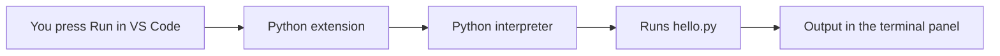

:::objectives
- Install Python 3 (3.10 or newer) from python.org, or from Linux on a Chromebook.
- Install Visual Studio Code and Microsoft's Python extension.
- Check the setup from VS Code's built-in terminal with one command.
- Fix the four problems that stop most people on day one.
:::

The projects in this course are bigger than one file. The quiz game in Module 4 has a program, a file of questions, and a file of saved scores, and you'll want to see all three at once. IDLE, the editor many people start with, opens one window per file and has no built-in terminal. **Visual Studio Code** (VS Code) shows your whole project folder in a sidebar, runs programs in a terminal at the bottom of the window, and underlines many mistakes before you even run the code.

Everything here is free. Budget about 30 minutes, most of it waiting for downloads.

## Three pieces, three jobs

It helps to know what each piece does, because most setup problems come from one piece not being able to find another.

-   **Python** is the interpreter: the program that reads your `.py` file and carries out each line. VS Code does not include it, so you install it separately.
-   **VS Code** is the editor: where you type, save, and organize files. On its own it knows nothing special about Python.
-   **The Python extension** (made by Microsoft) is the bridge. It finds the Python installed on your computer, adds a **Run** button, and powers autocomplete and error underlines.



If you already installed Python 3.10 or newer for an earlier course, skip Step 1 and keep the Python you have.

## Step 1: Install Python 3

:::tabs
@tab Windows
1.  Open [python.org/downloads](https://www.python.org/downloads/) and click the yellow **Download Python** button.
2.  Open the downloaded file and choose **Install**. Recent versions of Python for Windows use the **Python install manager**, which adds the `python` and `py` commands.
3.  The first time you run Python, a console window may ask questions, such as whether to install the latest version or add a folder to your PATH. Type `y` and press Enter for each one.
4.  If you see the older-style installer instead (a window with an **Install Now** button), tick **Add python.exe to PATH** at the bottom before clicking **Install Now**.
@tab macOS
1.  Open [python.org/downloads](https://www.python.org/downloads/) and click **Download Python**. You get a `.pkg` installer.
2.  Open it and click through **Continue**, **Agree**, and **Install**. Your Mac asks for your login password.
3.  When it finishes, a Finder window shows a new **Python 3** folder in **Applications**. You can close it; VS Code will find Python on its own.
4.  On a Mac the command is `python3`, not `python`. Remember that for the check below.
@tab Chromebook
1.  Open **Settings**, search for **Linux**, and turn on the **Linux development environment**. Accept the suggested disk size. A black Terminal window opens when it is ready.
2.  Linux already includes Python 3. Add the two extra pieces this course needs (virtual environments and pip) by typing:

```bash
sudo apt update
sudo apt install -y python3-venv python3-pip
```

3.  Check the version with `python3 --version`. Anything from 3.10 up works for this course.
:::

## Step 2: Install VS Code

:::tabs
@tab Windows
1.  Go to [code.visualstudio.com/download](https://code.visualstudio.com/download) and download the **User Installer** for Windows. It installs just for your account, so it does not need an administrator password.
2.  Run it and accept the license.
3.  On the **Select Additional Tasks** page, leave **Add to PATH** ticked. Then click **Install** and **Finish**.
@tab macOS
1.  Go to [code.visualstudio.com/download](https://code.visualstudio.com/download) and click the Mac download.
2.  Open the downloaded file and drag **Visual Studio Code** into your **Applications** folder. Running it straight from Downloads causes odd update problems later.
3.  Open it from Applications. If macOS asks whether you are sure you want to open an app downloaded from the internet, click **Open**.
@tab Chromebook
1.  In the Linux Terminal, run `dpkg --print-architecture`. If it prints `amd64`, you need the **x64 .deb** download; if it prints `arm64`, you need the **ARM64 .deb**.
2.  Download that `.deb` file from [code.visualstudio.com/download](https://code.visualstudio.com/download).
3.  Open the **Files** app, find the file in **Downloads**, and double-click it. Choose **Install** and wait a minute or two.
4.  VS Code now appears in your app launcher inside the **Linux apps** folder.
:::

## Step 3: Add the Python extension

1.  Open VS Code. Click the **Extensions** icon in the left bar (four small squares), or press **Ctrl+Shift+X** (**Cmd+Shift+X** on a Mac).
2.  Type `Python` in the search box.
3.  Pick the one named **Python** whose publisher is **Microsoft**, with a blue check mark, and click **Install**.

It brings three helpers along with it: **Pylance** (autocomplete and error underlines), **Python Debugger**, and **Python Environments** (which manages the virtual environments you will meet in the next lesson). You don't need to install those by hand.

:::warning
The Marketplace has many lookalikes with names such as "Python Extension Pack" or "Python for VSCode". Some are abandoned and a few clash with the real one. Check that the publisher says **Microsoft** before clicking Install.
:::

## Check it from VS Code's terminal

VS Code has a terminal built into the bottom of the window. Open it from the menu bar with **Terminal → New Terminal**, or press **Ctrl+`** (the backtick key, usually above Tab). Then type the command for your system and press Enter.

:::tabs
@tab Windows
```bash
python --version
```

```text
Python 3.15.2
```
@tab macOS
```bash
python3 --version
```

```text
Python 3.15.2
```
@tab Chromebook
```bash
python3 --version
```

```text
Python 3.11.2
```
:::

Your numbers will differ. What matters is that the answer starts with `Python 3.` and the second number is 10 or higher. If you got that, all three pieces can see each other and you are ready for the next lesson.

## When the check fails

**`python : The term 'python' is not recognized...` on Windows.** This almost always means VS Code was already open when you installed Python. A terminal copies the list of program locations (the PATH) when VS Code starts, so it can't see anything installed afterwards. Quit VS Code completely and open it again. If it still fails, try `py --version`; the `py` command often works when `python` doesn't.

**Typing `python` opens the Microsoft Store on Windows.** Windows has shortcut "aliases" that point `python` at the Store. Search the Start menu for **Manage app execution aliases** and make sure the entries for the Python you installed are turned on, then restart VS Code.

**`zsh: command not found: python` on a Mac.** Nothing is broken. macOS only names the command `python3`. Inside a virtual environment, which you'll make next lesson, plain `python` works too.

**No Linux option in a Chromebook's Settings.** School and family accounts often turn it off. Ask whoever manages the device, or use another computer for this course. You can't install VS Code on a Chromebook without Linux.

:::tip
When something fails, copy the exact error text before you change anything. "It doesn't work" is impossible to search; `The term 'python' is not recognized` takes ten seconds.
:::

## A tour of the same setup on video

:::video D2cwvpJSBX4
The VS Code team's own walkthrough. The first two chapters (to about 2:30) match this page: installing Python and then the Python extension. The chapters on virtual environments and ways to run a file match the next lesson. Their screen may look slightly different from yours, because VS Code updates every month.
:::

## Further reading

-   [Getting Started with Python in VS Code](https://code.visualstudio.com/docs/python/python-tutorial): the official written tutorial, with screenshots of each step.
-   [Using Python on Windows](https://docs.python.org/3/using/windows.html): python.org's guide to the install manager, including a table of fixes when `python` won't start.
-   [VS Code on a Chromebook](https://code.visualstudio.com/blogs/2020/12/03/chromebook-get-started): the VS Code team's notes on the Linux setup, including how to pick the right download for your chip.
