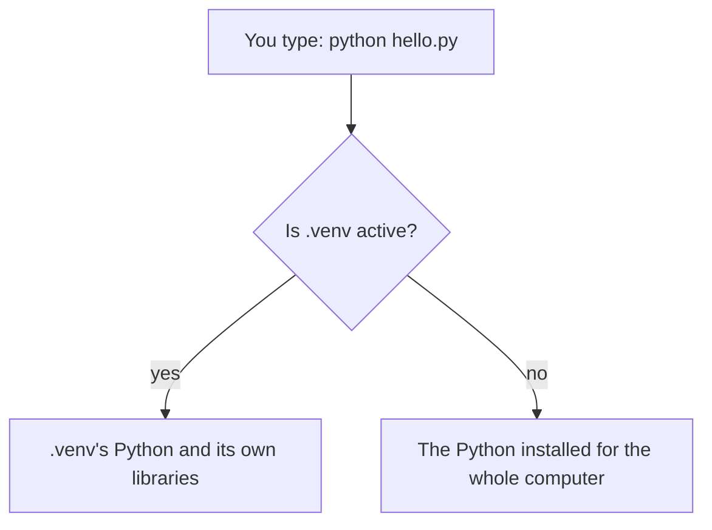

:::objectives
- Open a folder in VS Code and create a `.py` file in it.
- Run a file two ways: the **Run Python File** button and a typed terminal command.
- Read the command VS Code types for you, and know which Python it used.
- Create a `.venv` virtual environment and confirm you're inside it.
:::

When you press **Run** in VS Code, it does something sneaky: it types a command into the terminal for you, then presses Enter. That one line of text tells you exactly which copy of Python ran your code. By the end of this page you'll be able to read it, type it yourself, and switch the project onto a Python that belongs only to it.

## Step 1: Make a project folder and open it

Every program in this course will live in one folder. Make it now:

1.  In File Explorer (Windows), Finder (Mac), or Files (Chromebook, inside **Linux files**), create a folder called `python-projects`. Use lowercase and a dash, no spaces; spaces in folder names cause small headaches when you type paths in a terminal.
2.  In VS Code, choose **File → Open Folder…** and pick `python-projects`.
3.  VS Code asks whether you trust the authors of the files in this folder. It's your own empty folder, so choose **Yes, I trust the authors**.

The left sidebar (the **Explorer**) now shows `PYTHON-PROJECTS` with nothing under it. Opening the folder, not a single file, is what lets VS Code treat it as one project.

## Step 2: Write and run hello.py

Hover over the folder name in the Explorer and click the **New File** icon, then type `hello.py` and press Enter. VS Code sees the `.py` ending and switches on the Python extension. Type this in:

```python run title="hello.py"
name = "VS Code"
print(f"Hello from {name}!")

for n in range(1, 4):
    print(n, "squared is", n * n)
```

Now click the triangle **Run Python File** button in the top-right corner of the editor. A terminal panel slides up from the bottom, and you'll see a line like this appear before the output:

```bash
/usr/local/bin/python3 /Users/sam/Documents/python-projects/hello.py
```

That's the command VS Code typed. It has two parts: the full path to a Python interpreter, then the full path to your file. On Windows it starts with `&` and the interpreter path ends in `python.exe`, but the shape is the same. Look at the first path whenever you wonder "which Python ran this?"

## Step 3: Run it yourself from the terminal

You can type that command in a shorter form. Click inside the terminal and run:

:::tabs
@tab Windows
```bash
python hello.py
```
@tab macOS or Chromebook
```bash
python3 hello.py
```
:::

You get the same four lines. This works because the terminal starts *inside your project folder*, so the short name `hello.py` is enough. That detail comes back in Module 4, when your programs open data files by name.

:::warning
The terminal runs the file **as saved on disk**. If the editor tab shows a dot instead of an ×, you have unsaved changes, and `python hello.py` will run the old version. Press **Ctrl+S** (**Cmd+S** on a Mac) first, or turn on **File → Auto Save** so you never have to think about it.
:::

Programs that ask for input work the same way. Click in the terminal when the question appears, type your answer, and press Enter:

```python run title="greet.py" input="Priya"
name = input("What's your name? ")
print(f"Nice to meet you, {name}. Your project folder works.")
```

## Step 4: Give the project its own Python

Here's the problem a **virtual environment** solves. In Module 5 you'll install extra libraries with a tool called `pip`. Suppose one project needs version 1 of a library and another needs version 2. If both install into the same Python, one of them breaks.

A virtual environment is a folder, by convention called `.venv`, inside your project. It holds a small Python that points back to the one you installed, plus its own private shelf for libraries. Anything you install while it's active lands on that shelf and nowhere else. Delete the folder and the environment is gone, with nothing else on your computer touched.



The easiest way to make one is from VS Code:

1.  Open the Command Palette with **Ctrl+Shift+P** (**Cmd+Shift+P** on a Mac).
2.  Type `Python: Create Environment` and choose it.
3.  Follow the prompts: choose **Venv** as the type, then choose the Python you installed in the last lesson. If it asks for a name, keep `.venv`.

After a few seconds a `.venv` folder appears in the Explorer, and VS Code selects it for this project. If you prefer typing, this does the same job:

:::tabs
@tab Windows
```powershell
python -m venv .venv
.venv\Scripts\Activate.ps1
```
@tab macOS or Chromebook
```bash
python3 -m venv .venv
source .venv/bin/activate
```
:::

The first line builds the folder. The second line *activates* it for this terminal only. VS Code does that step for you in every new terminal once `.venv` is selected, so you'll rarely type it.

## Step 5: Prove which Python is running

Close the terminal (the trash-can icon on its toolbar) and open a fresh one with **Terminal → New Terminal**. The prompt should now begin with `(.venv)`. Ask Python where it lives:

```bash
python -c "import sys; print(sys.executable)"
```

```text
/Users/sam/Documents/python-projects/.venv/bin/python
```

The path ends inside `.venv`, so this is the project's own Python. (On Windows it ends in `.venv\Scripts\python.exe`.) Notice that plain `python` works here even on a Mac: an active environment always provides it.

For one more check, save this as `check_setup.py` and press Run:

```python run title="check_setup.py"
import sys

version = sys.version_info
print(f"Running Python {version.major}.{version.minor}")
if version >= (3, 10):
    print("New enough for every lesson in this course.")
else:
    print("Too old: install a newer Python from python.org.")

inside = sys.prefix != sys.base_prefix
print("Inside a virtual environment:", inside)
```

The output on this page comes from our lesson server, which doesn't use a virtual environment, so its last line says `False`. On your computer, with `.venv` selected, it should say `True`. The trick is in `sys.prefix != sys.base_prefix`: inside an environment, Python's own folder (`prefix`) differs from the folder of the Python it was made from (`base_prefix`).

## If it went wrong

**`Activate.ps1 cannot be loaded because running scripts is disabled on this system` (Windows).** PowerShell blocks scripts by default. Run this once, then try again:

```powershell
Set-ExecutionPolicy -ExecutionPolicy RemoteSigned -Scope CurrentUser
```

**`The virtual environment was not created successfully because ensurepip is not available` (Chromebook).** The `python3-venv` package is missing. Run `sudo apt install -y python3-venv`, delete the half-made `.venv` folder, and create it again.

**The prompt has no `(.venv)`, or `check_setup.py` says `False` on your computer.** VS Code is using a different Python. Open the Command Palette, run **Python: Select Interpreter**, and pick the entry whose path contains `.venv`. Then open a new terminal.

:::tip
Never save your own files inside `.venv`, and never copy it to another computer. Environments contain paths specific to one machine. To move a project, copy your `.py` files and build a fresh `.venv` on the other side.
:::

## The same idea from another teacher

:::video Y21OR1OPC9A
Tech With Tim explains what a virtual environment is in the first minute, then creates and activates one from the terminal. Watch for the moment the prompt changes to show the environment's name. His later chapters on installing packages and saving dependencies preview Module 5.
:::

:::quiz
Q: You edit `hello.py`, don't save it, and type `python hello.py` in the terminal. What runs?
- [ ] Your newest edits
  The terminal can't see the editor's unsaved text; it reads the file from disk.
- [x] The last saved version
  `python` opens the file on disk, so unsaved edits are ignored. Save first or turn on Auto Save.
- [ ] Nothing, Python refuses to run unsaved files
  Python has no idea the editor has unsaved changes. It just runs what's on disk.

Q: Your terminal prompt starts with `(.venv)`. What does that tell you?
- [ ] The file you're editing is inside `.venv`
  Your code lives beside `.venv`, not in it. The prefix is about the terminal.
- [x] Typing `python` in this terminal uses the project's own environment
  The prefix means the environment is active, so `python` and later `pip` use `.venv`.
- [ ] Python is not installed globally
  The environment is built from a global Python, so one must be installed.

Q: The command VS Code typed was `/usr/bin/python3 /Users/sam/python-projects/hello.py`. Is the project's `.venv` being used?
- [x] No, the interpreter path doesn't go through `.venv`
  The first path names the interpreter. A `.venv` interpreter's path would contain `.venv`.
- [ ] Yes, because `hello.py` is in the project folder
  Where the file lives doesn't decide which Python runs it. The first path does.
:::

## Further reading

-   [Python environments in VS Code](https://code.visualstudio.com/docs/python/environments): the official guide to creating, selecting, and switching environments, including the sidebar's quick-create button.
-   [venv: creation of virtual environments](https://docs.python.org/3/library/venv.html): the Python docs' description of what is inside `.venv` and how activation works on each shell.
-   [Terminal basics](https://code.visualstudio.com/docs/terminal/basics): how to open several terminals, split them, and clear them.
