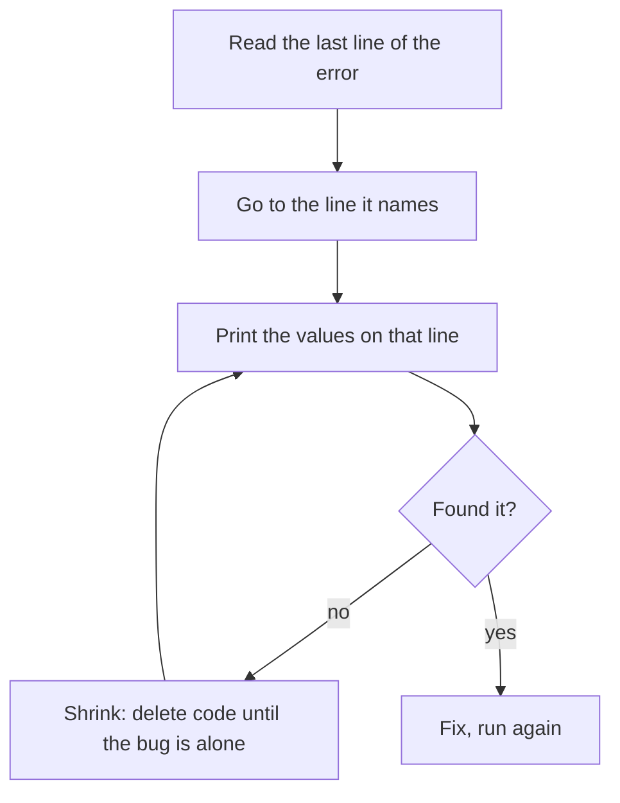

:::objectives
- Lay out `python-projects` so every module's files are easy to find.
- Name files in a way that never clashes with Python's own modules.
- Read a traceback from the bottom up to find the line and the cause.
- Use a four-step routine (read, locate, inspect, shrink) before asking for help.
:::

Here's a bug that has nothing to do with your code. You write a dice game, save it as `random.py`, and run it. Python replies:

```text
AttributeError: module 'random' has no attribute 'randint' (consider renaming '/Users/sam/python-projects/random.py' since it has the same name as the standard library module named 'random' and the import system gives it precedence)
```

When your program says `import random`, Python looks in your project folder *first*. It finds your own `random.py`, imports that instead of the real one, and your file has no `randint`. Recent versions of Python (3.13 and newer) spell out the fix, as you can see: rename the file. Older versions print only the first half of that message, which is far more confusing. A few habits about folders and names prevent this and most other "it worked yesterday" problems.

## One folder per module

Keep everything under the `python-projects` folder you opened last lesson, with a subfolder for each module. After a few modules it will look like this:

```text
python-projects/
├── .venv/
├── m1-setup/
│   ├── hello.py
│   └── check_setup.py
├── m2-gradebook/
│   ├── gradebook.py
│   └── practice/
├── m3-contacts/
│   └── contacts.py
├── m4-quiz/
│   ├── quiz.py
│   └── questions.json
└── scratch/
```

The one `.venv` at the top serves every module, so you only build it once. The `scratch` folder is for quick experiments you don't mean to keep. Drag `hello.py` and `check_setup.py` into `m1-setup` now; VS Code's Explorer lets you drag files between folders. Each Practice lesson gets a `practice` folder with one file per exercise (`ex1_word_count.py`, `ex2_tags.py`, and so on), so you can come back to any of them.

Rules for file names that save you trouble:

-   Lowercase letters, digits, and underscores only: `grade_book.py`, not `Grade Book.py`. A file you might import one day can't have spaces or dashes in its name.
-   Start with a letter.
-   Never reuse the name of something you import. `json.py`, `random.py`, `math.py`, `test.py`, and `string.py` are the usual culprits.

:::tip
To rename a file, right-click it in VS Code's Explorer and choose **Rename** (or select it and press F2 on Windows and Linux, Enter on a Mac). You may also notice a `__pycache__` folder appear next to your files: Python keeps quick-loading copies of imported files there. It's safe to ignore or delete.
:::

## Save, run, look, repeat

Small loops beat big ones. Write two or three lines, run, check the output, then write the next two. When something breaks you know it's in the last few lines you touched.

A few terminal habits make that loop fast:

-   **Up arrow** brings back the last command, so re-running is two keystrokes.
-   **Ctrl+C** stops a program that is stuck, for example in a loop that never ends. It works on a Mac too (Ctrl, not Cmd).
-   `clear` wipes the terminal so new output isn't mixed with old errors.
-   Turn on **File → Auto Save** if you haven't. Most "my fix didn't work" moments are an unsaved file.

VS Code also checks your code as you type. A red wavy underline usually marks a line that will fail, such as a misspelled name or a missing bracket, and a yellow one is a warning. Hover over it to read the message, or open the **Problems** panel from **View → Problems** to see them all at once.

## How to use the code on these pages

Every code block that shows output underneath has really been run, and the output is exactly what Python printed. When a lesson asks you to predict the output, make your guess before looking. Being wrong on a guess you committed to teaches you more than reading the right answer.

Type the examples into your own files instead of pasting them. Your fingers learn the syntax, and you'll make small typos that teach you what real error messages look like. In Practice lessons, give each exercise an honest ten minutes, then open the hint, and only then the solution. Comparing your version with the solution is where a lot of the learning happens, so do it even when yours works.

## Read a traceback from the bottom up

When a program crashes, Python prints a **traceback**: the story of which line called which, ending at the line that failed. Predict what happens when this runs:

```python run raises title="report.py"
def average(scores):
    return sum(scores) / len(scores)


def report(name, scores):
    print(name, "averages", average(scores))


report("Ava", [88, 92])
report("Ben", [])
```

Ava's line prints fine, then the program crashes on Ben. Read the traceback in this order:

1.  **The last line** says what went wrong: `ZeroDivisionError: division by zero`. The word before the colon is the error type; the rest is the message.
2.  **The frame just above it** says where: line 2, the `return` inside `average`. The `~~~^~~~` marks underneath underline the expression that failed, with the `^` under the `/` that did the dividing.
3.  **The frames above that** say how you got there: the bottom-level code called `report("Ben", [])`, which called `average([])`.

So the cause isn't really line 2. Line 2 is fine for any list with something in it. The cause is that `report` passed an empty list along without checking. That's a common pattern: the line that crashes is the messenger, and the real decision to fix is a frame or two higher.

## The four-step routine for getting unstuck



The third step is the one people skip. Don't guess what a variable holds; ask Python. Printing with `repr()` shows hidden characters, and `type()` shows what kind of value you have:

```python run title="inspect.py"
line = "42\n"
print("print shows:", line)
print("repr shows:", repr(line))
print("type is:", type(line))
print("fixed:", int(line.strip()) + 1)
```

Plain `print` hides the newline at the end of `"42\n"`, so the first line looks innocent and the output has a strange blank gap. `repr` shows the `\n` plainly. Values read from files and from `input()` are full of surprises like this, and Module 4 will run into exactly this one.

If you're still stuck after shrinking, ask for help with four things: what you expected, what happened instead, the **full** error text, and the smallest piece of code that shows the problem. Questions like that get answered quickly, and half the time you solve it yourself while writing them down.

## Tracebacks on video

:::video 3p3p6kp39to
Real Python reads real tracebacks line by line. As you watch, practice the order from this page: error type and message first, then the line that failed, then the calls that led there.
:::

:::quiz
Q: A traceback's last line is `KeyError: 'email'`. What is the best first move?
- [ ] Rewrite the whole function
  You haven't found the problem yet. Rewriting without understanding often keeps the bug.
- [x] Go to the line named just above, and print the dictionary used there
  The error says a key is missing. Printing the dictionary shows which keys it really has.
- [ ] Reinstall Python
  A `KeyError` comes from your data, not from a broken installation.

Q: You save a file as `json.py`, and `json.dump(...)` fails with `AttributeError`. Why?
- [ ] `json.dump` was removed from Python
  It's still there. The problem is which `json` got imported.
- [x] Python imported your own `json.py` instead of the real module
  Your project folder is searched first, so your file hides the standard library one. Rename it.
- [ ] JSON files can't be written from VS Code
  VS Code has nothing to do with it. Any editor would give the same error.

Q: A program is stuck printing the same line over and over. How do you stop it?
- [x] Click in the terminal and press Ctrl+C
  Ctrl+C interrupts the running program on every system, Mac included.
- [ ] Press Ctrl+S
  That saves the file. The program keeps running.
- [ ] Close the editor tab
  The program runs in the terminal, not in the tab, so it carries on.
:::

## Further reading

-   [Errors and Exceptions](https://docs.python.org/3/tutorial/errors.html): the official tutorial's chapter on what tracebacks contain and how exceptions work.
-   [Basic editing in VS Code](https://code.visualstudio.com/docs/editing/codebasics): Auto Save, multiple cursors, and other editor habits worth picking up early.
