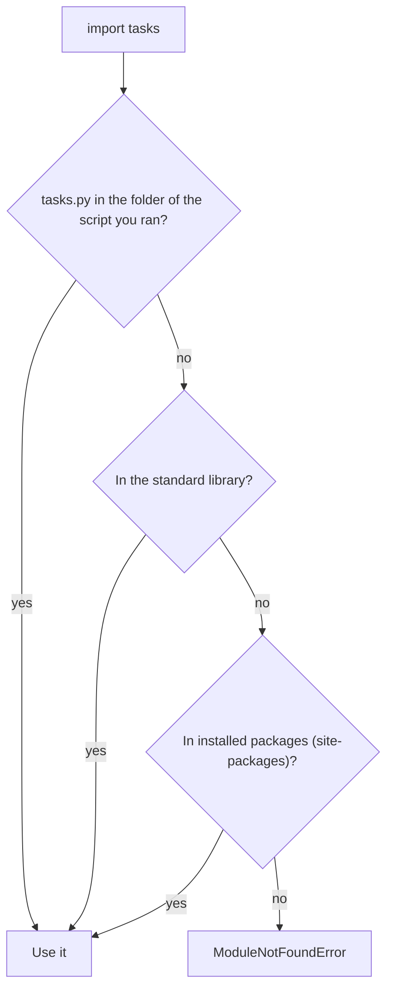

:::objectives
- Use `import`, `from … import`, and `as`, and explain where Python looks for a module.
- Reach for `random`, `datetime`, and `collections` instead of writing that code yourself.
- Split code into your own module and protect test code with `if __name__ == "__main__":`.
- Record a project's packages in `requirements.txt` so it runs on another computer.
- Catch a `ValueError` with `try`/`except` and re-prompt until the input is valid.
:::

Maya wrote `focus.py`, a study timer that downloads a quote of the day and then asks how many minutes to focus. It works every time on her laptop. She sends it to Jordan, and it dies before printing a single word:

```text
Traceback (most recent call last):
  File "C:\Users\jordan\Downloads\focus.py", line 1, in <module>
    import requests
ModuleNotFoundError: No module named 'requests'
```

Jordan installs the missing package and tries again. At the prompt `Minutes to focus:` he types `twenty`, and the program crashes with a `ValueError`. When he types `-5`, it cheerfully starts a timer for negative five minutes. These look like three separate bugs, but they share one cause: the script assumed things about the computer and about the person typing, and never checked any of them. This lesson fixes both halves.

## What `import` does, and where Python looks

A **module** is a file of Python code that other code can use. `import random` finds a file called `random.py`, runs it once, and hands you a name, `random`, that holds everything the file defined. You then reach inside with a dot: `random.randint(1, 6)`.

There are three ways to write an import, and you'll see all of them in real projects:

```python run title="imports.py"
import random                        # the whole module, used as random.something
from datetime import date, timedelta # just these two names
import statistics as stats           # the whole module, under a shorter name

random.seed(7)
print("Die roll:", random.randint(1, 6))
print("Due date:", date(2026, 11, 15) + timedelta(days=10))
print("Mean score:", stats.mean([88, 92, 75]))
```

`from datetime import date` lets you write `date(...)` instead of `datetime.date(...)`. That's shorter, but the reader can no longer see where `date` came from, so keep `from` imports to names you use a lot. `random.seed(7)` makes the "random" numbers repeat the same way every run, which is handy when you're testing. Delete the seed line and the die roll will change each time.

When you write `import tasks`, Python searches a list of folders in order and stops at the first match:



Your own folder comes first. That's what lets you import your own files, and it's also the source of one of the most confusing bugs in Python (see the warning further down).

## The standard library already wrote it for you

Python ships with a few hundred modules, called the **standard library**, and they're already installed wherever Python is. Before you write a helper, spend a minute checking whether it exists. Three modules show up in almost every project in this course.

### `random`: choices, shuffles, and dice

```python run title="pick_topic.py"
import random

random.seed(42)
topics = ["fractions", "essay outline", "vocab", "lab report"]
print("Study first:", random.choice(topics))
print("Random order:", random.sample(topics, k=len(topics)))
print("Two dice:", random.randint(1, 6), random.randint(1, 6))
```

`choice` picks one item, `sample` picks `k` different items (here all four, which gives a shuffled copy), and `randint(1, 6)` includes both ends, unlike `range`.

### `datetime`: real calendar math

```python run title="countdown.py"
from datetime import date

today = date(2026, 11, 15)  # in a real program: date.today()
exam = date.fromisoformat("2026-12-04")
gap = exam - today
print("Days until the exam:", gap.days)
print("The exam is on", exam.strftime("%A, %B %d"))
```

Subtracting two dates gives a `timedelta`, and `.days` turns it into a plain number. Months have different lengths and leap years exist, so counting days by hand goes wrong in ways you won't notice until February. `fromisoformat` reads the `YYYY-MM-DD` format, which is also the safest way to store dates in a JSON file.

### `collections`: counting and grouping

```python run title="tags.py"
from collections import Counter, defaultdict

tags = ["math", "art", "math", "bio", "math", "bio"]
print(Counter(tags).most_common(2))

by_subject = defaultdict(list)
for task, subject in [("worksheet 4", "math"), ("sketch", "art"), ("quiz prep", "math")]:
    by_subject[subject].append(task)
print(dict(by_subject))
```

`Counter` does the "make a dictionary of counts" loop in one call. A `defaultdict(list)` creates an empty list the first time you use a new key, so you never have to write `if subject not in by_subject:` again.

## Your own file is a module too

Any `.py` file in the same folder can be imported by its name, without the `.py`. Say you keep a helper that formats minutes:

```python title="units.py"
def minutes_to_hours(minutes):
    hours, rest = divmod(minutes, 60)
    return f"{hours}h {rest:02d}m"


print("Testing:", minutes_to_hours(135))
```

```py title="planner.py"
from units import minutes_to_hours

sessions = [45, 30, 50, 25, 100]
print("Study time this week:", minutes_to_hours(sum(sessions)))
```

```bash
$ python planner.py
Testing: 2h 15m
Study time this week: 4h 10m
```

The stray `Testing:` line appears because importing a module **runs** it, top to bottom. Every Python file gets a variable called `__name__`. When you run the file directly, it's set to `"__main__"`. When another file imports it, it's set to the module's name, `"units"`. So you can fence off code that should only run when the file is the one you started:

```python title="units.py"
def minutes_to_hours(minutes):
    hours, rest = divmod(minutes, 60)
    return f"{hours}h {rest:02d}m"


if __name__ == "__main__":
    print("Testing:", minutes_to_hours(135))
```

Now `python units.py` still prints the test, and `python planner.py` prints only `Study time this week: 4h 10m`.

## Why it runs on Maya's laptop and not Jordan's

`requests` isn't in the standard library. It's a **third-party package** that Maya installed months ago with pip and forgot about. Nothing in her script says it needs it. The fix is to write the dependency down in a file called `requirements.txt` that travels with the code:

```text title="requirements.txt"
requests
```

```bash
$ python -m pip install -r requirements.txt
```

Running pip as `python -m pip` guarantees the package lands in the same Python that will run your script, which avoids the "I installed it but it still says not found" problem when a computer has two Pythons. On macOS and Linux the command is often `python3` instead of `python`.

The `.venv` virtual environment from Module 1 is the other half of the fix. Packages installed while it's active belong to that project alone, so `requirements.txt` lists exactly what the project uses, not everything you've ever installed. When Jordan opens the folder, **Python: Create Environment** in the Command Palette builds his own `.venv` and offers to install from `requirements.txt` in the same step. "It works on my machine" becomes "it works on any machine that runs the install command."

:::note
Hard-coded paths break shared scripts too. `open("C:/Users/maya/Desktop/tasks.json")` fails on every computer except Maya's. Use a path relative to the project folder, like `open("tasks.json")`, and run the script from that folder.
:::

## Validate input: catch the crash, check the range, ask again

`input()` always returns a string. `int("twenty")` can't turn that into a number, so it **raises** a `ValueError`, and an exception nobody handles ends the program:

```python run raises
minutes = int("twenty")
```

`try`/`except` lets you handle it instead. Python runs the `try` block. If a `ValueError` happens anywhere inside it, Python jumps straight to the `except` block rather than crashing:

```python run title="safe_int.py" input="twenty|25"
for attempt in range(2):
    text = input("Minutes to focus: ")
    try:
        minutes = int(text)
        print("Got it:", minutes)
    except ValueError:
        print(f"'{text}' is not a whole number.")
```

Catching the crash is only half the job. `-5` is a perfectly good integer, so `int()` accepts it; you have to check the **range** yourself. Put both checks in a loop that only exits with a good value, and wrap it in a function so every prompt in your program can use it:

```python run title="ask_int.py" input="twenty|-5|25"
def ask_int(prompt, low, high):
    while True:
        text = input(prompt)
        try:
            number = int(text)
        except ValueError:
            print(f"'{text}' is not a whole number. Try again.")
            continue
        if low <= number <= high:
            return number
        print(f"Pick a number from {low} to {high}.")


minutes = ask_int("Minutes to focus (5-120): ", 5, 120)
print("Timer set for", minutes, "minutes.")
```

`continue` skips the rest of the loop body and asks again. `return` is the only way out, so the line after `ask_int(...)` can trust `minutes` completely. Step through it and watch `text` and `number` on each pass:

:::trace Watch ask_int reject two answers
```python input="twenty|-5|25"
def ask_int(prompt, low, high):
    while True:
        text = input(prompt)
        try:
            number = int(text)
        except ValueError:
            print("Not a whole number.")
            continue
        if low <= number <= high:
            return number
        print("Out of range.")

minutes = ask_int("Minutes: ", 5, 120)
print(minutes)
```
:::

The `try` block holds only the one line that can fail. If you put the range check inside it too, a bug in that code could be mistaken for "the user typed letters."

:::video CqvZ3vGoGs0
Corey Schafer imports his own module, then prints `sys.path` to show the exact folders Python searches. Watch that part closely: it's the diagram above in a real terminal. The second half is a fast tour of standard library modules worth knowing.
:::

:::warning
**Naming your file after a module.** Save a practice file as `random.py` and `import random` finds *your* file first, because your folder is searched before the standard library. Python 3.13 spells it out:

`AttributeError: module 'random' has no attribute 'randint' (consider renaming '…/random.py' since it has the same name as the standard library module named 'random' and the import system gives it precedence)`

Rename the file (`dice_game.py`) and run again. Watch for `random.py`, `math.py`, `json.py`, and `statistics.py`.
:::

:::warning
**A bare `except:` hides everything.** `except:` with no exception name catches every error, including a typo like `numbr` (a `NameError`) and even Ctrl+C, so a re-prompt loop with a bare `except` can't be stopped from the keyboard. Name the error you expect: `except ValueError:`.
:::

:::quiz
Q: You save a file as `random.py` containing `import random` and `print(random.randint(1, 6))`. What happens when you run it?
- [ ] It prints a number from 1 to 6
  It would, if Python found the standard library first. Your own folder is searched first.
- [x] An `AttributeError`, because `import random` loaded your own file
  Your file is the first `random.py` on the search path, and it doesn't define `randint`.
- [ ] A `ModuleNotFoundError`
  The module is found; it's just the wrong one.

Q: `ask_int("Pick 1-10: ", 1, 10)` gets the inputs `4.5`, `12`, `7`. What does it return, and how many times does it prompt?
- [ ] Returns 4, after one prompt
  `int("4.5")` doesn't round; it raises `ValueError`.
- [ ] Returns 12, after two prompts
  12 is a valid integer but fails the range check, so the loop asks again.
- [x] Returns 7, after three prompts
  `4.5` fails `int()`, `12` fails the range check, and `7` passes both.

Q: `helpers.py` ends with `if __name__ == "__main__": run_tests()`. What happens to `run_tests()` when `main.py` does `import helpers`?
- [x] It doesn't run, because `__name__` is `"helpers"` during the import
  The guard is only true for the file you started with `python`.
- [ ] It runs once, the first time the module is imported
  That's what happens with no guard at all.
- [ ] It raises an error, because `__main__` is already taken by `main.py`
  Every file can have the guard; only the started file sees `"__main__"`.

Q: Jordan gets `ModuleNotFoundError: No module named 'requests'` running Maya's project. What's the right fix?
- [ ] Copy the `requests` folder from Maya's laptop into the project
  Fragile, and it skips the packages `requests` itself depends on.
- [x] Run `python -m pip install -r requirements.txt` in the project's environment
  The file lists what the project needs, so one command installs it anywhere.
- [ ] Rename the import to `import request`
  There's no such module; renaming imports doesn't install anything.
:::

:::takeaways
- `import x` runs `x.py` once and gives you the name `x`; `from x import y` gives you just `y`.
- Python searches your script's folder first, so never name a file after a module you use.
- Check the standard library (`random`, `datetime`, `collections`, …) before writing a helper.
- Use `if __name__ == "__main__":` for code that should run only when the file is started directly.
- List third-party packages in `requirements.txt` and install them into a virtual environment.
- Validate in two steps, conversion (`try`/`except ValueError`) and range, inside a loop that only `return`s good values.
:::

## Further reading

- [The Python Tutorial: Modules](https://docs.python.org/3/tutorial/modules.html): the official explanation of `import`, the search path, and `__name__`.
- [The Python Tutorial: Errors and Exceptions](https://docs.python.org/3/tutorial/errors.html): `try`, `except`, `else`, and `finally`, with short examples.
- [Virtual Environments and Packages](https://docs.python.org/3/tutorial/venv.html): how `venv` and `requirements.txt` fit together.
