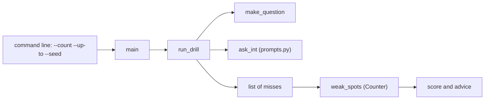

:::objectives
- Generate repeatable random questions with `random.Random(seed)`.
- Reuse a validated `ask_int()` loop and move it into its own module.
- Add command-line options with `argparse`, including `type=int` and defaults.
- Check option values that `argparse` can't check for you, using `parser.error()`.
- Summarize mistakes with `collections.Counter`.
:::

Typing practice into a terminal is faster than flash cards, and a program can notice patterns you can't, like the fact that every question you miss has a 9 in it. Here's the finished drill running in the VS Code terminal. The learner typed the numbers after each `=`, plus one typo:

```bash
$ python drill.py --count 5 --seed 11
Q1. 9 x 10 = 90
  Correct!
Q2. 9 x 9 = eighty one
  Type a whole number, like 42.
Q2. 9 x 9 = 72
  Not quite: 9 x 9 = 81
Q3. 10 x 11 = 110
  Correct!
Q4. 5 x 4 = 20
  Correct!
Q5. 10 x 9 = 80
  Not quite: 10 x 9 = 90

Score: 3/5
Practice your 9s and 10s
```

Notice three design decisions already. The typo `eighty one` gets a second chance instead of counting as wrong. `--count` and `--seed` are options on the command line, not questions the program asks. And the summary turns a list of misses into advice.



Make a folder called `drill` and open it in VS Code. Every cell below runs for real, and later cells use the functions from earlier ones, the same way your file grows as you add to it.

## Step 1: Make one random question

```python run
import random


def make_question(rng, up_to):
    return rng.randint(2, up_to), rng.randint(2, up_to)


rng = random.Random(11)
for _ in range(3):
    a, b = make_question(rng, 12)
    print(f"{a} x {b} = {a * b}")
```

`random.Random(11)` creates a random-number generator of our own, started from the **seed** 11. Two generators with the same seed produce the same numbers in the same order, which is how the session above can be repeated exactly. Passing `rng` into the function, instead of calling `random.randint` inside it, means the caller decides whether the questions are repeatable. Factors start at 2 because nobody needs to practice `1 x 7`.

## Step 2: Ask until you get a number

This is the validation loop from the notes, trimmed to what a drill needs: any whole number is a valid *answer*, even a wrong one, so there's no range check.

```python run input="eighty one|81"
def ask_int(prompt):
    """Ask until the user types a whole number, then return it."""
    while True:
        text = input(prompt).strip()
        try:
            return int(text)
        except ValueError:
            print("  Type a whole number, like 42.")


answer = ask_int("9 x 9 = ")
print("You answered", answer)
```

`.strip()` removes spaces around the input, so `" 81 "` counts. The `return` sits inside the `try` because `int(text)` is the only thing that can fail: if it works, the function ends right there.

## Step 3: Run a round and remember the misses

```python run input="90|72|110"
def run_drill(rng, count, up_to):
    missed = []
    for number in range(1, count + 1):
        a, b = make_question(rng, up_to)
        answer = ask_int(f"Q{number}. {a} x {b} = ")
        if answer == a * b:
            print("  Correct!")
        else:
            print(f"  Not quite: {a} x {b} = {a * b}")
            missed.append((a, b))
    return missed


missed = run_drill(random.Random(11), 3, 12)
print("Missed:", missed)
```

The function **returns** the misses instead of printing a final report. That keeps it useful: the caller can print a score, save the misses to a file, or test the result, and `run_drill` doesn't need to change for any of them. Each miss is a tuple `(a, b)` because the pair belongs together and never changes.

## Step 4: Find the weak spots with `Counter`

A list like `[(9, 9), (10, 9), (7, 9)]` hides the pattern. Counting every factor that appears in a miss makes it obvious:

```python run
from collections import Counter


def weak_spots(missed):
    factors = Counter()
    for a, b in missed:
        factors[a] += 1
        if b != a:
            factors[b] += 1
    return [factor for factor, _ in factors.most_common(2)]


print(weak_spots([(9, 9), (10, 9), (7, 9)]))
print(weak_spots([(6, 8), (8, 7)]))
print(weak_spots([]))
```

A `Counter` starts every key at 0, so `factors[a] += 1` works the first time a number appears. `most_common(2)` sorts by count and returns `(factor, count)` pairs; the list comprehension keeps just the factors. Missing `9 x 9` counts the 9 once, since it's one mistake. An empty list of misses gives an empty answer instead of an error, and Step 6 relies on that.

## Step 5: Take options from the command line

Asking "How many questions?" every time gets old. Options typed after the file name are faster, and `argparse` turns them into variables:

```python run
import argparse


def build_parser():
    parser = argparse.ArgumentParser(
        prog="drill.py",
        description="Practice multiplication facts in the terminal.",
    )
    parser.add_argument("--count", type=int, default=10,
                        help="number of questions (default: 10)")
    parser.add_argument("--up-to", type=int, default=12,
                        help="largest factor to use (default: 12)")
    parser.add_argument("--seed", type=int,
                        help="use the same questions every run")
    return parser


args = build_parser().parse_args(["--count", "5", "--seed", "11"])
print(args)
print(args.count + 1, args.up_to, args.seed)
```

When a real user runs the file, `parse_args()` reads what they typed. Here we pass a list of words instead, standing in for `python drill.py --count 5 --seed 11`, so we can see the result. Look at what `argparse` did: `"5"` became the integer `5` because of `type=int`, `--up-to` fell back to its default, and the dash in `--up-to` became an underscore in `args.up_to`, because a dash isn't allowed in a Python name.

You also get a help screen without writing one:

```python run
build_parser().parse_args(["--help"])
```

And `argparse` rejects bad types before your code ever sees them:

```bash
$ python drill.py --count ten
usage: drill.py [-h] [--count COUNT] [--up-to UP_TO] [--seed SEED]
drill.py: error: argument --count: invalid int value: 'ten'
```

## Step 6: Check what `argparse` can't, and write `main()`

`type=int` happily accepts `--count 0` or `--up-to 5000`. A zero-question drill is pointless, and factors up to 5000 aren't a times table. `parser.error()` prints the usage line plus your message and stops the program, so out-of-range options look exactly like the built-in errors:

```python run input="90|eighty one|72|110|20|80"
def main(argv=None):
    parser = build_parser()
    args = parser.parse_args(argv)
    if not 1 <= args.count <= 50:
        parser.error("--count must be between 1 and 50")
    if not 2 <= args.up_to <= 20:
        parser.error("--up-to must be between 2 and 20")

    rng = random.Random(args.seed)
    missed = run_drill(rng, args.count, args.up_to)

    score = args.count - len(missed)
    print(f"\nScore: {score}/{args.count}")
    if missed:
        print("Practice your", " and ".join(f"{n}s" for n in weak_spots(missed)))
    else:
        print("Perfect round.")


main(["--count", "5", "--seed", "11"])
```

That's the session from the top of the page, produced by the real code. `main(argv=None)` passes `None` to `parse_args` when the file runs normally, which tells `argparse` to read the real command line. In a test, you pass a list. When `--seed` is left out, `args.seed` is `None`, and `random.Random(None)` seeds itself from the system, so every round is different.

```bash
$ python drill.py --count 0
usage: drill.py [-h] [--count COUNT] [--up-to UP_TO] [--seed SEED]
drill.py: error: --count must be between 1 and 50
```

## Step 7: Move `ask_int` into its own module

`ask_int` has nothing to do with multiplication. Your next project will need it too, so give it a file of its own, `prompts.py`, in the same folder:

```text
drill/
├── drill.py     # the drill: questions, scoring, options
└── prompts.py   # input helpers any project can import
```

In `drill.py`, delete the `ask_int` definition and import it instead with `from prompts import ask_int`. Because both files sit in the same folder, Python finds `prompts.py` first on its search path.

## The finished program

```python title="prompts.py"
def ask_int(prompt):
    """Ask until the user types a whole number, then return it."""
    while True:
        text = input(prompt).strip()
        try:
            return int(text)
        except ValueError:
            print("  Type a whole number, like 42.")
```

```py title="drill.py"
import argparse
import random
from collections import Counter

from prompts import ask_int


def make_question(rng, up_to):
    return rng.randint(2, up_to), rng.randint(2, up_to)


def run_drill(rng, count, up_to):
    missed = []
    for number in range(1, count + 1):
        a, b = make_question(rng, up_to)
        answer = ask_int(f"Q{number}. {a} x {b} = ")
        if answer == a * b:
            print("  Correct!")
        else:
            print(f"  Not quite: {a} x {b} = {a * b}")
            missed.append((a, b))
    return missed


def weak_spots(missed):
    factors = Counter()
    for a, b in missed:
        factors[a] += 1
        if b != a:
            factors[b] += 1
    return [factor for factor, _ in factors.most_common(2)]


def build_parser():
    parser = argparse.ArgumentParser(
        prog="drill.py",
        description="Practice multiplication facts in the terminal.",
    )
    parser.add_argument("--count", type=int, default=10,
                        help="number of questions (default: 10)")
    parser.add_argument("--up-to", type=int, default=12,
                        help="largest factor to use (default: 12)")
    parser.add_argument("--seed", type=int,
                        help="use the same questions every run")
    return parser


def main(argv=None):
    parser = build_parser()
    args = parser.parse_args(argv)
    if not 1 <= args.count <= 50:
        parser.error("--count must be between 1 and 50")
    if not 2 <= args.up_to <= 20:
        parser.error("--up-to must be between 2 and 20")

    rng = random.Random(args.seed)
    missed = run_drill(rng, args.count, args.up_to)

    score = args.count - len(missed)
    print(f"\nScore: {score}/{args.count}")
    if missed:
        print("Practice your", " and ".join(f"{n}s" for n in weak_spots(missed)))
    else:
        print("Perfect round.")


if __name__ == "__main__":
    main()
```

Run it from the VS Code terminal with `python drill.py`, `python drill.py --count 3 --up-to 9`, or `python drill.py -h`. Imports go at the top in groups, with a blank line between them: the standard library first, then third-party packages (none here), then your own modules. That's the PEP 8 style most Python projects follow.

:::video FbEJN8FsJ9U
A short, practical look at running a script with `argparse` options. As you watch, compare each `add_argument` call he writes with the ones in `build_parser()`: every call becomes one attribute on `args`.
:::

:::quiz
Q: Why does `run_drill` take an `rng` argument instead of calling `random.randint` directly?
- [x] So the caller can pass a seeded generator and get the same questions every time
  That's what makes `--seed` work, and it makes the function testable.
- [ ] Because `random.randint` doesn't work inside functions
  It works anywhere; the choice is about who controls the randomness.
- [ ] Because a generator object is faster
  Speed isn't the reason; repeatability is.

Q: A user runs `python drill.py --count 500`. What happens?
- [ ] `argparse` rejects it with "invalid int value"
  `500` is a valid int, so `type=int` accepts it.
- [x] `main()` calls `parser.error()`, which prints the usage and the message, then exits
  The range check in `main()` catches what `type=int` can't.
- [ ] The drill asks 500 questions
  It would, without the range check.

Q: Typing `eighty one` doesn't count as a wrong answer. Which part of the code makes that true?
- [ ] The `if answer == a * b` check in `run_drill`
  That check only runs once `ask_int` has returned a number.
- [x] `ask_int` keeps looping until `int()` succeeds, so non-numbers never reach the scoring code
  Validation happens before scoring, so a typo can't be scored at all.
- [ ] `argparse` converts the answer with `type=int`
  `argparse` only handles the command line, not answers typed during the drill.
:::

:::takeaways
- Pass a `random.Random(seed)` into functions that need randomness so you can repeat a run.
- Validate input where it enters the program, so the rest of the code works only with good values.
- `argparse` handles types, defaults, and help; range rules still need your own `parser.error()` checks.
- `main(argv=None)` reads the real command line normally and accepts a list when you're testing.
- Helpers that aren't about this one program belong in their own module.
:::

## Ideas to extend it

- Add `--op` with `choices=["x", "+"]` so the drill can practice addition too.
- Time each round with `datetime.now()` before and after `run_drill`, and print the seconds taken.
- Ask each missed question once more at the end, using the list `run_drill` returns.
- Save each round's score and date to a JSON file and print your best score so far.

## Further reading

- [Argparse Tutorial](https://docs.python.org/3/howto/argparse.html): the official step-by-step guide, from one positional argument up to option groups.
- [random: Generate pseudo-random numbers](https://docs.python.org/3/library/random.html): every function in the module, plus why seeded generators repeat.
- [collections.Counter](https://docs.python.org/3/library/collections.html#collections.Counter): `most_common`, adding counters together, and other tricks.
