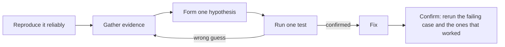

:::objectives
- Follow a repeatable debugging loop: reproduce, gather evidence, test one idea, fix, confirm.
- Read a traceback from the bottom up and find the line that matters.
- Use `print(f"{name=}")` and `repr` to see values exactly, quotes and spaces included.
- Add `assert` checks that stop the program the moment its data goes wrong.
- Replace debug prints with `logging`, so they can be turned off without deleting them.
- Shrink a bug into a minimal reproduction.
:::

The supply-room program has one job: when a delivery of 30 pens arrives, add 30 to the pen count. Erasers work fine. Pens don't change at all. Pencils, which nobody touched, jump from 40 to 70:

```python run title="supplies.py"
inventory = [
    {"name": "pencil", "qty": 40},
    {"name": "pen", "qty": 12},
    {"name": "eraser", "qty": 7},
]


def find_item(name):
    for item in inventory:
        if name in item["name"]:
            return item
    return None


find_item("eraser")["qty"] -= 2
find_item("pen")["qty"] += 30
for item in inventory:
    print(f"{item['name']:>7}: {item['qty']}")
```

You could start changing lines and rerunning until the numbers look right. That sometimes works, and when it does you've learned nothing and may have added a second bug. A better approach treats a bug like an experiment: collect evidence, form one guess, and test exactly that guess.

## The debugging loop



Apply it to the supply room. **Reproduce:** restocking `"eraser"` works and `"pen"` doesn't, every time. **Evidence:** the pen's extra 30 landed on the pencil, so `find_item("pen")` probably returned the wrong dictionary. **Test that one idea:** step through `find_item("pen")` and watch which item it stops on.

:::trace Watch find_item("pen") stop on the wrong item
```python
inventory = [
    {"name": "pencil", "qty": 40},
    {"name": "pen", "qty": 12},
]

def find_item(name):
    for item in inventory:
        if name in item["name"]:
            return item
    return None

found = find_item("pen")
print(found)
```
:::

It returns on the very first pass. `"pen" in "pencil"` asks whether `"pen"` appears *anywhere inside* `"pencil"`, and it does. Erasers worked only because no earlier item contains the letters "eraser". The fix is `if item["name"] == name:`, and the confirm step means rerunning both the pen and the eraser cases, not just the one that was broken.

## Read a traceback from the bottom up

When a program crashes, Python prints a **traceback**: the chain of function calls that was running at the moment of the crash. It looks scary because it's long, but you read it in a fixed order.

```python run raises title="report.py"
def total_value(items):
    total = 0
    for item in items:
        total += item["qty"] * item["price"]
    return total


def report(inventory):
    print("Items:", len(inventory))
    print("Value: $", total_value(inventory))


inventory = [
    {"name": "pencil", "qty": 40, "price": 0.25},
    {"name": "pen", "qty": 12, "cost": 1.10},
]
report(inventory)
```

1.  **The last line** is the error type and message: `KeyError: 'price'`. A `KeyError` means a dictionary didn't have the key you asked for, and the message names the key.
2.  **The frame just above it** is where it happened: line 4, inside `total_value`, on `item["qty"] * item["price"]`.
3.  **Frames further up** are who called whom. Read upward when you need to know *how* the program got there: the module called `report`, which called `total_value`.

The crash is on line 4, but line 4 is fine. The real mistake is in the data: the pen's dictionary says `"cost"` instead of `"price"`. The line that crashes is where the problem was *noticed*, which isn't always where it was *made*. Also notice that `Items: 2` printed before the crash, which proves `report` started and got halfway.

:::tip
In a long traceback from a library, skip frames from files you didn't write (paths containing `site-packages` or the Python install folder). The lowest frame that points at *your* file is usually the place to start.
:::

## Print the truth, not a look-alike

A plain `print` can hide exactly what you need to see. Strings print without quotes, so a trailing space vanishes, and the string `"12"` looks just like the number `12`:

```python run title="looks_fine.py"
name = "pen "
qty = "12"

print(name, qty)
print(f"{name=} {qty=}")
print(type(qty))
```

The `=` inside an f-string prints the expression, an equals sign, and the value's **repr**: the way you'd write it in code. Now the quotes show `qty` is text and the gap before the closing quote shows the space in `name`. When a lookup "can't find" something you can see on the screen, this is the first print to write.

## Make the program check itself with `assert`

`assert condition, message` says "this must be true here." If it isn't, Python stops with an `AssertionError` and your message:

```python run raises title="update_stock.py"
def update_stock(item, change):
    item["qty"] += change
    assert item["qty"] >= 0, f"{item['name']} went negative: {item['qty']}"


eraser = {"name": "eraser", "qty": 7}
update_stock(eraser, -2)
print("After one sale:", eraser)
update_stock(eraser, -9)
print("This line never runs")
```

Without the assert, the eraser would quietly sit at -4 until some report much later printed nonsense. With it, the program stops on the exact call that broke the rule. Use asserts for things that should be *impossible* if your code is right. Don't use them to check what a user typed: running Python with `python -O` removes every assert, and user mistakes need friendly messages anyway, the kind you wrote in Module 5.

## Logging: prints you can turn down

Debug prints pile up. You add six to find a bug, delete four, forget two, and now your program's output has `HERE!!` in it. The `logging` module gives each message a **level** (`DEBUG`, `INFO`, `WARNING`, `ERROR`, `CRITICAL`), and one setting decides which levels appear:

```python run title="restock_log.py"
import logging
import sys

logging.basicConfig(stream=sys.stdout, level=logging.DEBUG,
                    format="%(levelname)s %(funcName)s: %(message)s")


def restock(item, amount):
    logging.debug(f"{item['name']} has {item['qty']}, adding {amount}")
    if amount > 100:
        logging.warning(f"unusually large restock for {item['name']}: {amount}")
    item["qty"] += amount


pens = {"name": "pen", "qty": 12}
restock(pens, 30)
restock(pens, 500)

logging.getLogger().setLevel(logging.WARNING)
restock(pens, 5)
restock(pens, 200)
print(pens)
```

After the level changes to `WARNING`, the `DEBUG` lines disappear while the warnings keep coming. The code didn't change, only the setting. The format string adds the function name to every line for free, which is evidence you'd otherwise type by hand. (Logging normally writes to the terminal's error stream; `stream=sys.stdout` here keeps it in order with the `print` output.)

## Stuck? Explain it to a duck, then shrink it

**Rubber duck debugging** means explaining your code, line by line and out loud, to someone who knows nothing, even a rubber duck. It works because explaining forces you to say what each line *actually* does instead of what you meant: "this loop checks whether the name is *in* the item's name... oh."

If that doesn't crack it, build a **minimal reproduction**: copy the program and delete everything that isn't needed for the bug to happen. Remove the file loading, then the menu, then all but two items. Each time, rerun; if the bug vanishes, the last thing you deleted was involved. The supply-room bug shrinks to a single line:

```python run
print("pen" in "pencil")
```

Often you find the bug while shrinking. If you don't, you now have something small enough to show a teacher or post online, along with the full traceback, what you expected, and what happened instead.

:::video 3p3p6kp39to
A short Real Python explainer on reading a traceback. As you watch, match each part he points at to the `report.py` traceback above: the error line at the bottom, then the file, line number, and function in each frame.
:::

:::warning
**Changing several things at once.** If you edit three lines and the bug disappears, you don't know which edit fixed it, or whether one of the others broke something new. Change one thing, rerun, and look.
:::

:::warning
**Fixing the symptom.** Adding `if name == "pen": inventory[1]["qty"] += change` makes pens work and leaves `"cat"` matching `"bobcat"`. If your fix mentions the exact value from the bug report, ask whether you've found the cause yet.
:::

:::quiz
Q: A traceback has five frames and ends with `TypeError: unsupported operand type(s) for +=: 'int' and 'str'`. Where do you look first?
- [ ] The first frame at the top, because that's where the program started
  The top frame is usually just the line that called `main()`; it rarely contains the bug.
- [x] The last line, then the frame just above it in your own file
  The last line says what went wrong, and the lowest frame in your code says where.
- [ ] Search the whole traceback online, file paths included
  The paths are unique to your computer; the error line is what to search for.

Q: `print(f"{qty=}")` prints `qty='12'`. What have you learned?
- [ ] `qty` equals 12, so the bug is somewhere else
  The quotes say otherwise.
- [x] `qty` is a string, so math or comparisons with numbers will misbehave
  The repr shows quotes around text, so `'12'` is a string, not the number 12.
- [ ] `qty` has a trailing space
  A trailing space would show as `'12 '` inside the quotes.

Q: Which is the best place for an `assert`?
- [ ] Checking that a user typed a number at a prompt
  Asserts vanish under `python -O` and give users a crash instead of help.
- [x] After an update, checking that a stock count never went below zero
  That's a rule your own code must never break, so a crash pinpoints the bug.
- [ ] Wrapping every line in case something goes wrong
  Asserts work when they state specific rules, not as a general safety net.

Q: You shrink a 200-line program to 6 lines that still show the bug. What's the main benefit?
- [ ] Smaller programs run faster
  Speed isn't the point.
- [x] Everything left is involved in the bug, so the cause is easy to see or to show someone
  Every line you deleted without fixing the bug was ruled out as the cause.
- [ ] Python reports better tracebacks for short files
  The traceback format is the same at any length.
:::

:::takeaways
- Debug like an experiment: reproduce it, gather evidence, test one hypothesis, fix, then confirm.
- Read tracebacks bottom up: the error line, then the lowest frame in your own code.
- The crashing line is where a problem was noticed, not always where it was made.
- `print(f"{x=}")` shows the repr, so quotes, spaces, and types become visible.
- `assert` turns a silent bad state into an immediate, labeled stop.
- `logging` levels let you keep debug messages in the code and hide them with one setting.
- When stuck, explain it aloud, then shrink it to a minimal reproduction.
:::

## Further reading

- [Logging HOWTO](https://docs.python.org/3/howto/logging.html): the official guide; the basic tutorial at the top covers everything in this lesson.
- [Deciphering Python's Traceback](https://www.pythonmorsels.com/reading-tracebacks-in-python/): Trey Hunner's short article on reading tracebacks bottom up, with a narrated version.
- [How to create a Minimal, Reproducible Example](https://stackoverflow.com/help/minimal-reproducible-example): Stack Overflow's guide to asking for help with code people can actually run.
