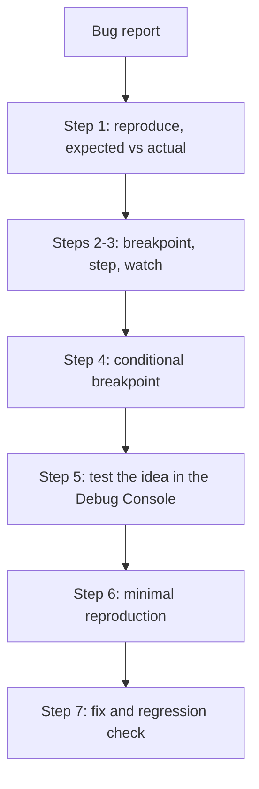

:::objectives
- Reproduce a bug and write down expected versus actual results before touching the code.
- Set breakpoints and start the **Python Debugger** in VS Code.
- Step through a loop with Continue and Step Over while reading the **Variables** and **Watch** panes.
- Use a conditional breakpoint and the **Debug Console** to test one hypothesis.
- Fix the bug and add a regression check so it can't quietly come back.
:::

The school store's bug report: "At the end of the day, the program should remove everything that sold out. Monday it worked. Tuesday, tape sold out and it's still on the list with 0 left." Same code, different days, different results. Staring won't find this one; a debugger will.

By the end of this build, the fixed program and its check will print this:

```text
in_stock: all checks passed
Monday:  ['pencil 35', 'tape 2', 'ruler 9']
Tuesday: ['pencil 35', 'ruler 9']
```



## Step 1: Reproduce it, and write down what you expected

Create `store.py` in your project folder and paste this in. It runs both days from the report:

```python run title="store.py"
def apply_sales(inventory, sales):
    for name, sold in sales:
        for item in inventory:
            if item["name"] == name:
                item["qty"] -= sold


def remove_sold_out(inventory):
    for item in inventory:
        if item["qty"] == 0:
            inventory.remove(item)


def end_of_day(sales):
    inventory = [
        {"name": "pencil", "qty": 40},
        {"name": "glue", "qty": 3},
        {"name": "tape", "qty": 2},
        {"name": "ruler", "qty": 9},
    ]
    apply_sales(inventory, sales)
    remove_sold_out(inventory)
    return [f"{item['name']} {item['qty']}" for item in inventory]


print("Monday: ", end_of_day([("glue", 3), ("pencil", 5)]))
print("Tuesday:", end_of_day([("glue", 3), ("tape", 2), ("pencil", 5)]))
```

Now write the evidence down, in a comment or on paper:

| Day | Sold out | Expected | Actual |
| --- | --- | --- | --- |
| Monday | glue | pencil, tape, ruler | pencil, tape, ruler |
| Tuesday | glue, tape | pencil, ruler | pencil, **tape 0**, ruler |

The bug happens every time we run Tuesday, and the table holds a clue: it only goes wrong when *two* items sell out. Tape is at 0, so `apply_sales` did its job. The suspect is `remove_sold_out`.

## Step 2: Pause the program with a breakpoint

A **breakpoint** tells the debugger "stop just before running this line, and let me look around."

1.  Move your mouse to the left of the line number for `if item["qty"] == 0:`. A faint red dot appears in the margin; click it. The dot stays, solid red. (Pressing **F9** with the cursor on the line does the same.)
2.  Click the small down arrow next to the **Run** triangle at the top right of the editor and choose **Python Debugger: Debug Python File**. If VS Code instead asks you to pick a debugger or configuration, choose **Python Debugger**, then **Python File**.
3.  The program runs until it reaches your line, then freezes. The line is highlighted, the **Run and Debug** view opens on the left, and a small toolbar appears at the top of the window.

The Run and Debug view has four sections: **VARIABLES** (everything that exists right now), **WATCH** (expressions you choose), **CALL STACK** (which function called which, like a live traceback), and **BREAKPOINTS**. Under VARIABLES, expand **Locals**, then `item`: it's `{'name': 'pencil', 'qty': 35}`.

:::note
Monday's run reaches the breakpoint first, because it runs first. From the first pause, press **F5** (Continue) three times to get through Monday, and the next pause is Tuesday's first item. Jot down which items Monday stops on; you'll want them in a minute.
:::

## Step 3: Step through the loop and watch the list

The toolbar buttons are the debugger's controls. These are the Windows and Linux shortcuts; on a Mac some function keys need the **Fn** key held down.

| Button | Key | What it does |
| --- | --- | --- |
| Continue | F5 | run until the next breakpoint |
| Step Over | F10 | run the current line, then pause on the next one |
| Step Into | F11 | go inside the function this line calls |
| Step Out | Shift+F11 | finish this function and pause in the caller |
| Restart | Ctrl+Shift+F5 | start the run again |
| Stop | Shift+F5 | end the debug session |

Make the list itself visible. In the **WATCH** section, click **+** and type `[i["name"] for i in inventory]`, then press Enter. A watch expression is re-evaluated every time the program pauses.

Now, paused at Tuesday's first item, press **F5** repeatedly and note `item["name"]` at each stop: `pencil`, `glue`, `ruler`, then the program ends. Four items, three visits. Monday's stops were the same three, so Monday skipped tape too; it did no harm because tape wasn't sold out. That's why the bug seemed to happen only sometimes: the skip happens whenever an item is removed, but it only *shows* when the skipped item also needed removing.

You can replay the same thing here, one line at a time; watch `item` and the list's length:

:::trace Step through remove_sold_out on Tuesday's data
```python
inventory = [
    {"name": "glue", "qty": 0},
    {"name": "tape", "qty": 0},
    {"name": "ruler", "qty": 9},
]
for item in inventory:
    print("checking", item["name"])
    if item["qty"] == 0:
        inventory.remove(item)
print([i["name"] for i in inventory])
```
:::

The loop never says `checking tape`. That's the key piece of evidence: tape wasn't checked and rejected, it was never checked at all.

## Step 4: Stop only when it matters

With 400 items, pressing F5 hundreds of times is miserable. A **conditional breakpoint** pauses only when an expression is true. Click the red dot to remove your breakpoint. Then right-click in the margin next to the same `if` line, choose **Add Conditional Breakpoint**, leave the type as **Expression**, type `item["name"] == "tape"`, and press Enter. The dot changes shape to show it has a condition.

Start the debugger again. It never pauses. The condition is checked every time the line runs, so never pausing proves `item` was never tape on that line. "I think it skips tape" is now a fact.

:::tip
Right-click the margin and choose **Add Logpoint** to print a message without editing your code. A logpoint like `checking {item["name"]}` writes to the Debug Console every time the line runs and never pauses. It's a `print` you can't forget to delete.
:::

## Step 5: Test the hypothesis in the Debug Console

Here's a hypothesis: removing an item shifts everything after it one place to the left, and the `for` loop, which counts positions, steps past whatever slid into the gap. Test it directly.

Remove the conditional breakpoint and put a plain one on the `inventory.remove(item)` line. Start debugging and continue until `item` is glue on Tuesday. Open the **Debug Console** (**View → Debug Console**, or Ctrl+Shift+Y) and type expressions at the `>` prompt. They run inside the paused program:

```text
> inventory.index(item)
1
> [i["name"] for i in inventory]
['pencil', 'glue', 'tape', 'ruler']
```

Press **F10** once to run the `remove` line, then ask again:

```text
> [i["name"] for i in inventory]
['pencil', 'tape', 'ruler']
```

Tape slid from position 2 into position 1. The loop has already done position 1, so its next pass looks at position 2, which is now ruler. Hypothesis confirmed, with evidence. Press **Shift+F5** to stop.

## Step 6: Shrink it to four lines

Before fixing, prove you understand the cause by reproducing it with no inventory, no dictionaries, and no sales:

```python run
numbers = [0, 0, 5]
for n in numbers:
    if n == 0:
        numbers.remove(n)
print(numbers)
```

The second `0` survives for the same reason tape did. Now the bug has nothing to do with stores, and the rule is clear: **don't add to or remove from a list while a `for` loop is walking through it.**

## Step 7: Fix it and lock it in

The fix is to stop removing and instead *build a new list* of the items to keep. A list comprehension reads the old list without changing it:

```python run title="fix_check.py"
def in_stock(inventory):
    """Return a new list without the items that have sold out."""
    return [item for item in inventory if item["qty"] > 0]


def check_in_stock():
    two_in_a_row = [{"name": "a", "qty": 0}, {"name": "b", "qty": 0}, {"name": "c", "qty": 4}]
    assert in_stock(two_in_a_row) == [{"name": "c", "qty": 4}], in_stock(two_in_a_row)
    assert in_stock([{"name": "a", "qty": 0}]) == []
    assert in_stock([]) == []
    print("in_stock: all checks passed")


check_in_stock()
```

The first check is the bug report's exact situation, two sold-out items in a row, shrunk to the smallest data that shows it. That's a **regression check**: a test for a bug you already fixed, so if someone "simplifies" the function back to a `remove` loop, it fails right away. The other two cover edges: everything sold out, and an empty store. If the first `assert` fails, its second part prints what the function really returned.

## The finished program

`remove_sold_out` is gone. `end_of_day` now *replaces* its list with the filtered one, and the check runs first:

```python run title="store.py"
def apply_sales(inventory, sales):
    for name, sold in sales:
        for item in inventory:
            if item["name"] == name:
                item["qty"] -= sold


def in_stock(inventory):
    """Return a new list without the items that have sold out."""
    return [item for item in inventory if item["qty"] > 0]


def end_of_day(sales):
    inventory = [
        {"name": "pencil", "qty": 40},
        {"name": "glue", "qty": 3},
        {"name": "tape", "qty": 2},
        {"name": "ruler", "qty": 9},
    ]
    apply_sales(inventory, sales)
    inventory = in_stock(inventory)
    return [f"{item['name']} {item['qty']}" for item in inventory]


def check_in_stock():
    two_in_a_row = [{"name": "a", "qty": 0}, {"name": "b", "qty": 0}, {"name": "c", "qty": 4}]
    assert in_stock(two_in_a_row) == [{"name": "c", "qty": 4}], in_stock(two_in_a_row)
    assert in_stock([{"name": "a", "qty": 0}]) == []
    assert in_stock([]) == []
    print("in_stock: all checks passed")


check_in_stock()
print("Monday: ", end_of_day([("glue", 3), ("pencil", 5)]))
print("Tuesday:", end_of_day([("glue", 3), ("tape", 2), ("pencil", 5)]))
```

Tuesday is right, and Monday is unchanged. Rechecking the case that already worked is the "confirm" step people skip.

:::video XmpIBsnc3xU
ArjanCodes gives a quick tour of the VS Code debugger in about seven minutes. The chapters on breakpoints, the call stack, variables, and watch expressions line up with Steps 2 to 4 here, so watch those to see each pane in action.
:::

:::quiz
Q: In Step 4, the conditional breakpoint `item["name"] == "tape"` never paused. Why is that useful evidence?
- [ ] It means the breakpoint was set up wrong
  It was set up correctly; the debugger checks the condition every time the line runs.
- [x] It proves the loop never reached tape on that line, so tape was skipped rather than misjudged
  A condition that's never true across every run of the line rules out "tape was checked and kept."
- [ ] It shows that tape's quantity wasn't 0
  The watch already showed tape at 0; the breakpoint is about whether the loop visited it.

Q: Why does the fix build a new list instead of removing items one at a time more carefully?
- [x] Reading one list while building another avoids changing the list the loop is walking through
  The loop's position counter can't get out of step with a list that doesn't change.
- [ ] List comprehensions are the only way to filter a list
  A `for` loop that appends to a new list works too; the point is not mutating the list being looped over.
- [ ] `remove` doesn't work on dictionaries
  `remove` worked fine; the problem was when it ran.

Q: The check uses two sold-out items in a row as its first test. Why that case?
- [ ] It's the shortest list possible
  An empty list is shorter, and there's a separate check for it.
- [x] It's the exact situation from the bug report, so it fails if the old bug ever returns
  A regression check recreates the bug's conditions in the smallest form.
- [ ] Asserts only work with three items
  Asserts work with any expression that's true or false.
:::

:::takeaways
- Write down expected versus actual first; the pattern in that table often points at the suspect.
- A breakpoint pauses before its line runs, and the Variables pane shows the program's state at that moment.
- Watch expressions and the Debug Console let you ask your own questions of the paused program.
- A conditional breakpoint that never fires is evidence too: that state never happened on that line.
- Don't add to or remove from a list inside a `for` loop over that same list; build a new one.
- Turn every fixed bug into a regression check that uses the bug's exact conditions.
:::

## Ideas to extend it

- Add a breakpoint inside `apply_sales` and use **Step Into** from `end_of_day` to watch a sale happen.
- Make `apply_sales` raise a `ValueError` for a name that isn't in the inventory, and add a check for it.
- Add a check that `apply_sales` never makes a quantity negative, then find a sale that breaks it.

## Further reading

- [Python debugging in VS Code](https://code.visualstudio.com/docs/python/debugging): starting the Python Debugger, and passing command-line arguments through `launch.json`.
- [Debug code with Visual Studio Code](https://code.visualstudio.com/docs/debugtest/debugging): every pane, breakpoint type, and toolbar button, for any language.
- [The Python Tutorial: for statements](https://docs.python.org/3/tutorial/controlflow.html#for-statements): the official note on why changing a collection while looping over it is tricky, with the safer patterns.
