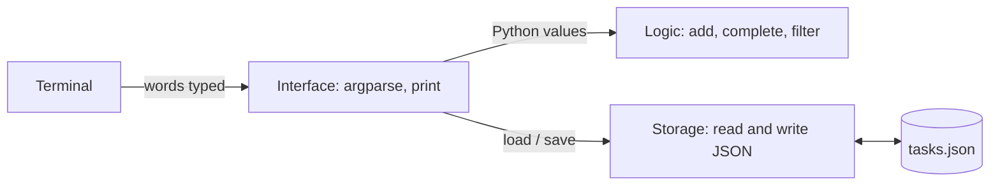

:::objectives
- Write a tool's commands and data shape before writing its code.
- Separate a program into interface, logic, and storage, and say what belongs in each.
- Build `argparse` subcommands and send each one to its own handler function.
- Give a program one entry point, `main(argv=None)`, that returns an exit code.
- List what a useful README contains.
:::

Sam's homework planner started as one function. Now `planner.py` has fourteen of them, and the only way to use it is to scroll to the bottom, uncomment the call you want, and press Run. Here's one of the fourteen:

```python
import json


def add_task():
    title = input("Title: ")
    with open("tasks.json") as file:
        tasks = json.load(file)
    tasks.append({"title": title, "done": False})
    with open("tasks.json", "w") as file:
        json.dump(tasks, file)
    print("Added", title, "- you now have", len(tasks), "tasks")
```

Nothing in it is wrong, exactly. But it asks a question, reads a file, changes data, writes a file, and prints, all at once. You can't test it without typing at a prompt and owning a real `tasks.json`. You can't call it from a command like `python planner.py add "Lab report"`. And if the file doesn't exist yet, it crashes. The code isn't the problem; the missing design is.

## Start from what the user types

Before any code, write down exactly how someone will use the tool, as if you were writing its instruction card:

```bash
$ python plan.py add "Read chapter 4" --due 2026-11-20
Added #1: Read chapter 4
$ python plan.py add "Lab report"
Added #2: Lab report
$ python plan.py done 1
Done: Read chapter 4
$ python plan.py list --all
[x] #1 Read chapter 4
[ ] #2 Lab report
```

Then write down the data that has to survive between runs:

```json
[
  {"id": 1, "title": "Read chapter 4", "due": "2026-11-20", "done": true},
  {"id": 2, "title": "Lab report", "due": null, "done": false}
]
```

These two sketches answer most design questions early. Tasks need an `id`, because typing `done 2` is easier than retyping a title. Dates are strings in `YYYY-MM-DD` form, because JSON has no date type. `list` hides finished work unless you ask for `--all`. If you can't write the commands and the data, you're not ready to write the program, and that's useful to discover before you've written 200 lines.

## Three layers: interface, logic, storage

Most command-line tools split cleanly into three jobs. Keeping them in separate functions, and later separate files, is the single biggest step from "script" to "project."



| Layer | Its job | Never does |
| --- | --- | --- |
| Interface | read the command line, print results and errors | the actual calculations |
| Logic | change and query the data, raise `ValueError` for bad requests | `print`, `input`, or open files |
| Storage | turn the file into Python data and back | decide what the data means |

The logic layer is the heart, and its rule is strict: it takes data in and hands data back. That makes it testable with nothing but `assert`:

```python run title="logic.py"
def add_task(tasks, title, due=None):
    title = title.strip()
    if not title:
        raise ValueError("a task needs a title")
    next_id = max((task["id"] for task in tasks), default=0) + 1
    task = {"id": next_id, "title": title, "due": due, "done": False}
    tasks.append(task)
    return task


tasks = []
add_task(tasks, "Read chapter 4", "2026-11-20")
add_task(tasks, "Lab report")
assert [task["id"] for task in tasks] == [1, 2]

try:
    add_task(tasks, "   ")
except ValueError as error:
    print("rejected:", error)
print(tasks)
```

No prompt, no file, no printing inside `add_task`, and yet it does all the real work, including the rule that blank titles aren't allowed. It *raises* an error rather than printing one, because only the interface knows whether that error should go to a terminal, a test, or someday a web page. `max(..., default=0)` handles the empty list, so the first task gets id 1.

## Subcommands: one tool, several verbs

`git commit`, `git push`, `pip install`: each tool has subcommands, and each subcommand has its own arguments. `argparse` builds this with `add_subparsers`:

```python run title="parser.py"
import argparse


def build_parser():
    parser = argparse.ArgumentParser(prog="plan.py", description="A homework planner.")
    commands = parser.add_subparsers(dest="command", required=True)

    add = commands.add_parser("add", help="add a task")
    add.add_argument("title")
    add.add_argument("--due", help="due date as YYYY-MM-DD")

    done = commands.add_parser("done", help="mark a task finished")
    done.add_argument("id", type=int)

    listing = commands.add_parser("list", help="show tasks")
    listing.add_argument("--all", action="store_true", help="include finished tasks")
    return parser


parser = build_parser()
print(parser.parse_args(["add", "Read chapter 4", "--due", "2026-11-20"]))
print(parser.parse_args(["done", "2"]))
print(parser.parse_args(["list"]))
```

`dest="command"` stores which subcommand was used, so `args.command` is `"add"`, `"done"`, or `"list"`. Each subcommand only gets its own arguments: there's no `args.id` after `add`. `action="store_true"` makes `--all` a switch that's `False` unless typed. And `required=True` means running the tool with no subcommand prints a usage error instead of doing nothing. The help screen comes for free:

```python run
build_parser().parse_args(["--help"])
```

## One way in: `main()` and exit codes

Now connect the layers. Each subcommand gets a small **handler** function, and `main()` picks the right one with a dictionary. A dictionary of functions is cleaner than a long `if args.command == ...` chain, and adding a command means adding one line.

```python run title="plan.py"
import sys


def cmd_add(tasks, args):
    task = add_task(tasks, args.title, args.due)
    return f"Added #{task['id']}: {task['title']}"


def cmd_done(tasks, args):
    for task in tasks:
        if task["id"] == args.id:
            task["done"] = True
            return f"Done: {task['title']}"
    raise ValueError(f"no task #{args.id}")


def cmd_list(tasks, args):
    lines = []
    for task in tasks:
        if args.all or not task["done"]:
            mark = "x" if task["done"] else " "
            lines.append(f"[{mark}] #{task['id']} {task['title']}")
    return "\n".join(lines) or "No tasks."


HANDLERS = {"add": cmd_add, "done": cmd_done, "list": cmd_list}
TASKS = []  # this demo keeps tasks in memory; the build-along saves them to JSON


def main(argv=None):
    args = build_parser().parse_args(argv)
    try:
        message = HANDLERS[args.command](TASKS, args)
    except ValueError as error:
        print(f"error: {error}", file=sys.stderr)
        return 1
    print(message)
    return 0


print("exit", main(["add", "Read chapter 4", "--due", "2026-11-20"]))
print("exit", main(["add", "Lab report"]))
print("exit", main(["done", "1"]))
print("exit", main(["done", "9"]))
print("exit", main(["list", "--all"]))
```

Every run returns an **exit code**: `0` means success and anything else means failure. Other programs, scripts, and graders read this number to know whether your tool worked. The fourth call returned `1`. Its message went to `sys.stderr`, the error stream, which this page doesn't display but your terminal does:

```bash
$ python plan.py done 9
error: no task #9
$ echo $?
1
```

(`echo $?` prints the last exit code on macOS and Linux; in PowerShell, use `$LASTEXITCODE`.) The last lines of a real `plan.py` connect `main()` to the terminal:

```py title="plan.py (last lines)"
if __name__ == "__main__":
    sys.exit(main())
```

When you run the file, `main()` gets `None`, so `argparse` reads the real command line, and `sys.exit` passes the return value to the shell. When a test file imports `plan`, the guard is false and nothing runs, so the test can call `main(["done", "9"])` itself and check that it returns 1.

## The README is part of the design

A README is the first file anyone opens, including you in three months. Write it while the design is fresh, and update it when commands change. A good one answers five questions:

```markdown title="README.md"
# plan

A homework planner for the terminal. Tasks are saved in `tasks.json`.

## Setup
Python 3.10 or newer. No extra packages.

## Usage
    python plan.py add "Read chapter 4" --due 2026-11-20
    python plan.py list           # unfinished tasks
    python plan.py list --all     # everything
    python plan.py done 1

## Files
- plan.py: commands and output
- tasks.py: task rules (no printing)
- storage.py: loading and saving tasks.json

## Known limits
Only one person's tasks; no reminders.
```

What is it, what do I need, how do I use it (with examples you can copy), how is it organized, and what doesn't it do. The usage examples are the same ones you wrote before coding, so the README is half done before the program is.

:::video sugvnHA7ElY
Corey Schafer shows what `__name__` is set to when a file runs directly and when it's imported, using two small files side by side. That's exactly why the `if __name__ == "__main__":` guard lets a test import your tool without running it.
:::

:::warning
**Logic that prints.** If `add_task` prints "Added!" itself, then every caller gets that message, including tests and other commands that reuse it. Return a value or raise an error, and let the interface decide what to show.
:::

:::warning
**Code at the bottom with no guard.** A bare `main()` on the last line runs the moment another file imports yours, so importing `plan` in a test starts reading the test runner's command-line arguments and fails with a confusing usage error. Always use `if __name__ == "__main__":`.
:::

:::quiz
Q: Where does a function that turns a task into the text `[x] #1 Read chapter 4` belong?
- [x] The interface layer
  Deciding how things look to the user is the interface's job.
- [ ] The logic layer
  Logic decides what's true about the data; formatting it for a screen is presentation.
- [ ] The storage layer
  Storage only converts between the file and Python data.

Q: Why does `main` take `argv=None` instead of always reading the real command line?
- [ ] `argparse` requires it
  `parse_args()` works fine with no argument at all.
- [x] So tests and other code can call `main(["done", "9"])` with a list of words
  `None` means "read the real command line"; a list stands in for what a user would type.
- [ ] So the program runs faster
  Speed is the same either way.

Q: After `parse_args(["done", "2"])`, what is `args.id`?
- [ ] The string `"2"`
  `type=int` converted it before your code saw it.
- [x] The integer `2`
  The `done` subcommand declared `id` with `type=int`.
- [ ] It doesn't exist, because ids are generated automatically
  `id` here is the argument the user typed, not the task's stored id.

Q: A grading script runs your tool and sees exit code 1. What does it conclude?
- [ ] The tool printed exactly one line
  Exit codes don't count output.
- [x] The tool reported a failure
  0 means success; any nonzero code means something went wrong.
- [ ] The tool succeeded on its first try
  That would be exit code 0.
:::

:::takeaways
- Design in this order: commands and sample output, then the data shape, then code.
- Interface reads input and prints; logic changes data and raises errors; storage reads and writes files.
- Logic functions that return values can be tested with plain `assert`, no typing or files needed.
- `add_subparsers(dest="command", required=True)` gives one tool several verbs, each with its own arguments.
- A dictionary from command names to handler functions keeps `main()` short.
- `main(argv=None)` returns an exit code; `sys.exit(main())` under the `__name__` guard hands it to the shell.
- A README answers: what is it, what do I need, how do I use it, how is it organized, and what are its limits.
:::

## Further reading

- [argparse: Sub-commands](https://docs.python.org/3/library/argparse.html#sub-commands): the official reference for `add_subparsers`, with the full list of options.
- [`__main__`: Top-level code environment](https://docs.python.org/3/library/__main__.html): how `__name__` works and the recommended `main()` pattern.
- [Command Line Interface Guidelines](https://clig.dev/): an excellent, readable guide to designing command-line tools that people enjoy using.
