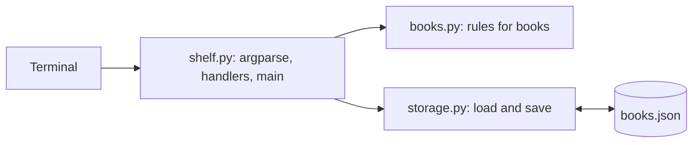

:::objectives
- Turn a list of commands and a data shape into a working multi-file tool.
- Write a storage layer that handles a missing file and a damaged one.
- Write logic functions that enforce the rules and raise `ValueError` instead of printing.
- Connect `argparse` subcommands to handler functions through one `main()`.
- Split the code into modules and document it with a README.
:::

You're going to build `shelf.py`, a reading log for the terminal. It remembers every book between runs, tracks pages, and refuses nonsense politely. Here's a real session with the finished tool:

```bash
$ python shelf.py add "The Hobbit" --pages 310
Added 'The Hobbit' (310 pages).
$ python shelf.py add Hatchet --pages 195
Added 'Hatchet' (195 pages).
$ python shelf.py read hatchet 120
'Hatchet': page 120 of 195 (62%).
$ python shelf.py read "the hobbit" 85
'The Hobbit': page 85 of 310 (27%).
$ python shelf.py read Hatchet 100
Finished 'Hatchet'!
$ python shelf.py list
The Hobbit    85/310   27%
Hatchet      195/195  100%
$ python shelf.py stats
2 books, 1 finished, 280 pages read.
$ python shelf.py read Holes 20
error: no book called 'Holes' (see: python shelf.py list)
```

Titles match without caring about capital letters, reading past the last page just finishes the book, and a typo gets a message that tells you what to do next. The quotes around `"The Hobbit"` keep a two-word title together as one argument.



Make a folder called `shelf` and open it in VS Code. We'll build each layer in this page first, where every cell runs, then split it into files.

## Step 1: Write the commands and the data first

The session above *is* the command design. The data design is one JSON list, one dictionary per book:

```json
[
  {"title": "The Hobbit", "pages": 310, "read": 85},
  {"title": "Hatchet", "pages": 195, "read": 195}
]
```

Store only facts, not things you can calculate. There's no `"percent"` or `"finished"` field, because both come from `read` and `pages`. If they were stored, they could disagree with the numbers they came from, and then which one is true?

## Step 2: Storage that survives a missing or damaged file

```python run
import json


def load_books(path):
    """Return the saved list of books, or [] if there's no file yet."""
    try:
        with open(path, encoding="utf-8") as file:
            return json.load(file)
    except FileNotFoundError:
        return []
    except json.JSONDecodeError as error:
        raise ValueError(f"{path} is damaged (line {error.lineno}); fix or delete it")


def save_books(path, books):
    with open(path, "w", encoding="utf-8") as file:
        json.dump(books, file, indent=2)


print(load_books("demo.json"))
save_books("demo.json", [{"title": "Holes", "pages": 233, "read": 40}])
print(load_books("demo.json"))

with open("demo.json", "w") as file:
    file.write('[{"title": "Holes",')
try:
    load_books("demo.json")
except ValueError as error:
    print("error:", error)
```

The first run of any tool has no data file, and that's normal, so `FileNotFoundError` becomes an empty shelf. A damaged file is *not* normal. Returning `[]` there would be a disaster: the next `save_books` would overwrite the user's whole reading history with an empty list. So storage turns it into a `ValueError` with a helpful message, which the interface will report. `encoding="utf-8"` keeps titles like *Les Misérables* safe on every operating system.

## Step 3: The rules, with no printing

```python run
def find_book(books, title):
    """Return the book whose title matches, ignoring case, or None."""
    wanted = title.strip().lower()
    for book in books:
        if book["title"].lower() == wanted:
            return book
    return None


def add_book(books, title, pages):
    title = title.strip()
    if not title:
        raise ValueError("the title can't be empty")
    if pages < 1:
        raise ValueError("a book needs at least 1 page")
    existing = find_book(books, title)
    if existing:
        raise ValueError(f"'{existing['title']}' is already on your shelf")
    book = {"title": title, "pages": pages, "read": 0}
    books.append(book)
    return book


def log_pages(books, title, pages):
    book = find_book(books, title)
    if book is None:
        raise ValueError(f"no book called '{title}' (see: python shelf.py list)")
    if pages < 1:
        raise ValueError("log at least 1 page")
    book["read"] = min(book["read"] + pages, book["pages"])
    return book


def is_finished(book):
    return book["read"] == book["pages"]


def progress(book):
    return round(100 * book["read"] / book["pages"])


shelf = []
add_book(shelf, "Hatchet", 195)
log_pages(shelf, "HATCHET", 250)
assert is_finished(shelf[0]) and progress(shelf[0]) == 100
for bad in [("", 100), ("hatchet", 50), ("Holes", 0)]:
    try:
        add_book(shelf, *bad)
    except ValueError as error:
        print("rejected:", error)
```

`find_book` uses `==` after lowercasing both sides, never `in`, so `"Hat"` can't match `"Hatchet"` (that's the supply-room bug from Module 6). `min(...)` caps the pages read at the book's length, so logging 250 pages of a 195-page book finishes it instead of reaching 128%. And every rule raises a `ValueError` with a sentence a user could act on. `*bad` unpacks each tuple into the two arguments, so one loop tests three bad requests.

## Step 4: Handlers and the parser

Each subcommand gets a handler that takes the books and the parsed arguments and **returns** the message to show. Handlers translate between the terminal's world (strings, flags) and the logic's world (books, numbers).

```python run
import argparse


def cmd_add(books, args):
    book = add_book(books, args.title, args.pages)
    return f"Added '{book['title']}' ({book['pages']} pages)."


def cmd_read(books, args):
    book = log_pages(books, args.title, args.pages)
    if is_finished(book):
        return f"Finished '{book['title']}'!"
    return f"'{book['title']}': page {book['read']} of {book['pages']} ({progress(book)}%)."


def cmd_list(books, args):
    if args.unfinished:
        books = [book for book in books if not is_finished(book)]
    if not books:
        return "Nothing to show. Add one with: python shelf.py add TITLE --pages N"
    width = max(len(book["title"]) for book in books)
    lines = []
    for book in books:
        lines.append(f"{book['title']:<{width}}  {book['read']:>4}/{book['pages']:<4} {progress(book):>3}%")
    return "\n".join(lines)


def cmd_stats(books, args):
    finished = sum(1 for book in books if is_finished(book))
    pages = sum(book["read"] for book in books)
    return f"{len(books)} books, {finished} finished, {pages} pages read."


HANDLERS = {"add": cmd_add, "read": cmd_read, "list": cmd_list, "stats": cmd_stats}


def build_parser():
    parser = argparse.ArgumentParser(prog="shelf.py", description="Track the books you're reading.")
    commands = parser.add_subparsers(dest="command", required=True)

    add = commands.add_parser("add", help="put a new book on your shelf")
    add.add_argument("title")
    add.add_argument("--pages", type=int, required=True, help="total pages in the book")

    read = commands.add_parser("read", help="log pages you've read")
    read.add_argument("title")
    read.add_argument("pages", type=int)

    listing = commands.add_parser("list", help="show your books and progress")
    listing.add_argument("--unfinished", action="store_true", help="hide finished books")

    commands.add_parser("stats", help="totals across your shelf")
    return parser


print(build_parser().parse_args(["read", "the hobbit", "85"]))
```

`--pages` uses `required=True` because a book without a length can't show progress. It's still written as an option so the command reads clearly: `add Hatchet --pages 195` says what 195 *is*. In `cmd_list`, the `f"{...:<{width}}"` format pads every title to the longest one, which lines up the columns. `stats` has no arguments, so its subparser needs no `add_argument` lines at all.

## Step 5: `main()` ties it together

```python run
import sys

DATA_FILE = "books.json"


def main(argv=None, path=DATA_FILE):
    args = build_parser().parse_args(argv)
    try:
        books = load_books(path)
        message = HANDLERS[args.command](books, args)
    except ValueError as error:
        print(f"error: {error}", file=sys.stderr)
        return 1
    save_books(path, books)
    print(message)
    return 0


main(["add", "The Hobbit", "--pages", "310"])
main(["add", "Hatchet", "--pages", "195"])
main(["read", "hatchet", "120"])
main(["read", "Hatchet", "100"])
main(["list"])
print("exit code:", main(["read", "Holes", "20"]))
print("exit code:", main(["add", "hatchet", "--pages", "200"]))
main(["stats"])
```

Every `main()` call is a separate "run": it loads `books.json`, does one thing, and saves. That's why the books from the first two calls are still there for `list`. The two failing calls return 1, and they save nothing, because the `return 1` happens before `save_books`. That ordering matters: a command that failed halfway should never write a half-changed shelf to disk. Their error messages went to the error stream; in the terminal they look like the last line of the session at the top of this page.

`path` is a parameter with a default, so a test can call `main(["stats"], path="test_books.json")` and never touch your real reading history.

## Step 6: Split it into three files

Everything works, so now arrange it the way the diagram shows. Each file imports only what it uses, and `books.py` imports nothing at all, which is a good sign that the logic really is independent.

```text
shelf/
├── README.md
├── shelf.py      # interface: argparse, handlers, main()
├── books.py      # logic: find, add, log pages, progress
├── storage.py    # storage: load_books, save_books
└── books.json    # created by the first add
```

## The finished program

```python title="storage.py"
import json


def load_books(path):
    """Return the saved list of books, or [] if there's no file yet."""
    try:
        with open(path, encoding="utf-8") as file:
            return json.load(file)
    except FileNotFoundError:
        return []
    except json.JSONDecodeError as error:
        raise ValueError(f"{path} is damaged (line {error.lineno}); fix or delete it")


def save_books(path, books):
    with open(path, "w", encoding="utf-8") as file:
        json.dump(books, file, indent=2)
```

```python title="books.py"
def find_book(books, title):
    """Return the book whose title matches, ignoring case, or None."""
    wanted = title.strip().lower()
    for book in books:
        if book["title"].lower() == wanted:
            return book
    return None


def add_book(books, title, pages):
    title = title.strip()
    if not title:
        raise ValueError("the title can't be empty")
    if pages < 1:
        raise ValueError("a book needs at least 1 page")
    existing = find_book(books, title)
    if existing:
        raise ValueError(f"'{existing['title']}' is already on your shelf")
    book = {"title": title, "pages": pages, "read": 0}
    books.append(book)
    return book


def log_pages(books, title, pages):
    book = find_book(books, title)
    if book is None:
        raise ValueError(f"no book called '{title}' (see: python shelf.py list)")
    if pages < 1:
        raise ValueError("log at least 1 page")
    book["read"] = min(book["read"] + pages, book["pages"])
    return book


def is_finished(book):
    return book["read"] == book["pages"]


def progress(book):
    return round(100 * book["read"] / book["pages"])
```

```py title="shelf.py"
import argparse
import sys

from books import add_book, is_finished, log_pages, progress
from storage import load_books, save_books

DATA_FILE = "books.json"


def cmd_add(books, args):
    book = add_book(books, args.title, args.pages)
    return f"Added '{book['title']}' ({book['pages']} pages)."


def cmd_read(books, args):
    book = log_pages(books, args.title, args.pages)
    if is_finished(book):
        return f"Finished '{book['title']}'!"
    return f"'{book['title']}': page {book['read']} of {book['pages']} ({progress(book)}%)."


def cmd_list(books, args):
    if args.unfinished:
        books = [book for book in books if not is_finished(book)]
    if not books:
        return "Nothing to show. Add one with: python shelf.py add TITLE --pages N"
    width = max(len(book["title"]) for book in books)
    lines = []
    for book in books:
        lines.append(f"{book['title']:<{width}}  {book['read']:>4}/{book['pages']:<4} {progress(book):>3}%")
    return "\n".join(lines)


def cmd_stats(books, args):
    finished = sum(1 for book in books if is_finished(book))
    pages = sum(book["read"] for book in books)
    return f"{len(books)} books, {finished} finished, {pages} pages read."


HANDLERS = {"add": cmd_add, "read": cmd_read, "list": cmd_list, "stats": cmd_stats}


def build_parser():
    parser = argparse.ArgumentParser(prog="shelf.py", description="Track the books you're reading.")
    commands = parser.add_subparsers(dest="command", required=True)

    add = commands.add_parser("add", help="put a new book on your shelf")
    add.add_argument("title")
    add.add_argument("--pages", type=int, required=True, help="total pages in the book")

    read = commands.add_parser("read", help="log pages you've read")
    read.add_argument("title")
    read.add_argument("pages", type=int)

    listing = commands.add_parser("list", help="show your books and progress")
    listing.add_argument("--unfinished", action="store_true", help="hide finished books")

    commands.add_parser("stats", help="totals across your shelf")
    return parser


def main(argv=None, path=DATA_FILE):
    args = build_parser().parse_args(argv)
    try:
        books = load_books(path)
        message = HANDLERS[args.command](books, args)
    except ValueError as error:
        print(f"error: {error}", file=sys.stderr)
        return 1
    save_books(path, books)
    print(message)
    return 0


if __name__ == "__main__":
    sys.exit(main())
```

Mistakes on the command line itself never reach your code: `argparse` catches them and exits with code 2.

```bash
$ python shelf.py add Holes
usage: shelf.py add [-h] --pages PAGES title
shelf.py add: error: the following arguments are required: --pages
```

## Step 7: Write the README

```markdown title="README.md"
# shelf

A reading log for the terminal. Your books are saved in `books.json`
in the folder you run it from.

## Setup
Python 3.10 or newer. No packages to install.

## Usage
    python shelf.py add "The Hobbit" --pages 310
    python shelf.py read "the hobbit" 85     # titles ignore capitals
    python shelf.py list                     # add --unfinished to hide finished books
    python shelf.py stats
    python shelf.py -h                       # every command and option

## Files
- shelf.py: commands, messages, and main()
- books.py: the rules (no printing, no files)
- storage.py: loading and saving books.json

## Known limits
- One reader per books.json.
- If books.json is damaged, shelf stops and tells you instead of overwriting it.
```

:::video E6NO0rgFub4
A practical walk through the sections a useful README needs. Compare his list with the README above, and notice which of his sections a small terminal tool can skip.
:::

:::quiz
Q: `load_books` returns `[]` for a missing file but raises an error for a damaged one. Why not return `[]` for both?
- [ ] A damaged file can't be opened at all
  It opens fine; `json.load` is what fails.
- [x] Returning `[]` would let the next save overwrite the user's real data with an empty list
  A missing file is a normal first run; a damaged one holds data worth protecting.
- [ ] `json.JSONDecodeError` can't be caught
  It's caught right there in the `except` clause.

Q: Why does `main()` call `save_books` only after the handler succeeds?
- [x] So a command that fails never writes a half-changed shelf to disk
  The `return 1` in the `except` block skips the save.
- [ ] Because saving is slow
  Speed isn't the reason; protecting the data is.
- [ ] Because `list` and `stats` would crash if they saved
  They save harmlessly; it's the failed commands that must not.

Q: Why doesn't the JSON store a `"finished": true` field?
- [ ] JSON can't store booleans
  It can: `true` and `false`.
- [x] It can be calculated from `read` and `pages`, and a stored copy could disagree with them
  Store facts and calculate everything else, so the data can't contradict itself.
- [ ] It would make the file too big
  One field per book is tiny.
:::

:::takeaways
- Design the commands and the data before the code; the session you sketch becomes your test and your README.
- Treat a missing data file as an empty start, and a damaged one as an error that must not be overwritten.
- Logic functions enforce rules by raising `ValueError` with a message a user can act on.
- Handlers return messages, and `main()` alone prints, saves, and picks the exit code.
- Save only after a command succeeds.
- A logic module that imports nothing is a sign the layers are really separate.
:::

## Ideas to extend it

- Add `remove TITLE` and `rename OLD NEW` commands.
- Add `--author` to `add`, then have `stats` show your most-read author with `collections.Counter`.
- Store the date each book was finished (as `YYYY-MM-DD`) and add `stats --year 2026`.
- Add `--file PATH` to the main parser so you can keep separate shelves.

## Further reading

- [argparse: Sub-commands](https://docs.python.org/3/library/argparse.html#sub-commands): every option `add_subparsers` and `add_parser` accept.
- [json: JSON encoder and decoder](https://docs.python.org/3/library/json.html): `load`, `dump`, `indent`, and `JSONDecodeError`.
- [Command Line Interface Guidelines: Errors](https://clig.dev/#errors): how good tools phrase error messages so people can fix the problem themselves.
