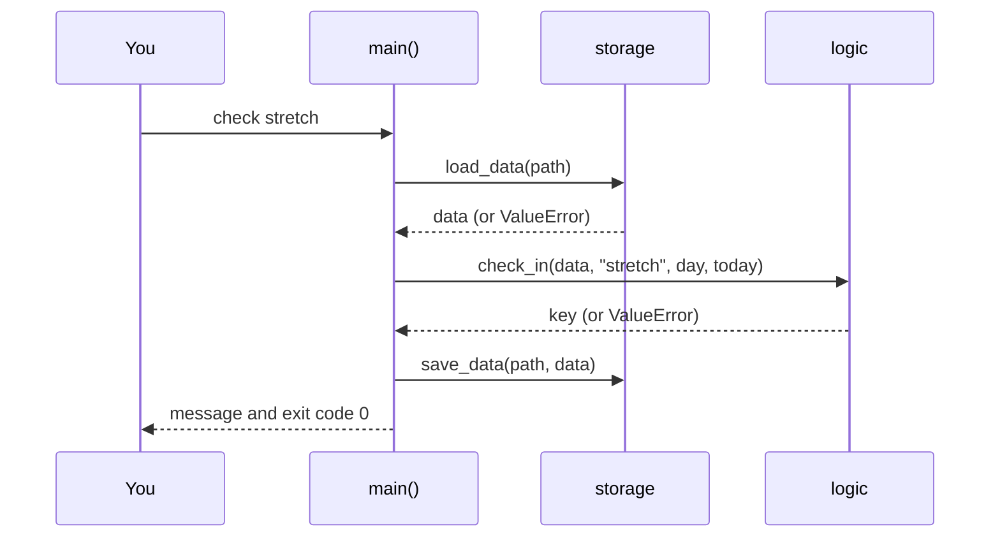

:::objectives
- Choose a capstone project that fits your time and skills.
- Write a one-page plan: commands, sample output, data shape, and functions in each layer.
- Define the trickiest rule in your project in plain words, with examples, before coding it.
- Break the build into milestones that each end with something you can run.
:::

Close VS Code tonight. Tomorrow morning, open a terminal and type `python habits.py list`. If it prints `read 20 pages  streak 12`, your program remembered something across a night, a restart, and maybe a laptop update. That's the whole capstone in one sentence: build a command-line tool that people would actually use every day, and that never loses or garbles their data.

You'll use everything from Modules 2 through 7: collections to model the data, functions with clear inputs and outputs, JSON files, validation, debugging, and the three-layer design. This lesson is about planning. The next one builds a complete example in milestones, and the last one covers testing, polish, and presenting.

## What every project must include

| Requirement | What counts | You learned it in |
| --- | --- | --- |
| Persistence | data saved to JSON and loaded on the next run; a missing file is a fresh start; a damaged file is reported, never overwritten | Module 4 |
| At least 4 subcommands | including one that **changes** saved data and one that **searches or filters** it | Module 7 |
| Validation | every value from the command line is checked, with a message that says how to fix it | Module 5 |
| Collections | at least two used for a reason (dict for lookup by name, set for "seen it?", `Counter` for totals...) | Module 2 |
| Dates or randomness | `datetime` for anything about days, or `random` for anything shuffled | Module 5 |
| Clear errors | no tracebacks for user mistakes; exit code 0 on success and nonzero on failure | Modules 5 and 7 |
| Layers | interface, logic, and storage in separate modules; logic never prints | Module 7 |
| Tests | at least 8 `unittest` tests, including edge cases | Lessons 2 and 3 of this module |
| README | the five questions: what, setup, usage, files, limits | Module 7 |

## Pick a project

All five ideas meet the requirements. The difference is how much logic sits in the middle.

| Project | Level | Core commands | The interesting part |
| --- | --- | --- | --- |
| **To-do list with due dates** | starter | `add`, `list`, `done`, `remove`, `list --overdue` | sorting by due date, and "overdue" depends on today |
| **Habit tracker** (built in the next lesson) | core | `add`, `check`, `list`, `history`, `remove` | streaks: counting days in a row, across months |
| **Flash-card trainer** | core | `add`, `quiz`, `search`, `stats` | spaced repetition: cards you miss come back sooner (a Leitner box system) |
| **Expense tracker with budgets** | stretch | `spend`, `earn`, `list`, `budget`, `report` | monthly totals per category with `defaultdict`, and warnings near a budget |
| **Club gear checkout** | stretch | `add`, `checkout`, `return`, `overdue`, `search` | who has what, due dates, and refusing to lend an item twice |

Pick the one *you* would use. If none fits, invent one with the same shape: a list of records, a few commands that change them, and at least one rule that's harder than adding and removing. A practice log for an instrument, a reading-challenge tracker, or a chore rotation that assigns jobs fairly would all work.

:::tip
If you've never built a multi-file program before, start with the to-do list and add features from a harder project once the requirements pass. A finished starter project beats an abandoned stretch one.
:::

## The one-page plan

Copy this into a file called `PLAN.md` in your project folder and fill it in before writing any Python. Expect to change it as you build; that's what it's for.

```text title="PLAN.md"
Project name:
Who it's for, in one sentence:

1. Commands (exactly what the user types, and what prints back)
   $ python ___.py ___
   ___

2. Data file shape (a small real example of the JSON)

3. Functions by layer
   Interface (argparse, handlers, printing):
   Logic (rules; raise ValueError, never print):
   Storage (load, save):

4. The hardest rule, in plain words, with 3 examples

5. Bad input I must handle (at least 5)

6. Milestones (each ends with something that runs)

7. Must have / nice to have
```

## A worked plan: the habit tracker

Here's the plan for the project you'll see built in the next lesson, filled in the way yours should be.

**Commands and output.** Sketched first, exactly as a user would see them:

```bash
$ python habits.py add "Read 20 pages"
Now tracking 'read 20 pages'. Check in with: python habits.py check "read 20 pages"
$ python habits.py check "read 20 pages"
Checked in 'read 20 pages' for today. Streak: 3 day(s).
$ python habits.py check stretch --date 2026-11-12
Checked in 'stretch' for 2026-11-12.
$ python habits.py list
[x] read 20 pages  streak   3  best   3
[ ] stretch        streak   0  best   2
$ python habits.py history "read 20 pages" --days 7
read 20 pages: ....###  (last 7 days, today on the right)
```

**Data shape.**

```json
{
  "habits": {
    "read 20 pages": {"days": ["2026-11-13", "2026-11-14", "2026-11-15"]},
    "stretch": {"days": ["2026-11-11", "2026-11-12"]}
  }
}
```

Every choice in that file has a reason, and writing the reasons down is part of the plan:

- **A dictionary keyed by name**, because every command finds a habit by name, and a dict lookup beats searching a list. Names are stored lowercase, so `Read` and `read` are the same habit.
- **Dates as `YYYY-MM-DD` strings**, because JSON has no date type, and this format sorts correctly as plain text.
- **A list of days in the file, a set in memory.** JSON has no sets either. But "was this day done?" is the question the streak code asks over and over, and `day in some_set` answers it instantly.
- **No stored streaks.** A streak can be calculated from the days, so storing it would only create a second copy that could disagree with the first.
- **An outer `{"habits": ...}` wrapper**, so a future version can add settings next to it without breaking old files.

**Functions by layer.** Interface: `build_parser`, one `cmd_` handler per command, `main(argv, path, today)`. Logic: `normalize`, `add_habit`, `check_in`, `current_streak`, `longest_streak`, `history_strip`. Storage: `load_data`, `save_data`.

Notice that `today` is a parameter. The logic never calls `date.today()` itself. That's how the tests in Lesson 3 can pretend it's November 15 forever.



## Find the hard part early

Every project has one rule that's harder than the rest. For the habit tracker, it's the **streak**. Before writing any code, pin it down in words and with examples, because most capstone bugs are really vague definitions.

> The current streak is the number of days in a row, ending today, on which the habit was done. If today isn't checked in yet, count back from yesterday instead, so the streak doesn't drop to 0 every morning.

| Days done (November) | Today | Current streak | Why |
| --- | --- | --- | --- |
| 13, 14, 15 | 15 | 3 | three in a row ending today |
| 13, 14 | 15 | 2 | today not done yet, so count from the 14th |
| 10, 11, 13 | 15 | 0 | the 14th was missed |
| Oct 31, Nov 1 | Nov 1 | 2 | the streak crosses a month boundary |

That table is already four test cases. Write the same kind of table for your hardest rule: when a flash card moves boxes, when an expense counts toward this month, when a checkout becomes overdue.

## Milestones that each end with something running

| Milestone | Done when... |
| --- | --- |
| M1 Storage | `load` and `save` round-trip your example data, and a missing file gives an empty start |
| M2 First command | `add` works and refuses duplicates and blank names |
| M3 The main change | the command that updates records works, with its validation |
| M4 The hard rule | the table from "Find the hard part early" passes as `assert`s |
| M5 Full command line | every command runs through `main()`, with errors and exit codes |
| M6 Tests and README | 8 or more `unittest` tests pass, and a stranger could use the tool from the README |

Run your program at the end of every milestone, and keep a copy that works before starting the next one. Committing it with git, if you use it, or zipping the folder both count.

**Must have** is the requirements table. **Nice to have** is everything else: colors, a `--json` output mode, CSV export, an `undo` command. Write nice-to-haves down so you stop thinking about them, then ignore them until the must-haves pass.

:::video 9N6a-VLBa2I
Corey Schafer covers loading and saving JSON in Python, including the table of how Python types turn into JSON types. Watch that part while you design your data shape: it shows why dates, sets, and tuples need converting before they can be saved.
:::

:::quiz
Q: The habit file stores days as a list of `"YYYY-MM-DD"` strings. Why not store `date` objects or a set?
- [ ] Strings take less space than dates
  Space isn't the issue here.
- [x] JSON has no date or set type, so they must be converted to strings and lists to be saved
  The program converts back to a set of dates after loading, when it needs fast lookups.
- [ ] Sets can't hold dates
  They can; the problem is only saving them as JSON.

Q: Why do the logic functions take `today` as a parameter instead of calling `date.today()`?
- [x] So tests can fix the date and get the same answer every day they run
  A test that depends on the real date passes today and fails tomorrow.
- [ ] Because `date.today()` is slow
  It's fast; the reason is control, not speed.
- [ ] Because logic functions aren't allowed to import `datetime`
  They can import it; they just shouldn't decide what day it is.

Q: Your plan has eight nice-to-have features and two must-haves still failing. What's the best next step?
- [ ] Add the nice-to-haves first, since they're more fun
  Unfinished requirements are what the rubric checks.
- [x] Finish the must-haves, keeping the nice-to-haves written down for later
  Writing them down lets you stop thinking about them without losing the ideas.
- [ ] Delete the plan and start over with a smaller project
  The plan is fine; the order of work is the issue.
:::

:::takeaways
- Plan on one page: commands and output, data shape, functions by layer, the hard rule, bad inputs, milestones.
- Choose the data shape for the questions your commands ask: dicts for lookup by name, sets for "did this happen?"
- Store facts, not things you can calculate.
- Pass `today` into logic so the date is something tests can control.
- Define the hardest rule with a table of examples; those rows become your first tests.
- Every milestone ends with a program that runs.
:::
