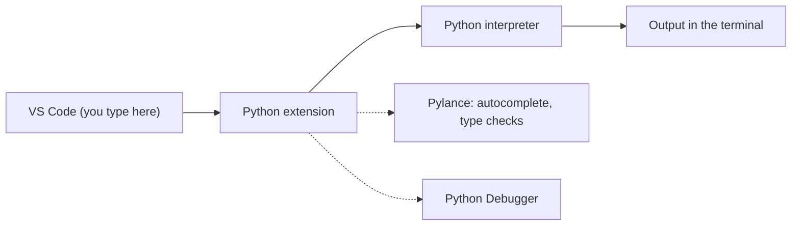

:::objectives
- Install Python 3.10 or newer and check its version from a terminal.
- Install VS Code and the Python extension, and say what job each one does.
- Run a setup-check script from VS Code and read what it tells you.
- Fix the four install problems that catch most people.
:::

Two students run the same test file. One sees `2 passed`. The other sees `No module named pytest`. The code is identical, so the difference has to be the setup: which Python ran the file, and whether that Python could see the testing tool.

This course is about designing programs out of classes, and you will lean on tests to know your designs still work. That only goes well if your setup is predictable. This module gets you to one editor, one Python per project, and one command that runs every test. This first lesson covers the installs.

## Three programs with three different jobs

It is easy to think "VS Code" is the thing that runs Python. It is not. Three separate pieces work together, and knowing which is which makes every later error message easier to read.



- **VS Code** is a general editor. Out of the box it knows nothing about Python.
- **The Python extension** (by Microsoft) teaches VS Code to run, debug, and test Python. It installs two helpers with it: Pylance, which powers autocomplete and type checking, and the Python Debugger.
- **The Python interpreter** is the program that actually executes your code. You install it yourself; neither VS Code nor the extension includes it.

You need Python **3.10 or newer**. Later modules use type-hint syntax like `int | None`, which older versions reject. Any current release from python.org is fine.

## Step 1: Install Python

:::tabs
@tab Windows
1. Go to [python.org/downloads](https://www.python.org/downloads/) and choose **Download Python install manager**. (The Microsoft Store has the same tool under the name Python Install Manager, if you prefer the Store.)
2. Open the downloaded file and select **Install**.
3. Open **PowerShell** from the Start menu and run the command below. It downloads the newest Python. If it offers to add a folder to your PATH, say yes.

```powershell
py install default
```

4. Close PowerShell, open a fresh one, and check the version:

```powershell
python --version
```

You should see something like `Python 3.15.2`. Any version from 3.10 up is fine.
@tab macOS
1. Go to [python.org/downloads](https://www.python.org/downloads/) and select the **Download Python 3.x** button. You get a `.pkg` installer.
2. Open it and click through the installer with the default options.
3. Open **Terminal** (press Cmd+Space and type Terminal) and check the version:

```bash
python3 --version
```

On a Mac the command is `python3`, not `python`. That changes once you create a virtual environment in the next lesson.
@tab Chromebook / Linux
1. On a Chromebook, turn on Linux first: select the time at the bottom right, then **Settings › About ChromeOS › Developers**, and next to **Linux development environment** select **Set up**. It can take 10 minutes. A Terminal window opens when it is done.
2. In the Terminal (on any Debian or Ubuntu Linux too), install Python with its virtual-environment and pip tools:

```bash
sudo apt update
sudo apt install python3 python3-venv python3-pip
```

3. Check the version:

```bash
python3 --version
```

If the Developers section has no Linux option, your school has turned it off. Ask whether you can use a home computer, or use a browser-based VS Code such as GitHub Codespaces, which has a free monthly allowance.
:::

## Step 2: Install VS Code

:::tabs
@tab Windows
1. Go to [code.visualstudio.com](https://code.visualstudio.com/) and download the Windows installer.
2. Run it. On the **Select Additional Tasks** screen, leave **Add to PATH** ticked so the `code` command works in terminals. If the installer also offers GitHub Copilot CLI, you can decline it; this course doesn't use it.
3. Open VS Code from the Start menu.
@tab macOS
1. Download VS Code for macOS from [code.visualstudio.com](https://code.visualstudio.com/).
2. Open the download and drag **Visual Studio Code.app** into your **Applications** folder, then open it from there.
3. Optional but handy: press Cmd+Shift+P, type `shell command`, and run the **Shell Command: Install 'code' … in PATH** entry. Now `code .` in Terminal opens the current folder.
@tab Chromebook / Linux
1. Find out which processor you have by running `dpkg --print-architecture` in the Terminal. It prints `amd64` (download the x64 build) or `arm64` (download the ARM64 build).
2. From [code.visualstudio.com/download](https://code.visualstudio.com/download), download the matching **.deb** package.
3. Install it from the Terminal, in the folder where it downloaded (on a Chromebook, first move it into **Linux files** using the Files app):

```bash
sudo apt install ./code_*.deb
```

4. Open **Visual Studio Code** from your Linux apps.
:::

## Step 3: Add the Python extension

1. In VS Code, open the Extensions view with **Ctrl+Shift+X** (Cmd+Shift+X on a Mac).
2. Search for `Python`.
3. Pick the one published by **Microsoft** (its ID is `ms-python.python`) and select **Install**.

Several look-alike extensions exist. The Microsoft one is the one every instruction in this course assumes.

## Step 4: Prove the three pieces are connected

Use **File › Open Folder…** to create and open a new folder called `oop-python`. You will keep everything for this course in it. In the Explorer, select the New File button, name the file `check_setup.py`, and paste this in:

```python run title="check_setup.py"
import sys

print("Python", sys.version.split()[0])
print("Running from", sys.executable)

if sys.version_info >= (3, 10):
    print("OK: this Python is new enough for the course.")
else:
    print("Too old: install Python 3.10 or newer.")
```

Save it (Ctrl+S or Cmd+S) and select the **Run Python File** play button at the top right of the editor. A terminal panel opens and prints three lines.

The output above came from the computer that built this page. Yours will show your own version and a path on your machine. The second line is the useful one: it names the exact interpreter VS Code used. When a package seems to be "missing", comparing that path with the one in your terminal usually reveals two different Pythons.

:::try
Click the Python version shown near the bottom right of the VS Code window (the Status Bar). A list of every Python VS Code found on your computer appears. Close it with Escape for now; you will use it in the next lesson.
:::

## The four problems people actually hit

:::warning Windows: "python is not recognized", or the Microsoft Store opens
Windows ships with placeholder `python` shortcuts that open the Store. Open the Start menu, search **Manage app execution aliases**, and make sure the **Python (default)** aliases are switched on (if they are, switch them off and on again). Close every terminal and open a new one, since terminals only read your PATH when they start.
:::

:::warning macOS: `zsh: command not found: python`
macOS has no `python` command. Type `python3`. Inside an activated virtual environment, which you make next lesson, plain `python` works too.
:::

:::warning VS Code can't find Python, or asks you to select an interpreter
VS Code was probably open while you installed Python, so it never saw it. Quit VS Code completely and reopen it. If it still can't find Python, open the Command Palette (Ctrl+Shift+P or Cmd+Shift+P) and run **Python: Select Interpreter**.
:::

:::warning Chromebook or Linux: `Unable to locate package python3-venv`
Your package list is out of date. Run `sudo apt update` and then repeat the install line.
:::

## Watch the setup once

:::video D2cwvpJSBX4
The VS Code team's own walkthrough of Python in VS Code. Watch for the moment an interpreter gets selected in the Status Bar: that click is the link between the editor and Python that this lesson set up.
:::

:::quiz
Q: You install VS Code and the Python extension on a new laptop, but not Python. What happens when you press Run Python File?
- [ ] It runs, because the extension includes Python
  The extension adds Python support to the editor but contains no interpreter.
- [x] It can't run, because there is no interpreter to execute the file
  VS Code and the extension only hand your file to a Python interpreter, and none is installed yet.
- [ ] It runs the file with Pylance
  Pylance reads your code to give autocomplete and warnings; it never executes it.

Q: `check_setup.py` prints `Running from C:\Python39\python.exe` and `Too old`. What is the best next step?
- [ ] Rewrite the script to support Python 3.9
  The course needs features from 3.10, so the script is right to complain.
- [ ] Reinstall VS Code
  VS Code isn't the problem; it ran an old Python it found.
- [x] Install a current Python, then pick it with Python: Select Interpreter
  The path shows VS Code chose an old interpreter. Install a newer one and point VS Code at it.
:::

:::takeaways
- VS Code edits, the Python extension connects, and the interpreter runs. You install all three.
- Use Python 3.10 or newer. On macOS and Linux the command is `python3` until a virtual environment is active.
- `sys.executable` tells you exactly which Python ran your file, which is the first thing to check when a package seems missing.
- Most install errors are fixed by opening a fresh terminal or a fresh VS Code window.
:::

## Further reading

- [Getting Started with Python in VS Code](https://code.visualstudio.com/docs/python/python-tutorial): the official tutorial, including running and debugging your first file.
- [Using Python on Windows](https://docs.python.org/3/using/windows.html): the install manager in detail, with a troubleshooting table for every Windows symptom.
- [Set up Linux on your Chromebook](https://support.google.com/chromebook/answer/9145439): Google's steps for turning on the Linux development environment.
