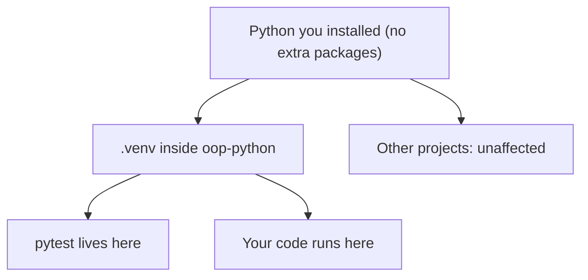

:::objectives
- Create a virtual environment in your project folder and point VS Code at it.
- Install pytest with `python -m pip` so it lands in the right Python.
- Write test functions that pytest can find, and run them from the terminal.
- Read a failing test report and use it to find the problem.
:::

By the end of this page your terminal will print `2 passed`. Then you will break one test on purpose and read exactly what pytest tells you, because a failing test is far more useful than a passing one when you are learning to read it.

## Why every project gets its own Python

When you run `pip install pytest`, the package goes into whichever Python `pip` belongs to. Most computers end up with more than one Python, so it is easy to install a package into one and run your code with another. That is the `No module named pytest` mystery from the last lesson.

A **virtual environment** fixes this. It is a folder (by convention named `.venv`) inside your project that holds a private Python and its own package shelf. Install pytest while the environment is active and it goes on that shelf, and nowhere else.



The environment is disposable. If it ever gets into a strange state, delete the `.venv` folder and make a new one in ten seconds. Never put your own code inside it.

## Step 1: Create the environment

Open your `oop-python` folder in VS Code (**File › Open Folder…**), then open a terminal with **Terminal › New Terminal**. The terminal starts inside your project folder. Run:

:::tabs
@tab Windows
```powershell
python -m venv .venv
```
@tab macOS
```bash
python3 -m venv .venv
```
@tab Chromebook / Linux
```bash
python3 -m venv .venv
```
:::

A `.venv` folder appears in the Explorer. If VS Code pops up a message offering to use the new environment for this workspace, choose **Yes**. You can also do this whole step from the Command Palette with **Python: Create Environment**, then **Venv**; either way you end up with the same folder.

## Step 2: Select it and activate it

Open the Command Palette (Ctrl+Shift+P, or Cmd+Shift+P on a Mac), run **Python: Select Interpreter**, and pick the entry whose path includes `.venv`. Then close the terminal (the trash-can icon) and open a new one. VS Code activates the selected environment in new terminals, and the prompt starts with `(.venv)`.

If you don't see `(.venv)`, activate it yourself:

:::tabs
@tab Windows
```powershell
.venv\Scripts\Activate.ps1
```
@tab macOS
```bash
source .venv/bin/activate
```
@tab Chromebook / Linux
```bash
source .venv/bin/activate
```
:::

Now prove it. Save this as `where_am_i.py` and run it with the play button:

```python run title="where_am_i.py"
import sys

print("Interpreter:", sys.executable)
print("Inside a virtual environment:", sys.prefix != sys.base_prefix)
```

The output shown here came from the machine that built this page, which is not inside a virtual environment, so it says `False`. Yours should say `True`, with a path ending in `.venv/bin/python` (macOS, Linux) or `.venv\Scripts\python.exe` (Windows). Inside an environment, `sys.prefix` points at `.venv` while `sys.base_prefix` still points at the Python it was made from, so the two differ.

## Step 3: Install pytest

With `(.venv)` showing, run:

```bash
python -m pip install pytest
python -m pytest --version
```

The second line should print something like `pytest 9.2.0`. Notice the commands start with `python -m`. That runs pip and pytest *as part of this exact Python*, so they can't wander off to a different one. Once the environment is active, `python` means the environment's Python on every operating system, including macOS.

## Step 4: Write a test pytest can find

Create `test_first.py` in the project folder:

```python run title="test_first.py"
def withdraw(balance, amount):
    if amount > balance:
        return balance
    return balance - amount


def test_withdraw_takes_money_out():
    assert withdraw(100, 30) == 70


def test_cannot_take_more_than_balance():
    assert withdraw(20, 50) == 20
```

Running this file directly prints nothing at all, which is why there is no Output box. That is expected: it only *defines* functions. pytest is the program that calls them. It looks for:

- files named `test_*.py` (or `*_test.py`),
- functions inside them whose names start with `test`,
- and inside each test, a plain `assert`. If the condition is true the test passes; if it is false, the test fails and pytest reports the values.

There is no magic in that. Here is the core of what pytest does, written out by hand with one test that is wrong on purpose:

```python run title="tiny_runner.py"
def withdraw(balance, amount):
    if amount > balance:
        return balance
    return balance - amount


def test_withdraw_takes_money_out():
    assert withdraw(100, 30) == 70


def test_wrong_on_purpose():
    assert withdraw(100, 30) == 60


for name, func in list(globals().items()):
    if name.startswith("test_") and callable(func):
        try:
            func()
            print("PASSED", name)
        except AssertionError:
            print("FAILED", name)
```

The loop walks through every name in the file, calls the ones that start with `test_`, and treats an `AssertionError` as a failure. pytest adds a lot on top (good reports, finding files, fixtures), but this is the idea.

## Step 5: Run it, then break it

In the terminal, run:

```bash
python -m pytest
```

```text
============================= test session starts ==============================
platform darwin -- Python 3.13.0, pytest-9.1.1, pluggy-1.6.0
rootdir: /Users/sam/oop-python
collected 2 items

test_first.py ..                                                         [100%]

============================== 2 passed in 0.02s ===============================
```

Each `.` is one passing test. The first lines vary by computer; the last line is the verdict. Now change `70` to `60` in the first test, save, and run `python -m pytest` again:

```text
============================= test session starts ==============================
platform darwin -- Python 3.13.0, pytest-9.1.1, pluggy-1.6.0
rootdir: /Users/sam/oop-python
collected 2 items

test_first.py F.                                                         [100%]

=================================== FAILURES ===================================
________________________ test_withdraw_takes_money_out _________________________

    def test_withdraw_takes_money_out():
>       assert withdraw(100, 30) == 60
E       assert 70 == 60
E        +  where 70 = withdraw(100, 30)

test_first.py:8: AssertionError
=========================== short test summary info ============================
FAILED test_first.py::test_withdraw_takes_money_out - assert 70 == 60
========================= 1 failed, 1 passed in 0.03s ==========================
```

Read the `E` lines first. `assert 70 == 60` shows what was compared, and `where 70 = withdraw(100, 30)` shows where the 70 came from. Here the test is wrong, not the function, so fix the test back to `70`. Sometimes it is the other way round, and deciding which one is wrong is a skill you will practise all course. Add `-v` (`python -m pytest -v`) any time you want one line per test with its name and `PASSED` or `FAILED`.

## Step 6: Run tests from the Testing view

VS Code can run the same tests with a click. Select the beaker icon in the Activity Bar on the left to open the Testing view. If it shows **Configure Python Tests**, select it, choose **pytest**, and pick the root folder (`.`). Your two tests appear in a tree; the play button at the top runs them all, and each gets a green tick or a red cross. A small play icon also appears next to every test function in the editor.

## When it doesn't work

:::warning `No module named pytest`
pytest is installed in a different Python from the one running your tests. Check that the prompt shows `(.venv)` and that VS Code's Status Bar shows the `.venv` interpreter, then run `python -m pip install pytest` again in that terminal.
:::

:::warning `error: externally-managed-environment`
On Chromebooks, many Linux systems, and Homebrew Pythons, pip refuses to install into the system Python. That refusal is protecting you: it means the environment isn't active. Activate `.venv` (Step 2) and run the install again.
:::

:::warning Windows: "Activate.ps1 cannot be loaded because running scripts is disabled on this system"
PowerShell blocks scripts by default. Run this once, then try activating again:

```powershell
Set-ExecutionPolicy -ExecutionPolicy RemoteSigned -Scope CurrentUser
```
:::

:::warning `collected 0 items` and `no tests ran`
pytest found no tests. Either the file name doesn't start with `test_` (for example `bank_checks.py`), a function name doesn't start with `test`, or the file isn't saved yet. Rename, save, and run again.
:::

## Two good videos

:::video mzlH8lp4ISA
A pytest core developer writes and runs first tests from scratch. Watch for how he reads the failure report, especially the lines starting with `E`.
:::

:::video Y21OR1OPC9A
A clear tour of virtual environments. Watch for the difference between the system Python and the environment's Python when packages are installed.
:::

:::quiz
Q: You run `pip install pytest` in a terminal without `(.venv)`, then run tests in VS Code with the `.venv` interpreter. What happens?
- [ ] The tests run, because pytest is now installed on the computer
  It is installed, but only into the Python that `pip` belonged to, not into `.venv`.
- [x] `No module named pytest`, because `.venv` has its own package shelf
  Each environment only sees its own packages, so `.venv` still has no pytest.
- [ ] VS Code installs pytest automatically
  VS Code may offer to, but nothing installs without you choosing to.

Q: Which of these will pytest collect and run by default?
- [ ] A function `check_withdraw()` in `test_bank.py`
  The file name is right, but the function must start with `test`.
- [ ] A function `test_withdraw()` in `bank_tests.txt`
  Only `.py` files named `test_*.py` or `*_test.py` are searched.
- [x] A function `test_withdraw()` in `test_bank.py`
  Both the file and the function follow pytest's naming rules.

Q: A test fails with `E assert 70 == 60` and `where 70 = withdraw(100, 30)`. What do you know for sure?
- [x] `withdraw(100, 30)` returned 70, and the test expected 60
  The report shows both sides of the comparison and where the left side came from.
- [ ] The `withdraw` function has a bug
  Maybe, maybe not. Here 70 is correct, so the test itself is wrong.
:::

:::takeaways
- A virtual environment is a per-project Python with its own packages. Create it with `python -m venv .venv` and select it in VS Code.
- Use `python -m pip` and `python -m pytest` so both use the environment's Python.
- pytest runs functions named `test...` in files named `test_*.py`, and a failing `assert` becomes a readable report.
- Read the `E` lines of a failure first, then decide whether the code or the test is wrong.
:::

## Further reading

- [venv: creation of virtual environments](https://docs.python.org/3/library/venv.html): the official reference, including the activation command for every shell.
- [pytest: get started](https://docs.pytest.org/en/stable/getting-started.html): install, first test, and grouping tests, in about ten minutes of reading.
- [Python testing in VS Code](https://code.visualstudio.com/docs/python/testing): everything the Testing view can do, including debugging a single test.
