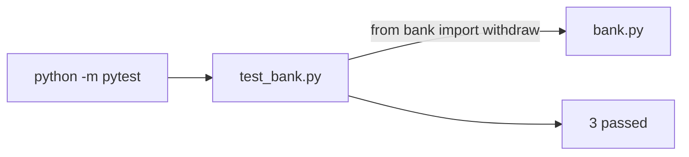
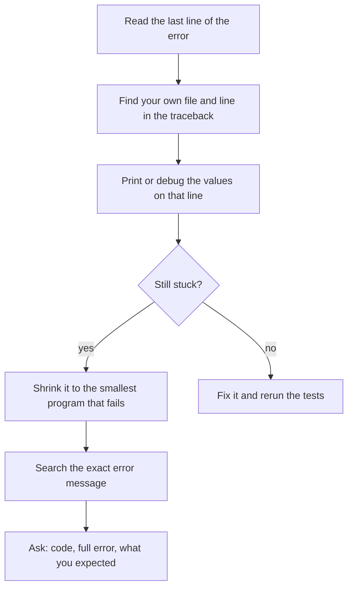

:::objectives
- Lay out your `oop-python` folder so every module's code and tests are easy to find.
- Split a file into code (`bank.py`) and tests (`test_bank.py`) and run them with pytest.
- Know how the code cells on these pages relate to the files on your computer.
- Read a traceback from the bottom up and use the debugger to watch values change.
- Follow a short routine when nothing works.
:::

By the end of this course your project folder will hold dozens of files, and some of them will be broken at any given moment. That is normal. What separates a calm programmer from a frustrated one is mostly habits: where files live, how code and tests are split, and what to do in the first ten minutes after something breaks.

## One folder per module

Make one folder for each module inside `oop-python`. The virtual environment stays at the top, shared by everything.

```text
oop-python/
├── .venv/
├── m1_setup/
│   ├── bank.py
│   └── test_bank.py
├── m2_objects/
│   ├── account.py
│   └── test_account.py
└── m3_relationships/
    └── ...
```

Drag `check_setup.py` and `where_am_i.py` from the last two lessons into `m1_setup` in the Explorer, so the top level stays clean. (`test_first.py` gets replaced in the next section.) Then run tests from inside the folder you are working on:

```bash
cd m1_setup
python -m pytest
```

Why not run everything from the top? If two folders each have a `test_bank.py`, pytest refuses with an `import file mismatch` error, because Python can only hold one module called `test_bank` at a time. Working inside one folder avoids that, and keeps each test run fast and focused.

## Split the code from its tests

Last lesson, `withdraw` and its tests lived in one file. Real projects keep them apart: the code goes in a module, and the tests import it. Make `m1_setup/bank.py` holding `withdraw` plus one new function, `apply_all`, which adds a list of amounts to a balance. Make `m1_setup/test_bank.py` holding the two old tests plus one for `apply_all`, then delete `test_first.py`. The test file starts with one new line, `from bank import apply_all, withdraw`. (The block further down shows both files' contents together.)



With both files saved, `python -m pytest -v` inside `m1_setup` prints:

```text
============================= test session starts ==============================
platform darwin -- Python 3.13.0, pytest-9.1.1, pluggy-1.6.0 -- /Users/sam/oop-python/.venv/bin/python
rootdir: /Users/sam/oop-python/m1_setup
collecting ... collected 3 items

test_bank.py::test_withdraw_takes_money_out PASSED                       [ 33%]
test_bank.py::test_cannot_take_more_than_balance PASSED                  [ 66%]
test_bank.py::test_apply_all_adds_every_amount PASSED                    [100%]

============================== 3 passed in 0.03s ===============================
```

## How the code on these pages relates to your files

Every code block on this site with an **Output** box was really run when the page was built; nobody typed that output. Each block is its own little program, though, so a page can't import one block from another. When a lesson tests something, it puts the code and its tests in one block and ends with a few lines that call the tests, just like `tiny_runner.py` did:

```python run title="bank.py and test_bank.py, together on one page"
def withdraw(balance, amount):
    if amount > balance:
        return balance
    return balance - amount


def apply_all(balance, amounts):
    for amount in amounts:
        balance = balance + amount
    return balance


def test_withdraw_takes_money_out():
    assert withdraw(100, 30) == 70


def test_cannot_take_more_than_balance():
    assert withdraw(20, 50) == 20


def test_apply_all_adds_every_amount():
    assert apply_all(10, [5, -3, 20]) == 32


for test in [test_withdraw_takes_money_out, test_cannot_take_more_than_balance,
             test_apply_all_adds_every_amount]:
    test()
    print("passed:", test.__name__)
```

When you copy a block like this into your project, split it in two: everything above the tests goes in the code file, the tests go in the test file (with the `from ... import` line at the top), and you drop the loop at the bottom, because pytest does that job for you.

:::tip Save before you test
pytest reads the file on disk, not what is on your screen. A dot on the editor tab means unsaved changes. Turn on **File › Auto Save** and this stops being a problem.
:::

## Read a traceback from the bottom up

Here is a bug. One amount arrived as text, maybe from a form or a file:

```python run raises title="bank_demo.py"
def apply_all(balance, amounts):
    for amount in amounts:
        balance = balance + amount
    return balance


print(apply_all(10, [5, "20", -3]))
```

Start at the **last line**: `TypeError: unsupported operand type(s) for +: 'int' and 'str'`. That is *what* went wrong: Python was asked to add a number and a string. Then read *upward* for *where*: each `File ..., line ..., in ...` entry is one function call, with the most recent call at the bottom. Here the crash happened on line 3 inside `apply_all`, which was called from line 7. The fix belongs wherever the bad value came in, which might not be the line that crashed.

Most bugs in this course end in one of a few error types. `AttributeError` means an object has no attribute with that name (often a typo, and Python usually suggests the right one). `TypeError` usually means the wrong number or kind of arguments. `NameError` means a name was never defined in that scope.

## Watch values change, one line at a time

A traceback tells you where a program died. To see how it got there, step through it. Press **Next** below and watch `balance` change inside `apply_all`, while `start` stays put in the outer frame:

:::trace Step through apply_all and watch two frames
```python
def apply_all(balance, amounts):
    for amount in amounts:
        balance = balance + amount
    return balance

start = 10
end = apply_all(start, [5, -3, 20])
print(start, end)
```
:::

Notice that `apply_all` gets its own box on the call stack while it runs, with its own `balance`. Changing that `balance` never touches `start`. These step-through players appear throughout the course, especially once objects start changing.

VS Code's debugger does the same thing for your real files:

1. Click in the gutter to the left of a line number (or press **F9**) to set a breakpoint, shown as a red dot.
2. Press **F5**. If VS Code asks which debugger or configuration to use, choose **Python Debugger**, then **Python File**.
3. The program stops on your breakpoint. The **Variables** pane on the left shows every local variable, and you can expand objects to see inside them.
4. Press **F10** to step over a line, **F11** to step into a function call, and **F5** to continue.

:::video 06eQ41TuJRs
The VS Code team walks through debugging Python. Watch for the Variables pane and the difference between stepping over and stepping into a function.
:::

## A routine for when you're stuck



Two habits make the biggest difference. First, **shrink the problem**: copy the failing part into a new file and delete everything that isn't needed for the bug to happen. Often the bug becomes obvious halfway through. Second, when you do ask someone, include the code, the *complete* error, and what you expected to happen. "It doesn't work" gives a helper nothing to go on.

For exploring, two built-in helpers are worth remembering. `dir(something)` lists every attribute and method it has, and `help(something)` prints its documentation. Try `help(str.split)` in the Python REPL (**Python: Start Terminal REPL** in the Command Palette).

:::quiz
Q: A traceback ends with `AttributeError: 'list' object has no attribute 'push'`. Where should you look first?
- [x] The last line: lists don't have a `push` method, so the call is wrong
  The final line says what went wrong. Python lists use `append`, not `push`.
- [ ] The first line of the traceback, because the error starts there
  The top of a traceback is the oldest call. The cause is described at the bottom.
- [ ] The test file, because the test must be wrong
  The error is about calling a method that lists don't have, wherever that call is.

Q: You edit `bank.py`, run `python -m pytest`, and the old failure appears again unchanged. What is the most likely reason?
- [ ] pytest caches old results forever
  pytest reruns your tests every time.
- [x] The file wasn't saved, so pytest ran the old version on disk
  pytest reads files from disk. Save (or turn on Auto Save) and run again.
- [ ] The virtual environment is broken
  A broken environment gives import errors, not an identical old failure.
:::

:::takeaways
- Keep one folder per module, and run `python -m pytest` from inside the folder you're working on.
- Code goes in `bank.py`; tests go in `test_bank.py` and import from it. On these pages, both sit in one block with a short loop that calls the tests.
- Read tracebacks bottom-up: the last line says what, the lines above say where.
- Breakpoints and stepping show you how values change; use them when a traceback isn't enough.
:::

## Further reading

- [Debugging Python in VS Code](https://code.visualstudio.com/docs/python/debugging): breakpoints, configurations, and the debug console in full.
- [Errors and exceptions](https://docs.python.org/3/tutorial/errors.html): the Python tutorial's chapter on reading and handling errors.
