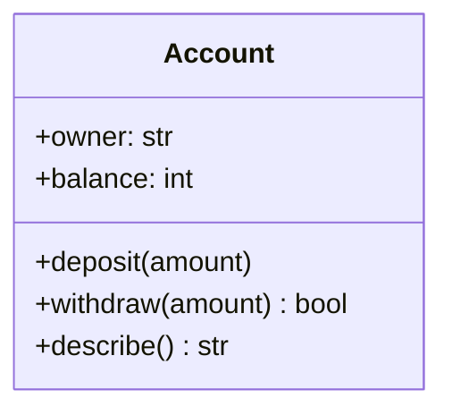

:::objectives
- Explain why data that belongs together breaks when it is kept in parallel lists.
- Write a class with `__init__`, attributes, and methods, and create several instances of it.
- Say exactly what `self` is when a method runs.
- Predict how an object's state changes as methods are called, including when two names share one object.
:::

A tiny bank keeps its records in two lists. Ben closes his account, so the program removes his name. A minute later, Cho checks her balance:

```python run title="parallel_lists.py"
owners = ["Ana", "Ben", "Cho"]
balances = [120, 45, 300]

owners.remove("Ben")  # Ben closes his account

i = owners.index("Cho")
print("Cho has", balances[i])
```

Cho had 300 dollars. The program says she has 45, which was Ben's. Nothing crashed and no error appeared, which makes this the worst kind of bug.

## Data that belongs together should travel together

In that script, the only thing connecting `"Cho"` to `300` is that they sit at the same position in two different lists. Every line of code that adds, removes, or sorts accounts has to update both lists in exactly the same way, forever. One forgotten line and the lists drift apart.

The fix is to stop splitting a single account across several containers. An account is *one thing* with a name and a balance, so it should be one value in the program. A dict like `{"owner": "Cho", "balance": 300}` gets part of the way. A **class** goes further: it bundles the data with the operations that are allowed on it, so the rules ("no overdrafts") live in one place instead of being repeated by every caller.

## A class describes a kind of thing; an instance is one of them

Here's the intuition. A class is like a blank form for opening an account: it says which boxes exist. Each filled-in form is an **instance**, a separate object with its own values in those boxes. Now precisely:

```python run title="first_class.py"
class Account:
    def __init__(self, owner, balance):
        self.owner = owner
        self.balance = balance


ana = Account("Ana", 120)
cho = Account("Cho", 300)

print(ana.owner, ana.balance)
print(cho.owner, cho.balance)
print(type(cho))
print(vars(cho))
```

What happened, line by line:

- `class Account:` defines a new type. Nothing is created yet.
- `Account("Ana", 120)` creates a new, empty object and then automatically calls `__init__` on it with `"Ana"` and `120`. Inside `__init__`, `self` is that new object.
- `self.owner = owner` creates an **attribute**: a variable that belongs to that one object. `ana.owner` and `cho.owner` are different attributes on different objects.
- `vars(cho)` shows the attributes stored on `cho`, as a dict. Under the hood, an object's attributes really are kept in a dict like that.

## Methods are functions that receive the object as self

A **method** is a function defined inside a class. You call it on an instance with a dot, and Python quietly passes the instance in as the first argument.

```python run title="methods.py"
class Account:
    def __init__(self, owner, balance):
        self.owner = owner
        self.balance = balance

    def deposit(self, amount):
        self.balance = self.balance + amount

    def describe(self):
        return f"{self.owner} has ${self.balance}"


ana = Account("Ana", 120)
ana.deposit(30)
print(ana.describe())

Account.deposit(ana, 50)  # exactly what ana.deposit(50) means
print(ana.describe())
```

The second call is the key to the whole idea. `ana.deposit(30)` is shorthand for `Account.deposit(ana, 30)`: look up `deposit` on the class, then call it with `ana` as the first argument. That first parameter is named `self` by convention. It isn't a keyword, just the name every Python programmer uses, so always use it.



Diagrams like this one are **class diagrams**. The top half lists the attributes each instance carries; the bottom half lists the methods. You will draw one before writing most classes in this course, because it forces you to decide what an object knows and what it can do.

## State changes over time, one method call at a time

An object's **state** is the current value of all its attributes. Methods are how state changes. This version adds a `withdraw` that refuses to overdraw and returns whether it worked. Before stepping through, predict the final values of `ana.balance` and `ok`.

:::trace Watch self and ana change together
```python
class Account:
    def __init__(self, owner):
        self.owner = owner
        self.balance = 0

    def deposit(self, amount):
        self.balance = self.balance + amount

    def withdraw(self, amount):
        if amount > self.balance:
            return False
        self.balance = self.balance - amount
        return True

ana = Account("Ana")
ana.deposit(50)
ok = ana.withdraw(80)
ok = ana.withdraw(20)
print(ana.balance, ok)
```
:::

Three things to notice as you step:

1. Each method call gets its own frame on the call stack, holding `self` and the arguments. The frame disappears when the method returns.
2. When `deposit` changes `self.balance`, the global `ana` changes *in the same step*. They are not copies; `self` and `ana` are two names for one object.
3. The failed `withdraw(80)` leaves the balance at 50. The object refused to enter a bad state, and no caller had to remember the rule.

## Two names can point at one object

Assignment never copies an object. It makes another name for the same one:

```python run title="aliases.py"
class Account:
    def __init__(self, owner, balance):
        self.owner = owner
        self.balance = balance

    def deposit(self, amount):
        self.balance = self.balance + amount


ana = Account("Ana", 100)
joint = ana            # a second name, not a second account
joint.deposit(25)
print(ana.balance)

twin = Account("Ana", 125)
print(ana is joint, ana is twin, ana == twin)
```

`joint.deposit(25)` changed `ana.balance` because there is only one object. `is` asks "same object?", so `ana is joint` is `True`. `twin` holds identical data but is a separate object, so `ana is twin` is `False`. And `ana == twin` is also `False`: by default, `==` on your own classes falls back to `is`. Module 4 shows how to teach a class what "equal" should mean.

Now the opening bug, fixed. Each account is one object, so removing Ben removes his whole record at once:

```python run title="accounts_list.py"
class Account:
    def __init__(self, owner, balance):
        self.owner = owner
        self.balance = balance


accounts = [Account("Ana", 120), Account("Ben", 45), Account("Cho", 300)]
accounts = [a for a in accounts if a.owner != "Ben"]

for a in accounts:
    print(a.owner, a.balance)
```

## The classic mistakes

:::warning Forgetting self in the parameter list
If you write `def deposit(amount):`, Python still passes the object in first, so there is one argument too many:

```python run raises title="no_self.py"
class Account:
    def __init__(self, owner):
        self.owner = owner
        self.balance = 0

    def deposit(amount):
        self.balance = self.balance + amount


Account("Ana").deposit(50)
```

The message "takes 1 positional argument but 2 were given" almost always means a missing `self`. Add it as the first parameter.
:::

:::warning Forgetting self. inside a method
`balance = balance + amount` (without `self.`) talks about a local variable named `balance`, which doesn't exist yet. Python raises `UnboundLocalError: cannot access local variable 'balance' where it is not associated with a value`. Attributes are always reached through `self.`.
:::

:::warning Forgetting the parentheses
`print(ana.describe)` prints something like `<bound method Account.describe of <__main__.Account object at 0x10f3...>>`. That's the method itself, not its result. Call it: `ana.describe()`.
:::

## See it explained another way

:::video ZDa-Z5JzLYM
A classic, careful introduction to classes and instances. Watch for the point where a method is called through the class with the instance passed in by hand: it's the same `Account.deposit(ana, 50)` idea from this page.
:::

:::quiz
Q: What does this print?

`a = Account("Ana", 10)`, then `b = a`, then `b.deposit(5)`, then `print(a.balance, b.balance)`
- [ ] `10 15`
  That would need `b` to be a copy, but assignment only creates a second name.
- [x] `15 15`
  `a` and `b` are the same object, so the deposit shows up through both names.
- [ ] `15 10`
  The deposit was made through `b`, and both names see the one object anyway.

Q: Inside `deposit(self, amount)`, what is `self` when you call `cho.deposit(40)`?
- [ ] A copy of `cho` made for the method
  No copy is made; changes to `self` change `cho`.
- [x] The `cho` object itself
  `cho.deposit(40)` runs `Account.deposit(cho, 40)`, so `self` is `cho`.
- [ ] The `Account` class
  The class is where the method is found, but `self` is the instance.

Q: A method has the line `balance = self.balance - amount` and the balance never changes. What's the bug?
- [x] It assigns to a local variable `balance`, not to `self.balance`
  The new value is stored in a local that vanishes when the method returns. Write `self.balance = ...`.
- [ ] `self.balance` can't be read inside a method
  Reading `self.balance` is fine; the problem is where the result is stored.
- [ ] Methods can't change attributes
  They can and should; that's how state changes.

Q: Why does a list of `Account` objects avoid the parallel-list bug?
- [ ] Lists of objects are sorted automatically
  They aren't, and sorting isn't the issue.
- [x] Each account's name and balance live in one object, so they can't drift apart
  Removing, sorting, or filtering moves whole accounts, never half of one.
- [ ] Objects use less memory than lists
  Memory has nothing to do with the bug.
:::

:::takeaways
- A class defines a kind of thing; calling it (`Account("Ana", 120)`) creates an instance and runs `__init__` on it.
- Attributes (`self.balance`) belong to one instance. Methods are functions that receive that instance as `self`.
- `obj.method(x)` means `Class.method(obj, x)`. That is all `self` is.
- Assignment shares an object rather than copying it; `is` tells you whether two names point at the same one.
:::

## Further reading

- [The Python tutorial: Classes](https://docs.python.org/3/tutorial/classes.html): the official explanation, especially the sections on class and instance objects and method objects.
- [Think Python, chapter 15: Classes and Methods](https://allendowney.github.io/ThinkPython/chap15.html): a free textbook chapter that builds methods step by step, with exercises.
- [Objects, values and types](https://docs.python.org/3/reference/datamodel.html#objects-values-and-types): the precise rules behind identity, `is`, and why assignment shares objects.
