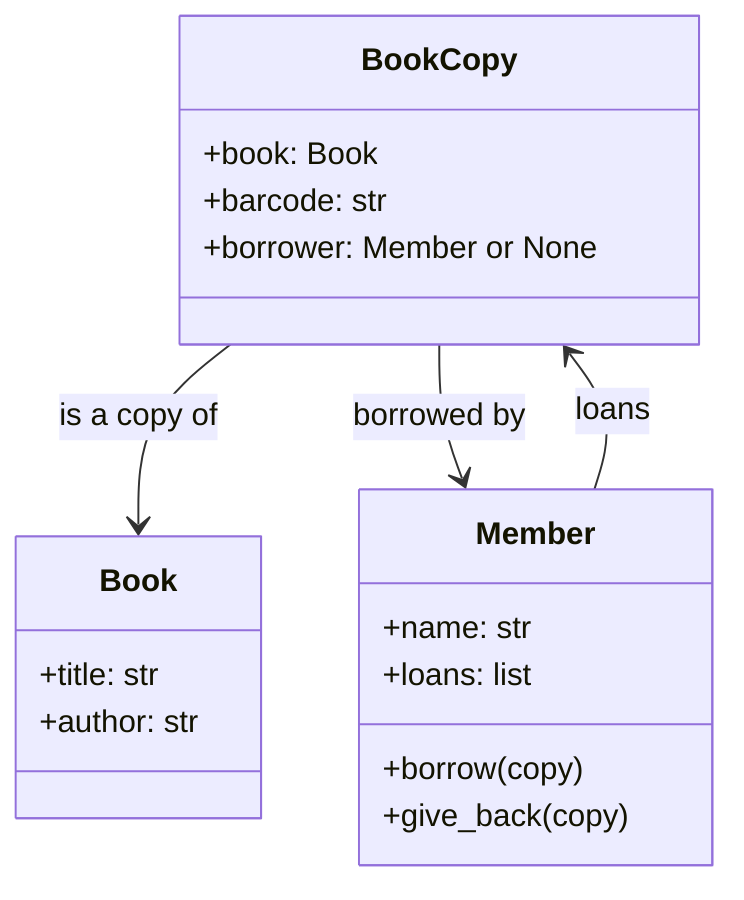

:::objectives
- Write classes whose methods change state and refuse invalid changes.
- Find and fix the two most common class bugs from their error messages.
- Model the difference between a book's record and its physical copies.
- Keep two objects that refer to each other consistent.
:::

Each exercise gives you a task and sample output. Write your answer in a file in `m2_objects`, run it, and only then open the solution. The hints nudge without giving the answer away.

## Warm-up: predict before you run

Read this and write down the three numbers it prints.

```python title="warmup.py"
class Counter:
    def __init__(self):
        self.count = 0

    def click(self):
        self.count = self.count + 1


a = Counter()
b = Counter()
c = a
a.click()
c.click()
b.click()
print(a.count, b.count, c.count)
```

:::solution Check your prediction
```python run title="warmup.py"
class Counter:
    def __init__(self):
        self.count = 0

    def click(self):
        self.count = self.count + 1


a = Counter()
b = Counter()
c = a
a.click()
c.click()
b.click()
print(a.count, b.count, c.count)
```

`c = a` makes a second name for the same counter, so `a.click()` and `c.click()` both add to one object. `b` is separate and was clicked once.
:::

### Exercise 1: A door counter that can undo

A library counts visitors with a clicker. Write a `DoorCounter` class with a `count` that starts at 0, a `click()` method that adds one, an `undo()` method that takes one away but never goes below 0, and a `reset()` method.

```text
3
2
0
0
```

That's the output of: three clicks, print; undo, print; reset, print; undo, print.

:::hint
`undo` needs an `if` that checks the count before changing it. `reset` is a single assignment.
:::

:::solution
```python run title="door_counter.py"
class DoorCounter:
    def __init__(self):
        self.count = 0

    def click(self):
        self.count += 1

    def undo(self):
        if self.count > 0:
            self.count -= 1

    def reset(self):
        self.count = 0


door = DoorCounter()
for _ in range(3):
    door.click()
print(door.count)
door.undo()
print(door.count)
door.reset()
print(door.count)
door.undo()
print(door.count)
```

The rule "never below zero" lives inside `undo`, so no caller can break it.
:::

### Exercise 2: Fix the broken thermostat

This class has two bugs. Run it, read the error, fix it, and run again until it prints `21` and then `23`.

```python run raises title="thermostat.py"
class Thermostat:
    def __init__(self, target):
        self.target = target

    def warmer(degrees):
        self.target = self.target + degrees

    def show(self):
        print(target)


t = Thermostat(21)
t.show()
t.warmer(2)
t.show()
```

:::hint
The first error is about `target` inside `show`. When you fix that, a second error appears about the number of arguments to `warmer`. Each one points at a missing `self`.
:::

:::solution
```python run title="thermostat.py"
class Thermostat:
    def __init__(self, target):
        self.target = target

    def warmer(self, degrees):
        self.target = self.target + degrees

    def show(self):
        print(self.target)


t = Thermostat(21)
t.show()
t.warmer(2)
t.show()
```

`show` read a bare name `target`, which doesn't exist outside `__init__`; attributes need `self.`. Recent Python versions even suggest the fix at the end of the error: `Did you mean: 'self.target'?` And `warmer` was missing `self` as its first parameter, which produces "takes 1 positional argument but 2 were given".
:::

### Exercise 3: Stock levels for a school shop

Write `StockItem(name, quantity, reorder_level)`. `sell(n)` raises `ValueError` if there aren't `n` in stock; `restock(n)` adds `n`; `needs_reorder()` returns `True` when quantity is at or below the reorder level.

```text
pencils: 12 left, reorder? False
pencils: 4 left, reorder? True
Refused: only 4 pencils left
```

:::hint
Check first, change second. The refusal message can use an f-string with `self.quantity` and `self.name`. Catch the error in your demo with `try` / `except ValueError as err:` and print `err`.
:::

:::solution
```python run title="stock.py"
class StockItem:
    def __init__(self, name, quantity, reorder_level):
        self.name = name
        self.quantity = quantity
        self.reorder_level = reorder_level

    def sell(self, n):
        if n > self.quantity:
            raise ValueError(f"only {self.quantity} {self.name} left")
        self.quantity -= n

    def restock(self, n):
        self.quantity += n

    def needs_reorder(self):
        return self.quantity <= self.reorder_level

    def report(self):
        return f"{self.name}: {self.quantity} left, reorder? {self.needs_reorder()}"


pencils = StockItem("pencils", 12, 5)
print(pencils.report())
pencils.sell(8)
print(pencils.report())
try:
    pencils.sell(10)
except ValueError as err:
    print("Refused:", err)
```

`report` calls another method on the same object with `self.needs_reorder()`. Methods often build on each other this way.
:::

### Exercise 4: One borrowable copy

Write `BookCopy(title, barcode)`. It starts with `borrower = None`. `check_out(name)` sets the borrower but raises `ValueError` if the copy is already out. `give_back()` clears the borrower. `is_available()` returns whether it can be borrowed.

```text
True
False Maya
Refused: Dune [B-104] is already out with Maya
True
```

:::hint
`None` is the natural "nobody" value. Test it with `self.borrower is None`.
:::

:::solution
```python run title="book_copy.py"
class BookCopy:
    def __init__(self, title, barcode):
        self.title = title
        self.barcode = barcode
        self.borrower = None

    def is_available(self):
        return self.borrower is None

    def check_out(self, name):
        if not self.is_available():
            raise ValueError(
                f"{self.title} [{self.barcode}] is already out with {self.borrower}"
            )
        self.borrower = name

    def give_back(self):
        self.borrower = None


copy = BookCopy("Dune", "B-104")
print(copy.is_available())
copy.check_out("Maya")
print(copy.is_available(), copy.borrower)
try:
    copy.check_out("Leo")
except ValueError as err:
    print("Refused:", err)
copy.give_back()
print(copy.is_available())
```
:::

### Exercise 5: A book record shared by its copies

A library owns three copies of one book. The title and author belong to the *book*; the barcode and borrower belong to each *copy*. Write a `Book(title, author)` class and change `BookCopy` so it takes a `Book` object instead of a title. Add `label()`, returning `"Title by Author [barcode]"`. Then fix a typo in the book's title once and show that every copy's label changes.

```text
Dnue by Frank Herbert [B-104]
Dune by Frank Herbert [B-104]
Dune by Frank Herbert [B-105]
```

:::hint
Store the book on the copy: `self.book = book`. Then `label` reaches through it with `self.book.title`. All three copies point at the same `Book` object.
:::

:::solution
```python run title="book_and_copies.py"
class Book:
    def __init__(self, title, author):
        self.title = title
        self.author = author


class BookCopy:
    def __init__(self, book, barcode):
        self.book = book
        self.barcode = barcode
        self.borrower = None

    def label(self):
        return f"{self.book.title} by {self.book.author} [{self.barcode}]"


dune = Book("Dnue", "Frank Herbert")
copies = [BookCopy(dune, code) for code in ["B-104", "B-105", "B-106"]]
print(copies[0].label())

dune.title = "Dune"  # fix the typo once
print(copies[0].label())
print(copies[1].label())
```

Here, sharing one object is exactly what we want. If each copy stored its own title string, fixing the typo would mean finding and editing every copy.
:::

### Exercise 6: A shelf of copies

Write a `Shelf` class that holds a list of `BookCopy` objects (from Exercise 5). Give it `add(copy)`, `available()` (a list of the copies nobody has borrowed), and `count_out()`.

```text
On shelf: ['Dune [B-104]', 'Holes [H-201]']
Out: 1
```

:::hint
Start `self.copies = []` in `__init__`. `available` is a list comprehension over `self.copies` that keeps copies whose `borrower` is `None`.
:::

:::solution
```python run title="shelf.py"
class Book:
    def __init__(self, title, author):
        self.title = title
        self.author = author


class BookCopy:
    def __init__(self, book, barcode):
        self.book = book
        self.barcode = barcode
        self.borrower = None


class Shelf:
    def __init__(self):
        self.copies = []

    def add(self, copy):
        self.copies.append(copy)

    def available(self):
        return [c for c in self.copies if c.borrower is None]

    def count_out(self):
        return len(self.copies) - len(self.available())


dune = Book("Dune", "Frank Herbert")
holes = Book("Holes", "Louis Sachar")
shelf = Shelf()
for copy in [BookCopy(dune, "B-104"), BookCopy(dune, "B-105"), BookCopy(holes, "H-201")]:
    shelf.add(copy)

shelf.copies[1].borrower = "Maya"
print("On shelf:", [f"{c.book.title} [{c.barcode}]" for c in shelf.available()])
print("Out:", shelf.count_out())
```

A `Shelf` *has* copies, and each copy *has* a book. Objects that hold other objects are the subject of the next module.
:::

### Challenge: Members who borrow, without the records disagreeing

Add a `Member(name)` class with a `loans` list. `member.borrow(copy)` must update **both** sides: the copy's `borrower` becomes the member, and the copy is added to `member.loans`. A member can hold at most 3 loans, and a copy that is already out can't be borrowed. `member.give_back(copy)` undoes both sides. Write tests for: a normal borrow, the loan limit, borrowing a copy that's already out, and giving back.

The hard part is consistency. If `borrow` updates the member and then fails on the copy, the two records disagree. Look at how the relationships fit together before you start:



:::hint
Do every check (limit reached? copy already out?) *before* changing anything. Only when all checks pass, change both sides. That's the same "validate, then change" order the Account used.
:::

:::solution
```python run title="members.py"
import pytest


class Book:
    def __init__(self, title, author):
        self.title = title
        self.author = author


class BookCopy:
    def __init__(self, book, barcode):
        self.book = book
        self.barcode = barcode
        self.borrower = None


class Member:
    LIMIT = 3

    def __init__(self, name):
        self.name = name
        self.loans = []

    def borrow(self, copy):
        if len(self.loans) >= Member.LIMIT:
            raise ValueError(f"{self.name} already has {Member.LIMIT} loans")
        if copy.borrower is not None:
            raise ValueError(f"{copy.barcode} is out with {copy.borrower.name}")
        copy.borrower = self
        self.loans.append(copy)

    def give_back(self, copy):
        if copy not in self.loans:
            raise ValueError(f"{self.name} doesn't have {copy.barcode}")
        self.loans.remove(copy)
        copy.borrower = None


def make_copies(n):
    book = Book("Dune", "Frank Herbert")
    return [BookCopy(book, f"B-{i}") for i in range(n)]


def test_borrow_updates_both_sides():
    maya, (copy,) = Member("Maya"), make_copies(1)
    maya.borrow(copy)
    assert copy.borrower is maya
    assert maya.loans == [copy]


def test_fourth_loan_is_refused_and_nothing_changes():
    maya, copies = Member("Maya"), make_copies(4)
    for copy in copies[:3]:
        maya.borrow(copy)
    with pytest.raises(ValueError):
        maya.borrow(copies[3])
    assert copies[3].borrower is None
    assert len(maya.loans) == 3


def test_cannot_borrow_a_copy_that_is_out():
    maya, leo, (copy,) = Member("Maya"), Member("Leo"), make_copies(1)
    maya.borrow(copy)
    with pytest.raises(ValueError):
        leo.borrow(copy)
    assert leo.loans == []


def test_give_back_clears_both_sides():
    maya, (copy,) = Member("Maya"), make_copies(1)
    maya.borrow(copy)
    maya.give_back(copy)
    assert copy.borrower is None
    assert maya.loans == []


for test in [test_borrow_updates_both_sides, test_fourth_loan_is_refused_and_nothing_changes,
             test_cannot_borrow_a_copy_that_is_out, test_give_back_clears_both_sides]:
    test()
    print("passed:", test.__name__)
```

`copy.borrower` now holds the `Member` object rather than a name string, so the copy can reach the member's details. Every refusal happens before any attribute changes, which is why the tests can check that nothing moved. `LIMIT = 3` is written on the class rather than on each member, so one number governs everyone; the next module explains exactly how that works.
:::
