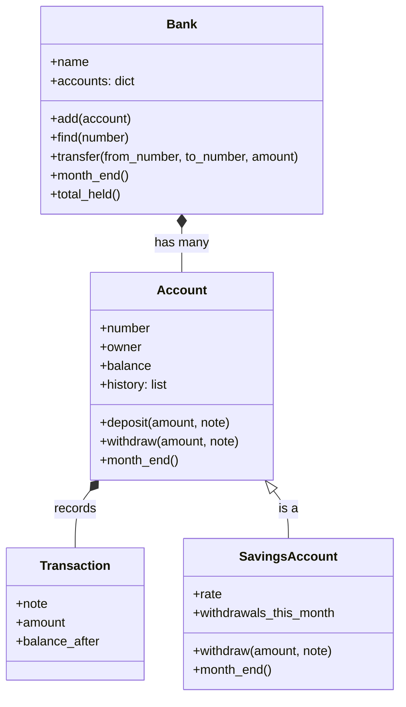

:::objectives
- Replace tuples with small objects, and see what composition buys in readability.
- Number accounts automatically with a class attribute and validate them in `__init__`.
- Build a `Bank` that holds accounts and coordinates transfers between them.
- Add a `SavingsAccount` with inheritance and `super()`, and give every account type the same month-end method.
:::

Last module's `Account` could only stand alone. Real banks have many accounts, of more than one kind, and the bank, not the account, decides how money moves between them. Here is the design we'll build, and the output of its demo:



```text
1001 Account Ana 150
    opening     +200   200
    to 1002      -50   150
1002 SavingsAccount Ben 561
    opening     +500   500
    from 1001    +50   550
    interest     +11   561
Total held: 711
```

Make a new folder `m3_relationships` with a file `bank.py`. On this page, the code cells share their variables like a notebook, so later steps can use earlier classes.

## Step 1: Transactions become objects

In module 2, each history entry was a tuple like `("deposit", 120, 120)`. Code that reads it says `entry[1]`, and you have to remember that position 1 means amount. A tiny class gives each piece a name:

```python run title="bank.py (step 1)"
class Transaction:
    def __init__(self, note, amount, balance_after):
        self.note = note
        self.amount = amount
        self.balance_after = balance_after


t = Transaction("deposit", 120, 120)
print(t.note, t.amount, t.balance_after)
```

An account will **have** a list of these. That is composition at its smallest: an object built out of other objects, each with one clear job.

## Step 2: Numbered, validated accounts

Each account gets a number from a class attribute that counts upward, and the constructor refuses a blank owner. An opening deposit is optional, and goes through `deposit` so it is recorded like any other.

```python run title="bank.py (step 2)"
class Account:
    next_number = 1001

    def __init__(self, owner, opening_deposit=0):
        if not owner.strip():
            raise ValueError("an account needs an owner")
        self.owner = owner.strip()
        self.number = Account.next_number
        Account.next_number += 1
        self.balance = 0
        self.history = []
        if opening_deposit:
            self.deposit(opening_deposit, "opening")

    def deposit(self, amount, note="deposit"):
        if amount <= 0:
            raise ValueError("deposits must be positive")
        self.balance += amount
        self.history.append(Transaction(note, amount, self.balance))

    def withdraw(self, amount, note="withdraw"):
        if amount <= 0:
            raise ValueError("withdrawals must be positive")
        if amount > self.balance:
            raise ValueError(f"account {self.number} only has ${self.balance}")
        self.balance -= amount
        self.history.append(Transaction(note, -amount, self.balance))


ana = Account("Ana", 200)
ben = Account("Ben")
print(ana.number, ben.number, ana.history[0].note, ana.balance)
try:
    Account("   ")
except ValueError as err:
    print("Refused:", err)
```

`Account.next_number` is written with the class name on purpose. Every kind of account, including the savings accounts coming in Step 4, should draw from the same counter, so no two accounts ever share a number.

## Step 3: A Bank that holds the accounts

The bank keeps its accounts in a dict keyed by number, so finding one is a single lookup. Notice that `transfer` finds *both* accounts before touching any money. If either number is wrong, nothing changes.

```python run title="bank.py (step 3)"
class Bank:
    def __init__(self, name):
        self.name = name
        self.accounts = {}

    def add(self, account):
        self.accounts[account.number] = account
        return account

    def find(self, number):
        if number not in self.accounts:
            raise ValueError(f"no account {number}")
        return self.accounts[number]

    def transfer(self, from_number, to_number, amount):
        source = self.find(from_number)
        target = self.find(to_number)
        source.withdraw(amount, f"to {target.number}")
        target.deposit(amount, f"from {source.number}")

    def total_held(self):
        return sum(account.balance for account in self.accounts.values())


bank = Bank("Maple Street Bank")
ana = bank.add(Account("Ana", 200))
ben = bank.add(Account("Ben", 20))
bank.transfer(ana.number, ben.number, 50)
print(ana.balance, ben.balance, bank.total_held())
try:
    bank.transfer(ana.number, 9999, 10)
except ValueError as err:
    print("Refused:", err, "| Ana still has", ana.balance)
```

`Bank` doesn't inherit from `dict`, so callers can't `clear()` it or `pop()` an account out from under it. It offers five operations, and every one of them keeps the bank in a valid state. The transfer logic also moved here from `Account`: deciding which accounts money flows between is the bank's job.

## Step 4: A SavingsAccount that is an Account

A savings account behaves like an account with two extra rules: it allows 3 withdrawals a month and earns interest. It inherits everything else.

```python run title="bank.py (step 4)"
class SavingsAccount(Account):
    max_withdrawals = 3

    def __init__(self, owner, opening_deposit=0, rate=0.02):
        super().__init__(owner, opening_deposit)
        self.rate = rate
        self.withdrawals_this_month = 0

    def withdraw(self, amount, note="withdraw"):
        if self.withdrawals_this_month >= SavingsAccount.max_withdrawals:
            raise ValueError("savings accounts allow 3 withdrawals a month")
        super().withdraw(amount, note)
        self.withdrawals_this_month += 1


saver = SavingsAccount("Cho", 100)
for _ in range(3):
    saver.withdraw(10)
try:
    saver.withdraw(10)
except ValueError as err:
    print("Refused:", err)
print(saver.number, saver.balance, isinstance(saver, Account))
```

`super().__init__` gives the savings account its number, owner, balance, and history, using exactly the code from Step 2. The overridden `withdraw` adds the monthly check and then hands the real work back to `Account.withdraw`, so the overdraft rule exists in one place only. And because a `SavingsAccount` *is* an `Account`, `bank.add(saver)` and `bank.transfer(...)` work with it unchanged.

## Step 5: Month end, without asking "what type are you?"

At the end of each month, savings accounts earn interest and reset their withdrawal count, while ordinary accounts do nothing. The tempting version checks types:

```python
def month_end(bank):
    for account in bank.accounts.values():
        if isinstance(account, SavingsAccount):
            account.balance += round(account.balance * account.rate)
            account.withdrawals_this_month = 0
```

This works today, but every new account type means editing this function, and it reaches inside the account to change its balance without recording a transaction. Instead, give *every* account a `month_end` method and let each class decide what that means. Add one method to each of the three classes:

```python
    # in Account: an ordinary account has nothing to do
    def month_end(self):
        pass

    # in SavingsAccount: earn interest, then reset the limit
    def month_end(self):
        interest = round(self.balance * self.rate)
        if interest > 0:
            self.deposit(interest, "interest")
        self.withdrawals_this_month = 0

    # in Bank: ask every account to do its own month end
    def month_end(self):
        for account in self.accounts.values():
            account.month_end()
```

The bank no longer knows or cares which kinds of account it holds. Calling the same method on different kinds of objects and having each respond in its own way is called **polymorphism**. The interest goes through `deposit`, so it shows up in the history like any other transaction. You'll see the result in the finished program's output: Ben's `interest +11` line.

```mermaid caption="The bank sends one message; each account answers its own way"
sequenceDiagram
    participant Bank
    participant A as Account 1001
    participant S as SavingsAccount 1002
    Bank->>A: month_end()
    A-->>Bank: nothing to do
    Bank->>S: month_end()
    S->>S: deposit(interest, "interest")
    S-->>Bank: done, limit reset
```

## Step 6: The finished bank.py

```python run title="bank.py"
class Transaction:
    def __init__(self, note, amount, balance_after):
        self.note = note
        self.amount = amount
        self.balance_after = balance_after


class Account:
    next_number = 1001

    def __init__(self, owner, opening_deposit=0):
        if not owner.strip():
            raise ValueError("an account needs an owner")
        self.owner = owner.strip()
        self.number = Account.next_number
        Account.next_number += 1
        self.balance = 0
        self.history = []
        if opening_deposit:
            self.deposit(opening_deposit, "opening")

    def deposit(self, amount, note="deposit"):
        if amount <= 0:
            raise ValueError("deposits must be positive")
        self.balance += amount
        self.history.append(Transaction(note, amount, self.balance))

    def withdraw(self, amount, note="withdraw"):
        if amount <= 0:
            raise ValueError("withdrawals must be positive")
        if amount > self.balance:
            raise ValueError(f"account {self.number} only has ${self.balance}")
        self.balance -= amount
        self.history.append(Transaction(note, -amount, self.balance))

    def month_end(self):
        pass  # an ordinary account has nothing to do at month end


class SavingsAccount(Account):
    max_withdrawals = 3

    def __init__(self, owner, opening_deposit=0, rate=0.02):
        super().__init__(owner, opening_deposit)
        self.rate = rate
        self.withdrawals_this_month = 0

    def withdraw(self, amount, note="withdraw"):
        if self.withdrawals_this_month >= SavingsAccount.max_withdrawals:
            raise ValueError("savings accounts allow 3 withdrawals a month")
        super().withdraw(amount, note)
        self.withdrawals_this_month += 1

    def month_end(self):
        interest = round(self.balance * self.rate)
        if interest > 0:
            self.deposit(interest, "interest")
        self.withdrawals_this_month = 0


class Bank:
    def __init__(self, name):
        self.name = name
        self.accounts = {}

    def add(self, account):
        self.accounts[account.number] = account
        return account

    def find(self, number):
        if number not in self.accounts:
            raise ValueError(f"no account {number}")
        return self.accounts[number]

    def transfer(self, from_number, to_number, amount):
        source = self.find(from_number)
        target = self.find(to_number)
        source.withdraw(amount, f"to {target.number}")
        target.deposit(amount, f"from {source.number}")

    def month_end(self):
        for account in self.accounts.values():
            account.month_end()

    def total_held(self):
        return sum(account.balance for account in self.accounts.values())


if __name__ == "__main__":
    bank = Bank("Maple Street Bank")
    ana = bank.add(Account("Ana", 200))
    ben = bank.add(SavingsAccount("Ben", 500, rate=0.02))
    bank.transfer(ana.number, ben.number, 50)
    bank.month_end()
    for account in bank.accounts.values():
        print(account.number, type(account).__name__, account.owner, account.balance)
        for t in account.history:
            print(f"    {t.note:<10}{t.amount:>+6}{t.balance_after:>6}")
    print("Total held:", bank.total_held())
```

## Step 7: Test the rules that matter

These tests target the decisions we made: one shared counter, the savings limit, month end, and transfers that fail safely. Put them in `test_bank.py` beginning with `import pytest` and `from bank import Account, Bank, SavingsAccount`. Here they run against the classes from the cell above:

```python run title="test_bank.py"
import pytest


def test_numbers_are_unique_across_account_types():
    a = Account("Ana")
    s = SavingsAccount("Ben")
    assert s.number == a.number + 1


def test_blank_owner_is_refused():
    with pytest.raises(ValueError):
        Account("   ")


def test_fourth_savings_withdrawal_is_refused():
    s = SavingsAccount("Ben", 100)
    for _ in range(3):
        s.withdraw(10)
    with pytest.raises(ValueError):
        s.withdraw(10)
    assert s.balance == 70


def test_month_end_adds_interest_and_resets_the_limit():
    s = SavingsAccount("Ben", 500, rate=0.02)
    s.withdraw(100)
    s.month_end()
    assert s.balance == 408
    assert s.withdrawals_this_month == 0


def test_transfer_to_unknown_account_changes_nothing():
    bank = Bank("Test")
    ana = bank.add(Account("Ana", 100))
    with pytest.raises(ValueError):
        bank.transfer(ana.number, 999, 40)
    assert ana.balance == 100


def test_month_end_treats_every_account_correctly():
    bank = Bank("Test")
    plain = bank.add(Account("Ana", 100))
    saver = bank.add(SavingsAccount("Ben", 100, rate=0.1))
    bank.month_end()
    assert (plain.balance, saver.balance) == (100, 110)
    assert bank.total_held() == 210


for name, test in list(globals().items()):
    if name.startswith("test_") and callable(test):
        test()
        print("passed:", name)
```

In your project, `python -m pytest` in `m3_relationships` reports `6 passed`.

:::video hxGOiiR9ZKg
A visual argument for preferring composition. Watch for the moment a new requirement doesn't fit the inheritance tree, and compare it with how `Bank` accepts any kind of account without changing.
:::

:::quiz
Q: Why does `Account.__init__` use `Account.next_number += 1` rather than `self.next_number += 1`?
- [ ] `self` isn't available inside `__init__`
  It is; `__init__` sets several attributes on `self`.
- [x] Assigning through `self` would create a per-account attribute, and every account would get number 1001
  Reading `self.next_number` finds the class value, but storing it puts the new value on the instance, so the class counter never moves.
- [ ] Class attributes can only be changed by subclasses
  Any code can change a class attribute through the class name.

Q: Why does `Bank.month_end` call `account.month_end()` instead of checking `isinstance(account, SavingsAccount)`?
- [x] New account types can define their own `month_end` without anyone editing `Bank`
  Each class owns its month-end rules, and the bank stays the same as types are added.
- [ ] `isinstance` doesn't work with subclasses
  It does: `isinstance(saver, Account)` is `True`.
- [ ] It makes the program run faster
  Speed isn't the point; keeping rules in the class that owns them is.

Q: `bank.transfer(1001, 9999, 40)` raises because 9999 doesn't exist. Why is Ana's balance still unchanged?
- [ ] Python undoes changes automatically when an error happens
  It doesn't. Anything changed before the error stays changed.
- [x] `transfer` looks up both accounts before withdrawing anything
  The lookup for 9999 fails on the second line, before `withdraw` runs.
:::

:::takeaways
- Small objects like `Transaction` replace "remember what index 1 means" with names.
- Use a class attribute, updated through the class name, for anything every instance must share, like a number counter.
- `Bank` *has* accounts (composition) and exposes only safe operations. `SavingsAccount` *is* an account (inheritance) and reuses its code with `super()`.
- Give every class the same method and let each implement it its own way; callers then never need to check types.
:::

## Ideas to extend it

- Add a `CheckingAccount` that allows an overdraft of up to $100 by overriding `withdraw`. Does `Bank` need any change?
- Add `Bank.statement(number)` that prints one account's history in the format from module 2.
- Charge a $2 fee at month end on ordinary accounts with less than $50, by overriding nothing but `Account.month_end`.

## Further reading

- [Inheritance in the Python tutorial](https://docs.python.org/3/tutorial/classes.html#inheritance): how method lookup walks from a class to its parents, and what `isinstance` and `issubclass` check.
- [Composition over inheritance](https://python-patterns.guide/gang-of-four/composition-over-inheritance/): Brandon Rhodes shows, in Python, how a tangle of subclasses collapses into a few composed objects.
