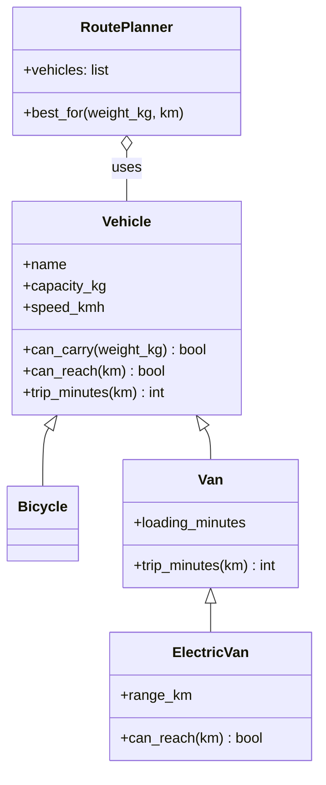

:::objectives
- Write constructors that validate, use safe defaults, and number each object.
- Add an alternative constructor with `@classmethod`.
- Build a small class hierarchy that reuses code through `super()`.
- Compose objects into a planner that works with any vehicle type, and justify each relationship.
:::

These exercises move from constructors to a delivery company's fleet. Exercises 4 to 6 and the challenge build on each other, so keep that code in one file, `fleet.py`, in your `m3_relationships` folder.

## Warm-up: which attribute wins?

Predict all five numbers before you open the answer.

```python title="warmup.py"
class Vehicle:
    wheels = 4
    count = 0

    def __init__(self, name):
        self.name = name
        self.count += 1


van = Vehicle("van")
bike = Vehicle("bike")
bike.wheels = 2
print(van.wheels, bike.wheels, Vehicle.wheels, Vehicle.count, bike.count)
```

:::solution Check your prediction
```python run title="warmup.py"
class Vehicle:
    wheels = 4
    count = 0

    def __init__(self, name):
        self.name = name
        self.count += 1


van = Vehicle("van")
bike = Vehicle("bike")
bike.wheels = 2
print(van.wheels, bike.wheels, Vehicle.wheels, Vehicle.count, bike.count)
```

`bike.wheels = 2` gives only the bike its own `wheels`. And `self.count += 1` reads the class's 0, then stores 1 *on the instance*, so `Vehicle.count` never moves. The counter needed `Vehicle.count += 1`.
:::

### Exercise 1: Playlists that share a secret

Two playlists are created without songs, and adding to one shows up in the other. Fix the class so each playlist gets its own list, and so passing in a list doesn't let the caller change the playlist behind its back.

```python run title="playlist.py"
class Playlist:
    def __init__(self, name, songs=[]):
        self.name = name
        self.songs = songs

    def add(self, song):
        self.songs.append(song)


gym = Playlist("Gym")
chill = Playlist("Chill")
gym.add("Eye of the Tiger")
print(chill.songs)
```

After your fix, that same demo should print `[]`.

:::hint
Change the default to `None`, then inside `__init__` choose between a brand-new list and a *copy* of the list you were given.
:::

:::solution
```python run title="playlist.py"
class Playlist:
    def __init__(self, name, songs=None):
        self.name = name
        self.songs = [] if songs is None else list(songs)

    def add(self, song):
        self.songs.append(song)


gym = Playlist("Gym")
chill = Playlist("Chill")
gym.add("Eye of the Tiger")
print(chill.songs)

starter = ["Song A"]
road = Playlist("Road", starter)
starter.append("Song B")  # the caller changes their own list later
print(road.songs)
```

`list(songs)` copies the caller's list, so the playlist only changes through its own `add` method.
:::

### Exercise 2: Numbered help-desk tickets

Write `Ticket(title, priority=2)`. Each ticket gets an ID `T-1`, `T-2`, and so on from a class attribute. The title is stripped and must not be empty, and `priority` must be 1, 2, or 3; otherwise raise `ValueError`.

```text
T-1 Printer jammed 2
T-2 Wi-Fi down 1
Refused: priority must be 1, 2, or 3
```

:::hint
Validate *before* taking a number, otherwise rejected tickets would use up IDs. Update the counter with `Ticket.next_id += 1`.
:::

:::solution
```python run title="tickets.py"
class Ticket:
    next_id = 1

    def __init__(self, title, priority=2):
        title = title.strip()
        if not title:
            raise ValueError("a ticket needs a title")
        if priority not in (1, 2, 3):
            raise ValueError("priority must be 1, 2, or 3")
        self.title = title
        self.priority = priority
        self.id = f"T-{Ticket.next_id}"
        Ticket.next_id += 1


for args in [("Printer jammed",), (" Wi-Fi down ", 1), ("Projector", 7)]:
    try:
        t = Ticket(*args)
        print(t.id, t.title, t.priority)
    except ValueError as err:
        print("Refused:", err)
```

Because the checks come first, the rejected ticket never took `T-3`.
:::

### Exercise 3: A second way to build a Book

A library imports books from lines like `"Dune;Frank Herbert;1965"`. Add a **class method** `Book.from_line(line)` that splits the line and returns a new `Book`. A class method receives the class itself as its first parameter (named `cls` by convention), so it can call `cls(...)` to build an instance:

```python
    @classmethod
    def from_line(cls, line):
        ...
        return cls(title, author, year)
```

Expected output for two lines:

```text
Dune by Frank Herbert (1965)
Holes by Louis Sachar (1998)
```

:::hint
`line.split(";")` gives three strings. Remember `int()` for the year, and `.strip()` in case of stray spaces.
:::

:::solution
```python run title="book_from_line.py"
class Book:
    def __init__(self, title, author, year):
        self.title = title
        self.author = author
        self.year = year

    @classmethod
    def from_line(cls, line):
        title, author, year = (part.strip() for part in line.split(";"))
        return cls(title, author, int(year))

    def describe(self):
        return f"{self.title} by {self.author} ({self.year})"


for line in ["Dune;Frank Herbert;1965", "Holes; Louis Sachar ;1998"]:
    print(Book.from_line(line).describe())
```

Writing `cls(...)` instead of `Book(...)` means a subclass such as `EBook.from_line(...)` would build an `EBook`.
:::

### Exercise 4: A delivery fleet

Write a `Vehicle(name, capacity_kg, speed_kmh)` with `can_carry(weight_kg)` and `trip_minutes(km)`, which returns `round(km / speed_kmh * 60)`. Then two subclasses:

- `Bicycle(name)`: always 15 kg capacity and 18 km/h. Use `super().__init__`.
- `Van(name)`: 800 kg and 36 km/h, plus a `loading_minutes` of 10 that is added to every trip. Override `trip_minutes`, reusing the parent's calculation.

```text
Bike 1: 10 min for 3 km, carries 20 kg? False
Van A: 15 min for 3 km, carries 20 kg? True
```

:::hint
In `Van.trip_minutes`, call `super().trip_minutes(km)` and add `self.loading_minutes`. Neither subclass needs to repeat `can_carry`.
:::

:::solution
```python run title="fleet.py (exercise 4)"
class Vehicle:
    def __init__(self, name, capacity_kg, speed_kmh):
        self.name = name
        self.capacity_kg = capacity_kg
        self.speed_kmh = speed_kmh

    def can_carry(self, weight_kg):
        return weight_kg <= self.capacity_kg

    def trip_minutes(self, km):
        return round(km / self.speed_kmh * 60)


class Bicycle(Vehicle):
    def __init__(self, name):
        super().__init__(name, capacity_kg=15, speed_kmh=18)


class Van(Vehicle):
    def __init__(self, name):
        super().__init__(name, capacity_kg=800, speed_kmh=36)
        self.loading_minutes = 10

    def trip_minutes(self, km):
        return super().trip_minutes(km) + self.loading_minutes


for v in [Bicycle("Bike 1"), Van("Van A")]:
    print(f"{v.name}: {v.trip_minutes(3)} min for 3 km, carries 20 kg? {v.can_carry(20)}")
```
:::

### Exercise 5: A route planner that has vehicles

Write a `RoutePlanner` that holds a list of vehicles (composition). Give it `add(vehicle)` and `best_for(weight_kg, km)`, which returns the vehicle that can carry the load with the shortest trip, or `None` if nothing can. It must work for any vehicle type without checking types.

```text
3 kg, 3 km -> Bike 1
3 kg, 12 km -> Van A
200 kg, 5 km -> Van A
2000 kg, 5 km -> None
```

:::hint
Filter to the vehicles where `can_carry` is true, then use `min(..., key=lambda v: v.trip_minutes(km))`. `min` raises on an empty list, so check for that first.
:::

:::solution
```python run title="fleet.py (exercise 5)"
class Vehicle:
    def __init__(self, name, capacity_kg, speed_kmh):
        self.name = name
        self.capacity_kg = capacity_kg
        self.speed_kmh = speed_kmh

    def can_carry(self, weight_kg):
        return weight_kg <= self.capacity_kg

    def trip_minutes(self, km):
        return round(km / self.speed_kmh * 60)


class Bicycle(Vehicle):
    def __init__(self, name):
        super().__init__(name, capacity_kg=15, speed_kmh=18)


class Van(Vehicle):
    def __init__(self, name):
        super().__init__(name, capacity_kg=800, speed_kmh=36)
        self.loading_minutes = 10

    def trip_minutes(self, km):
        return super().trip_minutes(km) + self.loading_minutes


class RoutePlanner:
    def __init__(self):
        self.vehicles = []

    def add(self, vehicle):
        self.vehicles.append(vehicle)

    def best_for(self, weight_kg, km):
        able = [v for v in self.vehicles if v.can_carry(weight_kg)]
        if not able:
            return None
        return min(able, key=lambda v: v.trip_minutes(km))


planner = RoutePlanner()
planner.add(Bicycle("Bike 1"))
planner.add(Van("Van A"))
for weight, km in [(3, 3), (3, 12), (200, 5), (2000, 5)]:
    best = planner.best_for(weight, km)
    print(f"{weight} kg, {km} km ->", best.name if best else None)
```

For 3 km the bike wins (10 minutes against the van's 15); for 12 km the van's speed outweighs its loading time (30 against 40). The planner never asks what kind of vehicle it has: each one answers `trip_minutes` its own way.
:::

### Exercise 6: Is-a or has-a?

For each pair, decide whether the first should **inherit from** or **hold** the second, and write one sentence why. No code needed.

1. `Van` and `Vehicle`
2. `Van` and `Engine`
3. `RoutePlanner` and `Vehicle`
4. `Library` and `list`
5. `ElectricVan` and `Van`, where an electric van can't do trips longer than its battery range

:::hint
Ask the substitution question: could the first stand in anywhere the second is used, and would everything still make sense?
:::

:::solution
1. **Inherit.** A van is a vehicle and can go anywhere the planner expects one.
2. **Hold.** A van has an engine; a van is not a kind of engine.
3. **Hold.** The planner has many vehicles and coordinates them; it can't stand in for one.
4. **Hold.** A library has a collection; inheriting would expose `clear()`, `sort()`, and every other list method.
5. **It depends, and that's the point.** An electric van is a van, but if code assumes every van can do any distance, swapping one in breaks that code. Inheritance only works if the base class lets vehicles say what they can do, for example with a `can_reach(km)` method. The challenge builds exactly that.
:::

### Challenge: An electric van the planner can trust

Add `can_reach(km)` to `Vehicle` (returning `True`), and an `ElectricVan(Van)` with a `range_km` (default 60) that overrides it. Update `RoutePlanner.best_for` so it only considers vehicles that can carry the load *and* reach the distance. Then write pytest tests for: a light short trip choosing the bike, a heavy long trip skipping an electric van that can't reach, a trip the electric van wins because it's faster, and a load nobody can carry.



:::hint
Make the electric van faster than a normal van (say 45 km/h) so it wins some trips. Its `__init__` calls `super().__init__(name)` and then changes `self.speed_kmh` and sets `self.range_km`. In `best_for`, add `and v.can_reach(km)` to the filter.
:::

:::solution
```python run title="fleet.py"
import pytest


class Vehicle:
    def __init__(self, name, capacity_kg, speed_kmh):
        self.name = name
        self.capacity_kg = capacity_kg
        self.speed_kmh = speed_kmh

    def can_carry(self, weight_kg):
        return weight_kg <= self.capacity_kg

    def can_reach(self, km):
        return True

    def trip_minutes(self, km):
        return round(km / self.speed_kmh * 60)


class Bicycle(Vehicle):
    def __init__(self, name):
        super().__init__(name, capacity_kg=15, speed_kmh=18)


class Van(Vehicle):
    def __init__(self, name):
        super().__init__(name, capacity_kg=800, speed_kmh=36)
        self.loading_minutes = 10

    def trip_minutes(self, km):
        return super().trip_minutes(km) + self.loading_minutes


class ElectricVan(Van):
    def __init__(self, name, range_km=60):
        super().__init__(name)
        self.speed_kmh = 45
        self.range_km = range_km

    def can_reach(self, km):
        return km <= self.range_km


class RoutePlanner:
    def __init__(self):
        self.vehicles = []

    def add(self, vehicle):
        self.vehicles.append(vehicle)

    def best_for(self, weight_kg, km):
        able = [v for v in self.vehicles if v.can_carry(weight_kg) and v.can_reach(km)]
        if not able:
            return None
        return min(able, key=lambda v: v.trip_minutes(km))


def make_planner():
    planner = RoutePlanner()
    for vehicle in [Bicycle("Bike 1"), Van("Van A"), ElectricVan("E-Van")]:
        planner.add(vehicle)
    return planner


def test_light_short_trip_goes_by_bike():
    assert make_planner().best_for(3, 3).name == "Bike 1"


def test_long_trip_skips_the_electric_van():
    assert make_planner().best_for(300, 90).name == "Van A"


def test_electric_van_wins_when_it_can_reach():
    assert make_planner().best_for(300, 30).name == "E-Van"


def test_nobody_can_carry_two_tonnes():
    assert make_planner().best_for(2000, 5) is None


def test_electric_van_is_still_a_van():
    e = ElectricVan("E-Van")
    assert isinstance(e, Van) and e.loading_minutes == 10


for name, test in list(globals().items()):
    if name.startswith("test_") and callable(test):
        test()
        print("passed:", name)
```

The design question from Exercise 6 is answered by `can_reach`: every vehicle now *says* whether it can do a trip, so an `ElectricVan` can stand in for a `Van` safely. The planner changed by one condition and still contains no type checks.
:::
