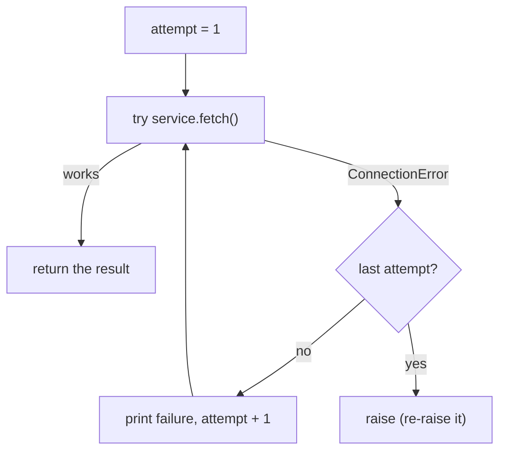

:::objectives
- Narrow a catch-all `except` and find the bug it was hiding.
- Write constructors and methods that raise precise, informative exceptions.
- Translate and re-raise exceptions without losing the original cause.
- Keep a module's demo code from running when it is imported.
:::

Work in a new folder in VS Code, one file per exercise. Type the code yourself instead of pasting it, and run each version before you open the solution. Several of these exercises start with code that misbehaves on purpose.

## Warm-up: predict the letters

Before you look at the output, write down which letters this prints and in what order.

```python run title="warmup.py"
def step(text):
    try:
        print("A")
        value = int(text)
        print("B")
    except KeyError:
        print("C")
    finally:
        print("D")
    return value

try:
    step("x")
except ValueError:
    print("E")
```

`int("x")` raises `ValueError`, so "B" is skipped. The inner handler only catches `KeyError`, so "C" is skipped too. `finally` prints "D" on the way out, `return value` never runs, and the exception climbs to the outer `try`, which prints "E".

### Exercise 1: Find the bug the catch-all was hiding

This function is supposed to average quiz scores and skip lines that aren't numbers. Run it.

```python run raises title="scores.py"
def average_score(lines):
    scores = []
    for line in lines:
        try:
            scores.apend(int(line))
        except Exception:
            print(f"Skipping {line!r}: not a number")
    return sum(scores) / len(scores)

print(average_score(["90", "85", "abc", "77"]))
```

Every line gets "skipped", including `"90"`, and then the program crashes dividing by zero. Change the handler so it catches only the error that bad input causes, put just the risky call inside `try`, and fix the bug that the narrower handler reveals. Expected output:

```text
Skipping 'abc': not a number
84.0
```

:::hint
After you switch to `except ValueError:`, run it again before fixing anything. The traceback now names the real problem and the exact line.
:::

:::solution
```python run title="scores.py"
def average_score(lines: list[str]) -> float:
    scores = []
    for line in lines:
        try:
            score = int(line)
        except ValueError:
            print(f"Skipping {line!r}: not a number")
        else:
            scores.append(score)
    return sum(scores) / len(scores)

print(average_score(["90", "85", "abc", "77"]))
```

With `except ValueError`, the typo shows up as `AttributeError: 'list' object has no attribute 'apend'`. Only `int(line)` is inside `try`, and the append moved to `else`, so a future typo there can't be mistaken for bad input.
:::

### Exercise 2: Refuse to build an invalid seat

A theater has rows `A` to `J` and seats `1` to `20`. This starter accepts any seat at all. Make the constructor raise `ValueError` with a message that says what was wrong.

```python title="seats.py"
class Seat:
    def __init__(self, row: str, number: int) -> None:
        # TODO: raise ValueError for a bad row or a bad number
        self.row = row
        self.number = number

    def __str__(self) -> str:
        return f"{self.row}{self.number}"


for row, number in [("C", 7), ("K", 3), ("A", 0), ("", 5)]:
    try:
        print("Seat", Seat(row, number))
    except ValueError as err:
        print("Rejected:", err)
```

Expected output:

```text
Seat C7
Rejected: row must be one letter A-J, got 'K'
Rejected: seat number must be 1-20, got 0
Rejected: row must be one letter A-J, got ''
```

:::hint
`row in "ABCDEFGHIJ"` looks like enough, but try `"" in "ABCDEFGHIJ"` in the terminal. An empty string is found inside every string.
:::

:::solution
```python run title="seats.py"
class Seat:
    ROWS = "ABCDEFGHIJ"

    def __init__(self, row: str, number: int) -> None:
        if len(row) != 1 or row not in self.ROWS:
            raise ValueError(f"row must be one letter A-J, got {row!r}")
        if not 1 <= number <= 20:
            raise ValueError(f"seat number must be 1-20, got {number}")
        self.row = row
        self.number = number

    def __str__(self) -> str:
        return f"{self.row}{self.number}"


for row, number in [("C", 7), ("K", 3), ("A", 0), ("", 5)]:
    try:
        print("Seat", Seat(row, number))
    except ValueError as err:
        print("Rejected:", err)
```

The `len(row) != 1` check runs first, so both `""` and `"AB"` are rejected before the membership test can be fooled. Using `!r` in the message puts quotes around the value, which makes an empty string visible.
:::

### Exercise 3: An exception family for library loans

A library lets each member borrow at most 2 books, and a book can only be out to one person at a time. Write `LibraryError` and two subclasses: `NotAvailable`, which stores `title` and `due_back`, and `LimitReached`, which stores `limit`. Then make `borrow` raise them, so the starter's loop prints the output below.

```python title="library.py"
from datetime import date

# TODO: LibraryError, NotAvailable, LimitReached


class Library:
    LIMIT = 2

    def __init__(self) -> None:
        self.loans: dict[str, tuple[str, date]] = {}  # title -> (member, due back)

    def borrow(self, member: str, title: str, due_back: date) -> None:
        # TODO: raise NotAvailable or LimitReached instead of always lending
        self.loans[title] = (member, due_back)


library = Library()
for member, title in [("Ava", "Dune"), ("Ben", "Dune"), ("Ava", "Holes"), ("Ava", "Wonder")]:
    try:
        library.borrow(member, title, date(2026, 12, 1))
        print(f"{member} borrowed {title}")
    except NotAvailable as err:
        print(f"{member}: {err}. Join the waitlist for {err.title}?")
    except LibraryError as err:
        print(f"{member}: {err}")
```

```text
Ava borrowed Dune
Ben: 'Dune' is out until 2026-12-01. Join the waitlist for Dune?
Ava borrowed Holes
Ava: members can borrow at most 2 books
```

:::hint
Each subclass needs its own `__init__` that calls `super().__init__(message)` and then saves its attributes. In `borrow`, check availability first, then count how many loans already belong to that member.
:::

:::solution
```python run title="library.py"
from datetime import date


class LibraryError(Exception):
    """Base class for every loan problem."""


class NotAvailable(LibraryError):
    def __init__(self, title: str, due_back: date) -> None:
        super().__init__(f"{title!r} is out until {due_back}")
        self.title = title
        self.due_back = due_back


class LimitReached(LibraryError):
    def __init__(self, limit: int) -> None:
        super().__init__(f"members can borrow at most {limit} books")
        self.limit = limit


class Library:
    LIMIT = 2

    def __init__(self) -> None:
        self.loans: dict[str, tuple[str, date]] = {}  # title -> (member, due back)

    def borrow(self, member: str, title: str, due_back: date) -> None:
        if title in self.loans:
            raise NotAvailable(title, self.loans[title][1])
        held = sum(1 for who, _ in self.loans.values() if who == member)
        if held >= self.LIMIT:
            raise LimitReached(self.LIMIT)
        self.loans[title] = (member, due_back)


library = Library()
for member, title in [("Ava", "Dune"), ("Ben", "Dune"), ("Ava", "Holes"), ("Ava", "Wonder")]:
    try:
        library.borrow(member, title, date(2026, 12, 1))
        print(f"{member} borrowed {title}")
    except NotAvailable as err:
        print(f"{member}: {err}. Join the waitlist for {err.title}?")
    except LibraryError as err:
        print(f"{member}: {err}")
```

The handler for `NotAvailable` reads `err.title` directly, which is why the attribute exists. `LimitReached` falls through to the general `LibraryError` handler, so a third kind of loan error added later would still be handled.
:::

### Exercise 4: Translate errors with raise from

Write `load_settings(text)` that parses a JSON string and returns the dict. It must raise one custom `SettingsError` for every way the input can be bad: invalid JSON, a missing `"volume"` key, or a volume that isn't a whole number from 0 to 10. When the cause was another exception, chain it with `from`. The starter below crashes on the second string with an uncaught `JSONDecodeError`:

```python title="settings.py"
import json


class SettingsError(Exception):
    """The settings text can't be used."""


def load_settings(text: str) -> dict:
    return json.loads(text)  # TODO: validate, and raise SettingsError


for text in ['{"volume": 7}', '{"volume": 7', '{"theme": "dark"}', '{"volume": 11}']:
    try:
        print("OK:", load_settings(text))
    except SettingsError as err:
        cause = type(err.__cause__).__name__ if err.__cause__ else "nothing"
        print(f"SettingsError: {err} (cause: {cause})")
```

Expected output once it works:

```text
OK: {'volume': 7}
SettingsError: settings are not valid JSON (cause: JSONDecodeError)
SettingsError: missing setting 'volume' (cause: KeyError)
SettingsError: volume must be a whole number 0-10, got 11 (cause: nothing)
```

:::hint
Use one `try` with two `except` clauses: `json.JSONDecodeError` and `KeyError`. The range check isn't caused by another exception, so it uses a plain `raise`.
:::

:::solution
```python run title="settings.py"
import json


class SettingsError(Exception):
    """The settings text can't be used."""


def load_settings(text: str) -> dict:
    try:
        data = json.loads(text)
        volume = data["volume"]
    except json.JSONDecodeError as err:
        raise SettingsError("settings are not valid JSON") from err
    except KeyError as err:
        raise SettingsError(f"missing setting {err}") from err
    if not isinstance(volume, int) or not 0 <= volume <= 10:
        raise SettingsError(f"volume must be a whole number 0-10, got {volume!r}")
    return data


for text in ['{"volume": 7}', '{"volume": 7', '{"theme": "dark"}', '{"volume": 11}']:
    try:
        print("OK:", load_settings(text))
    except SettingsError as err:
        cause = type(err.__cause__).__name__ if err.__cause__ else "nothing"
        print(f"SettingsError: {err} (cause: {cause})")
```

Callers only ever need `except SettingsError`, yet `__cause__` still tells a developer which low-level failure started it.
:::

### Exercise 5: Retry, then give up honestly

`FlakyService.fetch()` fails with `ConnectionError` a set number of times before it works. Write `fetch_with_retries(service, attempts=3)` that tries up to `attempts` times, prints each failure, returns the result as soon as one call works, and re-raises the last `ConnectionError` if every attempt fails.

```python
class FlakyService:
    def __init__(self, failures: int) -> None:
        self.failures = failures
        self.calls = 0

    def fetch(self) -> str:
        self.calls += 1
        if self.calls <= self.failures:
            raise ConnectionError(f"timeout on call {self.calls}")
        return "42 bookings"
```

Calling it with `FlakyService(failures=2)` and then with `FlakyService(failures=5)` should print:

```text
  attempt 1 failed: timeout on call 1
  attempt 2 failed: timeout on call 2
42 bookings
  attempt 1 failed: timeout on call 1
  attempt 2 failed: timeout on call 2
  attempt 3 failed: timeout on call 3
gave up: timeout on call 3
```



:::hint
`return` inside `try` exits the loop and the function on success. Inside the `except` block, a bare `raise` with nothing after it re-raises the exception being handled, traceback and all.
:::

:::solution
```python run title="retry.py"
class FlakyService:
    def __init__(self, failures: int) -> None:
        self.failures = failures
        self.calls = 0

    def fetch(self) -> str:
        self.calls += 1
        if self.calls <= self.failures:
            raise ConnectionError(f"timeout on call {self.calls}")
        return "42 bookings"


def fetch_with_retries(service: FlakyService, attempts: int = 3) -> str:
    for attempt in range(1, attempts + 1):
        try:
            return service.fetch()
        except ConnectionError as err:
            print(f"  attempt {attempt} failed: {err}")
            if attempt == attempts:
                raise
    raise ValueError("attempts must be at least 1")


print(fetch_with_retries(FlakyService(failures=2)))
try:
    fetch_with_retries(FlakyService(failures=5))
except ConnectionError as err:
    print("gave up:", err)
```

Only `ConnectionError` is retried; any other exception, such as a bug inside `fetch`, escapes on the first attempt, which is what you want. The last line of the function only runs if `attempts` is 0 or less, so the loop never ran.
:::

### Exercise 6: Stop a module from talking when imported

`grades.py` has a handy `letter()` function and a quick self-test at the bottom. `report.py` imports it. This cell creates both files and runs `report.py`:

```python run title="make_files.py"
import subprocess
import sys
from pathlib import Path

Path("grades.py").write_text('''\
def letter(score: int) -> str:
    if score >= 90:
        return "A"
    if score >= 80:
        return "B"
    return "C"

print("Self-test:", letter(95), letter(85), letter(70))
''')
Path("report.py").write_text('from grades import letter\nprint("Mia:", letter(88))\n')

print(subprocess.run([sys.executable, "report.py"], capture_output=True, text=True).stdout)
```

The self-test line leaks into the report. Rewrite `grades.py` so its self-test is in a `main()` function that runs only when `grades.py` is run directly. `python report.py` should print just `Mia: B`, and `python grades.py` should still print the self-test.

:::hint
Importing a module runs every top-level line in it. Move the `print` into `def main():` and call `main()` under `if __name__ == "__main__":`.
:::

:::solution
```python run title="fixed_grades.py"
import subprocess
import sys
from pathlib import Path

Path("grades.py").write_text('''\
def letter(score: int) -> str:
    if score >= 90:
        return "A"
    if score >= 80:
        return "B"
    return "C"


def main() -> None:
    print("Self-test:", letter(95), letter(85), letter(70))


if __name__ == "__main__":
    main()
''')
Path("report.py").write_text('from grades import letter\nprint("Mia:", letter(88))\n')

for script in ["report.py", "grades.py"]:
    print(f"$ python {script}")
    print(subprocess.run([sys.executable, script], capture_output=True, text=True).stdout)
```

When `report.py` imports `grades`, the module's `__name__` is `"grades"`, so `main()` is skipped. Run directly, it's `"__main__"` and the self-test prints. Wrapping the start-up code in `main()` also keeps its variables out of the module's global names.
:::

:::video KZpYtNtGxSU
An animated explanation of `__name__`. Watch for what happens to it when a file is imported rather than run, which is exactly why the self-test leaked in Exercise 6.
:::

### Challenge: Report every problem at once

A sign-up form that stops at the first mistake is annoying: fix the name, submit, then learn the age was wrong too. Write `ValidationError`, which stores a list called `problems`, and `validate_signup(form)` that checks every field before raising:

- `name` must not be blank.
- `age` must be digits, and between 13 and 19.
- `email` must contain `@`.

Test it with a good form and with `{"name": " ", "age": "fifteen", "email": "rae.example.com"}`, printing each problem on its own line.

:::hint
Start with `problems = []`, append a message for each failed check, and raise only once at the end, `if problems:`. Use `elif` for the age range so you never call `int()` on a non-number.
:::

:::solution
```python run title="signup.py"
class ValidationError(Exception):
    def __init__(self, problems: list[str]) -> None:
        super().__init__(f"{len(problems)} problem(s) with the form")
        self.problems = problems


def validate_signup(form: dict[str, str]) -> None:
    problems = []
    if not form.get("name", "").strip():
        problems.append("name is required")
    age = form.get("age", "")
    if not age.isdigit():
        problems.append(f"age must be a whole number, got {age!r}")
    elif not 13 <= int(age) <= 19:
        problems.append("age must be 13-19 for this club")
    if "@" not in form.get("email", ""):
        problems.append("email needs an @")
    if problems:
        raise ValidationError(problems)


forms = [
    {"name": "Rae", "age": "15", "email": "rae@example.com"},
    {"name": " ", "age": "fifteen", "email": "rae.example.com"},
]
for form in forms:
    try:
        validate_signup(form)
        print("Welcome,", form["name"])
    except ValidationError as err:
        print(err)
        for problem in err.problems:
            print(" -", problem)
```

One exception carries all the problems, so the caller decides how to show them. Python 3.11 added a built-in version of this idea for exceptions themselves, `ExceptionGroup`, with a matching `except*` syntax; read about it in the tutorial's errors chapter once this version makes sense.
:::
