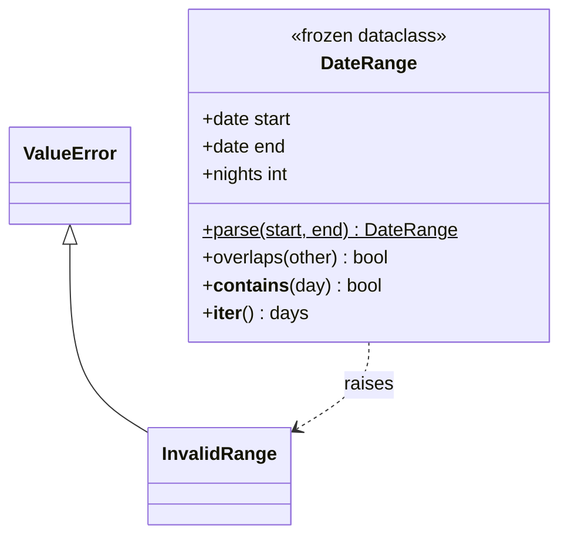
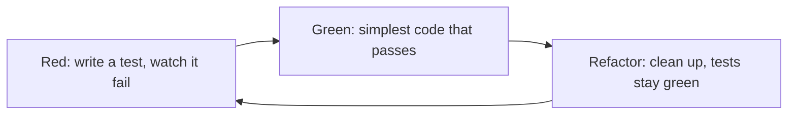

:::objectives
- Work in red-green-refactor cycles: write a failing test, make it pass, then tidy up.
- Build a reusable component with a small, clear interface and its own exception.
- Use `setUp` in `unittest` and fixtures plus `parametrize` in pytest to keep tests short.
- Reuse one tested component in two different programs.
:::

The overlap bug from the last lesson lived in three copies because three projects each wrote their own date logic. You're going to write that logic once, as a module called `dateranges.py`, and build it the test-first way: every behavior starts life as a failing test.

Here is the finished component. One class, one exception, five things a caller can do with it:



A range runs from `start` up to, **but not including**, `end`. For a hotel stay, `end` is the check-out day, so December 1 to December 4 is three nights, and someone else can check in on the 4th. That one rule is where every copy of the old code went wrong, so it gets tested first.



## Step 1: A helper to run tests on this page

In VS Code you'd run `python -m pytest` (or `python -m unittest`) in the terminal. On this page, a small helper runs `unittest` test classes and prints the results. Each cell after this shares names with the ones before it.

```python run title="run_tests.py"
import sys
import unittest


def run_tests(*cases: type[unittest.TestCase]) -> None:
    suite = unittest.TestSuite()
    for case in cases:
        suite.addTests(unittest.defaultTestLoader.loadTestsFromTestCase(case))
    unittest.TextTestRunner(stream=sys.stdout, verbosity=2).run(suite)
```

## Step 2: Red. Describe nights and bad ranges before they exist

Write down two promises: a range knows how many nights it covers, and it refuses to exist if `end` isn't after `start`. `DateRange` hasn't been written yet, so both tests should fail. Run them anyway.

```python run title="test_dateranges.py"
from datetime import date


def d(day: int) -> date:
    return date(2026, 12, day)


class TestBasics(unittest.TestCase):
    def test_nights_counts_check_out_as_free(self):
        self.assertEqual(DateRange(d(1), d(4)).nights, 3)

    def test_end_before_start_is_rejected(self):
        with self.assertRaises(InvalidRange):
            DateRange(d(4), d(1))


run_tests(TestBasics)
```

Two `ERROR`s with `NameError`. That's a useful failure: the tests run, and they fail for the reason you expected. A test you've never seen fail might not be testing anything at all.

## Step 3: Green. The simplest class that passes

```python run title="dateranges.py"
from dataclasses import dataclass
from datetime import date


class InvalidRange(ValueError):
    """A range whose end is not after its start."""


@dataclass(frozen=True)
class DateRange:
    """The days from start up to, but not including, end."""

    start: date
    end: date

    def __post_init__(self) -> None:
        if self.end <= self.start:
            raise InvalidRange(f"end {self.end} must be after start {self.start}")

    @property
    def nights(self) -> int:
        return (self.end - self.start).days


run_tests(TestBasics)
```

Both pass. A few design decisions are already baked in. `@dataclass(frozen=True)` writes `__init__`, `__eq__`, and `__repr__` for you, and makes the object read-only, so nobody can stretch a booked range after the overlap check approved it. `__post_init__` runs right after the generated `__init__`, which makes it the spot for validation. `InvalidRange` subclasses `ValueError`, so older code that already catches `ValueError` still works, while new code can catch the specific class.

## Step 4: Red, then a bug the tests catch

Next promise: two ranges overlap only if they share a night. These tests use `setUp`, which builds a fresh `stay` before each test method.

```python run title="test_dateranges.py"
class TestOverlaps(unittest.TestCase):
    def setUp(self):
        self.stay = DateRange(d(1), d(4))

    def test_shared_night_overlaps(self):
        self.assertTrue(self.stay.overlaps(DateRange(d(3), d(6))))

    def test_range_inside_overlaps(self):
        self.assertTrue(self.stay.overlaps(DateRange(d(2), d(3))))

    def test_back_to_back_does_not_overlap(self):
        self.assertFalse(self.stay.overlaps(DateRange(d(4), d(6))))
        self.assertFalse(DateRange(d(4), d(6)).overlaps(self.stay))
```

Now add `overlaps`. Here it's written the way the robotics club's copy had it, with `<=`, because "touching" feels like it should count:

```python run title="dateranges.py"
@dataclass(frozen=True)
class DateRange:
    """The days from start up to, but not including, end."""

    start: date
    end: date

    def __post_init__(self) -> None:
        if self.end <= self.start:
            raise InvalidRange(f"end {self.end} must be after start {self.start}")

    @property
    def nights(self) -> int:
        return (self.end - self.start).days

    def overlaps(self, other: "DateRange") -> bool:
        return self.start <= other.end and other.start <= self.end


run_tests(TestBasics, TestOverlaps)
```

Four pass and `test_back_to_back_does_not_overlap` fails with `AssertionError: True is not false`. The test caught the exact bug that sat in two projects for three months, and it did it in under a second. The fix is one character in each comparison:

```diff
-        return self.start <= other.end and other.start <= self.end
+        return self.start < other.end and other.start < self.end
```

## Step 5: Membership, iteration, and the finished component

Two more promises make the class pleasant to use: `day in stay` should work, and `for day in stay` should visit each night. Write the tests first, as always:

```python run title="test_dateranges.py"
class TestDays(unittest.TestCase):
    def setUp(self):
        self.stay = DateRange(d(1), d(4))

    def test_check_in_day_is_inside(self):
        self.assertIn(d(1), self.stay)

    def test_check_out_day_is_outside(self):
        self.assertNotIn(d(4), self.stay)

    def test_iterates_over_each_night(self):
        self.assertEqual(list(self.stay), [d(1), d(2), d(3)])

    def test_parse_reads_iso_dates(self):
        self.assertEqual(DateRange.parse("2026-12-01", "2026-12-04"), self.stay)
```

Here is the finished `dateranges.py`, with the overlap fix, the two dunder methods, and a `parse` class method for text input:

```python run title="dateranges.py"
from collections.abc import Iterator
from dataclasses import dataclass
from datetime import date, timedelta


class InvalidRange(ValueError):
    """A range whose end is not after its start."""


@dataclass(frozen=True)
class DateRange:
    """The days from start up to, but not including, end."""

    start: date
    end: date

    def __post_init__(self) -> None:
        if self.end <= self.start:
            raise InvalidRange(f"end {self.end} must be after start {self.start}")

    @classmethod
    def parse(cls, start: str, end: str) -> "DateRange":
        return cls(date.fromisoformat(start), date.fromisoformat(end))

    @property
    def nights(self) -> int:
        return (self.end - self.start).days

    def overlaps(self, other: "DateRange") -> bool:
        return self.start < other.end and other.start < self.end

    def __contains__(self, day: date) -> bool:
        return self.start <= day < self.end

    def __iter__(self) -> Iterator[date]:
        for offset in range(self.nights):
            yield self.start + timedelta(days=offset)


run_tests(TestBasics, TestOverlaps, TestDays)
```

All nine pass. `__contains__` uses the same "up to, not including" rule as `overlaps`, so the two can't disagree. The test for `parse` compares with `==`, which works because the dataclass generated `__eq__`. This is also the moment for the **refactor** part of the loop: with nine green tests, you can rename things or restructure the class and know within a second whether you broke a promise.

## Step 6: Reuse it in two projects

The payoff. Here are two unrelated programs, the hotel and the robotics club's room scheduler, both built on the same tested component. In each project, `from dateranges import DateRange` replaces the old copied logic.

```python run title="two_projects.py"
class HotelRoom:
    def __init__(self, number: int) -> None:
        self.number = number
        self.stays: list[DateRange] = []

    def book(self, stay: DateRange) -> bool:
        if any(stay.overlaps(existing) for existing in self.stays):
            return False
        self.stays.append(stay)
        return True


class ClubSchedule:
    def __init__(self) -> None:
        self.events: dict[str, DateRange] = {}

    def clashes(self, new: DateRange) -> list[str]:
        return [name for name, when in self.events.items() if when.overlaps(new)]


room = HotelRoom(101)
print(room.book(DateRange.parse("2026-12-01", "2026-12-04")))
print(room.book(DateRange.parse("2026-12-04", "2026-12-06")))  # back to back: fine

club = ClubSchedule()
club.events["build season"] = DateRange.parse("2026-12-01", "2026-12-20")
club.events["holiday break"] = DateRange.parse("2026-12-21", "2027-01-04")
print(club.clashes(DateRange.parse("2026-12-18", "2026-12-23")))
```

If someone finds another edge case next year, they add a test to `test_dateranges.py`, fix `DateRange` once, and both projects get the fix.

## Step 7: The same suite in pytest

Your VS Code project now looks like this:

```text
shared-dates/
├── dateranges.py         the component from Step 5
└── test_dateranges.py    the tests
```

pytest can run your `unittest` classes unchanged. Rewritten in pytest style, though, the suite gets shorter: a **fixture** replaces `setUp`, and `@pytest.mark.parametrize` turns a table of cases into separate tests. Save this as `test_dateranges.py`, and add `from dateranges import DateRange, InvalidRange` under `import pytest` (this page already has those names, so the block leaves that line out):

```python title="test_dateranges.py"
from datetime import date

import pytest


@pytest.fixture
def stay():
    return DateRange(date(2026, 12, 1), date(2026, 12, 4))


def test_nights_counts_check_out_as_free(stay):
    assert stay.nights == 3


def test_end_before_start_is_rejected():
    with pytest.raises(InvalidRange):
        DateRange(date(2026, 12, 4), date(2026, 12, 1))


@pytest.mark.parametrize(
    "start, end, expected",
    [
        ("2026-11-28", "2026-12-02", True),   # starts before, ends inside
        ("2026-12-02", "2026-12-03", True),   # fully inside
        ("2026-12-04", "2026-12-06", False),  # back to back
        ("2026-11-25", "2026-12-01", False),  # ends on our start day
    ],
)
def test_overlaps(stay, start, end, expected):
    other = DateRange.parse(start, end)
    assert stay.overlaps(other) is expected
    assert other.overlaps(stay) is expected


@pytest.mark.parametrize("day, inside", [(1, True), (3, True), (4, False)])
def test_contains(stay, day, inside):
    assert (date(2026, 12, day) in stay) is inside
```

```bash
python -m pytest -v
```

```text
collecting ... collected 9 items

test_dateranges.py::test_nights_counts_check_out_as_free PASSED          [ 11%]
test_dateranges.py::test_end_before_start_is_rejected PASSED             [ 22%]
test_dateranges.py::test_overlaps[2026-11-28-2026-12-02-True] PASSED     [ 33%]
test_dateranges.py::test_overlaps[2026-12-02-2026-12-03-True] PASSED     [ 44%]
test_dateranges.py::test_overlaps[2026-12-04-2026-12-06-False] PASSED    [ 55%]
test_dateranges.py::test_overlaps[2026-11-25-2026-12-01-False] PASSED    [ 66%]
test_dateranges.py::test_contains[1-True] PASSED                         [ 77%]
test_dateranges.py::test_contains[3-True] PASSED                         [ 88%]
test_dateranges.py::test_contains[4-False] PASSED                        [100%]

============================== 9 passed in 0.05s ===============================
```

Each row of a parametrize table becomes its own test with its own name, so a failure tells you *which* case broke. `test_overlaps` checks both directions on purpose: overlap should be symmetric, and a lopsided implementation would pass a one-way test.

:::video B1j6k2j2eJg
ArjanCodes works through red-green-refactor in Python. Watch for how little code goes into each "green" step, and for the moments he decides it's time to refactor.
:::

:::quiz
Q: In Step 2 the tests were run before `DateRange` existed. What did that prove?
- [ ] Nothing; it was a wasted run
  It confirmed something important about the tests themselves.
- [x] That the tests actually run and can fail, so a later pass means something
  A test that has never failed might be checking nothing, for example if its name doesn't start with `test`.
- [ ] That `unittest` can create missing classes
  It can't; that's why the tests errored with `NameError`.

Q: Why is `InvalidRange` a subclass of `ValueError` instead of `Exception`?
- [x] Existing code that catches `ValueError` keeps working, and new code can catch `InvalidRange` specifically
  A backwards range really is a bad value, so it fits under `ValueError` and gains a precise name.
- [ ] `@dataclass` only allows `ValueError` subclasses in `__post_init__`
  `__post_init__` can raise anything.
- [ ] `Exception` subclasses can't carry a message
  Any exception class can take a message.

Q: What would `frozen=True` stop in the hotel project?
- [ ] Creating two ranges with the same dates
  Equal ranges are allowed; they're just equal.
- [x] Code changing `stay.end` after `HotelRoom.book` checked it for overlaps
  A frozen dataclass raises `FrozenInstanceError` on assignment, so an approved booking can't be stretched into a clash.
- [ ] Iterating over the days
  `__iter__` only reads the fields.
:::

:::takeaways
- Red-green-refactor: write the test, watch it fail, write the least code that passes, then tidy while it stays green.
- The edge case that caused the original bug (back-to-back ranges) should be the first test you write, in both directions.
- A small frozen dataclass with one clear rule ("up to, not including") makes a good reusable component.
- `setUp` in `unittest` and fixtures in pytest give each test fresh objects; `parametrize` turns a table of cases into named tests.
- Fix shared logic once, in one tested module, and every project that imports it gets the fix.
:::

## Ideas to extend it

- Add `intersection(other)` that returns the shared `DateRange`, or `None` if there isn't one. Write the tests first, including back-to-back ranges.
- Build a second component, `ids.py`, with a `BookingId` class that formats IDs like `BK-0042` and rejects malformed strings with its own exception.
- Add a `__str__` that prints `Dec 1-4, 2026` and test it for ranges that cross a month or a year.

## Further reading

- [How to parametrize fixtures and test functions](https://docs.pytest.org/en/stable/how-to/parametrize.html) in the pytest docs, including stacking parametrize decorators.
- [dataclasses](https://docs.python.org/3/library/dataclasses.html) in the Python docs, for `frozen`, `__post_init__`, and `field()`.
- [Test Driven Development](https://martinfowler.com/bliki/TestDrivenDevelopment.html), Martin Fowler's short explanation of the loop and why the refactor step is the one people skip.
